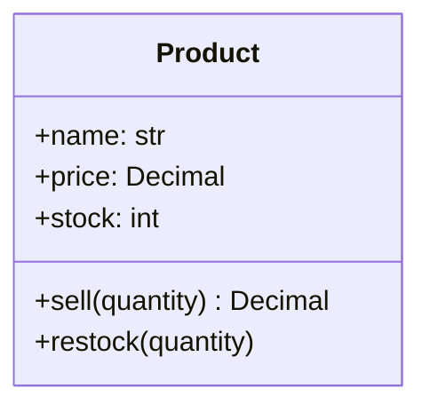
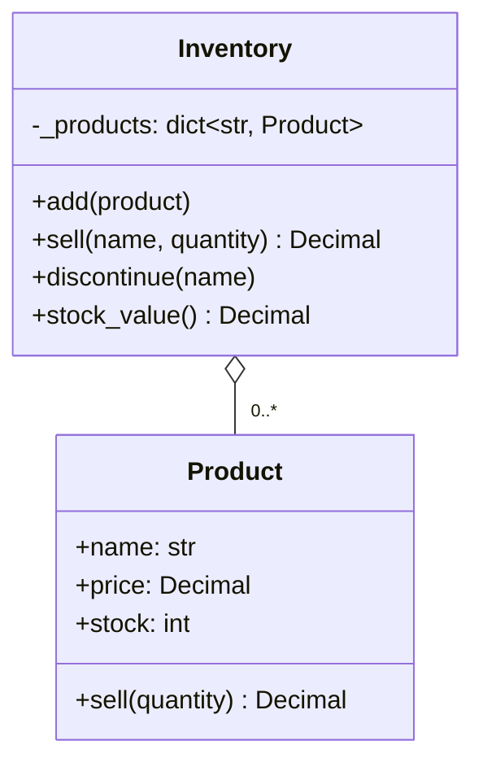
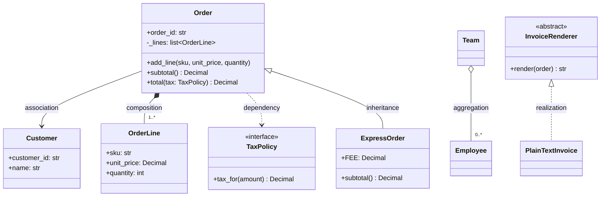

# Object-Oriented Programming in Python: From Your First Class to SOLID and the Object Model

If you have written Python scripts with variables, functions, lists and dicts, but never a `class`, this post is for you. We start with a small shop script that slowly turns into a mess, and use it to introduce classes and objects one idea at a time. From there we climb steadily: the four "pillars" of object-oriented programming, how classes relate to each other (and how to draw that), composition versus inheritance, the SOLID principles, and finally the deep end, where we open up Python's object model and look at descriptors, the method resolution order, dunder protocols, how `@dataclass` works and what `__slots__` does.

By the end you will be able to design a small set of cooperating classes, explain *why* you shaped them that way, read and draw class diagrams, and hold your own in a conversation about the trade-offs with an experienced engineer. Everything later in this series (design patterns, interviews, and eleven case studies) is built on the vocabulary from this post.

All code is runnable, standard-library Python 3.13. The full files live in [`code/`](code/):

| File | What it shows |
|---|---|
| [`oop_basics.py`](code/oop_basics.py) | The shop script with parallel lists, then your first classes: `Product`, `Inventory`, `Coupon`, class attributes, `@classmethod`, `@staticmethod` |
| [`oop_pillars.py`](code/oop_pillars.py) | Encapsulation, abstraction, inheritance and polymorphism with a bank account and payment gateways; mixins; dunder methods; `singledispatch`; `dataclass`; `Enum` |
| [`oop_relationships.py`](code/oop_relationships.py) | Dependency, association, aggregation, composition, inheritance, realization; the fragile base class problem; inheritance vs composition vs mixins |
| [`oop_solid.py`](code/oop_solid.py) | A before/after pair for each SOLID principle |
| [`oop_domain_modeling.py`](code/oop_domain_modeling.py) | Value objects vs entities, immutability, Law of Demeter, tell-don't-ask, anemic vs rich models, primitive obsession |
| [`oop_internals.py`](code/oop_internals.py) | Descriptors, a diamond with cooperative `super()`, a context manager, what `@dataclass` generates, `__slots__` measured |
| [`test_oop_fundamentals.py`](code/test_oop_fundamentals.py) | 59 `unittest` tests covering all of the above |

Run any file directly (`python3 oop_basics.py`) to see a short demo, or run the tests with `python3 -m unittest test_oop_fundamentals -v` from inside `code/`.

**How to read this post.** Parts 1 and 2 are for everyone and assume no prior object-oriented experience. Parts 3 and 4 are where design starts: read them before the case studies. Part 5, the deep end, is about how Python itself implements objects; you can skip it on a first read and come back when you want to understand what is happening under the hood.

---

# Part 1: Your first objects

## 1. A shop script that outgrows itself

Imagine a friend runs a small shop that sells mugs, tea and kettles, and asks you for a script to track stock. You know lists, so you keep one list per kind of information. Position 0 in every list is the mug, position 1 is the tea, and so on:

```python
names = ["mug", "tea", "kettle"]
prices = [Decimal("12.50"), Decimal("4.00"), Decimal("30.00")]
stock = [10, 50, 3]


def sell_by_name(name: str, quantity: int) -> Decimal:
    i = names.index(name)          # position in one list...
    stock[i] -= quantity           # ...is trusted to mean the same in the others
    return prices[i] * quantity
```

(`Decimal` is Python's exact decimal number type from the `decimal` module. We use it for money throughout, because ordinary floats cannot represent amounts like 0.10 exactly.)

These are called **parallel lists**: several lists that only make sense together, because the same position in each describes the same product. It works. Then the shop stops selling mugs, and you write the obvious function:

```python
def discontinue(name: str) -> None:
    names.remove(name)             # removes from ONE list; prices and stock
                                   # still hold the old row, so everything after
                                   # it is now misaligned
```

Watch what happens to a customer buying tea afterwards:

```pycon
>>> sell_by_name("mug", 2)
Decimal('25.00')
>>> discontinue("mug")
>>> names
['tea', 'kettle']
>>> prices
[Decimal('12.50'), Decimal('4.00'), Decimal('30.00')]
>>> sell_by_name("tea", 1)
Decimal('12.50')
```

Tea now costs what the mug used to cost, and the sale was subtracted from the mug's old stock count. Nothing crashed; the numbers are just silently wrong. You could fix this particular bug by removing from all three lists, but look at the deeper problems, because they all get worse as the script grows:

1. **The pieces of one product are scattered.** A product is "whatever sits at position *i* in three lists". Nothing in the code says so, and any function that forgets one of the lists corrupts the data. Switching to a list of dicts (`{"name": "mug", "price": ..., "stock": 10}`) helps keep a row together, but brings its own problem: a typo such as `product["stok"]` fails only at runtime, in whichever branch happens to run it.
2. **Nothing enforces the rules.** "Stock can never go negative" is a rule of the shop. `sell_by_name("kettle", 50)` happily sets kettle stock to -47. Even if you add a check to `sell_by_name`, any other line anywhere can still write `stock[2] = -47`.
3. **Rules get duplicated.** A second developer writes a refunds feature, doesn't know `sell_by_name` exists, and writes `stock[i] += quantity` with no checks of their own. Now the shop's rules live in two places, and they will drift apart.
4. **Variation turns into `if` chains.** Gift cards have no stock; perishable tea has an expiry date; kettles have a warranty. Every function grows an `if kind == "gift_card": ...` ladder, and every new kind of product means editing every ladder.

**Object-oriented programming** (OOP) is a response to exactly these problems. Its central idea is simple: **keep the data about one thing and the rules that protect that data together, in one place, and let only that place change the data.** That place is called an *object*.

A little history helps. Simula 67, designed in Norway for simulations, introduced classes and objects; Smalltalk at Xerox PARC in the 1970s (Alan Kay's group) made "everything is an object that receives messages" the whole programming model. C++, Java, C#, Python and Ruby all inherit those ideas. Functional and data-oriented styles have gained a lot of ground since, and modern Python happily mixes styles, but large business systems (banking cores, online shops, booking engines) are still overwhelmingly organized around objects.

## 2. Your first class, one idea at a time

We'll introduce six terms, each with the smallest example that shows it: **class**, **object**, **attribute**, **`__init__`**, **method** and **`self`**.

### Class: a blueprint for a kind of thing

A **class** is a description of a *kind* of thing: what data each one has and what it can do. Think of it as the blueprint for a house, or the template for a paper form. Here is the smallest class possible:

```python
class EmptyProduct:
    """The smallest possible class: a name for a new kind of thing."""
```

The `class` keyword creates a new type called `EmptyProduct`. The indented string is a **docstring**, a description for humans (and for `help()`). That's all a class needs.

### Object: one thing built from the blueprint

An **object** is one concrete thing built from a class, the way a house is built from a blueprint. Another word for the same thing is **instance**: "`thing` is an instance of `EmptyProduct`". You create one by *calling* the class as if it were a function:

```pycon
>>> thing = EmptyProduct()
>>> type(thing)
<class 'oop_basics.EmptyProduct'>
```

You can build as many objects from one class as you like. Each one is a separate thing with its own **identity**: two objects can hold identical data and still be two different objects, the way two identical mugs on a shelf are two mugs. Python's `is` operator asks "are these the very same object?"

### Attribute: a piece of data attached to an object

An **attribute** is a named value stored on an object. You read and write it with a dot:

```pycon
>>> thing.name = "anything"
>>> thing.name
'anything'
>>> vars(thing)
{'name': 'anything'}
```

`vars()` shows an object's attributes, and you can see that, behind the scenes, they live in a dict. So far an object looks like a dict with dot syntax, and bolting attributes on from outside has the same weakness as our dicts: nothing says which attributes a product *should* have. The next idea fixes that.

### `__init__`: setting up every new object the same way

When you call a class, Python creates a blank object and then runs a special function called **`__init__`** (pronounced "dunder init", short for "double underscore init") to set it up. Whatever `__init__` assigns becomes the object's starting attributes. Here's a better product class:

```python
class SimpleProduct:
    """First version: data plus one method, no rules yet."""

    def __init__(self, name: str, price: Decimal, stock: int) -> None:
        self.name = name
        self.price = price
        self.stock = stock

    def sell(self, quantity: int) -> Decimal:
        self.stock -= quantity
        return self.price * quantity
```

Now every product is guaranteed to start with a `name`, a `price` and a `stock`, and the three always travel together:

```pycon
>>> mug = SimpleProduct("mug", Decimal("12.50"), 10)
>>> tea = SimpleProduct("tea", Decimal("4.00"), 50)
>>> mug.name, mug.stock, tea.name, tea.stock
('mug', 10, 'tea', 50)
```

You'll often hear `__init__` called the **constructor**. Strictly, Python's constructor is `__new__` (which creates the blank object) and `__init__` is the *initializer* (which fills it in), but almost all everyday code only ever writes `__init__`.

### Method and `self`: behaviour attached to an object

A **method** is a function defined inside a class. `sell` above is a method. You call it on an object with a dot, and it acts on *that* object:

```pycon
>>> mug.sell(2)
Decimal('25.00')
>>> mug.stock, tea.stock
(8, 50)
```

Only the mug's stock changed. How did `sell` know which product to change? That's what **`self`** is for. When you write `mug.sell(2)`, Python passes `mug` itself as the first argument, so inside the method `self` *is* `mug`. These two lines do exactly the same thing:

```pycon
>>> SimpleProduct.sell(mug, 1)
Decimal('12.50')
>>> mug.stock
7
```

`self` is not a keyword; it's just the conventional name for that first parameter, and every Python programmer uses it. (Java, C# and C++ have the same idea but hide it: there it's an implicit variable called `this`.) Inside `__init__`, `self` is the brand-new object being set up, which is why `self.name = name` stores the name *on that object*.

One more thing worth seeing early: printing an object shows something unhelpful by default.

```pycon
>>> mug
<oop_basics.SimpleProduct object at 0x...>
```

The hex number is the object's address in memory (its identity). We'll fix the display in a moment with a `__repr__` method.

### Putting the rules inside: `Product`

`SimpleProduct` keeps each product's data together, which already kills bug 1 from the shop script. But it still has no rules: `mug.sell(100)` would happily drive stock to -93. Because the data and the method live together, the fix has an obvious home: the method itself.

```python
class Product:
    """One item the shop sells: its data and the rules for changing it."""

    def __init__(self, name: str, price: Decimal, stock: int = 0) -> None:
        if price < 0:
            raise ValueError("price cannot be negative")
        if stock < 0:
            raise ValueError("stock cannot be negative")
        self.name = name
        self.price = price
        self.stock = stock

    def sell(self, quantity: int) -> Decimal:
        if quantity <= 0:
            raise ValueError("quantity must be positive")
        if quantity > self.stock:
            raise ValueError(f"only {self.stock} {self.name} left")
        self.stock -= quantity
        return self.price * quantity

    def restock(self, quantity: int) -> None:
        if quantity <= 0:
            raise ValueError("quantity must be positive")
        self.stock += quantity

    def __repr__(self) -> str:
        return f"Product({self.name!r}, {self.price}, stock={self.stock})"
```

Three things happened:

- `__init__` **validates** its inputs, so a product with a negative price can never exist in the first place.
- `sell` and `restock` hold the shop's stock rules in exactly one place. A refunds feature calls `restock`; it doesn't rewrite the rule.
- `__repr__` is another special "dunder" method: Python calls it whenever it needs to show the object, so the REPL now prints something readable.

```pycon
>>> mug = Product("mug", Decimal("12.50"), stock=10)
>>> mug
Product('mug', 12.50, stock=10)
>>> mug.sell(100)
Traceback (most recent call last):
  ...
ValueError: only 10 mug left
```

A condition that must always be true for an object to make sense ("stock is never negative") is called an **invariant**. Protecting invariants is the single most important job of a class, and we'll come back to it under encapsulation.

### Objects working together: `Inventory`

One product isn't a shop. The shop's whole stock is another kind of thing with its own rules ("no two products with the same name", "you can't sell what isn't listed"), so it gets its own class. Instead of three parallel lists, it keeps one dict of whole `Product` objects:

```python
class Inventory:
    """The whole shop's stock. One dict of whole Product objects, so a row
    can never fall out of step with itself."""

    def __init__(self) -> None:
        self._products: dict[str, Product] = {}

    def add(self, product: Product) -> None:
        if product.name in self._products:
            raise ValueError(f"{product.name} already listed")
        self._products[product.name] = product

    def sell(self, name: str, quantity: int) -> Decimal:
        return self._find(name).sell(quantity)

    def discontinue(self, name: str) -> None:
        del self._products[name]  # the whole row goes at once

    def stock_value(self) -> Decimal:
        return sum((p.price * p.stock for p in self._products.values()), Decimal("0"))

    def _find(self, name: str) -> Product:
        try:
            return self._products[name]
        except KeyError:
            raise ValueError(f"unknown product {name!r}") from None

    def __len__(self) -> int:
        return len(self._products)
```

Replay the scenario that broke the script:

```pycon
>>> shop = Inventory()
>>> shop.add(Product("mug", Decimal("12.50"), 10))
>>> shop.add(Product("tea", Decimal("4.00"), 50))
>>> shop.discontinue("mug")
>>> shop.sell("tea", 1)
Decimal('4.00')
>>> len(shop)
1
```

Discontinuing removes the whole product at once, so nothing can fall out of step. Notice also:

- `Inventory.sell` doesn't re-check stock. It **asks the product to sell itself**, and the product applies its own rule. Each rule lives in the class that owns the data.
- The leading underscore in `_products` and `_find` is a Python convention meaning "internal; please use the public methods instead". We'll look at how Python handles privacy properly in [Encapsulation](#5-pillar-1-encapsulation).
- `__len__` is one more dunder method: defining it lets `len(shop)` work, just as it does for lists and dicts.

That's the whole core of OOP: **classes** describe kinds of things, **objects** are the things, **attributes** hold their data, **methods** hold their behaviour, `__init__` sets them up, and `self` is how a method knows which object it's working on. Everything else in this post is about using these well.

## 3. A few more class mechanics

Four more pieces of everyday Python, shown on a shop coupon.

```python
class Coupon:
    """Shows a class attribute, a classmethod and a staticmethod."""

    prefix = "SHOP"                       # class attribute: shared by every coupon

    def __init__(self, code: str, percent_off: int) -> None:
        if not self.is_valid_percent(percent_off):
            raise ValueError("percent_off must be 1..90")
        self.code = code                  # instance attributes: one per coupon
        self.percent_off = percent_off

    @classmethod
    def from_text(cls, text: str) -> Coupon:
        """Alternative constructor: parse 'SHOP-SPRING-15'."""
        prefix, name, percent = text.split("-")
        if prefix != cls.prefix:
            raise ValueError(f"not one of our coupons: {text!r}")
        return cls(name, int(percent))

    @staticmethod
    def is_valid_percent(percent: int) -> bool:
        return 1 <= percent <= 90

    def apply(self, amount: Decimal) -> Decimal:
        return (amount * (100 - self.percent_off) / 100).quantize(Decimal("0.01"))
```

**Class attributes vs instance attributes.** `prefix` is assigned in the class body, so it lives on the class and is shared by every coupon. `code` and `percent_off` are assigned to `self`, so each coupon gets its own. When you read `coupon.prefix`, Python looks on the object first and then falls back to the class. Assigning `coupon.prefix = "ZZ"` doesn't change the class; it creates a new attribute on that one object that *shadows* the shared one.

**`@classmethod`.** A classmethod receives the class itself (conventionally named `cls`) instead of an instance. Its most common use is an **alternative constructor**: another way to build an object, here from a text code. The standard library is full of them: `datetime.fromisoformat(...)`, `dict.fromkeys(...)`, `int.from_bytes(...)`.

```pycon
>>> c = Coupon.from_text("SHOP-SPRING-15")
>>> c.code, c.percent_off, c.apply(Decimal("40"))
('SPRING', 15, Decimal('34.00'))
```

**`@staticmethod`.** A staticmethod receives neither the instance nor the class. It's a plain function that lives inside the class because it belongs with it conceptually. A module-level function would work equally well; it's a matter of organization.

**The shared-mutable-default trap.** Class attributes are shared, which is a classic beginner bug when the attribute is mutable:

```python
class BuggyBasket:
    """The shared-mutable-class-attribute trap."""

    items: list[str] = []                 # ONE list, shared by every basket

    def add(self, item: str) -> None:
        self.items.append(item)           # mutates the shared class-level list


class Basket:
    def __init__(self) -> None:
        self.items: list[str] = []        # a fresh list for each basket

    def add(self, item: str) -> None:
        self.items.append(item)
```

Add a mug to one `BuggyBasket` and *every* `BuggyBasket` contains a mug, because `self.items.append` finds the single list on the class and mutates it. Create per-object mutable data in `__init__`. (The same trap exists for function default arguments, `def f(items=[])`, for the same reason.)

**Everything is an object.** In Python, integers, strings, functions, modules and even classes are objects. `type(42)` is `int`; `type(Coupon)` is `type`, meaning a class is itself an instance of `type`. That's why you can pass a class as an argument, store it in a dict, or call `cls(...)` inside a classmethod. We'll lean on this in Part 5.

## 4. You already use objects every day

Before going further, notice how much of Python you've been using is already objects:

- **Strings and lists.** `"mug".upper()` and `prices.append(x)` are method calls. A `str` object holds characters and the methods that know how to work on them.
- **`pathlib.Path`.** Compare the older, procedural `os.path.join(base, "reports", name)` (strings in, strings out) with `Path(base) / "reports" / name`. A `Path` object knows how to join, read, test for existence and list a directory, and `/` works because `Path` defines the dunder method for division.
- **`requests.Session`.** The popular `requests` HTTP library lets you call `requests.get(url)` as a plain function, but real services use a `Session` object. It bundles state that would otherwise be scattered across every call (cookies, default headers, authentication, a pool of reusable connections) with the methods that use it (`session.get`, `session.post`).
- **Django models.** In the Django web framework, a database table is described by a class, and each row is an object (this snippet needs Django, so it isn't in our `code/` folder):

```py
class Product(models.Model):
    name = models.CharField(max_length=100)
    price = models.DecimalField(max_digits=8, decimal_places=2)

    def is_affordable(self) -> bool:
        return self.price < 20
```

`Product.objects.filter(...)` gives you objects back, `product.save()` writes one row. Django's documentation encourages putting business rules like `is_affordable` on the model, which is exactly the "data and rules together" idea.

In **Java** and **C#**, every function must live inside a class, so OOP isn't optional there. Python lets you choose: plain functions are perfect for small scripts, and classes earn their place once you have data with rules to protect, which is where we're headed next.

---

# Part 2: The four pillars

Object-oriented programming is traditionally described by four "pillars": **encapsulation**, **abstraction**, **inheritance** and **polymorphism**. They aren't rules; they're four ideas about how to use classes well. We'll switch from the shop to a bank account for this part, because money makes the stakes of each idea obvious.

## 5. Pillar 1: Encapsulation

**Encapsulation** means bundling data with the methods that operate on it, *and* controlling access so the outside world can only change the data through those methods. Its purpose is to protect invariants. For a bank account, one invariant is "the balance never drops below the negative of the overdraft limit".

The procedural version of an account (in `oop_pillars.py`) is a dict plus functions like `proc_deposit` and `proc_withdraw`. As with the shop, any line of code can write `account["balance"] = Decimal("-1000")`, and the demo does exactly that without complaint. Here is the encapsulated version:

```python
class BankAccount:
    """A balance that can only change through deposit() and withdraw().

    Invariant: balance >= -overdraft_limit, always.
    """

    def __init__(self, owner: str, overdraft_limit: Decimal = Decimal("0")) -> None:
        self.owner = owner                      # public: fine to read and write
        self.overdraft_limit = overdraft_limit  # goes through the property setter
        self.__balance = Decimal("0")           # mangled to _BankAccount__balance
        self._history: list[tuple[str, Decimal]] = []
        self.status = AccountStatus.ACTIVE

    # Read-only view of the balance: there is deliberately no setter.
    @property
    def balance(self) -> Decimal:
        return self.__balance

    @property
    def overdraft_limit(self) -> Decimal:
        return self._overdraft_limit

    @overdraft_limit.setter
    def overdraft_limit(self, value: Decimal) -> None:
        if value < 0:
            raise ValueError("overdraft limit cannot be negative")
        self._overdraft_limit = value

    @property
    def history(self) -> tuple[tuple[str, Decimal], ...]:
        # Hand out a copy so callers cannot append fake transactions.
        return tuple(self._history)

    def deposit(self, amount: Decimal) -> None:
        self._check_can_move(amount)
        self.__balance += amount
        self._history.append(("deposit", amount))

    def withdraw(self, amount: Decimal) -> None:
        self._check_can_move(amount)
        if self.__balance - amount < -self._overdraft_limit:
            raise InsufficientFunds(f"{self.owner} cannot withdraw {amount}")
        self.__balance -= amount
        self._history.append(("withdraw", amount))
```

There is now exactly one place that changes the balance, the overdraft rule lives inside `withdraw`, and `account.balance = Decimal("1000")` raises `AttributeError: property 'balance' of 'BankAccount' object has no setter`. Three Python tools did the work: underscores, properties, and returning copies.

### How Python does "private"

Java and C# have `private` and `protected` keywords enforced by the compiler. Python deliberately doesn't; its philosophy is often summed up as "we are all consenting adults here". The language signals intent and trusts you. There are three spellings:

| Spelling | Meaning | Enforced? |
|---|---|---|
| `owner` | Public API. Anyone may use it. | n/a |
| `_history` | "Internal; don't touch from outside." A convention. Also skipped by `from module import *`. | No |
| `__balance` | **Name mangling**: inside the class body, Python rewrites it to `_BankAccount__balance`. | Only by renaming |

Name mangling is often mistaken for "real private". It isn't: anyone can still reach `account._BankAccount__balance`. Its actual purpose is to **prevent accidental name clashes in subclasses** (classes that extend this one, which we meet in [Inheritance](#7-pillar-3-inheritance)). In practice, most Python teams use a single underscore for internals and reserve double underscores for classes designed to be extended by people who can't see the source. (Even Java's `private` can be bypassed with reflection; in every language, access control is about guiding honest code, not stopping a determined one.)

### Properties: the Pythonic getter and setter

A **property** is a method that *looks like* an attribute from the outside. `@property` above `def balance` means reading `account.balance` runs that method. Adding `@overdraft_limit.setter` means assigning `account.overdraft_limit = Decimal("50")` runs the validating setter.

In Java you'd write `getBalance()` and `setBalance()` up front "just in case" you later need validation, because switching from a public field to a method later would break every caller. Python doesn't need that ceremony: start with a plain attribute, and if you later need a rule, turn it into a property *without changing a single caller*. Note that even `__init__` goes through the setter (`self.overdraft_limit = overdraft_limit`, no underscore), so an invalid value can't sneak in at construction time. (How a property actually intercepts attribute access is one of the deep-end topics: [descriptors](#16-how-attribute-lookup-works-descriptors-properties-and-methods).)

### Making illegal states unrepresentable with `Enum`

The account's lifecycle uses an `Enum`, a class whose instances are a fixed, named set of values:

```python
class AccountStatus(Enum):
    """Lifecycle of an account. Members carry behaviour, not just labels."""

    ACTIVE = "active"
    FROZEN = "frozen"
    CLOSED = "closed"

    @property
    def can_move_money(self) -> bool:
        return self is AccountStatus.ACTIVE
```

The string `"actve"` (typo) is a perfectly valid string, so a status stored as a string can silently hold nonsense. `AccountStatus.ACTVE` is an `AttributeError` the moment that line runs. Enums can carry behaviour too, so the rule "only active accounts move money" lives next to the states it describes.

### Common encapsulation mistakes

- **A getter and setter for every field.** If a class has `get_x`/`set_x` for every attribute with no rules inside, it isn't encapsulating anything; it's a dict with extra steps. Expose behaviour (`withdraw`), not raw fields.
- **Leaking mutable internals.** Returning `self._history` directly would let callers `append` to it. Return a copy or a read-only view (`tuple`, `types.MappingProxyType` for dicts).
- **Over-hiding.** Hiding data that has no invariant just makes debugging and testing harder. Encapsulate what needs protecting.

## 6. Pillar 2: Abstraction

**Abstraction** means exposing *what* an object does while hiding *how* it does it. The caller works with a simplified model and doesn't need to care about the details.

Payment providers are the textbook example. When a shop's checkout charges a card through a provider's SDK (software development kit, the provider's client library), it doesn't see TLS connections, request signing, retries with backoff, or the messages sent to the card networks. It sees something like "charge this amount to this card token, give me a receipt". Stripe's Python library is a good illustration of how far that goes: you work with objects such as a `Customer` or a `PaymentIntent`, call methods like `create` and `retrieve`, and read results as attributes, while the HTTP API, authentication and error mapping stay hidden behind them.

Our version uses an **abstract base class** (ABC): a class that declares methods its subclasses *must* provide, and that can't be instantiated itself.

```python
class PaymentGateway(ABC):
    """What every payment provider must offer. Cannot be instantiated."""

    name: str = "abstract"

    def __init__(self) -> None:
        self._counter = 0

    @abstractmethod
    def _submit(self, amount: Decimal, token: str) -> str:
        """Talk to the provider; return its transaction reference."""

    def charge(self, amount: Decimal, token: str) -> Receipt:
        # Shared, provider-independent rules live once, in the base class.
        if amount <= 0:
            raise ValueError("amount must be positive")
        if not token:
            raise ValueError("missing payment token")
        return Receipt(self.name, amount, self._submit(amount, token))
```

Two things are going on. First, `PaymentGateway()` raises `TypeError: Can't instantiate abstract class PaymentGateway without an implementation for abstract method '_submit'`, so nobody can accidentally use a half-finished gateway. Second, the public `charge` method holds the shared validation once and hands the provider-specific step to `_submit`. A concrete gateway only fills in that one step:

```python
class CardGateway(PaymentGateway):
    """Pretend card-network provider."""

    name = "card"

    def _submit(self, amount: Decimal, token: str) -> str:
        return self._next_ref("ch")
```

(`class CardGateway(PaymentGateway)` means "`CardGateway` extends `PaymentGateway`", which is inheritance, the next pillar. Abstraction and inheritance are often used together like this, but they're different ideas.)

### A real abstraction you use every day: the `io` module

Python's own `io` module is a beautiful study in abstraction. `io.IOBase` defines the abstract idea of a stream (`close`, `readable`, `writable`, `seek`, iteration). Three abstract branches refine it: `RawIOBase` (unbuffered bytes), `BufferedIOBase` (buffered bytes) and `TextIOBase` (decoded text). Concrete classes such as `FileIO`, `BufferedReader`, `BytesIO`, `TextIOWrapper` and `StringIO` fill them in. Code that accepts "a text stream" works the same with a real file, an in-memory `StringIO` in a test, or `sys.stdout`.

### Abstraction vs encapsulation

People mix these up because both "hide things". The difference is *what* is hidden and *why*:

| | Encapsulation | Abstraction |
|---|---|---|
| Hides | Internal **state** | Implementation **complexity** |
| Goal | Protect invariants; control access | Simplify use; allow swapping implementations |
| Python tools | `_name`, `__name`, `@property`, returning copies | `abc.ABC`, `@abstractmethod`, `typing.Protocol`, plain duck typing |
| Question it answers | "Who is allowed to change this?" | "What does the caller need to know?" |
| Example | `BankAccount.balance` has no setter | Checkout calls `charge()`, not HTTP |

They work together: abstraction decides the shape of the interface, encapsulation makes sure nobody goes around it.

## 7. Pillar 3: Inheritance

**Inheritance** lets one class (the *subclass*, *child* or *derived* class) reuse and extend another (the *superclass*, *parent* or *base* class). It models an **is-a** relationship: a savings account *is a* bank account, so anywhere a bank account is expected, a savings account should work. You write the parent's name in parentheses:

```python
class SavingsAccount(BankAccount):
    """Adds interest. Reuses every rule of BankAccount via super()."""

    def __init__(self, owner: str, annual_rate: Decimal) -> None:
        super().__init__(owner, overdraft_limit=Decimal("0"))
        self.annual_rate = annual_rate
        # This does NOT touch the parent's balance: it becomes
        # _SavingsAccount__balance, a different attribute. Name mangling
        # exists to prevent exactly this kind of accidental clash.
        self.__balance = "not the real balance"
```

`SavingsAccount` gets `deposit`, `withdraw`, `balance` and everything else from `BankAccount` for free, and adds what's new:

```python
    def add_monthly_interest(self) -> Decimal:
        interest = (self.balance * self.annual_rate / 12).quantize(Decimal("0.01"))
        if interest > 0:
            self.deposit(interest)  # go through the public API, keep invariants
        return interest
```

Points worth noticing:

- **`super().__init__(...)`** runs the parent's initializer, so the parent sets up its own attributes and invariants before the child adds its own. Forgetting it is a classic bug: the object ends up with no `_history` at all.
- **The child uses the parent's public API.** Interest goes in through `self.deposit`, not by touching the balance directly. A subclass is still "outside" its parent's private state.
- **Name mangling earns its keep.** The child innocently assigns `self.__balance`. Running the demo prints `['_BankAccount__balance', '_SavingsAccount__balance']`: two separate attributes, and the parent's real balance is safe.
- **Overriding.** A child can redefine a method the parent already has; the child's version wins for child objects. `CardGateway._submit` overrides `PaymentGateway._submit`.

### Shapes of hierarchies

| Shape | Description | Example |
|---|---|---|
| Single | One parent, one child | `SavingsAccount(BankAccount)` |
| Multilevel | A chain: grandparent, parent, child | `object -> IOBase -> TextIOBase -> TextIOWrapper` |
| Hierarchical | Several children share a parent | `CardGateway` and `BankTransferGateway` both extend `PaymentGateway` |
| Multiple | One child, several parents | `CustomerRecord(JsonMixin, RedactMixin, TypeTagMixin, Serializable)` |

Every Python class ultimately inherits from `object`, which is where default behaviour like the unhelpful `<... object at 0x...>` display comes from. **Java** and **C#** allow only single inheritance of classes (plus any number of *interfaces*, which declare methods without implementing state). Python and C++ allow multiple inheritance, which raises a question we answer in the deep end: if two parents define the same method, which one wins? (See [the MRO](#17-multiple-inheritance-the-mro-and-cooperative-super).)

### When inheritance is right, and when it hurts

Use inheritance when there's a true, stable is-a relationship *and* the child will honour every promise the parent makes (the [Liskov Substitution Principle](#l-liskov-substitution-principle) makes that precise). Framework extension points are the classic good case: Django's `models.Model`, `unittest.TestCase`, `logging.Handler`, `Exception`. Each was designed to be subclassed, and documents which methods you're meant to override.

Inheritance hurts when it's used only to reuse code. Deep hierarchies become hard to follow (the "yo-yo problem": bouncing up and down the hierarchy to understand one call), children become coupled to their parents' internals, and a change to a parent ripples into every child. [Composition vs inheritance](#11-composition-vs-inheritance) shows exactly how that breaks.

## 8. Pillar 4: Polymorphism

**Polymorphism** ("many forms") means one interface, many implementations: code written against a general idea works with any specific thing that fits it, and the right behaviour is chosen automatically. It's the pillar that makes the other three pay off, because it lets you add new kinds of things without editing the code that uses them, which is exactly the "every new product kind means editing every `if` ladder" problem from the shop.

```python
def checkout(payer: SupportsCharge, amount: Decimal, token: str) -> Receipt:
    """One call site, many implementations: that is polymorphism."""
    return payer.charge(amount, token)
```

`checkout` never asks *what kind* of payer it has. It works with a `CardGateway`, a `BankTransferGateway`, or a `GiftCardWallet` that has no relationship to `PaymentGateway` at all. Adding a fourth payment method means writing one new class; `checkout` doesn't change. Python offers polymorphism in several flavours.

### Overriding (subtype polymorphism)

A subclass overrides a parent method; calls made through the parent's interface run the child's version at runtime. When `charge` (defined once in `PaymentGateway`) calls `self._submit(...)`, Python looks up `_submit` on the actual object, so a `CardGateway` runs its own `_submit`. This is also called **runtime** or **dynamic** polymorphism, and in Java/C# terms, a *virtual method call*.

### Duck typing and Protocols

"If it walks like a duck and quacks like a duck, it's a duck." Python doesn't check types when you call a method; it just tries to call `.charge`, and any object with a suitable method works. This is **duck typing**, and it's why you can pass an in-memory `StringIO` to code expecting a file.

Pure duck typing gives tools nothing to check. **`typing.Protocol`** (PEP 544, Python 3.8+) fixes that by describing the *shape* a type checker such as mypy or pyright should expect, without requiring any inheritance:

```python
@runtime_checkable
class SupportsCharge(Protocol):
    def charge(self, amount: Decimal, token: str) -> Receipt: ...


class GiftCardWallet:
    """Does not inherit from PaymentGateway, yet fits SupportsCharge."""

    def __init__(self, credit: Decimal) -> None:
        self.credit = credit

    def charge(self, amount: Decimal, token: str) -> Receipt:
        if amount > self.credit:
            raise InsufficientFunds("gift card credit too low")
        self.credit -= amount
        return Receipt("gift_card", amount, f"gc_{token}")
```

Fitting by shape is called **structural typing**; fitting by declared ancestry (as with an ABC) is **nominal typing**. Go's interfaces and TypeScript's types are structural too; Java's and C#'s interfaces are nominal. We compare ABCs, Protocols and plain duck typing properly in [the deep end](#20-abc-vs-protocol-vs-duck-typing).

### "Overloading" in Python

Java lets you define `add(int, int)` and `add(double, double)` with the same name; the compiler picks one from the argument types (**compile-time** polymorphism, or *overloading*). Python has one function per name, so a second `def` simply replaces the first. The Pythonic substitutes are default arguments, `*args`, and **`functools.singledispatch`**, which picks an implementation from the type of the first argument:

```python
@singledispatch
def describe(value: object) -> str:
    return f"something of type {type(value).__name__}"


@describe.register
def _(value: int) -> str:
    return f"the integer {value}"
```

(`typing.overload` also exists, but it only describes several signatures to the type checker; it doesn't dispatch anything at runtime.)

### Operators and built-ins: dunder methods

We've already met `__init__`, `__repr__` and `__len__`. **Dunder methods** are how your objects plug into Python's syntax and built-in functions: `len(x)` calls `x.__len__()`, `a + b` calls `a.__add__(b)`, `for t in x` calls `x.__iter__()`, `a == b` calls `a.__eq__(b)`. This is polymorphism at the language level: `len` works on lists, strings, dicts and your own classes, because each supplies its own `__len__`.

The standard library's `collections.abc` module takes it further. Inherit from `Sequence`, implement just `__getitem__` and `__len__`, and you get `__contains__`, `__iter__`, `__reversed__`, `index()` and `count()` for free:

```python
class Playlist(Sequence[Track]):
    """Implements only __getitem__ and __len__; collections.abc.Sequence
    then supplies __contains__, __iter__, __reversed__, index() and count()."""

    def __init__(self, name: str, tracks: list[Track] | None = None) -> None:
        self.name = name
        self._tracks = list(tracks or [])

    def __getitem__(self, index):  # type: ignore[override]
        if isinstance(index, slice):
            return Playlist(self.name, self._tracks[index])
        return self._tracks[index]

    def __len__(self) -> int:
        return len(self._tracks)

    def __add__(self, other: Playlist) -> Playlist:
        if not isinstance(other, Playlist):
            return NotImplemented
        return Playlist(f"{self.name} + {other.name}", self._tracks + other._tracks)
```

Returning the special value **`NotImplemented`** (not raising `NotImplementedError`) tells Python "I don't know how to handle this type; try the other operand", which is how `a + b` correctly falls back to `b.__radd__(a)`. The deep end covers the protocols in more detail, including the equality/hash contract ([Dunder protocols](#18-dunder-protocols)).

### Data-holding classes: `@dataclass`

Many classes mostly hold data, and writing `__init__`, `__repr__` and `__eq__` by hand for them is boilerplate and a source of bugs. The `@dataclass` decorator generates them from type-annotated fields:

```python
@dataclass(order=True)
class Ticket:
    """Generated __init__, __repr__, __eq__ and ordering (by priority first)."""

    priority: int
    title: str = field(compare=False)
    tags: list[str] = field(default_factory=list, compare=False)
```

`sorted([Ticket(3, "typo"), Ticket(1, "outage"), Ticket(2, "slow page")])` sorts by priority, because `order=True` generated `<` and friends and the other fields are excluded with `compare=False`. `field(default_factory=list)` gives each ticket its own list, avoiding the shared-mutable-default trap from [section 3](#3-a-few-more-class-mechanics). Other useful options: `frozen=True` (immutable, and hashable) and `slots=True` (smaller objects that reject misspelled attributes). We'll look inside the decorator in [the deep end](#19-inside-dataclass).

---

# Part 3: Designing with several classes

Real programs have many classes that work together, and design is mostly about the connections between them. Before naming those connections, we need a way to draw them.

## 9. Reading and drawing class diagrams

A **class diagram** is a picture of classes and the relationships between them. The standard notation is **UML** (the Unified Modeling Language), created in the 1990s by Grady Booch, James Rumbaugh and Ivar Jacobson. UML has many diagram types and a lot of detail; in practice, almost everyone uses a small, informal subset on whiteboards and in design documents, and that subset is all you need for the rest of this series.

We draw diagrams with **Mermaid**, a text format that GitHub, GitLab and many documentation tools render as pictures. You write text like the following, and the page shows boxes and arrows.

### One class, one box

A class is a box with up to three compartments: the **name**, the **attributes**, and the **methods**.



The source is:

```text
classDiagram
    class Product {
        +name: str
        +price: Decimal
        +stock: int
        +sell(quantity) Decimal
        +restock(quantity)
    }
```

How to read the markings:

| Marking | Meaning | Example |
|---|---|---|
| `+` | Public | `+sell(quantity)` |
| `-` | Private (in Python: a leading underscore) | `-_products` |
| `#` | Protected (visible to subclasses; Python has no direct equivalent) | `#helper()` |
| `name: Type` | Attribute and its type | `+price: Decimal` |
| `method(args) ReturnType` | Method; Mermaid writes the return type after the parentheses | `+sell(quantity) Decimal` |
| `~T~` | Generic type parameter (Mermaid's spelling of `list[T]`) | `list~OrderLine~` |
| `<<interface>>`, `<<abstract>>` | A **stereotype**: a label saying what kind of class this is | an ABC or Protocol |
| `"1..*"` near a line end | **Multiplicity**: how many objects take part (`1`, `0..1`, `0..*` or `*`, `1..*`) | an order has `1..*` lines |

You don't have to list every attribute. A diagram is a communication tool: show what matters for the point you're making.

### Lines between boxes

The meaning lives in the lines. Each relationship from the next section has its own line style and arrowhead, and the shape at the end tells you which way the relationship goes:

| Line | Mermaid | Read it as |
|---|---|---|
| Solid line, hollow triangle at the parent | `Parent <\|-- Child` | Child **is a** Parent (inheritance) |
| Dashed line, hollow triangle at the interface | `Interface <\|.. Impl` | Impl **implements** Interface (realization) |
| Solid line, filled diamond at the whole | `Whole *-- Part` | Whole **owns** Part; parts die with it (composition) |
| Solid line, hollow diamond at the whole | `Whole o-- Part` | Whole **groups** Part; parts live on (aggregation) |
| Solid line with an arrow | `A --> B` | A **knows** B (association) |
| Dashed line with an arrow | `A ..> B` | A **uses** B briefly (dependency) |

Here is the shop from Part 1 as a diagram: an inventory holds any number of products.



The hollow diamond says the inventory *groups* products that were created outside it and handed in. What exactly that means, and when you'd choose a filled diamond instead, is the subject of the next section.

## 10. Class relationships

Objects rarely work alone. **Class relationships** describe how they're connected, and naming them precisely forces you to think about two questions that matter enormously in real systems: *who keeps a reference to whom*, and *whose lifetime depends on whose*. There are six, from weakest coupling to strongest:

1. **Dependency** ("uses briefly"): one class uses another temporarily, usually as a method parameter or a local variable, and doesn't keep a reference. `Order.total(tax)` depends on `TaxPolicy`.
2. **Association** ("knows a"): one class holds a long-lived reference to another, and both exist independently. An `Order` knows its `Customer`; deleting the order doesn't delete the customer.
3. **Aggregation** ("has a, shared"): a whole-part association where the parts can exist without the whole and may be shared. A `Team` has `Employee`s, but disbanding the team doesn't fire anyone.
4. **Composition** ("owns a"): a whole-part relationship where the whole creates and owns its parts, and the parts' lifetimes end with it. An `Order` owns its `OrderLine`s; an order line with no order is meaningless.
5. **Inheritance**, also called **generalization** ("is a"): a subclass extends a class.
6. **Realization** ("implements"): a class fulfils an interface, ABC or Protocol.

Here they all are in one small online-store model:



| Relationship | UML notation | Mermaid | Lifetime coupling | Python tell |
|---|---|---|---|---|
| Dependency | dashed line, open arrow | `..>` | None | Parameter or local variable |
| Association | solid line (arrow for direction) | `-->` | Independent | `self.customer = customer` (passed in) |
| Aggregation | solid line, hollow diamond at the whole | `o--` | Parts outlive whole | `self.members = list(members)` (passed in) |
| Composition | solid line, filled diamond at the whole | `*--` | Parts die with whole | `self._lines.append(OrderLine(...))` (created inside) |
| Inheritance | solid line, hollow triangle at the parent | `<\|--` | n/a | `class ExpressOrder(Order)` |
| Realization | dashed line, hollow triangle at the interface | `<\|..` | n/a | Implements an ABC / Protocol |

The code makes the distinctions concrete:

```python
class Order:
    """Association to Customer, composition of OrderLines, dependency on
    TaxPolicy (used only as a parameter, never stored)."""

    def __init__(self, order_id: str, customer: Customer) -> None:
        self.order_id = order_id
        self.customer = customer          # association
        self._lines: list[OrderLine] = []  # composition: created and owned here

    def add_line(self, sku: str, unit_price: Decimal, quantity: int = 1) -> None:
        if quantity <= 0:
            raise ValueError("quantity must be positive")
        self._lines.append(OrderLine(sku, unit_price, quantity))

    @property
    def lines(self) -> tuple[OrderLine, ...]:
        return tuple(self._lines)

    def subtotal(self) -> Decimal:
        return sum((line.subtotal for line in self._lines), Decimal("0"))

    def total(self, tax: TaxPolicy) -> Decimal:  # dependency
        sub = self.subtotal()
        return sub + tax.tax_for(sub)
```

Composition shows up in code as *who constructs the part* (the `Order` calls `OrderLine(...)` itself) and *who can reach it* (callers only get a tuple copy). In a garbage-collected language like Python or Java, the difference between aggregation and composition is about **intended ownership**, not memory management, and many practitioners treat aggregation as just "association with a whole-part flavour". The question to answer out loud is: **"if I delete the whole, do the parts go too?"** (In C++, by contrast, composition often *is* memory management: the whole literally destroys its parts.)

Real systems map these straight onto databases. In Django, an order's `ForeignKey(Customer, on_delete=models.PROTECT)` is an association (you can't delete a customer who still has orders), while an order line's `ForeignKey(Order, on_delete=models.CASCADE)` is composition expressed in SQL: delete the order and its lines go with it.

## 11. Composition vs inheritance

"Favour object composition over class inheritance" is one of the most quoted lines in software design. It comes from the 1994 book *Design Patterns* by Gamma, Helm, Johnson and Vlissides (often called the "Gang of Four"). **Composition** here means building behaviour by *holding* other objects and calling them, rather than by *being* a subclass of them. To see why it's favoured, you need the problem it avoids.

### The fragile base class problem

The **fragile base class problem**: a subclass depends, often invisibly, on *how* its parent is implemented, so a harmless-looking change (or an unknown detail) in the parent breaks the child. Inheritance weakens encapsulation in this sense, because the child is exposed to the parent's internal call structure. Joshua Bloch's *Effective Java* has a well-known instance of it; here is our own.

Another team wrote a `TagSet`. Its `add_many` happens to call `add` in a loop. You want to count how many tags were *attempted*:

```python
class TagSet:
    """Base class written by another team. add_many() happens to call add()."""

    def __init__(self) -> None:
        self._tags: set[str] = set()

    def add(self, tag: str) -> None:
        self._tags.add(tag.lower())

    def add_many(self, tags: list[str]) -> None:
        for t in tags:
            self.add(t)

    def __len__(self) -> int:
        return len(self._tags)


class CountingTagSetInherited(TagSet):
    """Wants to count how many add attempts happened. Looks right; is wrong."""

    def __init__(self) -> None:
        super().__init__()
        self.attempts = 0

    def add(self, tag: str) -> None:
        self.attempts += 1
        super().add(tag)

    def add_many(self, tags: list[str]) -> None:
        self.attempts += len(tags)
        super().add_many(tags)  # ...which calls self.add() -> counted twice
```

Adding three tags reports `attempts=6`. Each override is correct on its own; the bug is in the interaction with an implementation detail of the parent (its "self-use": one of its methods calling another). Worse, if the other team later "optimizes" `add_many` to update the set directly, your count silently becomes correct, and if you'd "fixed" it by not counting in `add_many`, it silently becomes wrong. You're coupled to code you don't own.

The composition version **wraps** a `TagSet` and forwards calls through its public API only. Forwarding a call to an object you hold is called **delegation**. It's correct today and stays correct however `TagSet` changes internally:

```python
class CountingTagSet:
    """Composition: wraps a TagSet and forwards. Immune to how TagSet
    implements add_many internally, because it only uses the public API."""

    def __init__(self, inner: TagSet | None = None) -> None:
        self._inner = inner if inner is not None else TagSet()
        self.attempts = 0

    def add(self, tag: str) -> None:
        self.attempts += 1
        self._inner.add(tag)

    def add_many(self, tags: list[str]) -> None:
        self.attempts += len(tags)
        self._inner.add_many(tags)
```

Python has a version of this trap built into the language. The built-in `dict` is implemented in C, and its `__init__` and `update` do **not** call your overridden `__setitem__`:

```python
class LowerKeyDict(dict):
    """Overrides __setitem__, but dict.__init__ and dict.update skip it."""

    def __setitem__(self, key: str, value: object) -> None:
        super().__setitem__(key.lower(), value)
```

Construct it with `{"Content-Type": "json"}`, call `update({"X-Trace": "1"})`, then assign `d["Accept"] = "*/*"`, and the keys are `['Content-Type', 'X-Trace', 'accept']`: only the bracket assignment was lowercased. The standard library's answer is `collections.UserDict`, a pure-Python wrapper (composition: it stores a real dict in `self.data`) that routes every write through `__setitem__`. The same goes for `UserList` and `UserString`, or for implementing `collections.abc.MutableMapping` yourself.

Language designers have taken this lesson to heart. Java lets you mark a class `final` (as `String` is) so nobody can subclass it; C# methods aren't overridable unless marked `virtual`; Kotlin classes are closed to subclassing by default. Python 3.8+ offers `typing.final` as a type-checker-only marker for the same intent.

### Comparing approaches: inheritance vs composition vs mixins

Consider exporting a report in several formats (CSV, JSON) to several destinations (memory, cloud storage, email).

**(a) Inheritance**: one subclass per combination.

```python
class CsvToMemoryExporter(ReportExporter):
    def export(self) -> str:
        header = ",".join(self.rows[0])
        body = [",".join(str(v) for v in r.values()) for r in self.rows]
        return "\n".join([header, *body])


class JsonToMemoryExporter(ReportExporter):
    def export(self) -> str:
        return json.dumps(self.rows)
# ...CsvToS3Exporter, JsonToS3Exporter, CsvToEmailExporter: N x M classes.
```

With N formats and M destinations you need N × M classes, and the CSV logic is copied into every CSV variant. This is the **class explosion** problem.

**(b) Composition**: two small roles, combined at runtime.

```python
class Report:
    """N formats + M destinations = N + M classes, any combination."""

    def __init__(self, name: str, formatter: Formatter, destination: Destination) -> None:
        self.name = name
        self.formatter = formatter
        self.destination = destination

    def publish(self, rows: list[dict]) -> str:
        return self.destination.send(self.name, self.formatter.format(rows))
```

`Formatter` and `Destination` are Protocols with one method each; `CsvFormatter`, `JsonFormatter` and `MemoryDestination` implement them. Any formatter works with any destination, and adding email delivery is one new class.

**(c) Mixin**: bolt an orthogonal capability onto any class. A **mixin** is a small class that adds one capability and is designed to be combined with other classes through multiple inheritance, never used alone:

```python
class RowCountMixin:
    def summary(self) -> str:
        return f"{type(self).__name__}: {len(self.rows)} rows"  # type: ignore[attr-defined]


class CountedCsvExporter(RowCountMixin, CsvToMemoryExporter):
    pass
```

| | Inheritance | Composition | Mixins |
|---|---|---|---|
| Relationship | is-a | has-a | "can also" |
| Choice made at | Class definition (static) | Construction / runtime (dynamic) | Class definition (static) |
| Classes for N × M variants | N × M | N + M | N + M, but each combination still needs a class |
| Coupling to internals | High (sees protected members, self-use) | Low (public API only) | Medium (mixins assume attributes like `self.rows`) |
| Testability | Must test through the hierarchy | Inject fakes per role | Test each mixin on a dummy host class |
| Pitfalls | Fragile base class, deep hierarchies, broken substitutability | More objects to wire; indirection | Ordering surprises, hidden attribute assumptions |
| Choose when | True is-a, stable parent, framework extension points | Behaviour varies independently along several axes | Small, orthogonal, reusable capabilities across unrelated classes |

**Recommendation:** default to composition. Use inheritance for genuine is-a relationships and for hooks a framework explicitly designed for subclassing. Use mixins sparingly, for capabilities that are truly orthogonal (serialization, logging, access control), keeping each mixin small. How Python decides which mixin's method runs is in [the deep end](#17-multiple-inheritance-the-mro-and-cooperative-super).

Industrial examples are everywhere:

- **Python's `logging`** is a clean composed design. A `Logger` *has* a list of `Handler`s (where records go: console, file, syslog), and each handler *has* a `Formatter` (how records look) and optional `Filter`s. You get any combination of destination and format without a `JsonFileLogger` subclass. Inheritance appears only at the extension point: you subclass `Handler` to add a new destination.
- **Python's `io`** mixes both: `TextIOWrapper` *inherits* the `TextIOBase` interface but *wraps* a buffered binary stream, which in turn wraps a raw one. Each layer adds one responsibility (decoding, buffering, operating-system calls).
- **Game engines** famously moved away from deep hierarchies like `Entity -> Character -> Enemy -> FlyingEnemy`. Unity, for example, builds a game object by attaching components (a transform, a renderer, a physics body, your own scripts), so "a flying enemy that can also be picked up" is a combination of components rather than a new class. The entity-component-system architecture used by many engines takes the same idea further.

---

# Part 4: Principles

## 12. SOLID

**SOLID** is an acronym for five design principles collected and popularized by Robert C. Martin ("Uncle Bob") in the early 2000s; the acronym itself was coined by Michael Feathers. They're guidelines, not laws, and each is best understood by seeing the pain it removes.

### S: Single Responsibility Principle

> A class should have one reason to change.

"Responsibility" here means a **reason to change**, which in practice usually means a group of people or a policy that might ask for the change. Here's an invoice service that three different groups would edit:

```python
class InvoiceServiceBefore:
    """Calculates, formats AND delivers. Finance, design and ops all edit it."""

    def __init__(self) -> None:
        self.outbox: list[tuple[str, str]] = []

    def process(self, customer_email: str, items: list[tuple[str, Decimal, int]]) -> str:
        total = sum((price * qty for _, price, qty in items), Decimal("0"))
        if total > 100:
            total *= Decimal("0.95")  # bulk discount: a finance rule
        lines = [f"{name:<10}{qty:>3} x {price}" for name, price, qty in items]
        text = "\n".join([*lines, f"TOTAL {total:.2f}"])  # a layout rule
        self.outbox.append((customer_email, text))         # a delivery rule
        return text
```

Finance changing the discount, design changing the layout and ops switching email providers would all touch the same method, conflict in the same file and risk breaking each other. After splitting by reason to change:

```python
class InvoiceCalculator:
    """Changes only when pricing rules change."""

    def total(self, items: list[LineItem]) -> Decimal:
        total = sum((i.price * i.quantity for i in items), Decimal("0"))
        if total > 100:
            total *= Decimal("0.95")
        return total.quantize(Decimal("0.01"))
```

plus an `InvoiceFormatter`, an `InvoiceMailer`, and a thin `InvoiceService` that only coordinates the steps. Each piece can be tested alone (the calculator test needs no mail server). The test suite checks that before and after produce identical output, which is how you'd verify a real refactor.

A caution: SRP doesn't mean "one method per class". Splitting too finely scatters one concept across ten files. Split along lines where changes actually happen independently. Web frameworks bake a coarse version of SRP into their structure: Django keeps data and rules (models), request handling (views) and presentation (templates) apart because they change for different reasons and are often edited by different people.

### O: Open/Closed Principle

> Software entities should be open for extension but closed for modification.

You should be able to add new behaviour by **adding** code, without **editing** code that already works (and is already tested and deployed). Bertrand Meyer stated the original version in 1988; the modern reading relies on polymorphism. The violation is the type switch, the same `if` ladder that hurt the shop script:

```python
def shipping_cost_before(carrier: str, weight_kg: Decimal) -> Decimal:
    """Every new carrier means editing (and re-testing) this function."""
    if carrier == "ground":
        return Decimal("5") + weight_kg * Decimal("0.5")
    elif carrier == "air":
        return Decimal("15") + weight_kg * Decimal("2")
    elif carrier == "pickup":
        return Decimal("0")
    raise ValueError(f"unknown carrier {carrier}")
```

The fix gives each pricing rule its own object behind a common interface (`ShippingRate`, a Protocol with a `code` and a `cost` method), and a calculator that never mentions a specific carrier:

```python
class ShippingCalculator:
    """Closed for modification: it never mentions a specific carrier."""

    def __init__(self, rates: list[ShippingRate] | None = None) -> None:
        self._rates: dict[str, ShippingRate] = {}
        for r in rates or []:
            self.register(r)

    def register(self, rate: ShippingRate) -> None:
        self._rates[rate.code] = rate

    def cost(self, carrier: str, weight_kg: Decimal) -> Decimal:
        try:
            return self._rates[carrier].cost(weight_kg)
        except KeyError:
            raise ValueError(f"unknown carrier {carrier}") from None
```

When the business adds parcel lockers with tiered pricing, you write a new `TieredRate` class and `register` it. `ShippingCalculator` and the existing `LinearRate` are untouched. Plugin systems are OCP at scale: pytest discovers plugins without editing pytest, Django lets you list extra authentication backends in settings, and `logging` accepts any new `Handler` subclass.

OCP isn't a mandate to abstract everything up front. A three-branch `if` that has never changed is fine. Apply OCP where you see (or are told about) a **real axis of variation**.

### L: Liskov Substitution Principle

> If S is a subtype of T, objects of type T may be replaced by objects of type S without breaking the program.

Named after Barbara Liskov, who presented the idea in a 1987 keynote. "Breaking" means violating anything callers rely on, which you can make precise with **design by contract**: a subtype may not **strengthen preconditions** (demand more of callers), may not **weaken postconditions** (promise less), must preserve the parent's **invariants**, and shouldn't throw new kinds of exceptions callers aren't prepared for.

The classic violation is a subclass that can't actually do what the parent promises:

```python
class FixedDepositBefore(AccountBefore):
    """A term deposit cannot be withdrawn early, so it breaks the promise."""

    def withdraw(self, amount: Decimal) -> None:
        raise NotImplementedError("locked until maturity")


def pay_rent_before(account: AccountBefore, rent: Decimal) -> None:
    account.withdraw(rent)  # crashes for one particular subclass
```

A type checker happily accepts `pay_rent_before(FixedDepositBefore(...), ...)`, and it blows up at runtime. The fix is to shape the hierarchy around what each type can truly promise:

```python
class WithdrawableAccount(Account):
    """Only accounts that can really honour withdraw() promise it."""

    def withdraw(self, amount: Decimal) -> None:
        if amount > self._balance:
            raise ValueError("insufficient funds")
        self._balance -= amount


class CheckingAccount(WithdrawableAccount):
    pass


class FixedDeposit(Account):
    """No withdraw() at all, so nobody can be surprised by it."""

    def __init__(self, balance: Decimal, months: int) -> None:
        super().__init__(balance)
        self.months = months
```

Now `pay_rent` asks for a `WithdrawableAccount`, a type checker rejects a `FixedDeposit`, and `total_assets(accounts: list[Account])` still works with every kind of account. (The famous textbook versions are the square that can't independently set width and height, and the bird that can't fly. They're all the same lesson: "is a" in English isn't "is substitutable" in code.)

Smells that hint at an LSP violation: overrides that raise `NotImplementedError`, overrides that silently do nothing, and callers writing `if isinstance(x, SomeSubclass)` to special-case a child.

### I: Interface Segregation Principle

> Clients should not be forced to depend on methods they do not use.

A "fat" interface forces implementers to stub out methods they can't support, and forces callers to depend on more than they need:

```python
class CheapPrinterBefore(OfficeDeviceBefore):
    def print_doc(self, doc: str) -> str:
        return f"printed {doc}"

    def scan(self) -> str:
        raise NotImplementedError  # forced to lie about its abilities

    def fax(self, number: str, doc: str) -> str:
        raise NotImplementedError
```

(This is also an LSP violation; the two principles often travel together.) The fix splits the interface into small, role-based ones and lets each client ask for exactly the role it needs:

```python
class Printer(Protocol):
    def print_doc(self, doc: str) -> str: ...


class Scanner(Protocol):
    def scan(self) -> str: ...
```

```python
def print_payslips(printer: Printer, names: list[str]) -> list[str]:
    """Needs printing only, so it asks for exactly that."""
    return [printer.print_doc(f"payslip-{n}") for n in names]
```

A `MultiFunctionPrinter` satisfies both protocols without declaring anything; a `CheapPrinter` satisfies only `Printer`. Protocols make ISP almost free in Python. Python's own `collections.abc` is ISP in practice: `Sized`, `Iterable`, `Container` and `Hashable` are separate one-method ABCs, and the bigger ones (`Sequence`, `Mapping`) are built from them. Java's standard library does the same with small interfaces such as `Comparable`, `Iterable` and `AutoCloseable`.

### D: Dependency Inversion Principle

> High-level modules should not depend on low-level modules. Both should depend on abstractions.

A **high-level module** holds business policy ("when a user signs up, welcome them"); a **low-level module** is a detail ("talk SMTP to this mail server"). Without DIP, the policy creates the detail itself:

```python
class SignupServiceBefore:
    """High-level policy welded to a low-level detail: hard to test or swap."""

    def __init__(self) -> None:
        self.mailer = SmtpMailer()  # the dependency is created, not received
        self.users: list[str] = []

    def register(self, email: str) -> None:
        self.users.append(email)
        self.mailer.send(email, "Welcome!")
```

You can't test `register` without a mail server (or monkey-patching), and switching to push notifications means editing the signup logic. The inverted version declares the abstraction it needs and receives an implementation from outside:

```python
class Notifier(Protocol):
    """The abstraction is owned by the high-level code that needs it."""

    def send(self, to: str, subject: str) -> None: ...
```

```python
class SignupService:
    def __init__(self, notifier: Notifier) -> None:
        self.notifier = notifier
        self.users: list[str] = []

    def register(self, email: str) -> None:
        if email in self.users:
            raise ValueError("already registered")
        self.users.append(email)
        self.notifier.send(email, "Welcome!")
```

The "inversion" is in the direction of the source-code dependency. Before: `SignupService -> SmtpMailer`. After: `SignupService -> Notifier <- SmtpMailer`. The detail now depends on an abstraction that the policy owns. Passing the dependency in through the constructor is called **dependency injection** (DI); DIP is the principle, DI is the most common technique. In tests you pass an `InMemoryNotifier` and assert on what it captured; in production, a small piece of startup code (often called the **composition root**) wires in the real mailer.

In the Java world, the Spring framework is largely a dependency-injection container: you declare constructor parameters and Spring supplies the implementations. In Python, FastAPI's `Depends` plays a similar role for web handlers. Inside companies, a very common use of DIP is wrapping a vendor's payment SDK behind your own `PaymentGateway` interface, so you can add a second provider for redundancy or a new region without touching checkout code.

### SOLID at a glance

| Principle | One-line test | Typical smell | Typical fix |
|---|---|---|---|
| SRP | Can you name one reason this class changes? | Class name with "And"/"Manager"; huge diffs from unrelated teams | Split by reason to change |
| OCP | Can you add a variant without editing old code? | `if type == ...` chains repeated in several places | Polymorphism, registry of implementations |
| LSP | Can every subtype stand in for its parent? | Overrides that raise or no-op; `isinstance` special cases | Reshape the hierarchy; composition |
| ISP | Does every implementer use every method? | `NotImplementedError` stubs | Small role interfaces / Protocols |
| DIP | Does policy code construct its own infrastructure? | `SomeClient()` inside business logic; hard-to-test code | Depend on Protocols; inject |

## 13. More principles: DRY, KISS, YAGNI, Law of Demeter, tell-don't-ask

**DRY (Don't Repeat Yourself)**, from *The Pragmatic Programmer*, says every piece of *knowledge* should have one authoritative representation. The key word is knowledge, not text. Two functions that happen to look alike but encode different business rules should stay separate; merging them couples rules that will diverge. Conversely, the overdraft rule written in three modules is a DRY violation even if the code looks different each time. (The refunds developer in the shop script broke DRY.)

**KISS (Keep It Simple)** says prefer the simplest design that works. A clear three-class design you can finish beats a twelve-class design you can't.

**YAGNI (You Aren't Gonna Need It)**, from Extreme Programming, says don't build for hypothetical future requirements. It balances OCP: add the extension point when the variation is real or explicitly in scope, not "just in case".

**The Law of Demeter** (the "principle of least knowledge") came out of the Demeter project at Northeastern University in 1987. It says a method should talk only to its immediate collaborators: its own object, its parameters, objects it creates, and its own fields. Not to strangers reached through them. The usual symptom is a chain like `order.customer.wallet.balance`.

**Tell, don't ask** is its close cousin: instead of *asking* an object for its data and deciding on its behalf, *tell* it what you want and let it decide. (`Inventory.sell` telling a `Product` to sell itself was an example.) Here's code that violates both:

```python
def checkout_demeter_violation(customer: Customer, price: Money) -> None:
    """Asks, then decides on the wallet's behalf, reaching two levels deep.
    It also duplicates the 'enough money?' rule that Wallet already owns."""
    wallet = customer.wallet_for_reporting
    if wallet.balance.amount >= price.amount:      # asking...
        wallet._balance = wallet.balance - price   # ...then poking internals
    else:
        raise ValueError("insufficient balance")


def checkout_tell(customer: Customer, price: Money) -> None:
    customer.pay(price)  # tell the object what you want; it knows how
```

The "ask" version knows the customer has a wallet, the wallet has a balance, and a balance has an `amount`; it re-implements the "enough money" rule (and gets it subtly wrong: comparing raw amounts skips the currency check) and writes to a private field. If `Wallet` changes, this function breaks. The "tell" version knows one thing: customers can pay.

Demeter is a guideline about *coupling to structure*, not a rule about counting dots. Fluent interfaces such as Django's `Product.objects.filter(...).order_by(...)` or `pathlib`'s `path.with_suffix(".bak").name`, and chains over plain data or value objects, are fine: each call returns a new value of a type you're meant to use, not a peek into someone's internals.

## 14. Value objects, entities and immutability

These two terms come from Eric Evans' *Domain-Driven Design* (2003), and they're among the most useful ideas for deciding how a class should define **equality** (what `==` means for it).

An **entity** has an **identity** that persists while its attributes change. A customer who changes name and email is still the same customer; two customers both named "Ana" are different people. Entities compare by ID:

```python
class Customer:
    """An entity: same id means same customer, even after a rename."""

    def __init__(self, customer_id: str, name: str, email: EmailAddress, wallet: Wallet) -> None:
        self.customer_id = customer_id
        self.name = name
        self.email = email
        self._wallet = wallet

    def __eq__(self, other: object) -> bool:
        if not isinstance(other, Customer):
            return NotImplemented
        return self.customer_id == other.customer_id

    def __hash__(self) -> int:
        return hash(self.customer_id)  # identity never changes, so hash is stable
```

A **value object** has no identity; it *is* its values. Any $10 bill is as good as any other. Value objects should be **immutable** (unchangeable after creation), compare by value, and **validate themselves** so an invalid one can never exist:

```python
@dataclass(frozen=True, slots=True)
class Money:
    """Two Money objects with the same amount and currency are the same money."""

    amount: Decimal
    currency: str

    def __post_init__(self) -> None:
        if not isinstance(self.amount, Decimal):
            raise TypeError("use Decimal for money, never float")
        if not re.fullmatch(r"[A-Z]{3}", self.currency):
            raise ValueError(f"bad ISO 4217 code: {self.currency!r}")
        # Frozen dataclasses block normal assignment, so normalise via object.__setattr__.
        object.__setattr__(self, "amount",
                           self.amount.quantize(Decimal("0.01"), rounding=ROUND_HALF_EVEN))

    def _same_currency(self, other: Money) -> None:
        if self.currency != other.currency:
            raise CurrencyMismatch(f"{self.currency} vs {other.currency}")

    def __add__(self, other: Money) -> Money:
        if not isinstance(other, Money):
            return NotImplemented
        self._same_currency(other)
        return Money(self.amount + other.amount, self.currency)
```

`Money` refuses floats, refuses lowercase or invalid currency codes, rounds once at creation with banker's rounding (round half to even), and refuses to add dollars to euros. Arithmetic returns a *new* `Money`. Because it's frozen, it's also hashable and safe to use as a dict key. `__post_init__` is a hook `@dataclass` calls at the end of the generated `__init__`, the natural place for validation.

| | Entity | Value object |
|---|---|---|
| Defined by | Identity (an ID) | Its attribute values |
| Equality | Same ID | All fields equal |
| Mutability | Usually mutable over its lifecycle | Immutable; "change" means create a new one |
| Lifecycle | Created, changed, persisted, archived | Created and discarded freely |
| Examples | Customer, Order, Account, Booking | Money, EmailAddress, DateRange, Coordinates, Address |
| Python shape | Regular class with `__eq__`/`__hash__` on ID | `@dataclass(frozen=True)` |

You've been using value objects all along: `str`, `int`, `Decimal`, `datetime.date` and `pathlib.Path` are all immutable and compare by value. Django model instances are entities: two instances of the same model with the same primary key compare equal even if one has unsaved changes. Java added `record` types (Java 16) and C# added `record` types (C# 9) specifically to make value objects as cheap to write as a frozen dataclass.

### Why immutability matters

An **immutable** object can't change after creation. That buys a lot:

- **Safe sharing.** Pass a `Money` anywhere; nobody can alter your copy. No defensive copying needed.
- **Thread safety.** A **race condition** happens when two threads read and write shared data at the same time and the result depends on timing. Data that never changes can't race.
- **Valid hash keys.** Mutating an object after putting it in a set or dict corrupts the lookup (it sits in the bucket for its *old* hash). Immutable objects can't be mutated.
- **Easier reasoning.** Validation in `__post_init__` happens once, and the object stays valid forever.

Two Python traps. First, `frozen=True` is **shallow**: it blocks reassigning fields, not mutating what they point to.

```python
@dataclass(frozen=True)
class ShallowConfig:
    """Frozen... but the list inside can still be mutated."""

    region: str
    allowed_ips: list[str] = field(default_factory=list)
```

`shallow.allowed_ips.append("6.6.6.6")` works fine, which is a security-relevant surprise for a config object. Use immutable field types (`tuple`, `frozenset`, other frozen dataclasses) for real immutability. Second, "changing" an immutable object means building a new one, which `dataclasses.replace` makes concise:

```python
@dataclass(frozen=True)
class DeepConfig:
    region: str
    allowed_ips: tuple[str, ...] = ()

    def with_ip(self, ip: str) -> DeepConfig:
        # "Changing" an immutable object means building a new one.
        return dataclasses.replace(self, allowed_ips=(*self.allowed_ips, ip))
```

The same "with" style appears in the standard library: `date.replace(year=2027)`, `Path.with_suffix(".bak")` and `str.replace(...)` all return new objects and leave the original alone.

## 15. Anti-patterns to recognize

An **anti-pattern** is a common solution that looks reasonable but reliably causes problems. Learning to name them is how you critique a design, your own or someone else's.

### God class

A **god class** (or "god object") knows and does too much: a `SystemManager`, a `Utils`, or a `Shop` class that holds every list, every rule and every workflow. It violates SRP at scale: every change touches it, everyone's merge conflicts happen in it, and it's impossible to test in isolation. Fix it by finding the separate responsibilities hiding inside (often visible as clusters of fields used by clusters of methods) and extracting them into collaborating classes. If one box on your class diagram has twenty methods, that's your cue.

### Anemic domain model

Martin Fowler named this one: domain objects that are just bags of fields, with all the behaviour living in "service" classes that manipulate them from the outside.

```python
@dataclass
class AnemicSubscription:
    """Just a bag of fields. Every rule lives somewhere else, maybe twice."""

    status: SubStatus = SubStatus.TRIAL
    cancelled_on: date | None = None


class SubscriptionService:
    """The anemic model's partner: all logic outside the data."""

    def cancel(self, sub: AnemicSubscription, today: date) -> None:
        if sub.status is SubStatus.CANCELLED:
            raise ValueError("already cancelled")
        sub.status = SubStatus.CANCELLED
        sub.cancelled_on = today
    # Nothing stops other code from writing sub.status = ACTIVE after this.
```

It's the shop script's dicts wearing class syntax, with all the problems from [section 1](#1-a-shop-script-that-outgrows-itself): the rules aren't enforced, and they get duplicated in whichever service needs them. The **rich** alternative puts the **state machine** (a model in which an object is always in one of a fixed set of states and only certain transitions between them are allowed) inside the object:

```python
class Subscription:
    """Rich model: the object owns its state machine and enforces it."""

    _ALLOWED = {
        SubStatus.TRIAL: {SubStatus.ACTIVE, SubStatus.CANCELLED},
        SubStatus.ACTIVE: {SubStatus.CANCELLED},
        SubStatus.CANCELLED: set(),
    }
```

```python
    def _move_to(self, new: SubStatus) -> None:
        if new not in self._ALLOWED[self._status]:
            raise ValueError(f"cannot go from {self._status.value} to {new.value}")
        self._status = new
```

To be fair to anemic models: plain data classes are the right choice for **DTOs** (data transfer objects: request and response payloads, rows moving between layers) where there are no rules to protect. The anti-pattern is when objects that *do* have rules are anemic.

### Primitive obsession

**Primitive obsession** is using raw `str`, `int`, `float` or `dict` for domain concepts: an email as a `str`, money as a `float`, a status as a string, a date range as two loose dates. Every function that touches the value must re-validate it (or forget to), and nothing stops you passing a customer ID where an order ID was expected. The cure is a small value object:

```python
@dataclass(frozen=True, slots=True)
class EmailAddress:
    """Cure for primitive obsession: the rules for an email live in one place."""

    value: str

    def __post_init__(self) -> None:
        normalised = self.value.strip().lower()
        if not re.fullmatch(r"[^@\s]+@[^@\s]+\.[^@\s]+", normalised):
            raise ValueError(f"invalid email: {self.value!r}")
        object.__setattr__(self, "value", normalised)
```

Once a function takes an `EmailAddress`, it never has to wonder whether the string was trimmed, lowercased or validated. (For lightweight type distinctions with no validation, `typing.NewType("OrderId", str)` gives type-checker-only safety at zero runtime cost.)

### A few more worth naming

- **Refused bequest**: a subclass that inherits methods it doesn't want (and raises or ignores them). Usually an LSP violation; prefer composition.
- **Yo-yo problem**: a hierarchy so deep you bounce up and down it to understand one call.
- **Feature envy**: a method that uses another object's data more than its own; it probably belongs on that other object (tell, don't ask).
- **Shotgun surgery**: one logical change requires small edits in many classes; the knowledge is scattered (a DRY violation in disguise).

---

# Part 5: The deep end: Python's object model

Everything so far works the same way in most object-oriented languages. This part is about how Python specifically makes it work. Knowing it lets you read framework source code (Django, SQLAlchemy and the standard library lean on all of it), debug surprising behaviour, and explain *why*, not just *what*.

## 16. How attribute lookup works: descriptors, properties and methods

When you write `obj.name`, Python doesn't just look in `obj.__dict__`. Simplified, `object.__getattribute__` does this:

1. Look up `name` on the **class** (walking its parents in MRO order, see the next section). If what it finds is a **data descriptor**, call that descriptor's `__get__` and return the result.
2. Otherwise, if `name` is in the **instance's** `__dict__`, return that.
3. Otherwise, if the class attribute found in step 1 is a **non-data descriptor**, call its `__get__`; if it's a plain value, return it.
4. Otherwise call `__getattr__` if the class defines it, or raise `AttributeError`.

A **descriptor** is any object, stored as a class attribute, that defines `__get__`, and optionally `__set__` or `__delete__`. If it defines `__set__` or `__delete__` it's a *data* descriptor and wins over the instance dict; if it only defines `__get__` it's a *non-data* descriptor and the instance dict wins. This one mechanism explains a surprising amount of Python.

### Writing a descriptor

Here's a reusable validated attribute: write the "must be positive" rule once, use it for any number of fields.

```python
class Positive:
    """A reusable validated attribute. A *data descriptor*: it defines
    __get__ and __set__, so it wins over the instance __dict__."""

    def __set_name__(self, owner: type, name: str) -> None:
        # Called once, when the owning class body finishes executing.
        self.public_name = name
        self.private_name = "_" + name

    def __get__(self, obj: object | None, objtype: type | None = None) -> Any:
        if obj is None:
            return self                     # accessed on the class itself
        return getattr(obj, self.private_name)

    def __set__(self, obj: object, value: Decimal | int) -> None:
        if value <= 0:
            raise ValueError(f"{self.public_name} must be positive, got {value}")
        setattr(obj, self.private_name, value)


class ShippingBox:
    """Three validated fields from one descriptor class, no copy-paste."""

    width = Positive()
    height = Positive()
    depth = Positive()

    def __init__(self, width: int, height: int, depth: int) -> None:
        self.width, self.height, self.depth = width, height, depth
```

`self.width = 30` in `__init__` doesn't create an instance attribute called `width`: Python finds the data descriptor `width` on the class and calls `Positive.__set__`, which validates and stores the value as `_width`. The demo confirms that `vars(box)` contains only `['_depth', '_height', '_width']`, and `box.height = 0` raises `ValueError: height must be positive, got 0`. `__set_name__` (Python 3.6+) is how each descriptor learns which attribute name it was assigned to.

### `@property` is a descriptor

Now the encapsulation section makes sense mechanically: `property` is a built-in data descriptor class. `@property def balance(...)` creates a `property` object whose `__get__` calls your function; with no setter supplied, its `__set__` raises the "has no setter" `AttributeError`. Because it's a *data* descriptor, it wins even if someone stuffs a `balance` key into the instance's `__dict__`.

`functools.cached_property` is the non-data counterpart:

```python
    @cached_property
    def volume(self) -> int:
        # A non-data descriptor: computed once, then stored in __dict__,
        # which shadows the descriptor on every later lookup.
        print("  (computing volume)")
        return self.width * self.height * self.depth
```

The first `box.volume` runs the function and stores the result in the instance `__dict__`. Every later lookup finds it there in step 2, before the descriptor is consulted again, so the function runs once.

### Methods are descriptors: where `self` comes from

This closes the loop on the very first mystery of the post. A function defined in a class is a plain function object stored on the class. Functions are non-data descriptors: their `__get__` returns a **bound method**, a small object that remembers the instance and passes it as the first argument. So `box.fits(other)` is really:

```python
    bound = ShippingBox.fits.__get__(box)   # what box.fits does behind the scenes
    print("methods are descriptors too:", bound.__self__ is box,
          bound(ShippingBox(40, 40, 40)))
```

That's the whole trick behind `self`. `@classmethod` and `@staticmethod` are just two more descriptors: one binds the class instead of the instance, the other binds nothing.

### Descriptors in industry

ORMs (object-relational mappers, libraries that map classes to database tables) are the biggest users. In SQLAlchemy, the mapped attributes on a class are descriptor objects (`InstrumentedAttribute`): reading `user.name` goes through the descriptor, which is how SQLAlchemy tracks changes and loads data lazily. Django similarly installs descriptors for model fields and relations, which is why reading `order.customer` can trigger a database query the first time and come from a cache afterwards. When you see a class attribute that "magically" behaves differently on an instance, look for `__get__`.

## 17. Multiple inheritance, the MRO and cooperative `super()`

When a class has several parents, Python needs one unambiguous order in which to search them. That order is the **method resolution order** (MRO): a single, linear list of classes, available as `SomeClass.__mro__`, that attribute lookup walks from left to right. It's computed with the **C3 linearization** algorithm (adopted in Python 2.3), which guarantees two things: a child always comes before its parents, and the left-to-right order of parents you wrote in the `class` statement is preserved. If no order satisfies both, Python refuses to create the class with a `TypeError`.

The key insight that trips people up: **`super()` doesn't mean "my parent". It means "the next class after mine in the MRO of the object I'm actually running on".** That's what makes mixins compose.

### A cooperative serialization chain

```python
class Serializable:
    """Base of the chain: turns public attributes into a dict."""

    def to_dict(self) -> dict:
        return {k: v for k, v in vars(self).items() if not k.startswith("_")}


class RedactMixin:
    """Masks sensitive fields. Calls super() so others can join the chain."""

    redacted_fields: tuple[str, ...] = ()

    def to_dict(self) -> dict:
        data = super().to_dict()
        for name in self.redacted_fields:
            if name in data:
                data[name] = "***"
        return data


class TypeTagMixin:
    """Adds the class name so a reader knows what it is deserializing."""

    def to_dict(self) -> dict:
        data = super().to_dict()
        data["_type"] = type(self).__name__
        return data


class JsonMixin:
    """Adds a capability (to_json) on top of whatever to_dict() returns."""

    def to_json(self) -> str:
        return json.dumps(self.to_dict(), sort_keys=True, default=str)


class CustomerRecord(JsonMixin, RedactMixin, TypeTagMixin, Serializable):
    """Mixins first, the real base last: the conventional ordering."""

    redacted_fields = ("card_number",)
```

`RedactMixin` inherits only from `object`, which has no `to_dict`, yet it calls `super().to_dict()`. That works because, *for a `CustomerRecord`*, the MRO is:

```text
['CustomerRecord', 'JsonMixin', 'RedactMixin', 'TypeTagMixin', 'Serializable', 'object']
```

So `to_json` calls `to_dict`, which finds `RedactMixin.to_dict`, whose `super()` is `TypeTagMixin`, whose `super()` is `Serializable`. Every class in the chain runs exactly once and the output is `{"_type": "CustomerRecord", "card_number": "***", "name": "ana"}`. This is **cooperative multiple inheritance**.

### The diamond, and cooperative `__init__`

The hardest case is the **diamond**: two parents that share a grandparent. A copier is both a printer and a scanner, and both are devices:

```python
class Device:
    def __init__(self, *, serial: str, **kwargs: Any) -> None:
        super().__init__(**kwargs)          # keep the chain going to object
        self.serial = serial
        self.boot_log: list[str] = ["Device"]


class Printer(Device):
    def __init__(self, *, dpi: int = 300, **kwargs: Any) -> None:
        super().__init__(**kwargs)
        self.dpi = dpi
        self.boot_log.append("Printer")


class Scanner(Device):
    def __init__(self, *, color: bool = True, **kwargs: Any) -> None:
        super().__init__(**kwargs)
        self.color = color
        self.boot_log.append("Scanner")


class Copier(Printer, Scanner):
    """Printer and Scanner both inherit Device: a diamond. Device.__init__
    still runs exactly once, because super() follows Copier's MRO."""

    def __init__(self, **kwargs: Any) -> None:
        super().__init__(**kwargs)
        self.boot_log.append("Copier")
```

`Copier(serial="CX-1", dpi=600, color=False)` has the MRO `Copier, Printer, Scanner, Device, object`. `Printer.__init__`'s `super()` goes to **`Scanner`**, a class `Printer` has never heard of, and only then to `Device`. The demo prints the boot log `['Device', 'Scanner', 'Printer', 'Copier']`: each initializer ran exactly once (the calls go down the MRO, and the bodies finish in reverse). If `Printer` and `Scanner` had called `Device.__init__(self, ...)` directly instead of `super()`, `Device.__init__` would run twice and `Scanner` might be skipped, which is exactly the bug C++ needs "virtual inheritance" to avoid.

The rules for cooperative classes:

1. Every class in the chain calls `super()` (except a terminal base that knows it's last).
2. Signatures must be compatible. For `__init__`, use **keyword-only arguments**, consume the ones you own, and pass `**kwargs` along, so each class can take its own parameters without knowing who's next.
3. Mixins go on the left, the "real" base class on the right.

Real codebases rely on this. Django's class-based views are assembled from mixins (`LoginRequiredMixin`, `PermissionRequiredMixin`, `ContextMixin` and so on), and its documentation tells you to put access mixins leftmost precisely because of the MRO. The standard library's `socketserver.ThreadingMixIn` turns a server class into one that handles each request in a new thread, just by listing it first. Java and C# avoid the whole question by allowing only single class inheritance; since Java 8, interfaces can carry `default` method implementations, which gives a mixin-like capability with explicit conflict rules (a class must override a method if two interfaces both supply a default).

## 18. Dunder protocols

A **protocol** in the Python sense is a set of dunder methods that, together, let an object take part in a language feature. You've seen several. Here are the ones that matter most for design, and the contracts that come with them.

| Feature | Dunder methods | Used by |
|---|---|---|
| Display | `__repr__` (for developers), `__str__` (for users) | REPL, `print`, logging, debuggers |
| Equality and hashing | `__eq__`, `__hash__` | `==`, `set`, `dict` keys |
| Ordering | `__lt__`, `__le__`, ... (or `functools.total_ordering`) | `sorted`, `min`, `max` |
| Truthiness and size | `__bool__`, `__len__` | `if obj:`, `len(obj)` |
| Containers | `__getitem__`, `__contains__`, `__iter__` | `obj[i]`, `in`, `for` |
| Arithmetic | `__add__`, `__radd__`, `__mul__`, ... | `+`, `*`, ... |
| Context management | `__enter__`, `__exit__` | `with` |
| Calling | `__call__` | `obj(...)` |

### The equality/hash contract

The rule: **if `a == b`, then `hash(a) == hash(b)` must hold.** Sets and dicts find things by hash first and only then check `==`, so breaking the rule makes objects "disappear" from sets. Python enforces part of it for you: if a class defines `__eq__` without defining `__hash__`, Python sets `__hash__` to `None`, making instances unhashable. That's the right default for mutable objects (the `Playlist` stays unhashable). Entities hash on their unchanging ID (`Customer`), and frozen value objects hash on all their fields (`Money`).

### Context managers: guaranteed cleanup

A **context manager** is an object used with `with`. Python calls `__enter__` at the start of the block and `__exit__` at the end, **even if the block raises an exception**. That makes it the standard tool for "always undo or release this": closing files, releasing locks, committing or rolling back transactions. Here's an all-or-nothing stock batch:

```python
class LedgerBatch:
    """Context manager: snapshot on enter, roll back on any exception."""

    def __init__(self, ledger: StockLedger) -> None:
        self._ledger = ledger

    def __enter__(self) -> StockLedger:
        self._snapshot = dict(self._ledger._qty)
        return self._ledger

    def __exit__(self, exc_type, exc, tb) -> bool:
        if exc_type is not None:
            self._ledger._qty = self._snapshot   # undo every take() in the block
        return False                             # never swallow the exception
```

In the demo, a batch takes two mugs and then fails to take five teas; the exception propagates, but the ledger is back to `[('mug', 3), ('tea', 1)]`. `__exit__` receives the exception details; returning `True` would swallow the exception, which is almost never what you want. (`LedgerBatch` reaches into the ledger's `_qty`, which is acceptable here because the two classes are designed as a pair in the same module.)

This is how the real thing works: `with open(...) as f` closes the file, `with lock:` releases a `threading.Lock`, a `sqlite3` connection used in a `with` block commits on success and rolls back on an exception, and `with requests.Session() as s:` closes its pooled connections. Java's equivalent is try-with-resources over an `AutoCloseable`; C# has `using` with `IDisposable`.

### Iteration

`StockLedger` defines `__iter__`, so `for sku, qty in ledger` and `list(ledger)` work; `__contains__` makes `"tea" in ledger` mean "in stock", and `__len__` counts SKUs with stock left. An **iterable** is anything with `__iter__`; an **iterator** is the object `__iter__` returns, with `__next__` producing one item at a time until it raises `StopIteration`. Returning `iter(...)` of a built-in collection, or writing `__iter__` as a generator function with `yield`, means you almost never write `__next__` by hand.

## 19. Inside `@dataclass`

`@dataclass` isn't magic; it's a function that runs once when the class is created, reads the class's annotations, and adds methods. Given:

```python
@dataclass
class LineItem:
    sku: str
    quantity: int = 1
    tags: list[str] = field(default_factory=list)
```

the decorator generates code roughly equivalent to this hand-written class:

```python
class HandWrittenLineItem:
    """Roughly what @dataclass generated for LineItem, written out by hand."""

    __match_args__ = ("sku", "quantity", "tags")

    def __init__(self, sku: str, quantity: int = 1, tags: list[str] | None = None) -> None:
        self.sku = sku
        self.quantity = quantity
        self.tags = [] if tags is None else tags

    def __repr__(self) -> str:
        return f"HandWrittenLineItem(sku={self.sku!r}, quantity={self.quantity!r}, tags={self.tags!r})"

    def __eq__(self, other: object) -> bool:
        if other.__class__ is not self.__class__:
            return NotImplemented
        return (self.sku, self.quantity, self.tags) == (other.sku, other.quantity, other.tags)

    __hash__ = None  # type: ignore[assignment]  # eq without frozen -> unhashable
```

Details worth knowing:

- **How it's built.** The decorator reads `__annotations__` in order, turns each into a `dataclasses.Field` (inspect them with `dataclasses.fields(LineItem)`), builds the source text of `__init__`, `__repr__` and `__eq__`, and compiles it with `exec`. The generated `__init__` is ordinary Python, which is why `inspect.signature(LineItem)` shows `(sku: 'str', quantity: 'int' = 1, tags: 'list[str]' = <factory>) -> None`.
- **Equality is strict about class.** The generated `__eq__` compares only objects of exactly the same class, so `LineItem("a") != HandWrittenLineItem("a")` even though their fields match.
- **Hashing follows from `eq` and `frozen`.** With `eq=True` (the default) and not frozen, `__hash__` is set to `None` (mutable, so unhashable). With `frozen=True` it generates a hash over the fields. `unsafe_hash=True` forces one anyway, and is unsafe for exactly the reason in the equality/hash contract.
- **`frozen=True`** works by generating `__setattr__` and `__delattr__` that raise `dataclasses.FrozenInstanceError`. That's why `Money.__post_init__` has to call `object.__setattr__` directly to normalize its amount: it deliberately goes around the generated guard, once, during construction.
- **`__match_args__`** lets dataclasses work with `match` statements positionally: `case LineItem(sku, qty):`.
- **`slots=True`** (3.10+) can't add `__slots__` to an existing class, so the decorator builds and returns a **new** class. Usually invisible, but anything that captured the original class is caught out. On Python 3.13 that includes zero-argument `super()` inside the class's own methods, which fails with a confusing `TypeError` because it still refers to the original class.
- **Default factories.** `field(default_factory=list)` exists because a plain `tags: list[str] = []` would be the shared-mutable-default trap. `@dataclass` refuses such defaults outright (`ValueError: mutable default <class 'list'> for field tags is not allowed: use default_factory`).

Similar tools exist elsewhere: the third-party `attrs` library inspired dataclasses and has more features, and Pydantic adds runtime type validation and parsing, which is why web frameworks like FastAPI use it for request bodies. Java records, C# records and Kotlin data classes are the same idea built into the language.

## 20. ABC vs Protocol vs duck typing

Every time you define "something that can be charged", you choose one of three ways to say so: an ABC like `PaymentGateway` (a class must inherit from it to qualify), a Protocol like `SupportsCharge` (anything with the right methods qualifies), or no declaration at all (just call `.charge` and see).

| | ABC | Protocol | Plain duck typing |
|---|---|---|---|
| How a class qualifies | Inherits (or is `register()`ed) | Has matching methods | Has matching methods |
| Error if a method is missing | At instantiation | At type-check time (mypy/pyright) | At the call, at runtime |
| Can share implementation | Yes (concrete methods like `charge`) | Not meaningfully | No |
| Works with third-party classes you can't edit | Only via `register()` | Yes | Yes |
| `isinstance` checks | Yes | With `@runtime_checkable` (method names only) | No |
| Best for | Framework base classes; families with shared logic | Dependencies you inject; "anything that can X" | Small scripts; internal helpers |

Some internals behind that table:

- **`ABC.register(SomeClass)`** declares a **virtual subclass**: `isinstance` and `issubclass` return `True`, but nothing is inherited and nothing is checked. The standard library uses it to make built-ins fit its ABCs; for example, `tuple` and `str` are registered as `Sequence`.
- **`__subclasshook__`** lets an ABC decide membership by structure. `collections.abc.Iterable` and `Sized` implement it, which is why `isinstance(obj, Iterable)` is true for any class defining `__iter__`, even one that never mentioned `Iterable`. These ABCs are halfway to Protocols.
- **`@runtime_checkable`** Protocols check only that the attribute names *exist*, not their signatures or return types, and the check is noticeably slower than an ordinary `isinstance`. Use it for coarse runtime guards, and rely on a static type checker for real verification.
- **Where the abstraction lives.** With an ABC, the implementer imports the abstraction. With a Protocol, the *consumer* defines what it needs and implementers never import it. That's dependency inversion with no coupling at all, and why `Notifier` was a Protocol.

**Recommendation:** use a **Protocol** for the dependencies a class receives (it keeps the consumer decoupled and makes test doubles trivial, as with `SignupService`). Use an **ABC** when you're building a family of classes that should share real behaviour and you want instantiation to fail loudly if a subclass is incomplete. Reserve bare duck typing for small or internal code. Many designs use both: a Protocol describes what a consumer needs, and an ABC is one convenient way to build implementations of it.

## 21. `__slots__`

By default, each instance stores its attributes in a per-instance dictionary, `__dict__`. That's what makes `thing.name = "anything"` work on any object. Declaring `__slots__` replaces the dictionary with a fixed set of attribute slots (implemented as descriptors on the class, which you now recognize):

```python
class PointSlots:
    __slots__ = ("x", "y")

    def __init__(self, x: float, y: float) -> None:
        self.x, self.y = x, y
```

What you get:

- **Less memory per instance.** The demo measures 100,000 points with `tracemalloc`. On Python 3.13 on my machine, a plain class used about 96 bytes per instance and the slotted class about 56. (Exact numbers vary by version and platform. Recent CPython versions store instance attributes more compactly than older ones did, which has narrowed the gap, but slots still win.)
- **Typo protection.** `p.z = 3` raises `AttributeError: 'PointSlots' object has no attribute 'z' and no __dict__ for setting new attributes`. A misspelled `self.qauntity = ...` fails loudly instead of quietly creating a new attribute.
- **Slightly faster attribute access**, because there's no dictionary lookup.

And the costs and caveats:

- **No new attributes**, by design, so no monkey-patching instances and no `vars(obj)`.
- **Subclasses must declare `__slots__` too.** `PointSlotsChild` forgot, so its instances get a `__dict__` back (about 72 bytes in the same measurement), and the typo protection is gone.
- **Multiple inheritance** with two parents that both have non-empty slots fails with a layout conflict.
- **Weak references** need `"__weakref__"` listed in the slots explicitly.

Use `__slots__` (or `@dataclass(slots=True)`) for small classes you create in large numbers, such as value objects, events, points, or rows. Don't bother for a handful of long-lived service objects.

---

## 22. How real codebases put it together

Pulling the threads together, here's how some well-known software uses the ideas in this post:

- **Django models** use inheritance where the framework designed for it: you subclass `models.Model`, and the framework turns class attributes like `name = models.CharField(...)` into database columns and installs descriptors for them. Django supports three model inheritance styles: abstract base classes (`class Meta: abstract = True`, shared fields with no table of their own), multi-table inheritance (a child table joined one-to-one to the parent's) and proxy models (same table, different Python behaviour). Choosing between them is a composition-vs-inheritance decision expressed in SQL. Django also encourages "fat models", putting domain behaviour on the model rather than in views, which is the rich-domain-model idea.
- **Python's `io` module** uses ABCs for the interface hierarchy and composition for the layering: a text file is a `TextIOWrapper` around a `BufferedReader` around a `FileIO`.
- **`collections.abc`** is small interfaces plus mixin methods: implement two or three abstract methods and inherit a dozen concrete ones, with `__subclasshook__` for structural checks.
- **`logging`** is composition (Logger has Handlers, Handler has a Formatter and Filters) with inheritance only at the extension point.
- **`requests.Session`** is encapsulation of connection state behind a simple interface, and a context manager for cleanup.
- **`pathlib`** is a family of immutable value objects (`PurePath`, `Path`, and OS-specific variants) with operator overloading for `/`.
- **Payment SDKs** such as Stripe's present resource objects (customers, payment intents, refunds) over an enormous amount of hidden machinery: authentication, request signing, idempotency keys so a retried request doesn't charge twice, retries and webhooks. Companies commonly wrap the vendor SDK behind their own interface (dependency inversion) to keep checkout code provider-neutral.
- **`unittest.TestCase`** is inheritance used as a framework hook: the framework calls your `setUp`, test methods and `tearDown` in a fixed order.
- **SQLAlchemy** maps classes to tables with descriptors, and separates the entity (your mapped class) from the unit of work that tracks and saves changes (the `Session`).
- **Game engines** such as Unity build objects from components rather than deep class hierarchies.

## 23. Where this leads next

You now have the full vocabulary: classes and objects, the four pillars, relationships and how to draw them, composition over inheritance, SOLID, value objects and entities, and Python's object model underneath it all.

You may have noticed some shapes recurring. A base class with a fixed algorithm and one overridable step (`PaymentGateway.charge` calling `_submit`). A family of interchangeable objects behind one interface, chosen at runtime (shipping rates). A wrapper that forwards to an object it holds (`CountingTagSet`). An object whose allowed actions depend on its current state (`Subscription`). Experienced engineers have given names to these recurring combinations of composition, polymorphism and interfaces: they're called **design patterns**, and they're the subject of the next post, [Design Patterns](02-design-patterns.md). After that, [What Is an OOD Interview?](03-what-is-an-ood-interview.md) and [The OOD Interview Framework](04-the-ood-interview-framework.md) show how to put all of this to work under interview conditions, and the case studies, starting with [Design a Parking Lot](../02-case-studies/01-parking-lot/README.md), apply it end to end.

## 24. Test yourself

<details>
<summary>1. In your own words, what are a class, an object, an attribute and a method? What is <code>self</code>?</summary>

A class is a blueprint describing a kind of thing; an object (instance) is one concrete thing built from it, with its own identity. Attributes are the named data stored on an object (`mug.stock`); methods are functions defined in the class that act on an object (`mug.sell(2)`). `self` is the first parameter of every regular method: Python passes the object the method was called on, so `mug.sell(2)` is the same as `Product.sell(mug, 2)`. Mechanically, that happens because functions are descriptors whose `__get__` returns a bound method.
</details>

<details>
<summary>2. Why did the parallel-lists shop script start charging the wrong price after a product was discontinued, and how does the class-based version make that bug impossible?</summary>

The script represented one product as "position i in three lists", and `discontinue` removed the name from only one list, so every later position was misaligned. `Inventory` stores whole `Product` objects in one dict keyed by name; deleting a product removes its name, price and stock together, and `Product` enforces its own stock rules, so there's no way for one field of a product to fall out of step with the others.
</details>

<details>
<summary>3. What is the difference between encapsulation and abstraction? Give a Python example of each.</summary>

Encapsulation hides **state** to protect invariants: `BankAccount.balance` is a property with no setter, so the balance can only change via `deposit`/`withdraw`, which enforce the overdraft rule. Abstraction hides **complexity** to simplify use and allow substitution: checkout calls `payer.charge(amount, token)` without knowing whether a card network, a bank transfer or a gift card is behind it. Abstraction shapes the interface; encapsulation keeps people from going around it.
</details>

<details>
<summary>4. Does a double-underscore attribute make a field private in Python? What is it actually for?</summary>

No. `self.__balance` inside class `BankAccount` is rewritten to `self._BankAccount__balance`, which anyone can still access. Its purpose is to prevent accidental clashes with attributes of the same name in subclasses: a `SavingsAccount` that sets `self.__balance` gets its own `_SavingsAccount__balance`. The everyday "internal" marker is a single underscore, which is purely a convention.
</details>

<details>
<summary>5. Draw (in Mermaid or on paper) an <code>Order</code> that belongs to a <code>Customer</code>, owns its <code>OrderLine</code>s, and receives a <code>TaxPolicy</code> only as a method argument. Which line types do you use, and why?</summary>

`Order --> Customer` (association: a solid arrow, because the order keeps a long-lived reference but the customer exists independently); `Order *-- "1..*" OrderLine` (composition: a filled diamond at the order, because the order creates its lines and they die with it); `Order ..> TaxPolicy` (dependency: a dashed arrow, because the policy is only passed into `total()` and never stored). The deciding questions are "is a reference kept?" and "if I delete the whole, do the parts go too?"
</details>

<details>
<summary>6. You subclass <code>dict</code> to lowercase all keys by overriding <code>__setitem__</code>. Some keys still come out mixed-case. Why, and what are two fixes?</summary>

The built-in `dict` is implemented in C, and its `__init__` and `update` insert directly without calling your Python-level `__setitem__`. This is a fragile-base-class problem: you depended on an implementation detail of the parent. Fixes: subclass `collections.UserDict` (which routes all writes through `__setitem__`), or implement `collections.abc.MutableMapping` around an internal dict (composition).
</details>

<details>
<summary>7. A <code>ReadOnlyRepository</code> subclasses <code>Repository</code> and overrides <code>save()</code> to raise <code>PermissionError</code>. Which principles does this violate, and how would you redesign it?</summary>

It violates LSP (code holding a `Repository` expects `save` to work, and a substitute now throws a new exception), it's a refused-bequest smell, and it suggests the interface is too fat (ISP). Redesign with segregated roles: a `Reader` protocol (`get`, `find`) and a `Writer` protocol (`save`, `delete`). The read-only implementation satisfies only `Reader`; code that needs to write asks for `Writer`, so a type checker prevents the mistake.
</details>

<details>
<summary>8. Your pricing function has an <code>if/elif</code> per customer tier and product managers add a tier every quarter. Refactor it, and explain which principle you're applying and when you wouldn't bother.</summary>

Apply OCP via polymorphism: define a `PricingRule` protocol with `price(order) -> Money`, implement one class per tier, and have the calculator look the rule up in a registry (as `ShippingCalculator` does). New tiers become new classes registered at startup; the calculator and existing rules are untouched and their tests stay valid. If the `if/elif` had two stable branches and nobody expected more, YAGNI and KISS would say leave it: OCP pays off along a real axis of change.
</details>

<details>
<summary>9. Is <code>Address</code> an entity or a value object in an online shop? Does the answer ever change?</summary>

Usually a value object: two addresses with the same street, city and postcode are interchangeable, it should be immutable, and an order should store a *copy* of the shipping address at order time (so later edits to the customer's address book don't rewrite history). It becomes an entity in a domain where addresses themselves are tracked over time with identity, such as a postal service or a utility company managing service points with their own IDs. The classification depends on the domain, not the data.
</details>

<details>
<summary>10. In the <code>Copier(Printer, Scanner)</code> diamond, <code>Printer.__init__</code> calls <code>super().__init__(**kwargs)</code>. Which class's <code>__init__</code> runs next, and what would go wrong if <code>Printer</code> called <code>Device.__init__(self, ...)</code> directly?</summary>

`Scanner.__init__` runs next, because `super()` follows the MRO of the actual object (`Copier, Printer, Scanner, Device, object`), not `Printer`'s declared parent. Calling `Device.__init__` directly would skip `Scanner.__init__` entirely when coming from `Printer` (so `color` is never set), and if `Scanner` also called `Device.__init__` directly, `Device.__init__` would run twice and reset `boot_log`. Cooperative `super()` with keyword-only arguments and `**kwargs` makes each initializer run exactly once.
</details>

<details>
<summary>11. Why does <code>@cached_property</code> compute only once, while <code>@property</code> runs every time? What would break if <code>cached_property</code> were a data descriptor?</summary>

`property` is a data descriptor (it defines `__set__`), so it takes priority over the instance `__dict__` and its getter runs on every access. `cached_property` is a non-data descriptor (only `__get__`): the first access computes the value and stores it in the instance `__dict__`, and from then on normal lookup finds the dict entry first and never reaches the descriptor. If it were a data descriptor, it would win over the instance dict on every lookup, so the stored value would be ignored and caching wouldn't work.
</details>

<details>
<summary>12. A teammate makes a config class <code>@dataclass(frozen=True)</code> with a <code>list</code> field of allowed IPs and calls it immutable. Is it? And would adding <code>slots=True</code> change anything?</summary>

Only shallowly. `frozen=True` generates a `__setattr__` that blocks reassigning the field, but `config.allowed_ips.append(...)` still mutates the list, and hashing it would fail (lists are unhashable). Use a `tuple` or `frozenset` for the field and provide "with" methods that return new objects via `dataclasses.replace`. `slots=True` saves memory and blocks *new* attributes, but does nothing about mutating the list inside an existing one.
</details>

<details>
<summary>13. When would you choose an ABC over a Protocol?</summary>

Choose an ABC when you're defining a family of classes that should **share implementation** (like `PaymentGateway.charge` doing validation once) and you want an incomplete subclass to fail at instantiation. Choose a Protocol for **dependencies you receive**, especially when implementations may come from third parties or tests, because nothing has to inherit from it and the consumer stays decoupled. Many designs use both.
</details>

## 25. Key takeaways

- OOP exists to keep data and the rules that protect it in one place. If any code can write any field, you don't have objects; you have dicts.
- A **class** is a blueprint, an **object** is one instance of it, **attributes** hold data, **methods** hold behaviour, `__init__` sets an object up, and `self` is the object a method was called on.
- **Encapsulation** protects invariants (Python: `_name`, name mangling for subclass safety, `@property`). **Abstraction** hides complexity behind a simple interface (ABCs, Protocols). **Inheritance** models true is-a relationships. **Polymorphism** lets one call site work with many types (overriding, duck typing, Protocols, `singledispatch`, dunder methods).
- Name relationships precisely and draw them with the right line: dependency, association, aggregation, composition, inheritance, realization. Ask "do the parts die with the whole?"
- **Prefer composition over inheritance**: inheritance couples you to the parent's internals (fragile base class) and explodes into N × M classes; composition combines N + M parts at runtime.
- **SOLID**: one reason to change; extend by adding code; subtypes keep their parents' promises; small role interfaces; depend on abstractions and inject details. Balance it with DRY (about knowledge), KISS and YAGNI.
- Entities compare by identity; value objects compare by value, and should be immutable and self-validating. `frozen=True` is shallow.
- Under the hood: attribute access runs through **descriptors** (properties, methods, ORM fields), `super()` follows the **MRO** of the actual object, **dunder protocols** plug objects into the language, `@dataclass` generates ordinary code, and `__slots__` trades flexibility for memory.

## 26. Further reading

- Gamma, Helm, Johnson, Vlissides, *Design Patterns: Elements of Reusable Object-Oriented Software* (1994): the source of "favour composition over inheritance".
- Robert C. Martin, *Agile Software Development, Principles, Patterns, and Practices* (2002) and *Clean Architecture* (2017): the SOLID principles in depth.
- Eric Evans, *Domain-Driven Design* (2003): entities, value objects, rich domain models.
- Joshua Bloch, *Effective Java*: the "favor composition over inheritance" item is the classic fragile-base-class write-up, and translates directly to Python.
- Luciano Ramalho, *Fluent Python* (2nd ed., 2022): the best book-length tour of Python's data model, descriptors and protocols.
- Raymond Hettinger, [Python's super() considered super!](https://rhettinger.wordpress.com/2011/05/26/super-considered-super/): cooperative multiple inheritance done right.
- Python docs: [Classes tutorial](https://docs.python.org/3/tutorial/classes.html), [Data model](https://docs.python.org/3/reference/datamodel.html), [Descriptor HowTo Guide](https://docs.python.org/3/howto/descriptor.html), [The Python 2.3 Method Resolution Order](https://docs.python.org/3/howto/mro.html), [`abc`](https://docs.python.org/3/library/abc.html), [`typing.Protocol`](https://docs.python.org/3/library/typing.html#typing.Protocol), [`dataclasses`](https://docs.python.org/3/library/dataclasses.html), [`collections.abc`](https://docs.python.org/3/library/collections.abc.html), [`enum`](https://docs.python.org/3/library/enum.html).
- [PEP 544: Protocols, structural subtyping](https://peps.python.org/pep-0544/).
- [Mermaid class diagram syntax](https://mermaid.js.org/syntax/classDiagram.html).
- Martin Fowler: [AnemicDomainModel](https://martinfowler.com/bliki/AnemicDomainModel.html), [ValueObject](https://martinfowler.com/bliki/ValueObject.html), and the book *Refactoring* for code smells.
- [Refactoring Guru: code smells](https://refactoring.guru/refactoring/smells).
- Next in this series: [Design Patterns](02-design-patterns.md).
