# Design Patterns in Python: Reusable Shapes Built from OOP Fundamentals

You already know the raw materials of object-oriented design: classes, the four pillars, composition, interfaces and the SOLID principles. This post is about what experienced engineers *build* with those materials. A **design pattern** is a named, reusable arrangement of a few classes that solves a problem which keeps coming back: "the pricing rules keep changing", "this object behaves differently depending on its status", "five other parts of the system need to know when this happens". We start by solving one such problem with nothing but what you learned in [OOP Fundamentals](01-oop-fundamentals.md), discover that the solution has a name, and then work through the fifteen patterns that come up most often in real code and in design interviews: what each one is made of, idiomatic Python for it, the shortcut Python gives you, where it lives in software you use every day, and when *not* to use it.

This post assumes you have read [OOP Fundamentals](01-oop-fundamentals.md) (or know the same material): classes and objects, encapsulation, abstraction, inheritance, polymorphism, composition vs inheritance, the SOLID principles, `abc.ABC` vs `typing.Protocol`, and how to read a Mermaid class diagram. Nothing else is assumed.

All the code is runnable and tested:

- [`code/patterns_behavioral.py`](code/patterns_behavioral.py): Strategy, State, Observer, Command, Template Method, Chain of Responsibility, Iterator
- [`code/patterns_creational.py`](code/patterns_creational.py): Simple Factory, Factory Method, Abstract Factory, Singleton, Builder
- [`code/patterns_structural.py`](code/patterns_structural.py): Adapter, Facade, Decorator, Proxy, Composite, Specification
- [`code/test_patterns.py`](code/test_patterns.py): 68 `unittest` tests (run `python3 -m unittest test_patterns -v` from the `code/` folder)

Each module also has a `demo()`; run `python3 patterns_behavioral.py` (and so on) to see every pattern in action.

---

## 1. A problem you can already solve

### The parking garage that kept changing its prices

Imagine you write the checkout software for a small parking company. On day one there is a single rule: $4 per started hour, with a one-hour minimum. A function with one line of arithmetic does the job.

A month later the company starts running the garage next to the stadium, and on game nights it charges a flat $10. You add a `mode` parameter and an `if`. Then it takes over a garage under a shopping mall, where the first hour is free to keep shoppers happy. Another branch. Here is the function after three requests from the business:

```python
def charge_with_if_chain(minutes: int, mode: str) -> Decimal:
    """The "before" picture: every new pricing rule is another branch here."""
    if minutes < 0:
        raise ValueError("duration cannot be negative")
    if mode == "hourly":
        return Decimal("4") * max(1, math.ceil(minutes / 60))
    elif mode == "flat":
        return Decimal("10")
    elif mode == "first_hour_free":
        if minutes <= 60:
            return Decimal("0")
        return Decimal("4") * math.ceil((minutes - 60) / 60)
    else:
        raise ValueError(f"unknown pricing mode {mode!r}")
```

Nothing here is wrong yet. It is short, it is tested, it works. But you can already feel where it is heading:

- **Every new rule is an edit to this one function.** Weekend rates, early-bird specials, a surge price when the lot is 90% full: each one reopens code that already works, and each edit risks breaking the branches next to it. That is exactly the situation the **Open/Closed Principle** from [OOP Fundamentals](01-oop-fundamentals.md) warns about.
- **The rates are welded into the code.** The mall wants $3 an hour instead of $4. You cannot express that without another branch or another parameter.
- **The mode is a bare string.** A caller who types `"hourley"` gets an error at runtime, not when the code is written.
- **Testing is all-or-nothing.** To test the mall rule you go through a function that also knows about stadiums.
- **Different people own different rules.** The stadium team and the mall team both have to edit, review and deploy the same function.

### Fixing it with three moves you already know

You do not need anything new to fix this. You need three ideas from [OOP Fundamentals](01-oop-fundamentals.md), applied in order.

**Move 1: polymorphism.** Every branch answers the same question, "how much for a stay of this many minutes?". So give that question a name, make it an abstract method, and turn each branch into a class that answers it in its own way. An abstract base class (an `ABC` with an `@abstractmethod`) states the contract:

```python
class PricingStrategy(ABC):
    """An interchangeable algorithm for turning a stay (in minutes) into a fee."""

    @abstractmethod
    def fee(self, minutes: int) -> Decimal:
        """Return the fee for a stay of ``minutes`` minutes."""


class HourlyPricing(PricingStrategy):
    """Charge per started hour, with a one-hour minimum."""

    def __init__(self, rate_per_hour: Decimal) -> None:
        self.rate_per_hour = rate_per_hour

    def fee(self, minutes: int) -> Decimal:
        hours = max(1, math.ceil(minutes / 60))
        return self.rate_per_hour * hours
```

Notice that the rate moved from the code into the object (`rate_per_hour`). The mall's $3 garage and the downtown $4 garage are now two *instances* of the same class, not two branches. `FlatRatePricing` and `FirstHourFreePricing` in the file follow the same shape.

**Move 2: composition.** The checkout does not need to *be* a pricing rule; it needs to *have* one. So it holds a pricing object and delegates to it:

```python
class ParkingCheckout:
    """The *context*: it uses a strategy but does not know which one."""

    def __init__(self, strategy: PricingStrategy) -> None:
        self._strategy = strategy

    def set_strategy(self, strategy: PricingStrategy) -> None:
        self._strategy = strategy

    def charge(self, minutes: int) -> Decimal:
        if minutes < 0:
            raise ValueError("duration cannot be negative")
        return self._strategy.fee(minutes)
```

**Move 3: depend on the abstraction.** `ParkingCheckout` mentions only `PricingStrategy`, never `HourlyPricing`. That is the **Dependency Inversion Principle**: the high-level policy (checking a customer out) depends on an abstraction, and the details (specific pricing rules) plug into it. Who decides which rule a garage uses? Whoever builds the checkout:

```python
checkout = ParkingCheckout(HourlyPricing(Decimal("4")))
print("  hourly, 130 min:", checkout.charge(130))
checkout.set_strategy(FirstHourFreePricing(Decimal("4")))
print("  first hour free, 130 min:", checkout.charge(130))
```

Now look at what happened to each pain point. A new rule is a new class; `ParkingCheckout` is not touched (Open/Closed). Rates are constructor arguments. A typo in a class name fails immediately with a `NameError` rather than at the moment a customer pays. Each rule is tested on its own. And the validation (`minutes < 0`) lives once in the checkout, so every rule gets it for free: **shared rules belong in the context, varying rules belong in the strategies.** The test `test_strategies_match_the_if_chain_they_replace` checks that the refactor did not change a single price.

### You just discovered a design pattern

What you built has a name. It is the **Strategy pattern**, and drawn as a class diagram it looks like this:

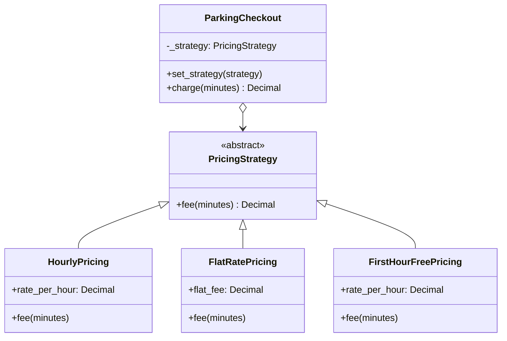

There was nothing magical in it. It is **composition + polymorphism + the Open/Closed Principle**, arranged in a particular way to solve a particular, very common problem. That is what every pattern in this post is: a familiar combination of things you already know, with a name attached.

---

## 2. So what is a design pattern?

### A named, reusable solution shape

A design pattern is a description of a problem that keeps recurring, together with the core of a solution you can adapt every time it appears. Three words in that sentence matter:

- **Named.** "Let's make pricing a strategy" says in four words what took a page above. A shared vocabulary is half the value of patterns: in a code review or a design discussion, names let people agree (or disagree) quickly.
- **Reusable.** The same shape fits parking prices, shipping costs, tax rules, sort orders and retry policies.
- **Shape, not code.** A pattern is not a library you import. Two codebases that both use Strategy may share no code at all; they share an *arrangement* of responsibilities.

### Where the idea came from

The idea did not start in software. In 1977 the architect **Christopher Alexander** and his colleagues published *A Pattern Language*, a catalogue of 253 recurring solutions to problems in building and town design, with names like "Light on Two Sides of Every Room" and "Window Place". Each entry described a problem that keeps coming up, the forces pulling in different directions, and the core of a solution that could be used over and over without ever being built the same way twice. Two houses that both follow "Light on Two Sides of Every Room" look nothing alike, yet they share a solution shape.

Programmers noticed. In 1987 Kent Beck and Ward Cunningham presented a small pattern language for Smalltalk user interfaces at the OOPSLA conference. In 1994 four authors, Erich Gamma, Richard Helm, Ralph Johnson and John Vlissides, published *Design Patterns: Elements of Reusable Object-Oriented Software*. They became known as the **Gang of Four (GoF)**, and their 23 patterns, with examples in C++ and Smalltalk, are still what people mean when they say "the Observer pattern".

### What a pattern description contains

The GoF describe each pattern with four essential elements:

1. **A name**, the shared word.
2. **A problem**: when the pattern applies, including the symptoms you will see in code (like the growing `if/elif` above).
3. **A solution**: the classes, their responsibilities and how they collaborate. It is a template, not finished code.
4. **Consequences**: the trade-offs. Every pattern buys flexibility by adding *indirection* (an extra layer between the caller and the code that finally does the work), and indirection has a cost: more classes, more places to look.

The consequences are what separate understanding from memorisation. "I'll use Strategy" is a name. "I'll use Strategy because pricing changes independently of checkout and the business already has three schemes; the cost is one interface" is engineering.

### The principles underneath, and where you met them

The GoF book opens with two principles, and a third became famous through later books such as *Head First Design Patterns*. Each one is something you already learned:

| Principle | What it says | Where you met it in OOP Fundamentals |
|---|---|---|
| **Program to an interface, not an implementation** | Callers depend on an abstract role ("something that can compute a fee"), not a concrete class | Abstraction; ABC vs Protocol; the Dependency Inversion Principle |
| **Favour object composition over class inheritance** | Build varying behaviour by giving an object another object, rather than by subclassing | Composition vs inheritance; the fragile base class problem |
| **Encapsulate what varies** | Find the part that changes most often and put it behind its own interface | The Open/Closed and Single Responsibility Principles |

Nearly every pattern in this post is one or more of these three sentences applied to a specific situation. When you forget a pattern's details, you can usually rebuild it from these principles plus the problem in front of you, exactly as we did in section 1.

### Patterns in a dynamic language like Python

The GoF wrote for C++ and Smalltalk. In 1996 Peter Norvig gave a talk, *Design Patterns in Dynamic Languages*, arguing that 16 of the 23 GoF patterns become simpler or invisible in languages with first-class functions, dynamic typing and modules. Python is such a language:

- Functions are objects, so a one-method Strategy or Command can just be a function.
- A module is imported once and cached, so a module-level object is already shared like a Singleton.
- Duck typing (and `typing.Protocol`) means an Adapter does not need to inherit from anything.
- `yield` turns a hand-written Iterator into a few lines, and `@decorator` syntax is built into the language.

So for every pattern below you will see two forms: the **classic** structure (which you need, because that is what other engineers draw on whiteboards and what Java, C# and C++ codebases contain) and the **Pythonic shortcut**, with a note on when each one is the better choice.

### The three families

The GoF sort their patterns by purpose:

| Family | Question it answers | Patterns in this post | Other GoF patterns |
|---|---|---|---|
| **Behavioral** | How do objects divide work and talk to each other? | Strategy, State, Observer, Command, Template Method, Chain of Responsibility, Iterator | Mediator, Memento, Visitor, Interpreter |
| **Creational** | Who decides which concrete class gets created? | Factory Method, Abstract Factory, Builder, Singleton (+ Simple Factory) | Prototype |
| **Structural** | How are objects wired together into bigger structures? | Adapter, Facade, Decorator, Proxy, Composite (+ Specification) | Bridge, Flyweight |

Two entries are not GoF patterns. **Simple Factory** is an informal idiom (one function that picks a class) that everyone writes. **Specification** comes from Eric Evans and Martin Fowler's work on domain-driven design; it appears constantly in "filter" problems such as file search and promotion rules, so it earns a place.

---

## 3. How to read this post

Fifteen patterns is a lot to take in at once, and you do not need them all equally. Here is the plan:

1. **Read the core four first** (section 4): **Strategy, State, Observer and Factory**. They solve the problems that appear in almost every real system and every design interview ("add a new rule", "it behaves differently depending on its status", "notify these other parts", "create the right kind of object"). Between them they cover most of the design decisions in this series' case studies.
2. **Skim the rest** (sections 5 to 7) so you know each pattern exists and what problem it answers. Treat them as a reference: when a case study says "the ATM's transactions are Commands", come back and read that section properly.
3. **Use the comparison and chooser sections** (sections 8 and 9) once you know a few patterns. They answer "isn't that just X?" and "which one do I need here?".

Every pattern section has the same layout, so you can jump around:

- **The problem**: a concrete situation that hurts without the pattern.
- **Built from**: which ideas from [OOP Fundamentals](01-oop-fundamentals.md) the pattern combines.
- **The pattern**: the structure, with a class diagram.
- **Python implementation**: excerpts from the runnable files.
- **The Pythonic shortcut**: the lighter form Python allows, and when to prefer it.
- **In real software**: where you have already used it, often without noticing.
- **When not to use it**: the cost, and the simpler alternative.
- **In this series**: which case studies use it (or compare it with an alternative).

Here is the whole map, with each pattern's ingredients:

| Pattern | Family | Built from | Where |
|---|---|---|---|
| **Strategy** | Behavioral | Composition, polymorphism, Open/Closed, Dependency Inversion | 4.1 (core) |
| **State** | Behavioral | Composition, polymorphism, encapsulation, Single Responsibility | 4.2 (core) |
| **Observer** | Behavioral | Protocol / duck typing, a list of collaborators, Dependency Inversion, Open/Closed | 4.3 (core) |
| **Simple Factory + registry** | Creational | Encapsulating construction, Open/Closed, polymorphism | 4.4 (core) |
| Command | Behavioral | Encapsulation (a request as an object), polymorphism | 5.1 |
| Template Method | Behavioral | Inheritance, abstract methods, polymorphism | 5.2 |
| Chain of Responsibility | Behavioral | Composition (each handler holds the next), polymorphism, Single Responsibility | 5.3 |
| Iterator | Behavioral | Encapsulation (hide the storage), Python's iteration protocol | 5.4 |
| Factory Method | Creational | Inheritance, abstract methods (Template Method for creation) | 6.1 |
| Abstract Factory | Creational | Composition, Dependency Inversion, ABCs | 6.2 |
| Builder | Creational | Encapsulation, immutable value objects | 6.3 |
| Singleton | Creational | Class attributes, `__new__` (and in tension with Dependency Inversion) | 6.4 |
| Adapter | Structural | Composition, Protocol, Dependency Inversion | 7.1 |
| Facade | Structural | Composition, encapsulation, Law of Demeter | 7.2 |
| Decorator | Structural | Composition *and* inheritance together, Liskov Substitution, Open/Closed | 7.3 |
| Proxy | Structural | Composition, encapsulation (same interface, controlled access) | 7.4 |
| Composite | Structural | Polymorphism, aggregation, recursion | 7.5 |
| Specification | Structural-ish | Polymorphism, operator overloading, Composite | 7.6 |

---

## 4. The core four

### 4.1 Strategy

**The problem.** You have already met it: an algorithm that varies (pricing, sorting, routing, tax, retries) is tangled into code that does not vary (checkout, the sort itself, the request loop), usually as an `if/elif` on a mode string.

**Built from.** Composition (the context *has* a strategy), polymorphism (all strategies answer the same method), the Open/Closed Principle (new strategy, no edits) and Dependency Inversion (the context depends only on the abstract strategy).

**The pattern.** Define a family of algorithms, put each behind one common interface, and let the **context** (the object that uses the algorithm) hold one of them without knowing which. Section 1 built exactly this; the diagram there is the whole structure. Three refinements are worth knowing.

*Strategies are chosen from outside.* The checkout never decides its own pricing; whoever builds it (a configuration loader, a test, an admin screen) does. This is what separates Strategy from State (section 8.1).

*Strategies can be swapped at runtime.* `set_strategy` lets a garage switch to event pricing at 6 pm without rebuilding the checkout. Garage operators that use dynamic pricing, where rates rise as the lot fills, are doing exactly this.

*Strategies can be selected by name.* Configuration files contain strings, not classes, so real systems keep a small dictionary from names to strategy factories. That is the registry idea from the Factory section (4.4), and it is how frameworks let you pick a strategy in a settings file.

**The Pythonic shortcut.** A strategy with one method and no other state is just a function, and Python passes functions around like any other value:

```python
# The Pythonic shortcut: a strategy is just a callable.
FeeFunction = Callable[[int], Decimal]


def hourly(rate_per_hour: Decimal) -> FeeFunction:
    """Build an hourly fee function (a closure stands in for a strategy object)."""

    def fee(minutes: int) -> Decimal:
        return rate_per_hour * max(1, math.ceil(minutes / 60))

    return fee


def weekend_flat(minutes: int) -> Decimal:
    return Decimal("15")
```

A **closure** is a function that remembers variables from the scope where it was created; here `fee` remembers `rate_per_hour`, which plays the role of the strategy object's constructor argument. Use functions when the strategy is one small calculation. Use classes when a strategy needs several methods (`fee()` *and* `describe()` for the receipt), carries configuration you want to inspect, log or save, or forms a named interface that other teams implement.

**In real software.**

- `sorted(items, key=...)` and `list.sort` take a key strategy; Java's `Comparator` is the textbook Strategy.
- In Python's `logging`, every handler holds a `Formatter` you can swap with `handler.setFormatter(...)`: the handler decides *where* a record goes, the formatter strategy decides *how it looks*.
- `concurrent.futures` defines one `Executor` interface with interchangeable implementations, `ThreadPoolExecutor` and `ProcessPoolExecutor`. Code that calls `executor.submit(...)` does not care which it was given.
- Django lets you choose file storage, cache, email and session backends in settings; each is a strategy behind a fixed interface.
- Passport.js, the Node.js authentication library, literally calls its pluggable login mechanisms "strategies".
- Payment platforms route a transaction to one of several processors based on cost, currency or availability; the routing rule and the processors are both strategies.

**When not to use it.** If there are two variants and no sign of a third, an `if` is clearer. If the variants differ only in a number ($3 an hour vs $4), that is configuration, not a new strategy. And if the choice depends on the object's own changing status rather than on an outside decision, you want State.

**In this series.** Strategy is the most used pattern in the case studies: pricing policies in the [parking lot](../02-case-studies/01-parking-lot/README.md); pricing and refund policies in [movie ticket booking](../02-case-studies/02-movie-ticket-booking/README.md); payment methods in the [vending machine](../02-case-studies/04-vending-machine/README.md); dispatch (which car answers a call) in the [elevator system](../02-case-studies/05-elevator-system/README.md); promotion rewards in the [grocery store](../02-case-studies/06-grocery-store/README.md); move-choosing and win-checking in [tic-tac-toe](../02-case-studies/07-tic-tac-toe/README.md); player and dealer decisions in [blackjack](../02-case-studies/08-blackjack/README.md); fee, expiry and compartment-assignment policies in the [shipping locker](../02-case-studies/09-shipping-locker/README.md); table assignment and bill splitting in [restaurant management](../02-case-studies/11-restaurant-management/README.md).

### 4.2 State

**The problem.** A vending machine accepts coins, lets you pick a product and dispenses it. But "pick a product" means different things depending on what has happened so far: with no money inserted it should complain, with enough money it should vend, and when everything is sold out it should refuse coins altogether. The first version stores a status string and checks it in every method:

```text
def select(self, product):
    if self.status == "idle":       complain
    elif self.status == "has_money": vend
    elif self.status == "sold_out":  refuse
```

Multiply that by four actions (insert, select, refund, restock) and four statuses and you have sixteen branches scattered across four methods. Adding a "maintenance" status means editing every one of them, and nothing stops a bug from setting `status = "has_mony"`.

**Built from.** Composition (the machine holds a state object), polymorphism (each state answers the same actions differently), encapsulation (the status is no longer a loose string anyone can set) and the Single Responsibility Principle (each class describes one state).

**The pattern.** First, a term. A **state machine** (or *finite state machine*) is a model in which a system is always in exactly one of a fixed set of states, and *events* move it from one state to another along defined *transitions*. Here is the vending machine's:

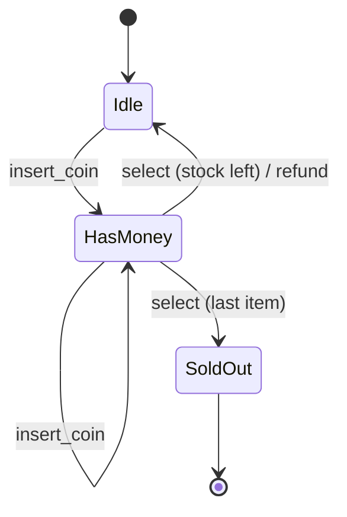

The State pattern turns each state into a class. The **context** (the machine) holds a reference to its current state object and forwards every action to it. Each state handles the actions that make sense for it and decides the next state. The `if status ==` checks disappear because *which object receives the call* already encodes the status.

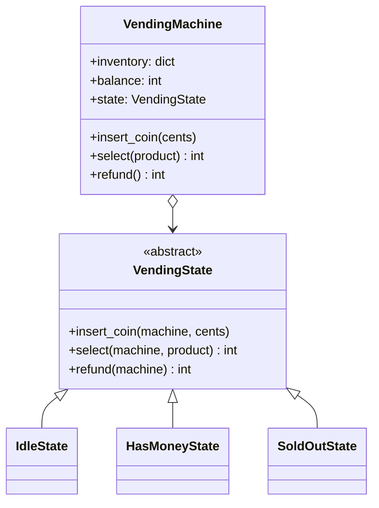

If this diagram looks identical to Strategy's, you are paying attention. Section 8.1 explains the difference.

**Python implementation.** The base class makes every action illegal by default, so each concrete state only overrides what it allows. That is a safe default: forgetting to handle an action produces a clear error, not a silent wrong answer.

```python
class VendingState(ABC):
    """Base state. Every action is illegal unless a concrete state allows it."""

    name = "abstract"

    def insert_coin(self, machine: VendingMachine, cents: int) -> None:
        raise InvalidAction(f"cannot insert coins while {self.name}")

    def select(self, machine: VendingMachine, product: str) -> int:
        raise InvalidAction(f"cannot select a product while {self.name}")

    def refund(self, machine: VendingMachine) -> int:
        return machine.take_balance()
```

The interesting state is the one with money in it, because it owns the transition logic:

```python
class HasMoneyState(VendingState):
    name = "has_money"

    def insert_coin(self, machine: VendingMachine, cents: int) -> None:
        machine.balance += cents

    def select(self, machine: VendingMachine, product: str) -> int:
        slot = machine.inventory.get(product)
        if slot is None or slot.quantity == 0:
            raise InvalidAction(f"{product!r} is not available")
        if machine.balance < slot.price:
            raise InvalidAction(f"{product!r} costs {slot.price}, balance is {machine.balance}")
        slot.quantity -= 1
        machine.balance -= slot.price
        change = machine.take_balance()
        machine.state = IDLE if machine.has_stock() else SOLD_OUT
        return change
```

Because the state objects hold no data of their own (the balance and inventory live in the machine), one shared instance of each is enough:

```python
# State objects hold no data of their own, so one shared instance each is enough.
IDLE = IdleState()
HAS_MONEY = HasMoneyState()
SOLD_OUT = SoldOutState()
```

The context just forwards:

```python
    def select(self, product: str) -> int:
        """Vend ``product`` and return the change in cents."""
        return self.state.select(self, product)
```

The example counts money in integer cents, which is what a coin mechanism reports; real vending controllers talk to coin and bill acceptors over the MDB bus in the smallest currency unit, and you should never use floats for money.

**The Pythonic shortcut: a transition table.** When states differ only in *which moves are legal*, not in behaviour, a class per state is ceremony. A dictionary from `(state, event)` to the next state does the job, and because it is data it can be printed, tested exhaustively and even drawn automatically. The classic example is a subway turnstile:

```python
TURNSTILE_TRANSITIONS: dict[tuple[str, str], str] = {
    ("locked", "coin"): "unlocked",
    ("locked", "push"): "locked",
    ("unlocked", "push"): "locked",
    ("unlocked", "coin"): "unlocked",
}


def next_state(state: str, event: str) -> str:
    try:
        return TURNSTILE_TRANSITIONS[(state, event)]
    except KeyError:
        raise InvalidAction(f"no transition from {state!r} on {event!r}") from None
```

In real code you would use an `Enum` for the states rather than strings (an idea from the encapsulation section of [OOP Fundamentals](01-oop-fundamentals.md)). The rule of thumb: **table when states differ in what is allowed, classes when states differ in what they do.** Many production systems use both: a table as the single source of truth for legal transitions, and classes for the few states with rich behaviour.

**Going deeper: event-driven vs level-triggered.** The State pattern is *event-driven* (or *edge-triggered*): each event arrives once and moves the machine one step. If an event is lost, the machine is wrong until something else happens. Kubernetes takes the opposite approach in its **controllers**. A controller does not trust a history of events; it repeatedly compares the *desired* state (what the user declared, such as "three replicas of the web server") with the *actual* state of the cluster, and takes whatever action closes the gap. This is called a **reconcile loop**, and it is *level-triggered*: it reacts to the current level, not to edges.

```python
def reconcile(desired: dict[str, int], actual: dict[str, int]) -> list[str]:
    """Return the actions that move ``actual`` replica counts toward ``desired``."""
    actions: list[str] = []
    for name in sorted(desired.keys() | actual.keys()):
        want, have = desired.get(name, 0), actual.get(name, 0)
        if have < want:
            actions.append(f"start {want - have} x {name}")
        elif have > want:
            actions.append(f"stop {have - want} x {name}")
    return actions
```

Run it twice and the second run returns nothing (`test_reconcile_is_idempotent`): it is **idempotent**, meaning that repeating it is harmless. That property is why reconcile loops survive crashes, restarts and dropped messages so well. Kubernetes still has explicit lifecycle states (a Pod's phase is Pending, Running, Succeeded, Failed or Unknown), but the controllers that drive them are reconcilers. For an in-process object like a vending machine, the State pattern is right; for a distributed system where messages get lost, think about whether a reconcile loop is safer.

**In real software.**

- The GoF book's own example is a TCP connection delegating `open()`, `close()` and `acknowledge()` to `TCPEstablished`, `TCPListen` or `TCPClosed` objects. The TCP specification itself (originally RFC 793, now RFC 9293) defines a connection as a state machine.
- Payment APIs expose explicit state machines: a Stripe PaymentIntent moves through statuses such as `requires_payment_method`, `requires_action`, `processing`, `succeeded` and `canceled`, and each status permits different API calls.
- E-commerce orders (placed, paid, shipped, delivered, returned), document workflows (draft, in review, published) and CI pipeline runs are all state machines.
- Game AI is often a finite state machine (patrol, chase, attack, flee), and game engines such as Unity provide state-machine tools for animation.
- Spring Statemachine in Java and XState in JavaScript are dedicated state-machine frameworks.

**When not to use it.** Two states and two actions? A boolean is fine. States that differ only in legal transitions? Use a table. And beware *state explosion*: if your "states" are really combinations of independent flags (door open/closed *times* moving/stopped), model the flags separately rather than creating one class per combination.

**In this series.** The [vending machine](../02-case-studies/04-vending-machine/README.md) and the [ATM](../02-case-studies/10-atm/README.md) (idle, card inserted, authenticated, in a transaction) use the State pattern. The [elevator system](../02-case-studies/05-elevator-system/README.md), [shipping locker](../02-case-studies/09-shipping-locker/README.md), [restaurant management](../02-case-studies/11-restaurant-management/README.md) and [tic-tac-toe](../02-case-studies/07-tic-tac-toe/README.md) case studies deliberately choose an enum plus a transition table instead, and each compares it with the State pattern and says when it would switch. [Blackjack](../02-case-studies/08-blackjack/README.md) and [movie ticket booking](../02-case-studies/02-movie-ticket-booking/README.md) also guard their lifecycles with explicit transition tables.

### 4.3 Observer

**The problem.** When an elevator car reaches a floor, the lobby display must update, the maintenance log must record the trip, the voice announcer must say the floor number, and next quarter an analytics service wants a feed too. If `Elevator.move_to()` calls each of these directly, the elevator has to import and know about all of them, and every new listener is an edit to the elevator.

**Built from.** A `Protocol` (any object with the right method can listen, which is duck typing made checkable), composition (the subject holds a list of collaborators), Dependency Inversion (the subject depends on an abstract listener role, never on concrete listeners) and Open/Closed (new listeners need no edits to the subject).

**The pattern.** Observer (also called *publish-subscribe*, or *pub-sub*) defines a one-to-many dependency: the **subject** keeps a list of **observers** and notifies all of them when something happens. The subject only knows that observers have a notification method; it has no idea what they do.

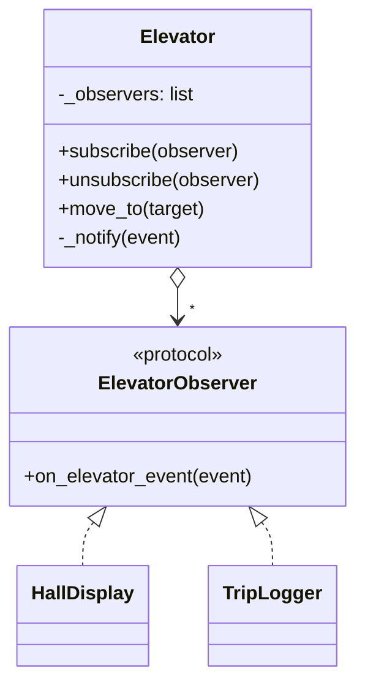

**Python implementation.** `typing.Protocol` describes the observer role without forcing observers to inherit from anything:

```python
class ElevatorObserver(Protocol):
    def on_elevator_event(self, event: ElevatorEvent) -> None: ...


class Elevator:
    """The *subject*: it knows only that observers have ``on_elevator_event``."""

    def __init__(self, elevator_id: str, floor: int = 0) -> None:
        self.elevator_id = elevator_id
        self.floor = floor
        self._observers: list[ElevatorObserver] = []

    def subscribe(self, observer: ElevatorObserver) -> None:
        if observer not in self._observers:
            self._observers.append(observer)

    def unsubscribe(self, observer: ElevatorObserver) -> None:
        self._observers.remove(observer)
```

```python
    def _notify(self, event: ElevatorEvent) -> None:
        # Iterate over a copy so an observer may unsubscribe while being notified.
        for observer in list(self._observers):
            observer.on_elevator_event(event)
```

That `list(...)` copy is a detail worth understanding. Without it, an observer that unsubscribes itself during notification removes an item from the list being iterated, and the loop silently skips the next observer. The test `test_observer_may_unsubscribe_during_notify` covers exactly this. The event itself is a frozen dataclass (an immutable value object), so one observer cannot change the data the next observer is about to see.

**The Pythonic shortcut.** Observers are often just callbacks. A tiny `Signal` class holding a list of functions covers most needs, and returning the handler from `connect` lets it double as a decorator:

```python
class Signal:
    """Pythonic observer: subscribers are plain callables (cf. Django signals)."""

    def __init__(self) -> None:
        self._handlers: list[Callable[..., None]] = []

    def connect(self, handler: Callable[..., None]) -> Callable[..., None]:
        """Register ``handler``; returns it so ``@signal.connect`` works as a decorator."""
        self._handlers.append(handler)
        return handler

    def disconnect(self, handler: Callable[..., None]) -> None:
        self._handlers.remove(handler)

    def emit(self, *args: object, **kwargs: object) -> None:
        for handler in list(self._handlers):
            handler(*args, **kwargs)
```

There is a production question hiding in `emit`: what if one handler raises? The loop stops, and every handler after it never hears about the event. Sometimes that is right (a validation hook *should* abort), but for side effects such as "send the receipt email" and "update analytics", one broken subscriber should not silence the others. Django's signals offer both behaviours, `send()` and `send_robust()`, and our `Signal` mirrors that:

```python
    def emit_robust(self, *args: object, **kwargs: object) -> list[Exception]:
        """Like ``emit``, but one failing handler cannot silence the others."""
        errors: list[Exception] = []
        for handler in list(self._handlers):
            try:
                handler(*args, **kwargs)
            except Exception as exc:  # isolate each subscriber's failure
                errors.append(exc)
        return errors
```

**In real software.** Observer is everywhere, often under the names "events", "signals", "hooks", "listeners" or "callbacks".

- **Python's `logging`.** A logger does not write anything itself. It keeps a list of *handlers* (console, file, rotating file, syslog, HTTP) and hands each record to every handler attached to it. Adding a new destination is `logger.addHandler(...)`, with no change to the code that logs.
- **Django signals.** `post_save`, `pre_delete` and `request_finished` let any app react when a model is saved or a request ends without the model knowing the app exists.
- **SQLAlchemy events.** `event.listen(engine, "before_cursor_execute", fn)` or the `@event.listens_for(...)` decorator attach observers to engines, sessions and mapped classes, which is how query timers and audit logs are usually built.
- **Spring.** Java Spring's `ApplicationEventPublisher` and `@EventListener` let beans publish and subscribe to application events.
- **Kubernetes.** Controllers *watch* the API server and are notified when objects change; that notification is Observer, and what they do with it is the reconcile loop from section 4.2.
- **Browsers and UIs.** `addEventListener` in the DOM, Java Swing's `ActionListener`, and the reactive state systems of modern front-end frameworks descend from Smalltalk-80's Model-View-Controller, which was built on this idea.
- **Across services.** Webhooks (a payment provider calling your URL when a charge succeeds) and message brokers such as Kafka are Observer across process and company boundaries.

**When not to use it.** Observer makes control flow *implicit*: reading `move_to()` no longer tells you everything that happens, and "why did this email get sent?" becomes a search. Specific pitfalls:

- **Ordering.** Observers should not depend on being notified in a particular order.
- **Exceptions.** Decide per event whether one failure should stop the rest (`emit` vs `emit_robust`).
- **Memory leaks.** The subject holds strong references, so forgotten subscriptions keep objects alive (the *lapsed listener* problem). Explicit unsubscribe, or `weakref.WeakSet`, fixes it.
- **Threads.** Subscribing on one thread while notifying on another needs a lock or a copy-on-write list.

If there is exactly one listener and it will always be there, a direct method call is simpler and clearer.

**In this series.** The [vending machine](../02-case-studies/04-vending-machine/README.md) publishes telemetry to listeners; the [elevator system](../02-case-studies/05-elevator-system/README.md) has cars publish events on an event bus; the [shipping locker](../02-case-studies/09-shipping-locker/README.md) notifies customers and staff through observers; the [restaurant](../02-case-studies/11-restaurant-management/README.md) routes fired tickets to kitchen displays that subscribe by station. [Movie ticket booking](../02-case-studies/02-movie-ticket-booking/README.md) proposes Observer for a waitlist extension.

### 4.4 Factory (Simple Factory and the registry)

**The problem.** A parcel-locker station has small, medium and large compartments, each a different class. The code that builds a station from a configuration file has to turn `"M"` into a `MediumLocker`. If every caller writes its own `if size == "S": SmallLocker(...)`, adding an extra-large size means hunting down every one of those `if`s. Object creation has become the thing that varies, and it is scattered.

**Built from.** Encapsulation (the decision "which class?" is hidden in one place), polymorphism (callers receive an abstract `Locker` and use it without caring which subclass it is) and the Open/Closed Principle (with a registry, new types need no edit to the factory).

**The pattern.** A **Simple Factory** is one function (or static method) that takes a description of what you want and returns an instance of the right class. Callers name *what* they want, not *which class*. It is not one of the 23 GoF patterns, but it is the factory you will write most often, and it is usually what people mean when they say "use a factory". (The two GoF factory patterns, Factory Method and Abstract Factory, are in section 6.)

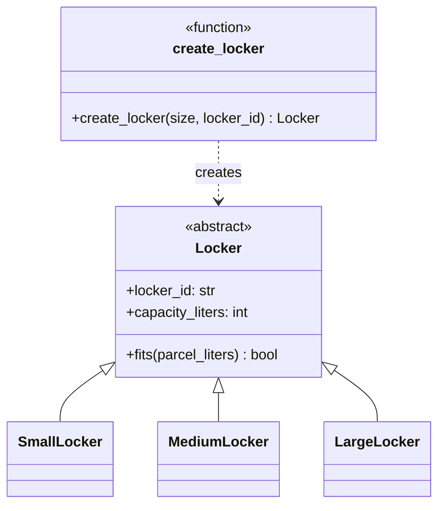

**Python implementation.** The simplest version is a dictionary lookup. A *registry* plus a class decorator goes one step further: each new locker size registers itself, so the factory function never needs to be edited:

```python
_LOCKER_TYPES: dict[LockerSize, type[Locker]] = {}


def register_locker(size: LockerSize) -> Callable[[type[Locker]], type[Locker]]:
    """Class decorator: adding a size means adding a class, not editing the factory."""

    def decorator(cls: type[Locker]) -> type[Locker]:
        _LOCKER_TYPES[size] = cls
        return cls

    return decorator


@register_locker(LockerSize.SMALL)
class SmallLocker(Locker):
    capacity_liters = 10
```

```python
def create_locker(size: LockerSize, locker_id: str) -> Locker:
    """The simple factory: callers name *what* they want, not *which class*."""
    try:
        cls = _LOCKER_TYPES[size]
    except KeyError:
        raise ValueError(f"no locker registered for {size}") from None
    return cls(locker_id)
```

The input is a `LockerSize` enum rather than a raw string, so a typo fails where it is written. The registry is the same move as Strategy-by-name in section 4.1: a dictionary from names to classes is how most plugin systems work.

**The Pythonic shortcut.** Classes are first-class values in Python, so the registry *is* the factory: `_LOCKER_TYPES[size](locker_id)` would work on its own. The function adds a clear error message and a single place to add logging, caching or validation later. `functools.singledispatch` is a related standard-library tool: it keeps a registry of implementations keyed by argument type, replacing an `if isinstance(...)` chain.

**In real software.**

- Python's built-in `open()` is a simple factory: depending on the mode it returns a `TextIOWrapper`, a `BufferedReader`, a `BufferedWriter` or a raw `FileIO`.
- `pathlib.Path(...)` returns a `PosixPath` or `WindowsPath` depending on the operating system.
- `hashlib.new("sha256")` returns the right hash object for a name, and `codecs` keeps a registry of text encodings looked up by name.
- `logging.getLogger("payments")` is a registry of named instances: the same name always returns the same logger.
- **Java Spring** is built around a factory. Its `BeanFactory` (and the richer `ApplicationContext`) creates application objects ("beans") from configuration, decides their concrete classes, injects their dependencies and manages their lifetimes. Your code asks for "a `PaymentService`" and the container decides which implementation to build. That is a factory and a registry, grown into a framework, and it is also the most common real-world form of dependency injection.
- Plugin systems (pytest plugins, Django apps, serialisation formats) register classes by name exactly like the example.

**When not to use it.** If there is only one class, call its constructor. A "factory" that just forwards its arguments to one constructor adds a layer without adding a decision.

**In this series.** The [shipping locker](../02-case-studies/09-shipping-locker/README.md) builds every compartment through one factory (`with_layout`), which is the single place to change when new compartment kinds arrive.

---

## 5. Reference: more behavioral patterns

Behavioral patterns are about **who does what** and **who tells whom**. You have seen the core three. These four solve narrower problems; read them when you need them.

### 5.1 Command

**The problem.** In a restaurant, a waiter takes orders at the table, but the kitchen cooks them later. Sometimes a guest changes their mind and the last order must be cancelled. If the waiter calls `kitchen.cook("ramen")` immediately, there is nothing to queue, nothing to cancel and no record of what was asked.

**Built from.** Encapsulation (a request, with its target and arguments, becomes an object with its own data), polymorphism (every command answers `execute()`), and Single Responsibility (the one who *asks* is separated from the one who *does*).

**The pattern.** Command turns a request into an object. The object captures *who* should do the work (the **receiver**), *what* to do and *with which arguments*. Because it is an object, it can be stored in a queue, logged, sent over a network, retried or undone. The **invoker** (the waiter) triggers commands without knowing what they do.

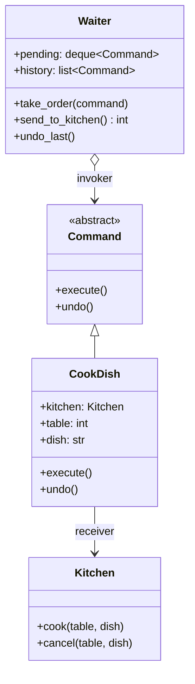

**Python implementation:**

```python
@dataclass
class CookDish(Command):
    kitchen: Kitchen
    table: int
    dish: str

    def execute(self) -> None:
        self.kitchen.cook(self.table, self.dish)

    def undo(self) -> None:
        self.kitchen.cancel(self.table, self.dish)
```

```python
    def send_to_kitchen(self) -> int:
        sent = 0
        while self.pending:
            command = self.pending.popleft()
            command.execute()
            self.history.append(command)
            sent += 1
        return sent

    def undo_last(self) -> None:
        if not self.history:
            raise InvalidAction("nothing to undo")
        self.history.pop().undo()
```

The `history` list is an undo stack. Redo is a second stack: when undoing, move the command onto `redo`; when redoing, execute it and move it back.

**The Pythonic shortcut.** If you only need "run this later", a function or `functools.partial(kitchen.cook, 4, "ramen")` is a command with no class. You need the full object when you want `undo()`, when the command must be serialised (to a queue, a database or a log), or when you want to inspect it ("which table is this for?").

**In real software.**

- Every text editor's undo and redo is a stack of commands.
- **Django migrations** are lists of operation objects (`CreateModel`, `AddField`, `RunPython`), and each operation knows how to apply itself forwards and backwards. Running `migrate` to an earlier migration replays the backwards halves in reverse order: Command with undo, applied to a database schema.
- Background job systems such as Celery serialise a task name plus its arguments into a message: a command shipped to another machine. `concurrent.futures.Executor.submit(fn, *args)` and Java's `Runnable` handed to an `ExecutorService` are commands in a queue.
- Redux in front-end JavaScript models every state change as an *action* object that is dispatched and applied by a reducer, which is what makes time-travel debugging possible.
- Restaurant point-of-sale systems such as Toast send tickets to kitchen display screens; the ticket is the command. **Event sourcing**, where a system stores the list of things that happened and derives current state from it, is Command's history taken to its logical end.

**When not to use it.** If the action happens immediately and is never undone, queued or logged, a direct method call is clearer. Undo is also harder than it looks when commands have external side effects: you cannot un-send an email, only send a correction. Do not promise undo for those.

**In this series.** The [ATM](../02-case-studies/10-atm/README.md) models each customer transaction (balance inquiry, withdrawal, deposit) as a Command with `execute` and `undo`. [Restaurant management](../02-case-studies/11-restaurant-management/README.md) compares a command queue with Observer for kitchen routing and picks Observer, keeping Command for offline queuing. [Tic-tac-toe](../02-case-studies/07-tic-tac-toe/README.md) compares Command objects, snapshots (the Memento pattern) and a plain move log for undo.

### 5.2 Template Method

**The problem.** In blackjack, every participant's turn has the same skeleton: look at your hand; if you are over 21 you bust; otherwise decide whether to hit; if you hit, draw a card and repeat. The only thing that differs is *the decision*. The dealer must hit below 17 by house rules; a player follows their own policy. Copying the loop into every participant class duplicates the bust logic and invites bugs.

**Built from.** Inheritance (subclasses fill in steps), abstract methods (an `ABC` forces the required steps to exist) and polymorphism (the base class calls a method whose behaviour depends on the subclass).

**The pattern.** Template Method puts the skeleton of an algorithm in a base-class method, the **template method**, and leaves specific steps to subclasses. Steps subclasses *must* provide are abstract; steps they *may* override, with a do-nothing default, are called **hooks**. This is sometimes called the *Hollywood principle*: "don't call us, we'll call you". The base class calls the subclass, not the other way round.

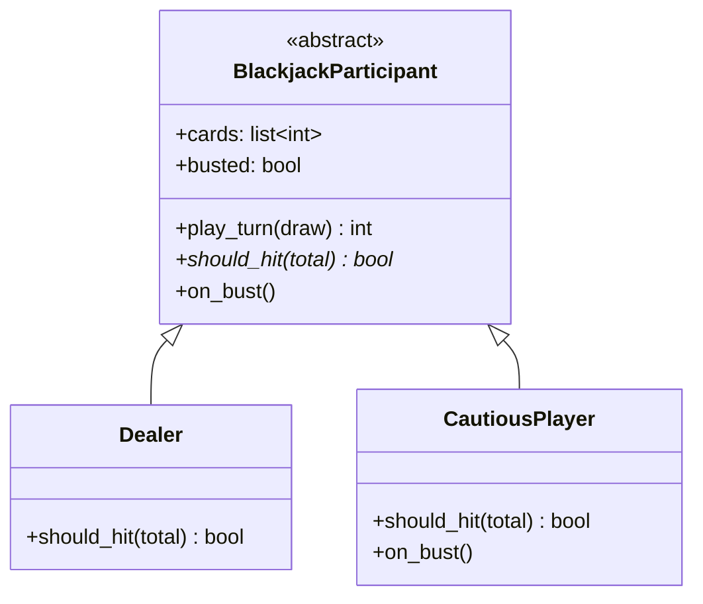

**Python implementation:**

```python
class BlackjackParticipant(ABC):
    """``play_turn`` is the template method: a fixed skeleton with one abstract step."""

    def __init__(self, name: str) -> None:
        self.name = name
        self.cards: list[int] = []
        self.busted = False

    def play_turn(self, draw: Callable[[], int]) -> int:
        while True:
            total = hand_value(self.cards)
            if total > 21:
                self.busted = True
                self.on_bust()
                return total
            if not self.should_hit(total):
                return total
            self.cards.append(draw())

    @abstractmethod
    def should_hit(self, total: int) -> bool:
        """The step subclasses must supply."""

    def on_bust(self) -> None:
        """A *hook*: optional step with a do-nothing default."""


class Dealer(BlackjackParticipant):
    """House rule: hit until 17 or more."""

    def should_hit(self, total: int) -> bool:
        return total < 17
```

`draw` is passed in as a function, which makes the turn testable with a scripted deck (`lambda: next(deck)`) instead of a random shoe. That is dependency injection on a small scale.

**The Pythonic shortcut.** Python has no runtime-enforced `final` (there is `typing.final` for type checkers), so nothing stops a subclass from overriding `play_turn` itself; convention and review do that job. When the varying step is small, passing it in as a function (`should_hit=lambda total: total < 17`) turns Template Method into Strategy. Section 8.4 compares them.

**In real software.** Template Method is the backbone of most frameworks, because a framework owns the skeleton and you fill in the blanks:

- `unittest.TestCase.run()` calls `setUp()`, your test method, then `tearDown()`.
- **`collections.abc`**: subclass `collections.abc.Sequence`, implement just `__getitem__` and `__len__`, and you get `__contains__`, `__iter__`, `__reversed__`, `index` and `count` for free. The mixin methods are template methods written in terms of your two. Java's `AbstractList` does the same.
- **`logging.Handler`**: `handle()` applies the handler's filters, takes a lock and then calls `emit()`. Custom handlers override only `emit()`.
- `json.JSONEncoder` calls the hook `default()` for objects it cannot serialise; you subclass and override it.
- `threading.Thread.start()` arranges for your overridden `run()` to be called; `socketserver.BaseRequestHandler` calls `setup()`, `handle()` and `finish()`.
- Django's class-based views define a request-handling skeleton with overridable steps such as `get_queryset()` and `get_context_data()`.

**When not to use it.** Template Method relies on inheritance, so it inherits inheritance's problems from [OOP Fundamentals](01-oop-fundamentals.md): one axis of variation per hierarchy, subclasses tightly coupled to the base class's call order, and deep hierarchies that are hard to read. If two independent things vary (how to play *and* how to bet), use two strategies instead of one subclass per combination.

**In this series.** [Blackjack](../02-case-studies/08-blackjack/README.md) compares inheritance with a Template Method against composition with a decision Strategy, and recommends the Strategy, which is exactly the trade-off above.

### 5.3 Chain of Responsibility

**The problem.** An ATM holds cassettes of $100, $50 and $20 notes. A withdrawal of $290 should be paid with the largest notes first, but if the $100 cassette is short, the remainder must fall through to smaller notes. One function with a branch per denomination needs editing every time the bank adds a cassette type.

**Built from.** Composition (each handler holds a reference to the next one), polymorphism (every handler answers the same request) and the Single Responsibility Principle (each handler knows only its own job).

**The pattern.** Chain of Responsibility passes a request along a chain of handlers. Each handler either handles it, handles part of it, or passes it on. The sender knows only the head of the chain.

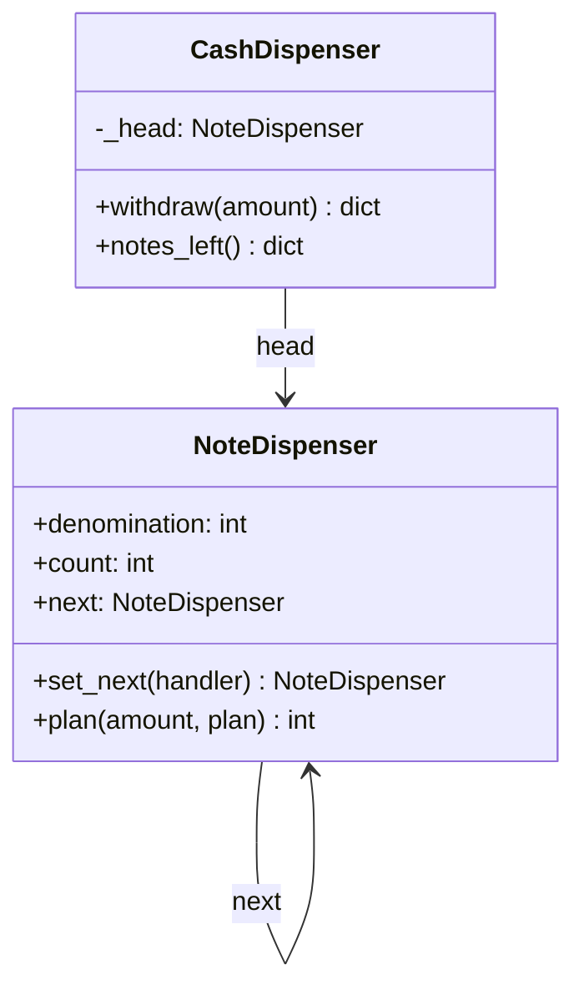

**Python implementation.** Each link pays what it can and forwards the remainder:

```python
    def plan(self, amount: int, plan: dict[int, int]) -> int:
        """Fill ``plan`` with notes to use; return the amount nobody could cover."""
        notes = min(amount // self.denomination, self.count)
        if notes:
            plan[self.denomination] = notes
        remaining = amount - notes * self.denomination
        if remaining and self.next is not None:
            return self.next.plan(remaining, plan)
        return remaining
```

The dispenser *plans* first and *commits* only if the whole amount can be covered. Otherwise a failed withdrawal would leave the counts wrong, and an ATM must never record notes as dispensed that were not:

```python
    def withdraw(self, amount: int) -> dict[int, int]:
        if amount <= 0:
            raise ValueError("amount must be positive")
        plan: dict[int, int] = {}
        if self._head.plan(amount, plan) != 0:
            raise InsufficientCash(f"cannot dispense {amount} with the notes available")
        for denomination, notes in plan.items():  # commit only once the whole plan works
            self._links[denomination].count -= notes
        return plan
```

There is an honest limitation here. A greedy chain can fail when a solution exists: with one $50 and three $20s, $60 is payable as three $20s, but the chain grabs the $50 first and is left with $10. The test `test_greedy_chain_limitation` documents it. A robust dispenser falls back to a small search (or dynamic programming) over note counts. Knowing *where a pattern stops being the right tool* is part of knowing the pattern.

**The Pythonic shortcut.** A chain can be a list of handler functions tried in order (`for handler in handlers: if handler(request): break`). The linked version is useful when handlers decide for themselves whether to forward, or when the chain is assembled dynamically.

**In real software.**

- **Django middleware.** Each middleware receives the next layer as `get_response`. It can return a response early (a 403, a cached page) without calling the rest, modify the request, or pass it on and then modify the response on the way back.
- **Django authentication backends.** `authenticate()` tries each backend listed in `AUTHENTICATION_BACKENDS` in order until one recognises the credentials.
- **Kubernetes admission controllers.** Every request to create or change an object passes through a sequence of admission plugins and webhooks (mutating ones first, then validating ones), and any of them can reject it.
- **Python exceptions** travel up the call stack until some `except` claims them, and in `logging` a record propagates up the logger hierarchy to parent loggers' handlers unless `propagate` is false.
- DOM events bubble from a child element up through its parents. Java servlet filters and Express middleware are chains, and support desks escalate tickets from tier 1 to tier 3 the same way.

**When not to use it.** When exactly one handler always handles the request, a dictionary lookup or a direct call is simpler. Chains also let a request fall off the end unhandled, so always decide what happens there (here: `InsufficientCash`).

**In this series.** The [ATM](../02-case-studies/10-atm/README.md) compares greedy dispensing, a Chain of Responsibility and dynamic programming, shows that the chain fails in the same low-cassette cases as greedy, and recommends the dynamic-programming planner.

### 5.4 Iterator

**The problem.** An elevator has a set of requested floors. The order in which to visit them is neither sorted nor first-come-first-served: the classic SCAN algorithm (also called *the elevator algorithm*, and used for disk-head scheduling) keeps moving in its current direction, serving every request on the way, then reverses. The code that drives the car should not need to know that logic; it just wants "the next floor".

**Built from.** Encapsulation (how the data is stored and traversed stays hidden) and Python's iteration protocol, which is built on the dunder methods `__iter__` and `__next__`.

**The pattern.** Iterator gives sequential access to the elements of a collection without exposing how it is stored. The traversal lives in an iterator object, so you can have several traversals of the same data (SCAN, nearest-first) and several iterations in progress at once.

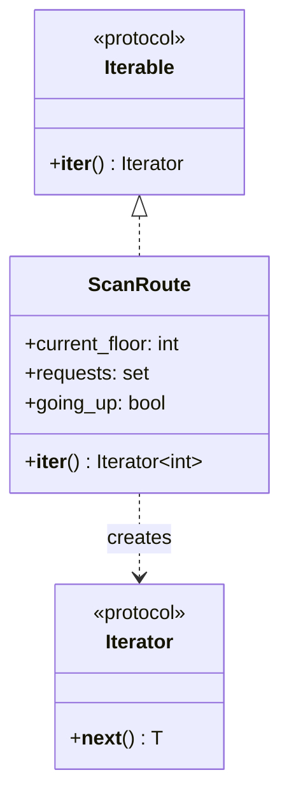

**Python implementation.** Python's iterator protocol *is* the pattern: an *iterable* has `__iter__()` returning an *iterator*, and an iterator has `__next__()` returning the next item or raising `StopIteration`. A generator function writes the iterator for you:

```python
    def __iter__(self) -> Iterator[int]:
        above = sorted(f for f in self.requests if f >= self.current_floor)
        below = sorted((f for f in self.requests if f < self.current_floor), reverse=True)
        if self.going_up:
            yield from above
            yield from below
        else:
            yield from below
            yield from above
```

Each call to `__iter__` creates a fresh generator, so the route can be iterated more than once (`test_duplicates_collapsed_and_route_reusable`). The file also contains `ExplicitScanIterator`, the same traversal written the long way with `__next__`, so you can see what the generator saves you.

**In real software.** Every `for` loop in Python uses this protocol. `os.scandir`, `os.walk` and `pathlib.Path.rglob` walk directories lazily. Database drivers return cursors you iterate row by row instead of loading millions of rows into memory. Paginated web APIs are iterators over the network; Stripe's Python library, for example, offers `auto_paging_iter()` so you can loop over every customer while it fetches pages behind the scenes. Java's `Iterator` and C#'s `IEnumerable` are the same idea.

**When not to use it.** You almost never write an iterator *class* in Python; a generator is shorter. A list comprehension over a small in-memory list needs no custom iterator at all. And remember that iterators are single-use: a generator object passed to two consumers is exhausted by the first.

**In this series.** The [unix file search](../02-case-studies/03-unix-file-search/README.md) makes `search` a generator that walks the tree lazily, so a caller who wants only the first match stops the walk early.

---

## 6. Reference: more creational patterns

Creational patterns answer one question: **who decides which concrete class gets created?** You met the everyday answer, Simple Factory, in section 4.4. These four handle more specific situations.

### 6.1 Factory Method

**The problem.** When a parcel lands in a locker, the customer gets a pickup code. Some deployments notify by email, others by SMS. The notification workflow (compose the message, send it) is the same; only the channel differs. We want the workflow written once, with subclasses deciding which channel object to create.

**Built from.** Inheritance and abstract methods. It is Template Method (section 5.2) where the deferred step is "create an object".

**The pattern.** Factory Method declares a creation method in a base class (the **creator**) and lets subclasses decide which class to instantiate. The creator's other methods use the created object (the **product**) through its interface. The difference from Simple Factory: the creation decision is made by *subclassing* a class that also *does something* with the product.

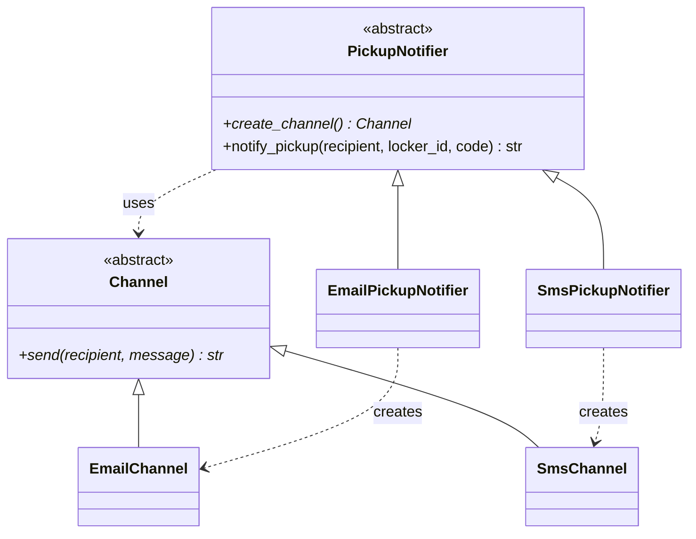

**Python implementation:**

```python
class PickupNotifier(ABC):
    """The *creator*. ``notify_pickup`` is shared; ``create_channel`` is the factory method."""

    @abstractmethod
    def create_channel(self) -> Channel: ...

    def notify_pickup(self, recipient: str, locker_id: str, code: str) -> str:
        channel = self.create_channel()
        return channel.send(recipient, f"Your parcel is in locker {locker_id}. Pickup code {code}.")


class EmailPickupNotifier(PickupNotifier):
    def create_channel(self) -> Channel:
        return EmailChannel()
```

**The Pythonic shortcut.** Classes are values in Python, so you can often pass the class itself, `PickupNotifier(channel_cls=SmsChannel)`, instead of creating a subclass per product. That replaces inheritance with composition, which is usually the better default.

**In real software.** Python's `__iter__` is a factory method: each iterable class returns its own kind of iterator, as Java's `Collection.iterator()` does. The `logging` documentation describes `Logger.makeRecord()` as a factory method that subclasses can override to create custom log records. Django's form views let you override `get_form_class()` to choose which form to build.

**When not to use it.** Creating a subclass only to override one factory method is heavy. If the creator has no other behaviour, use a simple factory or pass the class in.

**In this series.** The [shipping locker](../02-case-studies/09-shipping-locker/README.md) describes its `with_layout` constructor as a small factory method; it is a class-level method that builds a whole locker bank.

### 6.2 Abstract Factory

**The problem.** A locker station is built from hardware parts, such as door locks and a screen, and the parts must match: one vendor's lock controller talks to that vendor's display board. On developer laptops and in tests you want simulated parts that record what happened. Mixing a real lock with a simulated screen is a bug.

**Built from.** Composition (the station is *given* a factory), Dependency Inversion (it depends only on abstract factory and abstract parts) and ABCs (the factory interface lists every part a family must supply).

**The pattern.** Abstract Factory provides an interface for creating *families* of related objects without naming their concrete classes. Each concrete factory produces one consistent family.

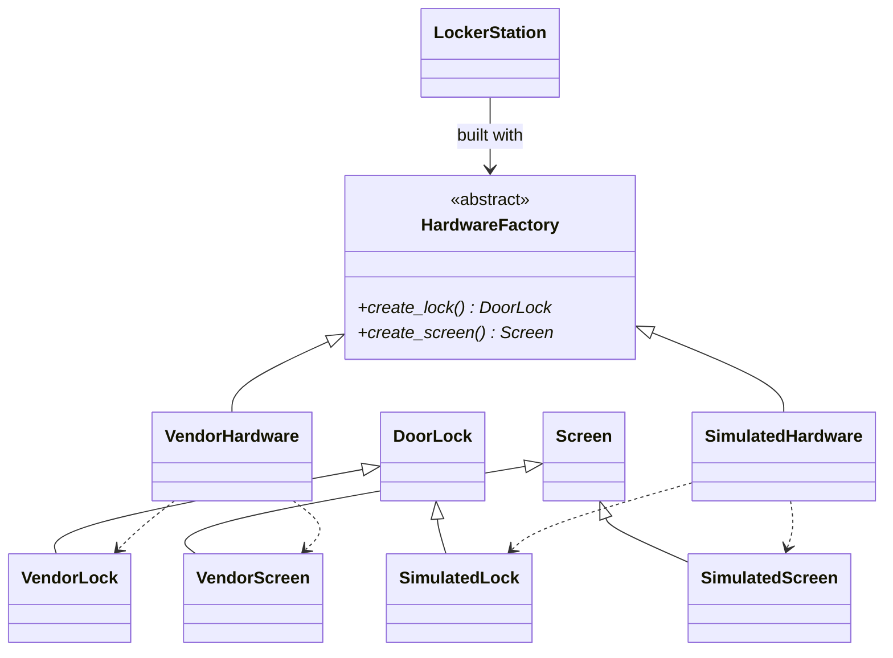

**Python implementation:**

```python
class HardwareFactory(ABC):
    """Creates a *family* of parts that must match each other."""

    @abstractmethod
    def create_lock(self) -> DoorLock: ...

    @abstractmethod
    def create_screen(self) -> Screen: ...
```

```python
class SimulatedHardware(HardwareFactory):
    """Used in tests and on developer laptops: no real solenoids required."""

    def create_lock(self) -> DoorLock:
        return SimulatedLock()

    def create_screen(self) -> Screen:
        return SimulatedScreen()


class LockerStation:
    """Client code: it only ever talks to the abstract factory and abstract parts."""

    def __init__(self, hardware: HardwareFactory, codes: dict[str, str]) -> None:
        self.lock = hardware.create_lock()
        self.screen = hardware.create_screen()
        self._codes = codes  # pickup code -> locker id
```

Swapping the whole family is one constructor argument: `LockerStation(SimulatedHardware(), ...)` in tests, `LockerStation(VendorHardware(), ...)` in production.

**The Pythonic shortcut.** A factory can be a module, a dictionary of callables (`{"lock": SimulatedLock, "screen": SimulatedScreen}`) or a dataclass holding classes. Keep the ABC when the family is large or when you want a type checker to verify that every factory supplies every part.

**In real software.** The GoF example is a GUI widget factory producing windows and scroll bars for different look-and-feel standards, which Java Swing's pluggable look-and-feel follows. Django's database backends are families: each backend supplies matching classes for SQL operations, schema editing, introspection and the database client, and the single `ENGINE` setting selects the whole family. Cloud SDKs that abstract over several providers do the same.

**When not to use it.** One family, or a family with one member, is overkill. And note the asymmetry: adding a new *family* (a second vendor) is easy, but adding a new *kind of product* (a barcode scanner) means changing the abstract factory and every concrete factory.

**In this series.** None of the case studies needs a full Abstract Factory, which is itself a useful lesson: most interview-sized systems have one family of objects. They achieve the same testability with constructor injection of individual fakes (a fake dispenser, a fake payment gateway, a manual clock).

### 6.3 Builder

**The problem.** A file search request has a root folder and a pile of optional settings: name pattern, extensions, minimum and maximum size, maximum depth, whether to follow symbolic links. A constructor with many positional parameters is unreadable (`SearchQuery("/", None, None, 1000, None, 2, False)`: which number is which?), and building the object through setters leaves it half-initialised and mutable.

**Built from.** Encapsulation (construction steps hide normalisation and validation) and the immutable value objects from [OOP Fundamentals](01-oop-fundamentals.md) (the product is a frozen dataclass).

**The pattern.** Builder separates the step-by-step construction of a complex object from the finished product. The builder accumulates choices; a final `build()` call validates them and returns the product, often immutable.

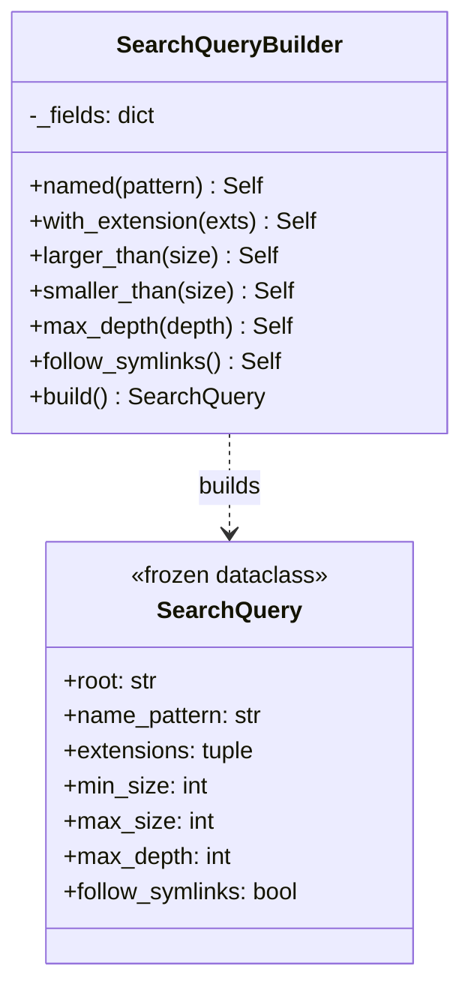

**Python implementation.** Each step returns `self` (typed as `Self`), which allows *method chaining*, also called a *fluent interface*:

```python
class SearchQueryBuilder:
    """Collects options step by step, then produces one immutable ``SearchQuery``."""

    def __init__(self, root: str) -> None:
        self._fields: dict[str, object] = {"root": root}
        self._extensions: list[str] = []

    def named(self, pattern: str) -> Self:
        self._fields["name_pattern"] = pattern
        return self

    def with_extension(self, *extensions: str) -> Self:
        self._extensions.extend(e.lower().lstrip(".") for e in extensions)
        return self
```

```python
query = (
    SearchQueryBuilder("/var/log")
    .named("*error*")
    .with_extension(".log", "gz")
    .larger_than(1_000_000)
    .max_depth(2)
    .build()
)
```

Validation lives in the *product*, not the builder, so a `SearchQuery` created any other way is checked too:

```python
    def __post_init__(self) -> None:
        if not self.root:
            raise ValueError("root is required")
        if self.min_size is not None and self.max_size is not None and self.min_size > self.max_size:
            raise ValueError("min_size cannot exceed max_size")
        if self.max_depth is not None and self.max_depth < 0:
            raise ValueError("max_depth cannot be negative")
```

**The Pythonic shortcut.** Python solves most of Builder's original problem with **keyword arguments and defaults**. `SearchQuery(root="/var/log", min_size=1_000_000, max_depth=2)` is readable, and `@dataclass(frozen=True, kw_only=True)` makes it immutable and keyword-only. A separate builder earns its keep when construction is genuinely *incremental* (options parsed from command-line flags one at a time), when steps *normalise* input (`with_extension` strips dots and lowercases), or when one builder can produce different representations.

**In real software.** SQLAlchemy's `select(User).where(...).order_by(...)` builds a query step by step, each call returning a new statement object. Java has `StringBuilder`, `HttpRequest.newBuilder()` in the standard HTTP client, protobuf message builders and Lombok's `@Builder`. Python's `argparse.ArgumentParser` is configured incrementally with `add_argument` calls before `parse_args` produces the finished namespace.

**When not to use it.** For objects with a handful of fields, keyword arguments are simpler and do not need a parallel class kept in sync with the product.

**In this series.** The [unix file search](../02-case-studies/03-unix-file-search/README.md) uses a small builder (`where(attribute).gt(1024)`) to construct search predicates readably, plus a builder for in-memory test trees.

### 6.4 Singleton (and why it is often an anti-pattern)

**The problem.** Some things should exist once per process: a configuration registry, a connection pool, the driver for the one cash dispenser inside an ATM. If two parts of the program create two pools, you double your database connections.

**Built from.** Class attributes (shared by all instances) and Python's `__new__`, which controls object creation before `__init__` runs. It also *conflicts* with an idea from [OOP Fundamentals](01-oop-fundamentals.md): Dependency Inversion says dependencies should be passed in, while Singleton lets any code reach out and grab one.

**The pattern.** Singleton ensures a class has only one instance and provides a global point of access to it.

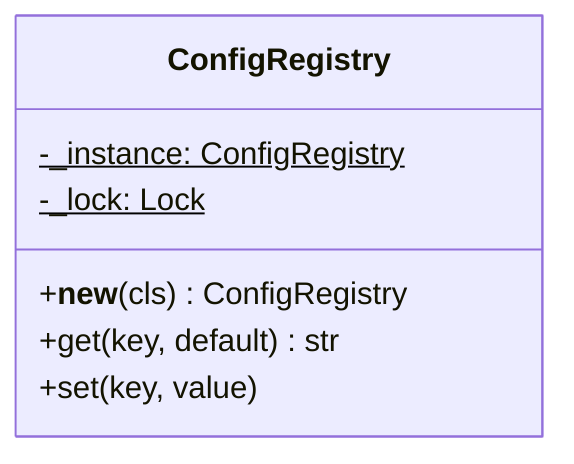

**Classic Python implementation.** Overriding `__new__` makes every `ConfigRegistry()` call return the same object. *Double-checked locking* (check, lock, check again) stops two threads from both seeing `None` and both creating an instance. That bug is a **race condition**: a bug whose outcome depends on the timing of threads.

```python
class ConfigRegistry:
    """Classic GoF singleton: every ``ConfigRegistry()`` call returns the same object.

    Double-checked locking keeps two threads from both creating an instance.
    Shown for completeness; prefer the module-level alternatives below.
    """

    _instance: ConfigRegistry | None = None
    _lock = threading.Lock()
    _settings: dict[str, str]

    def __new__(cls) -> ConfigRegistry:
        if cls._instance is None:
            with cls._lock:
                if cls._instance is None:
                    instance = super().__new__(cls)
                    instance._settings = {}
                    cls._instance = instance
        return cls._instance
```

The test `test_thread_safe_creation` starts eight threads behind a `threading.Barrier`, so they all call the constructor at the same moment, and checks that exactly one instance comes out.

**Why it is often an anti-pattern.** Singleton is the most criticised pattern in the GoF book, for good reasons:

- **It is global state in disguise.** Any code anywhere can read and change it, so you cannot understand a function from its parameters.
- **It hides dependencies.** A class that calls `ConfigRegistry()` internally does not declare that it needs configuration.
- **It makes tests interfere with each other.** State left by one test leaks into the next. Notice the `_reset_for_tests` classmethod the example needs: a smell in itself.
- **It assumes "one" forever.** "There is only one parking lot" lasts until the company buys a second garage; "one database" lasts until you add a read replica.
- **It couples lifetime to access.** "There should be one" is a decision about how the program is wired, and it belongs in the *composition root* (the `main()` that builds everything), not inside the class.

**The Pythonic alternatives.** A Python module is imported once and cached in `sys.modules`, so a module-level object is already shared by every importer, with no special class:

```python
# Pythonic alternative 1: a module is imported once, so a module-level object
# is already shared by every importer.
settings = Settings()


# Pythonic alternative 2: a cached accessor creates the object lazily, once.
@cache
def get_settings() -> Settings:
    return Settings()
```

`Settings` is an ordinary class, so tests can still create a fresh one. Better still, create one instance in `main()` and *pass it in* to the objects that need it (dependency injection). You get "only one" without any class enforcing it.

**In real software.** `None`, `True`, `False` and `Ellipsis` are true singletons in Python. `logging.getLogger(name)` returns one shared logger per name. Java's `Runtime.getRuntime()` is a singleton. Spring beans are *singleton-scoped* by default, but the container creates and injects them, which keeps the "one instance" benefit while avoiding the hidden-dependency problem. That is the industrial answer: one instance, managed and injected, not grabbed from a global.

**When not to use it.** Most of the time. A stronger design statement than "`ParkingLot` is a singleton" is "there is one per process in this deployment, so `main()` creates one and passes it around; nothing in the class needs to enforce that."

**In this series.** None of the case studies uses Singleton. The systems that look like natural singletons (a [parking lot](../02-case-studies/01-parking-lot/README.md), an [elevator bank](../02-case-studies/05-elevator-system/README.md)) are ordinary classes created once and passed around. Where shared state really is the issue, such as seat inventory in [movie ticket booking](../02-case-studies/02-movie-ticket-booking/README.md), the hard problem is concurrent access (locks and seat holds), not the number of instances.

---

## 7. Reference: structural patterns

Structural patterns are about **how objects are wired together**: wrapping one object in another, giving a group the same interface as an individual, or putting a simpler face on a complicated subsystem.

### 7.1 Adapter

**The problem.** Our checkout code expects a `PaymentProcessor` with `charge(amount: Decimal, card_token) -> transaction_id` that raises an exception on failure. The bank we just signed with provides an SDK whose method is `make_payment(amount_cents: int, token, currency)` and which returns a dictionary with a `"status"` field instead of raising. We cannot change the SDK, and we do not want its quirks leaking through our code.

**Built from.** Composition (the adapter holds the foreign object), a `Protocol` (our code defines the interface it wants) and Dependency Inversion (our code depends on *its own* abstraction, and the adapter makes the outside world conform to it). It is the Interface Segregation Principle's friend too: you adapt only the methods you actually need.

**The pattern.** Adapter converts the interface of a class into another interface clients expect. Like a travel plug adapter, it does not add features; it translates.

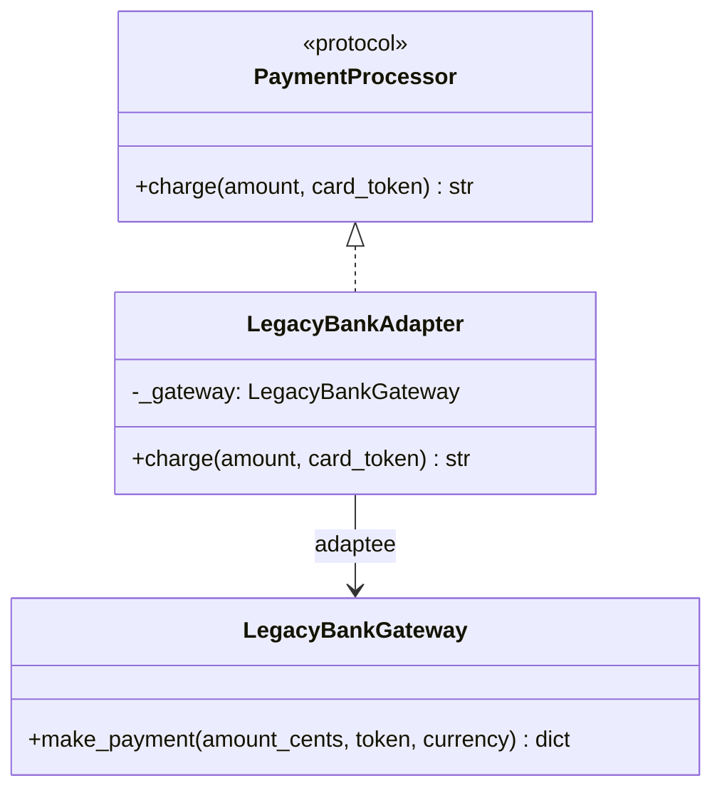

**Python implementation.** The adapter translates three things: units (dollars to cents, with explicit rounding), return values (dictionary to transaction id) and error style (status codes to exceptions):

```python
class LegacyBankAdapter:
    """Wraps the gateway and translates units, return values and errors."""

    def __init__(self, gateway: LegacyBankGateway) -> None:
        self._gateway = gateway

    def charge(self, amount: Decimal, card_token: str) -> str:
        cents = int((amount * 100).to_integral_value(rounding=ROUND_HALF_UP))
        response = self._gateway.make_payment(cents, card_token)
        if response["status"] != "OK":
            raise PaymentError(response.get("reason", "declined"))
        return response["ref"]
```

This is an **object adapter** (it holds the adaptee). The GoF also describe a **class adapter** that inherits from the adaptee; in Python, composition is almost always preferred, because inheriting would expose every SDK method too.

**The Pythonic shortcut.** Thanks to duck typing the adapter does not inherit from `PaymentProcessor`; it just has a matching `charge` method, and the `Protocol` lets a type checker confirm the fit. For a one-method interface, a small function can adapt, though you will usually still want the error translation.

**In real software.**

- **Payment provider adapters.** Companies that accept payments through several providers (Stripe, Adyen, PayPal, a local bank) write one adapter per provider behind their own `PaymentGateway` interface. The translations are exactly the ones above: Stripe, for example, takes amounts as integers in the smallest currency unit (cents for USD), other providers differ, and every provider reports declines in its own format. The adapter layer is what lets a business add a second provider for redundancy, or route by region, without touching checkout.
- **Python's DB-API (PEP 249)** is a common interface that each database driver adapts its native client to; `sqlite3.register_adapter` even uses the word, letting you adapt your own Python types into values SQLite can store.
- **`contextlib.contextmanager`** adapts a generator function into an object that speaks the context-manager protocol (`__enter__` and `__exit__`).
- **`requests`** sends every request through a *transport adapter*; the default `HTTPAdapter` adapts requests' interface to `urllib3`, and `session.mount(prefix, adapter)` lets you plug in a different one per URL prefix.
- Java's `InputStreamReader` adapts a byte stream into a character `Reader`. ATMs speak ISO 8583 messages to card networks, and the code that turns an internal "withdraw" request into that format is an adapter.

**When not to use it.** If you control both sides, change one of them instead of adding a translation layer. And if your "adapter" starts adding behaviour such as caching or retries, it has become a Decorator or a Proxy; name it accordingly.

**In this series.** The [unix file search](../02-case-studies/03-unix-file-search/README.md) uses an adapter (`DiskNode`) to present real files on disk through the same interface as its in-memory tree. [Restaurant management](../02-case-studies/11-restaurant-management/README.md) adds an adapter per delivery platform to translate incoming orders, and [tic-tac-toe](../02-case-studies/07-tic-tac-toe/README.md) adapts typed console input into moves.

### 7.2 Facade

**The problem.** Letting a car into a garage involves a spot allocator, a ticket office and a tariff engine. Entry kiosks, exit kiosks, a mobile app and an admin console all need to "park a car" and "let a car out". If each coordinates the three subsystems itself, the coordination logic is duplicated four times and the subsystems can never be refactored.

**Built from.** Composition (the facade owns or holds the subsystems), encapsulation (the coordination lives in one place) and the Law of Demeter from [OOP Fundamentals](01-oop-fundamentals.md) (clients talk to one friend instead of reaching through it).

**The pattern.** Facade provides one simplified interface to a set of interfaces in a subsystem. It does not forbid direct access for clients who need it; it gives the common cases a single front door.

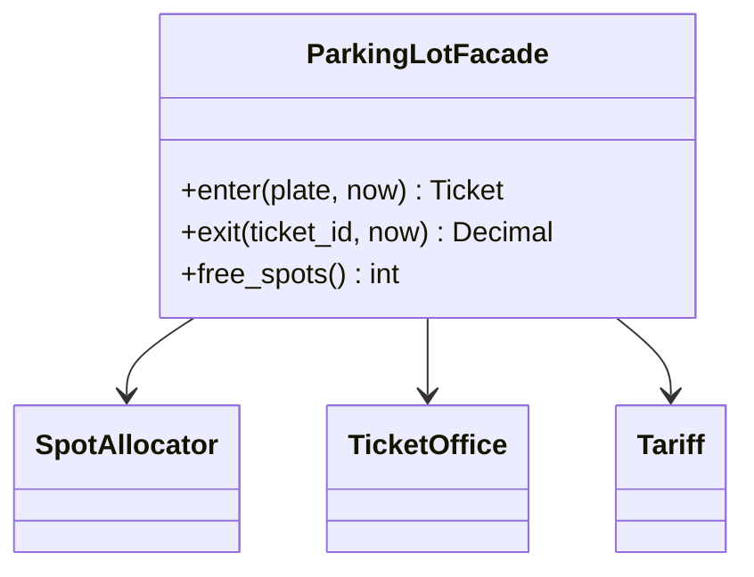

**Python implementation:**

```python
class ParkingLotFacade:
    """Two methods hide three collaborating subsystems from the entry/exit kiosks."""

    def __init__(self, spots: list[str], rate_per_hour: Decimal) -> None:
        self._spots = SpotAllocator(spots)
        self._tickets = TicketOffice()
        self._tariff = Tariff(rate_per_hour)

    def enter(self, plate: str, now: int) -> Ticket:
        spot = self._spots.allocate()
        return self._tickets.issue(plate, spot, now)

    def exit(self, ticket_id: int, now: int) -> Decimal:
        ticket = self._tickets.close(ticket_id)
        self._spots.release(ticket.spot)
        return self._tariff.fee(now - ticket.entered_at)
```

In system design the facade is often the class named after the whole system (`ParkingLot`, `VendingMachine`, `ATM`): the object the outside world talks to. Its public methods tend to map one-to-one onto the use cases, which makes it a handy checklist.

**In real software.** `requests.get(url)` is a famously friendly facade over connection pooling, redirects, encodings and `urllib3`. `subprocess.run()` is a facade over `Popen`, pipes and waiting. `shutil.copytree` hides many `os` calls. Cloud SDKs often provide both a low-level client that mirrors every API call and a higher-level, friendlier layer on top. A compiler's single `compile()` entry point hides the lexer, parser, optimiser and code generator.

**When not to use it.** A facade that grows a method for every subsystem operation becomes a **god class**, the anti-pattern from [OOP Fundamentals](01-oop-fundamentals.md). Keep it to the common workflows, keep it thin (it coordinates; it does not decide), and let advanced clients use the subsystems directly.

**In this series.** Almost every case study exposes its system through a facade: `ParkingLot` in the [parking lot](../02-case-studies/01-parking-lot/README.md), `BookingService` in [movie ticket booking](../02-case-studies/02-movie-ticket-booking/README.md), `VendingMachine` in the [vending machine](../02-case-studies/04-vending-machine/README.md), `ElevatorSystem` in the [elevator system](../02-case-studies/05-elevator-system/README.md), `GroceryStore` in the [grocery store](../02-case-studies/06-grocery-store/README.md), `LockerService` in the [shipping locker](../02-case-studies/09-shipping-locker/README.md), the `ATM` in the [ATM](../02-case-studies/10-atm/README.md) and `Restaurant` in [restaurant management](../02-case-studies/11-restaurant-management/README.md).

### 7.3 Decorator

**The problem.** A grocery receipt line for two bottles of olive oil might get "10% off this week" and then "$1 off with the loyalty coupon". Next week it might be only the coupon, or a different pair of discounts. A subclass per combination (`OliveOilWithTenPercentAndCoupon`) explodes combinatorially, and a pile of flags on `Product` turns it into a god class.

**Built from.** Composition *and* inheritance at the same time: a decorator *is a* `LineItem` (so it can stand anywhere a line item can, which is the Liskov Substitution Principle at work) and *has a* `LineItem` (which it wraps and delegates to). Adding a new kind of decoration is a new class, with no edits (Open/Closed).

**The pattern.** Decorator attaches extra responsibilities to an object *dynamically* by wrapping it in another object with the same interface. Because the wrapper looks exactly like what it wraps, wrappers stack in any order and any number.

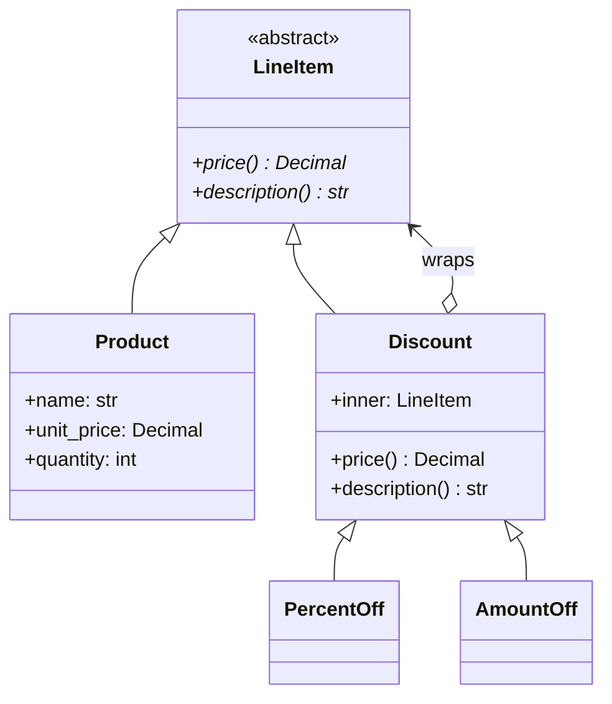

The arrow from `Discount` back to `LineItem` is the signature of the pattern: inherit from the interface *and* hold one.

**Python implementation:**

```python
class Discount(LineItem):
    """Base decorator: same interface as what it wraps, delegates by default."""

    def __init__(self, inner: LineItem) -> None:
        self.inner = inner

    def price(self) -> Decimal:
        return self.inner.price()

    def description(self) -> str:
        return self.inner.description()


class PercentOff(Discount):
    def __init__(self, inner: LineItem, percent: Decimal) -> None:
        super().__init__(inner)
        self.percent = percent

    def price(self) -> Decimal:
        return money(self.inner.price() * (100 - self.percent) / 100)

    def description(self) -> str:
        return f"{self.inner.description()} [-{self.percent}%]"
```

Stacking is just nesting:

```python
item = AmountOff(PercentOff(Product("olive oil", Decimal("12.50"), 2), Decimal("10")), Decimal("1"))
print(" ", item.description(), "=>", item.price())
```

```text
  2 x olive oil [-10%] [-$1] => 21.50
```

Order matters, and that is a business rule, not a coding accident: 50% off then $2 off a $10 item gives $3, while $2 off then 50% off gives $4 (`test_order_of_decoration_matters`). Real stores define a stacking order for promotions for exactly this reason. `money()` rounds with `Decimal` and `ROUND_HALF_UP`; never use floats for money.

**Python's `@decorator` syntax.** Python has a language feature with the same name and the same spirit, applied to *functions*: a decorator is a function that takes a function and returns a wrapped one with the same call signature.

```python
def retry(times: int, exceptions: tuple[type[Exception], ...] = (Exception,)) -> Callable[
    [Callable[P, R]], Callable[P, R]
]:
    """Wrap a function so transient failures are retried up to ``times`` attempts."""

    def decorator(func: Callable[P, R]) -> Callable[P, R]:
        @functools.wraps(func)
        def wrapper(*args: P.args, **kwargs: P.kwargs) -> R:
            for attempt in range(1, times + 1):
                try:
                    return func(*args, **kwargs)
                except exceptions:
                    if attempt == times:
                        raise
            raise AssertionError("unreachable")

        return wrapper

    return decorator
```

`functools.wraps` copies the wrapped function's name, docstring and other metadata onto the wrapper so that debugging, logging and introspection still show the original name. `ParamSpec` tells type checkers that the wrapper accepts exactly the same arguments as the original. Note that `retry` only catches the exceptions you list; retrying a `KeyError` caused by a bug would just repeat the bug (`test_retry_gives_up_and_ignores_other_errors`).

**In real software.**

- **The `functools` and `contextlib` toolbox.** `functools.lru_cache` and `functools.cache` wrap a function with memoisation; `functools.wraps` exists so that decorators behave well; `contextlib.contextmanager` is itself used as a decorator; and `contextlib.ContextDecorator` lets one object work both as a `with` block and as a function decorator. `@property`, `@staticmethod` and `@classmethod` are decorators built into the language.
- **Web frameworks.** Flask's `@app.route` and Django's `@login_required` and `@cache_page` wrap view functions. WSGI middleware wraps a whole application in another callable with the same signature.
- **I/O stacks.** Java's `new BufferedReader(new InputStreamReader(new FileInputStream(path)))` is the textbook object decorator chain. Python's `io` stack is similar: `open()` in text mode returns a `TextIOWrapper` around a `BufferedReader` around a raw `FileIO`.
- **Retry and resilience libraries** wrap calls to remote services with retries, timeouts and circuit breakers, exactly like `retry` above.

**When not to use it.** Long chains of wrappers are hard to debug ("which layer changed this value?"), and code that checks `isinstance(item, Product)` breaks when the product is wrapped. If you need to remove a decoration from the middle later, pick "the best of" several discounts, or forbid certain combinations, a list of rule objects applied by one policy engine is clearer than nested wrappers.

**In this series.** The [parking lot](../02-case-studies/01-parking-lot/README.md) recommends `PeakHourSurcharge`, a decorator that wraps any pricing strategy. The [grocery store](../02-case-studies/06-grocery-store/README.md) and [restaurant management](../02-case-studies/11-restaurant-management/README.md) case studies both compare a decorator design (stacked discounts, menu modifiers) and choose something else, for the reasons just listed. Reading those three side by side is a good lesson in when Decorator fits.

### 7.4 Proxy

**The problem.** A price lookup goes to a slow remote service. The checkout asks for the price of milk dozens of times per shift. You want to cache answers without changing either the checkout or the service, and without the checkout knowing a cache exists.

**Built from.** Composition (the proxy holds the real object) and encapsulation (same interface, with access to the real object controlled behind it).

**The pattern.** A Proxy is a stand-in that has the same interface as the real object and controls access to it. Common kinds: a *virtual proxy* delays creating or loading an expensive object until it is needed; a *caching proxy* remembers answers; a *protection proxy* checks permissions; a *remote proxy* makes an object in another process look local.

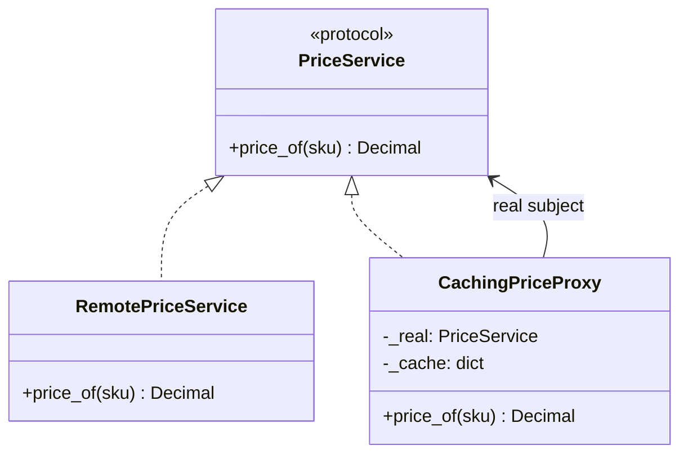

**Python implementation:**

```python
class CachingPriceProxy:
    """Same interface as the real service; controls *access* to it (here: caching)."""

    def __init__(self, real: PriceService) -> None:
        self._real = real
        self._cache: dict[str, Decimal] = {}

    def price_of(self, sku: str) -> Decimal:
        if sku not in self._cache:
            self._cache[sku] = self._real.price_of(sku)
        return self._cache[sku]
```

Structurally this is a decorator. The difference is intent: a proxy does not change *what* the answer is, only *how and when* the real object is reached (section 8.2).

**The Pythonic shortcut.** For a pure function, `functools.cache` is a caching proxy in one line. For objects, `__getattr__` can forward every attribute you do not define to the real object, which is how generic proxies are written.

**In real software.**

- **Django's `SimpleLazyObject`** wraps `request.user`, so the user is loaded from the database only when code first touches it: a virtual proxy.
- **ORM lazy loading.** SQLAlchemy and Django load related objects (`order.customer`) only when accessed.
- **Spring AOP.** When you mark a Spring bean method `@Transactional`, callers actually receive a proxy (a JDK dynamic proxy or a CGLIB subclass) that begins a transaction, calls the real method, and commits or rolls back.
- **Remote proxies.** gRPC generates client stubs that make a remote service look like a local object, and `multiprocessing.managers` hands out proxies to objects living in another process.
- `weakref.proxy` refers to an object without keeping it alive, and `unittest.mock.Mock` is a stand-in that records calls.

**When not to use it.** A proxy hides cost: a harmless-looking attribute access might be a database query (the classic "N+1 queries" problem with lazy loading). And a cache needs an invalidation rule; this one never forgets a price, which is fine for a demo and wrong for a store that changes prices daily.

**In this series.** None of the case studies needs a Proxy in its core design; it appears here mainly so that you can tell it apart from Decorator and Adapter.

### 7.5 Composite

**The problem.** A file search tool needs the total size of a directory. A directory contains files and other directories, which contain files and other directories. Client code full of `if isinstance(node, Directory): recurse ... else: ...` repeats the tree-walking logic everywhere.

**Built from.** Polymorphism (files and directories answer the same methods), aggregation (a directory holds children) and recursion (a directory answers by asking its children).

**The pattern.** Composite arranges objects into trees and lets clients treat individual objects (**leaves**) and groups (**composites**) uniformly through one **component** interface. A composite implements each operation by delegating to its children and combining the results.

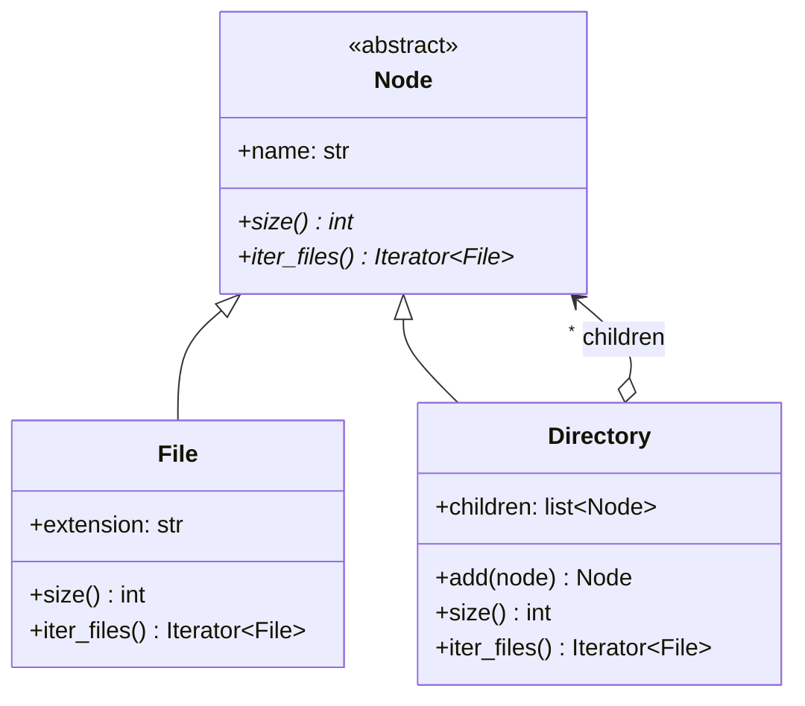

**Python implementation:**

```python
class Directory(Node):
    def __init__(self, name: str, children: list[Node] | None = None) -> None:
        super().__init__(name)
        self.children: list[Node] = list(children or [])

    def add(self, node: Node) -> Node:
        self.children.append(node)
        return node

    def size(self) -> int:
        # The composite does not care whether a child is a file or another directory.
        return sum(child.size() for child in self.children)

    def iter_files(self) -> Iterator[File]:
        for child in self.children:
            yield from child.iter_files()
```

`iter_files` combines Composite with Iterator: a `File` yields itself, a `Directory` yields from each child, and recursion does the rest.

There is a classic design tension: should `add()` live on the component, so clients never need to know whether a node is a leaf ("transparency"), or only on the composite, so nobody can add children to a file ("safety")? The GoF discuss both; the example chooses safety, as most modern code does.

**In real software.** User interfaces are the best-known composites. The browser **DOM** is a tree in which every element may contain elements. **React** UIs are trees of components that render other components, and rendering recurses down the tree; **Flutter** builds everything from a widget tree; **SwiftUI** views contain views. Java AWT and Swing make `Container` a kind of `Component`. Game engines such as Unity arrange game objects in a parent-child hierarchy where moving a parent moves its children. Beyond UIs: matplotlib figures contain axes that contain lines and text, all of them "artists"; Python's `ast` module represents programs as trees of nodes; XML documents in `xml.etree.ElementTree`; organisation charts, bills of materials, nested menus, and retail "bundles" made of other products.

**When not to use it.** If the hierarchy is fixed and shallow (a store always has aisles, aisles always have shelves), separate concrete classes are clearer than a uniform interface. Composite also makes it hard to restrict what may contain what, so enforce such rules explicitly. Very deep trees can hit Python's recursion limit; production traversals often use an explicit stack.

**In this series.** The [unix file search](../02-case-studies/03-unix-file-search/README.md) models files, directories and symlinks as a composite. The [grocery store](../02-case-studies/06-grocery-store/README.md) builds promotion eligibility rules as a composite (`AllOf`, `AnyOf`, `Not`), which leads to the next pattern.

### 7.6 Specification (filters you can combine)

**The problem.** A file search lets users ask for "Python files bigger than 1 KB that are not in the legacy folder" or "Markdown *or* text files". A method per combination (`find_big_python_files_not_legacy`) is hopeless, and a single `find(ext=None, min_size=None, exclude_name=None, ...)` grows a parameter per criterion and still cannot express "or".

**Built from.** Polymorphism (every rule answers one question), operator overloading through dunder methods (`__and__`, `__or__`, `__invert__`, from the polymorphism section of [OOP Fundamentals](01-oop-fundamentals.md)) and Composite (combined rules are trees of rules).

**The pattern.** Specification, described by Eric Evans and Martin Fowler, represents a business rule as an object with one question, `is_satisfied_by(candidate) -> bool`. Specifications combine with **and**, **or** and **not** into new specifications.

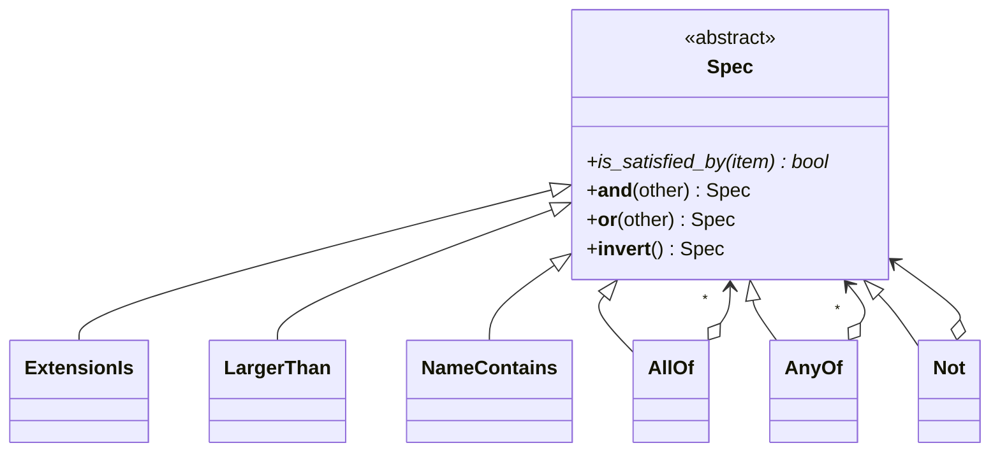

**Python implementation.** Overloading `&`, `|` and `~` gives a small, readable query language:

```python
class Spec(ABC):
    """A business rule as an object, combinable with &, | and ~."""

    @abstractmethod
    def is_satisfied_by(self, item: File) -> bool: ...

    def __and__(self, other: Spec) -> Spec:
        return AllOf(self, other)

    def __or__(self, other: Spec) -> Spec:
        return AnyOf(self, other)

    def __invert__(self) -> Spec:
        return Not(self)
```

```python
big_python = ExtensionIs("py") & LargerThan(1_000) & ~NameContains("old")
print("  big python files (not legacy):", search(tree, big_python))
```

On the sample tree this prints `['app.py']`. A new criterion (`ModifiedAfter(date)`, `OwnedBy(user)`) is one small class, and it immediately combines with all the others.

**The Pythonic shortcut.** A specification is a predicate, so plain functions plus two helpers go a long way:

```python
def all_of(*predicates: Predicate) -> Predicate:
    return lambda item: all(p(item) for p in predicates)


def any_of(*predicates: Predicate) -> Predicate:
    return lambda item: any(p(item) for p in predicates)
```

The class version wins when specifications must be *inspected*, for example translated into SQL or into the flags of a faster tool, because a lambda is opaque while `LargerThan(1000)` knows its own threshold.

**In real software.** Django's `Q` objects support `&`, `|` and `~` and are translated into SQL `WHERE` clauses; SQLAlchemy's `and_()`, `or_()` and `not_()` build expression trees the same way. The command-line `find` tool evaluates exactly such an expression (`-name '*.py' -a -size +1k -a ! -path '*legacy*'`). In Python's `logging`, filters attached to loggers and handlers are small rule objects with a `filter(record)` method, and a record must pass all of them. E-commerce promotion engines describe eligibility ("member AND basket over $50") as composable rules.

**When not to use it.** For one or two fixed filters, an `if` in a list comprehension is clearer. Specifications evaluated one item at a time in Python are also slow for large data; in production you translate them into an index query or SQL rather than scanning everything.

**In this series.** The [unix file search](../02-case-studies/03-unix-file-search/README.md) uses composable predicates over its composite file tree, and the [grocery store](../02-case-studies/06-grocery-store/README.md) uses composable eligibility criteria for promotions.

---

## 8. Commonly confused patterns

Several patterns have nearly identical class diagrams. What separates them is **intent**: the problem they solve and who controls the moving part.

### 8.1 Strategy vs State

Both have a context holding a reference to an interface with several implementations.

| | Strategy | State |
|---|---|---|
| Who chooses the implementation? | The **client**, from outside | The **states themselves**, through transitions |
| Do implementations know about each other? | No; strategies are independent | Yes; a state decides which state comes next |
| How often does it change? | Rarely; often fixed at construction | Constantly, as events arrive |
| Question it answers | "*How* should this be done?" | "*What* can be done right now, and what happens next?" |
| Example | Pricing scheme for a garage | Vending machine idle / has money / sold out |

The [elevator system](../02-case-studies/05-elevator-system/README.md) has both, which makes the difference concrete: the *dispatch strategy* (which car answers a hall call) is chosen by the building operator, while the *car state* (idle, moving, doors open) changes by itself as the car moves.

### 8.2 Decorator vs Proxy vs Adapter

All three wrap another object and forward calls to it.

| | Decorator | Proxy | Adapter |
|---|---|---|---|
| Interface vs wrapped object | **Same** | **Same** | **Different** |
| Purpose | **Add** behaviour | **Control access** (lazy load, cache, permissions, remote call) | **Translate** one interface into another |
| Who creates the wrapper? | Client code, often stacking several | Usually the system or framework, invisibly | Integration code at a boundary |
| Stacking | Designed to stack | Usually one | Usually one |
| Example | `PercentOff(AmountOff(product))` | `CachingPriceProxy(remote_service)` | `LegacyBankAdapter(gateway)` |

Facade is sometimes added to this comparison: a facade wraps *many* objects and offers a *new, simpler* interface, while these three wrap *one*.

### 8.3 Simple Factory vs Factory Method vs Abstract Factory

| | Simple Factory | Factory Method | Abstract Factory |
|---|---|---|---|
| Shape | One function with a lookup | An overridable method in a class that also uses the product | An object with several creation methods |
| How do you vary what is created? | Pass a different key | Subclass the creator | Pass a different factory object |
| Creates | One product | One product | A **family** of related products |
| Mechanism | Lookup or conditional | Inheritance | Composition |
| Example | `create_locker(LockerSize.MEDIUM, ...)` | `SmsPickupNotifier().create_channel()` | `SimulatedHardware()` making lock and screen |

A memorable summary: Factory Method is *a method*; Abstract Factory is *an object* whose methods are often factory methods. In Python, a simple factory with a registry covers most real needs.

### 8.4 Template Method vs Strategy

Both let you vary one step of an algorithm.

| | Template Method | Strategy |
|---|---|---|
| Mechanism | **Inheritance**: a subclass overrides a step | **Composition**: the context holds a step object |
| When is the variant chosen? | When you pick the class (fixed for the object's life) | At construction, and swappable at runtime |
| Granularity | Can vary several related steps plus optional hooks | One strategy per varying concern |
| Combining variants | One subclass per combination | Mix and match independent strategies |
| Example | `Dealer.should_hit` overrides a step of `play_turn` | `ParkingCheckout(HourlyPricing(...))` |

"Favour composition" points toward Strategy, and in application code that is usually right. Template Method fits frameworks, where the framework owns a fixed sequence of closely related steps and you fill in the blanks (`unittest.TestCase`, `logging.Handler`, `collections.abc.Sequence`).

### 8.5 Observer vs Chain of Responsibility vs Command

These three all involve "sending" something:

- **Observer**: one event, *every* subscriber receives it.
- **Chain of Responsibility**: one request, handlers are tried *in order* until it is handled.
- **Command**: one request *object*, executed by whoever holds it, possibly later or elsewhere.

Python's `logging` contains all three ideas in one module: a logger hands each record to *all* its handlers (Observer), records propagate *up* the logger hierarchy (Chain), and each `LogRecord` is a self-contained object that a `QueueHandler` can ship to another thread for processing later (Command-like).

---

## 9. The pattern chooser

Patterns are answers to symptoms. When you see the symptom on the left, in your own code or in a new requirement, consider the pattern on the right.

| Symptom you notice | Pattern to consider | Why it fits |
|---|---|---|
| A growing `if/elif` on a *mode* or *type* string to pick an algorithm | **Strategy** | Each branch becomes a class (or function) behind one interface |
| An object behaves differently depending on its *status*, and every method checks the status | **State** (or a transition table) | Each status becomes a class; transitions live with it |
| "When X happens, notify A, B and C (and maybe D next month)" | **Observer** | The subject does not need to know its listeners |
| `if kind == ...: SomeClass()` repeated wherever objects are created | **Simple Factory** / registry | The creation decision lives in one place |
| "Queue it", "undo it", "log it", "retry it", "run it later" | **Command** | The request becomes a storable object |
| Several classes run the *same steps in the same order* with one step different | **Template Method** (or Strategy for that step) | The skeleton is written once |
| A request may be handled by one of several handlers, or partly by each, in order | **Chain of Responsibility** | Handlers can be added or reordered |
| Callers need to walk a collection without knowing its structure, or in a special order | **Iterator** (a generator in Python) | Traversal logic lives in one place |
| A shared workflow needs subclasses to choose which object to create | **Factory Method** | Creation is the deferred step |
| Groups of objects must match each other (vendor parts, UI themes, database backends) | **Abstract Factory** | One choice selects a whole family |
| A constructor has many optional parameters, or an object is built up in steps | **Builder** (or a keyword-only dataclass) | Readable construction, validated once |
| "There must be exactly one of these" | **Create once and inject**; rarely **Singleton** | One instance without global coupling |
| A third-party class does the right thing behind the wrong interface | **Adapter** | Translate, don't rewrite |
| Clients must coordinate many subsystem objects to do one common thing | **Facade** | One front door for common workflows |
| Optional extra behaviour combines freely (discounts, logging, caching, retries) | **Decorator** | Stackable wrappers instead of a subclass explosion |
| Access to an object should be delayed, cached, checked or remote | **Proxy** | A stand-in with the same interface |
| A part-whole hierarchy where one item and a group should be treated the same | **Composite** | Recursive structure, uniform interface |
| Filters or rules that users combine with and / or / not | **Specification** | Rules as composable objects |

A rule of thumb that experienced designers repeat: **don't start with patterns, arrive at them.** Write the simplest design for today's requirements, let a real change (or a "now add X" question) reveal the axis that varies, and then introduce the pattern that absorbs it. That is exactly the order of events in section 1.

---

## 10. Patterns across the case studies

This table lists what each case study in the series actually does. "Compared" means the case study shows the pattern as an alternative and explains why it chose something else, which is as instructive as using it.

| Case study | Patterns used in the recommended design | Patterns compared as alternatives |
|---|---|---|
| [Parking lot](../02-case-studies/01-parking-lot/README.md) | Strategy (pricing), Decorator (peak surcharge), Facade (`ParkingLot`) | |
| [Movie ticket booking](../02-case-studies/02-movie-ticket-booking/README.md) | Strategy (pricing, refunds), Facade (`BookingService`) | Observer (waitlist extension) |
| [Unix file search](../02-case-studies/03-unix-file-search/README.md) | Composite (file tree), Specification (predicates), Iterator (lazy generator search), Adapter (`DiskNode`), Builder (query fields) | |
| [Vending machine](../02-case-studies/04-vending-machine/README.md) | State, Strategy (payment methods), Observer (telemetry), Facade | |
| [Elevator system](../02-case-studies/05-elevator-system/README.md) | Strategy (dispatch), Observer (event bus), Facade; enum + transition table for car states | State pattern |
| [Grocery store](../02-case-studies/06-grocery-store/README.md) | Composite / Specification (eligibility criteria), Strategy (rewards), Facade | Decorator (stacked discounts) |
| [Tic-tac-toe](../02-case-studies/07-tic-tac-toe/README.md) | Strategy (move choice, win checking), Adapter (console input) | State pattern, Command and Memento (for undo) |
| [Blackjack](../02-case-studies/08-blackjack/README.md) | Strategy (player and dealer decisions); transition table for round phases | Template Method |
| [Shipping locker](../02-case-studies/09-shipping-locker/README.md) | Strategy (fees, expiry, compartment assignment), Observer (notifications), Factory (`with_layout`), Facade | State pattern |
| [ATM](../02-case-studies/10-atm/README.md) | State (session), Command (transactions), Facade | Chain of Responsibility (cash dispensing) |
| [Restaurant management](../02-case-studies/11-restaurant-management/README.md) | Observer (kitchen routing), Strategy (table assignment, bill splitting), Facade | Command, State pattern, Decorator; Adapter for delivery platforms as an extension |

Two things stand out. Strategy appears in nearly every row, and Facade in most of them, which is why they are worth mastering first. And the *compared* column is full: good designers know the patterns well enough to turn them down.

---

## 11. Going deeper: patterns in production

### Patterns and concurrency

Patterns describe structure, not thread safety. Each one has a classic concurrency trap:

- **Singleton**: lazy creation is a race, shown above with double-checked locking. In Python, a module-level instance created at import time avoids it, because importing a module is protected by the import lock.
- **Observer**: one thread subscribes while another notifies. Copying the list before iterating avoids "list changed size during iteration" errors, but you still need a lock if subscriptions change often, and you must decide whether observers run on the notifying thread or are handed to a queue. Production event systems usually do the latter so a slow subscriber cannot stall the publisher.
- **State**: two events arriving at once (two coins, or a refund pressed while a product is vending) must be serialised. The usual fix is a lock around each public method of the context, or an event queue processed by one thread, which is how embedded controllers typically work.
- **Command**: commands in a queue are a natural unit of concurrency (a worker pool consumes them), but `undo` across concurrent commands needs ordering, which is why collaborative editors use more advanced techniques than a simple stack.
- **Chain of Responsibility**: the ATM's plan-then-commit is a tiny transaction. With concurrent withdrawals, planning and committing must happen under one lock, or two customers can be promised the same notes.
- **Proxy**: a caching proxy shared between threads needs its cache protected, and two threads missing the cache at once will both call the slow service (a *cache stampede*) unless you guard it.

### Patterns and testing

Most behavioral and creational patterns make code easier to test, because they create *seams*: places where a fake can be plugged in. Strategy and Abstract Factory let you inject a fake (`SimulatedHardware` instead of real solenoids). An injected `draw` function makes a card game deterministic. Observer lets a test subscribe a recorder and assert on what was emitted. Singleton is the exception: it makes testing harder, which is a large part of its bad reputation.

### Beyond the Gang of Four

The GoF catalogue is about objects inside one program. Other catalogues describe larger shapes, and you will meet their names in real codebases:

- **Unit of Work** (from Martin Fowler's *Patterns of Enterprise Application Architecture*): track every object loaded, created, changed or deleted during a business operation, then write all the changes to the database in one transaction. SQLAlchemy's `Session` is the canonical Python implementation: you add and modify objects, and `commit()` flushes the whole set of changes at once, in the right order. The same book describes the **Identity Map** (one in-memory object per database row, which the `Session` also maintains) and the **Repository** (a collection-like interface over storage).
- **Dependency injection containers**: Spring's `ApplicationContext` is a factory, a registry and a lifetime manager combined. It is why Spring applications rarely need hand-written Singletons or factories.
- **Reconcile loops**: the Kubernetes controller shape from section 4.2, now standard for anything that manages infrastructure.
- **Middleware pipelines**: Chain of Responsibility and Decorator fused into the standard architecture of web frameworks.

These are the same ideas at a bigger scale: encapsulate what varies, depend on abstractions, compose small pieces.

### Pattern overuse

The opposite failure is just as common: a design with an `AbstractVehicleFactoryProvider`, three Singletons and a Visitor for a problem that needed four classes. Every pattern adds indirection, and indirection is only worth it on an axis that actually changes. Signs you have overdone it:

- An interface with exactly one implementation and no plan for a second (apart from a test fake).
- A factory that only ever calls one constructor.
- A class name that lists patterns (`OrderStrategyFactoryBuilder`).
- You cannot say which future change the pattern makes easier.

The best answer to "why did you use X?" names the change it absorbs: "Pricing rules change seasonally and differ per garage, so pricing is a strategy; spot types change rarely, so they are an `Enum`."

---

## 12. Using patterns in a design interview

The next two posts, [What is an OOD interview?](03-what-is-an-ood-interview.md) and [The OOD interview framework](04-the-ood-interview-framework.md), cover interviews properly. For now, here is how patterns fit into one:

1. **Requirements first, pattern names later.** In the first minutes, listen for the axes of change: "different pricing for different lots", "the machine can go into maintenance mode", "customers get notified".
2. **Name the symptom, then the pattern.** "Pricing varies by garage and changes over time, so I'll put it behind a `PricingStrategy` interface."
3. **Draw the minimal structure.** Context, interface, two concrete classes. You do not need every GoF participant.
4. **Mention the Pythonic shortcut and the cost.** "It could be a plain function; I'll use a class because the receipt also needs a description. It's one more interface, worth it because there are already three schemes."
5. **Absorb the follow-up.** When the interviewer says "now add X", show that the change is a new class and no edits. That is the payoff moment.

Common mistakes: confusing Strategy with State; making everything a Singleton; using a subclass for every variation instead of composition; forgetting failure modes (what if no handler in the chain handles the request, or an observer throws?); naming a pattern but not actually using its structure; and using floats for money.

---

## Test yourself

<details>
<summary>1. A <code>Document</code> class has <code>publish()</code>, <code>edit()</code> and <code>archive()</code>, and each method starts with <code>if self.status == "draft": ... elif self.status == "review": ...</code>. Which pattern, and what would the classes be?</summary>

State. Create a `DocumentState` base class with `publish`, `edit` and `archive` (illegal by default) and concrete `DraftState`, `InReviewState`, `PublishedState` and `ArchivedState`. `Document` holds `self.state` and forwards each method to it; each state sets the next state. Adding a "scheduled" status becomes a new class rather than an edit to every method. If the states differ only in which transitions are legal, an enum plus a transition table is a lighter alternative.
</details>

<details>
<summary>2. Strategy and State have identical class diagrams. What actually distinguishes them?</summary>

Intent and control. In Strategy the client picks the algorithm from outside and strategies are independent of each other; it answers "how should this be done?". In State the state objects drive transitions among themselves as events arrive; it answers "what is allowed right now, and what happens next?".
</details>

<details>
<summary>3. Which ideas from OOP fundamentals does Strategy combine, and which one is responsible for "adding a pricing rule needs no edits to checkout"?</summary>

Composition (the checkout holds a pricing object), polymorphism (every pricing class answers `fee`), Dependency Inversion (the checkout depends on the abstract `PricingStrategy`) and the Open/Closed Principle. The "no edits" property is Open/Closed, and it is made possible by the other three: because the checkout only knows the abstraction and delegates to it, a new subclass plugs in without the checkout changing.
</details>

<details>
<summary>4. Your notification code calls each subscriber in a loop, and the email subscriber starts throwing because the mail server is down. What goes wrong, and what are the options?</summary>

With a plain loop, the exception stops the loop, so every subscriber after the email one silently misses the event. Options: catch and collect exceptions per subscriber (like `emit_robust`, or Django's `send_robust`), log them and carry on; or hand events to a queue so each subscriber runs independently and can retry. Keep the fail-fast behaviour only for subscribers whose failure *should* abort the operation, such as validation hooks.
</details>

<details>
<summary>5. Why is Singleton often called an anti-pattern, and what would you use in Python instead?</summary>

It is global mutable state disguised as a constructor: dependencies become hidden, tests interfere with each other, and the "only one" assumption is hard to undo when requirements change. In Python, use a module-level instance (modules are imported once) or a `functools.cache`d accessor, and better still create one instance in `main()` and pass it to whoever needs it. Spring's singleton-scoped beans show the industrial version: one instance, created and injected by a container.
</details>

<details>
<summary>6. Your grocery store needs "10% off", "$2 off" and "buy one get one" in any combination. Decorator or a list of rule objects? Give a reason for each.</summary>

Decorator if discounts attach to individual items and stack freely in a known order: wrappers compose and each new discount type is one class. A list of rule objects applied by a promotion engine if the store needs to pick "the best of" several offers, forbid certain combinations, or audit and reorder rules centrally, because nested wrappers have no natural place for those policies. The grocery store case study chooses the engine for exactly these reasons.
</details>

<details>
<summary>7. The interviewer says "add undo to the restaurant ordering system". Which pattern, and what is tricky about it?</summary>

Command: each order becomes an object with `execute()` and `undo()`, and the invoker keeps a history stack. The tricky part is side effects you cannot reverse: if the kitchen has already started cooking, "undo" is really a compensating action (cancel and record the waste), not a true reversal. Concurrency is also tricky: two waiters undoing on a shared history need an agreed order. A plain log of immutable events with one place that knows how to reverse each kind is often simpler than one class per command.
</details>

<details>
<summary>8. Decorator, Proxy and Adapter all wrap an object. How do you tell them apart?</summary>

Adapter changes the interface (it translates). Decorator keeps the interface and adds behaviour, and is designed to stack. Proxy keeps the interface and controls access to the real object (lazy loading, caching, permissions, remoting), usually without the client knowing it is there; Spring's `@Transactional` proxies and Django's `SimpleLazyObject` are examples.
</details>

<details>
<summary>9. What is the difference between an event-driven State pattern and a Kubernetes-style reconcile loop, and when would you prefer the second?</summary>

The State pattern is edge-triggered: each event moves the machine one step, so a lost or duplicated event leaves it in the wrong state. A reconcile loop is level-triggered: it repeatedly compares desired state with actual state and acts to close the gap, and it is idempotent, so running it again is harmless. Prefer reconciliation in distributed systems where messages can be lost, processes restart and the real world can drift (a server crashes on its own); prefer the State pattern for in-process objects whose events are reliable, like a vending machine's keypad.
</details>

<details>
<summary>10. A colleague writes <code>class FilterByExtensionAndSizeAndNotName</code>. What would you suggest, and how would the query look?</summary>

Specification: small rule classes (`ExtensionIs`, `LargerThan`, `NameContains`) plus `AllOf`, `AnyOf` and `Not` combinators, with operator overloading so the query reads `ExtensionIs("py") & LargerThan(1000) & ~NameContains("old")`. Each new criterion is one class that combines with all the others, and because the rules are inspectable objects they can later be translated into SQL, as Django's `Q` objects are.
</details>

<details>
<summary>11. You need to support locker hardware from two vendors plus a simulator, and each needs a lock driver, a screen driver and a barcode scanner that match. Which pattern? What becomes hard later?</summary>

Abstract Factory: a `HardwareFactory` interface with `create_lock`, `create_screen` and `create_scanner`, and one concrete factory per vendor plus a simulated one. Adding a new vendor is easy (one new factory). Adding a new *kind* of part, such as a camera, is hard: the interface and every concrete factory must change.
</details>

<details>
<summary>12. When would you choose Template Method over Strategy?</summary>

When a framework owns a fixed sequence of closely related steps that share base-class state and are customised together, and swapping at runtime is not needed: `unittest.TestCase` with `setUp`, the test and `tearDown`, or `logging.Handler` with `handle` calling your `emit`. If only one step varies, or several steps vary independently, prefer Strategy (composition), which avoids a subclass per combination.
</details>

---

## Key takeaways

- A design pattern is a named, reusable solution shape with known trade-offs. The idea comes from Christopher Alexander's architecture work and reached software through Beck and Cunningham and then the Gang of Four in 1994.
- Patterns are not new ingredients. Each one is a particular combination of what you learned in OOP fundamentals: composition, polymorphism, interfaces and SOLID. If you understand *why* the combination works, you can rebuild the pattern from the problem, as section 1 did with Strategy.
- Learn the core four first: **Strategy** (an algorithm that varies), **State** (behaviour that depends on status), **Observer** (notify many without knowing them) and **Factory** (decide which class to create in one place).
- Learn patterns as **symptom to pattern** pairs: `if/elif` on a mode means Strategy, behaviour by status means State, "notify many" means Observer, "undo / queue" means Command, "filters with and/or" means Specification.
- Python makes many patterns lighter: functions for one-method strategies and commands, generators for iterators, modules instead of Singletons, keyword arguments instead of most Builders, `@decorator` syntax built in. Know both forms and say when you would pick each.
- Patterns with identical diagrams differ in intent: Strategy vs State, Decorator vs Proxy vs Adapter, Template Method vs Strategy.
- Every pattern costs indirection. Introduce one only when you can name the change it absorbs.

## Further reading

- Erich Gamma, Richard Helm, Ralph Johnson, John Vlissides, *Design Patterns: Elements of Reusable Object-Oriented Software* (Addison-Wesley, 1994).
- Christopher Alexander et al., *A Pattern Language* (Oxford University Press, 1977).
- Eric Freeman and Elisabeth Robson, *Head First Design Patterns* (O'Reilly, 2nd edition 2020).
- Martin Fowler, *Patterns of Enterprise Application Architecture* (Addison-Wesley, 2002): Unit of Work, Identity Map, Repository.
- Refactoring Guru, design pattern catalogue: <https://refactoring.guru/design-patterns>
- Brandon Rhodes, *Python Design Patterns*: <https://python-patterns.guide/>
- Peter Norvig, *Design Patterns in Dynamic Languages* (1996): <https://norvig.com/design-patterns/>
- Martin Fowler and Eric Evans, *Specifications*: <https://martinfowler.com/apsupp/spec.pdf>
- Python documentation, `logging` (handlers, filters, formatters): <https://docs.python.org/3/library/logging.html>
- Python documentation, `functools`: <https://docs.python.org/3/library/functools.html> and `contextlib`: <https://docs.python.org/3/library/contextlib.html>
- Kubernetes documentation, Controllers: <https://kubernetes.io/docs/concepts/architecture/controller/>
- Series posts: [OOP Fundamentals](01-oop-fundamentals.md) (previous), [What is an OOD interview?](03-what-is-an-ood-interview.md) and [The OOD interview framework](04-the-ood-interview-framework.md) (next).
