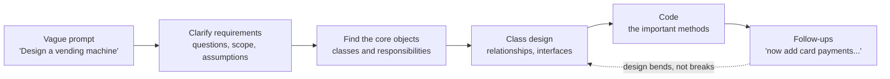

# What Is an Object-Oriented Design Interview? From Knowing OOD to Doing It Live

If you have read [OOP Fundamentals](01-oop-fundamentals.md) and [Design Patterns](02-design-patterns.md), you already know the ingredients: encapsulation, polymorphism, composition, SOLID, Strategy, State, Observer, Factory. This post is about something different: using those ingredients **in front of another engineer, against a clock, on a problem that keeps changing**. By the end you will know exactly what an object-oriented design (OOD) round is, how it differs from the other technical rounds, what interviewers write on their scorecards, how the same skills are judged at work in design reviews and code reviews, and how to practice so that the knowledge turns into performance.

## 1. Why knowing the patterns is not enough

Picture Maya. She is a solid engineer with three years of experience. Over the last month she read about the SOLID principles, worked through every pattern in a catalog, and could explain the difference between Strategy and State in her sleep. Her interview starts. The interviewer smiles and says:

> "Let's design a parking lot."

And that is all. No input format, no example, no expected output. Maya waits for more. None comes. She starts typing `class ParkingLot:` and then stops, because she does not know what a parking lot in this conversation needs to *do*. Does it charge money? Are there motorcycles? Multiple floors? She picks some answers silently, writes a `ParkingLot` class with twelve methods, and twenty minutes later the interviewer asks, "What if we want to charge more during peak hours?" Her fee calculation is an `if/elif` block buried in the middle of `exit_vehicle()`. She knows that this is exactly what the Strategy pattern is for. She just did not see it coming while she was writing.

Nothing Maya studied was wrong. What failed was the step from *recognizing* a good design to *producing* one under four conditions that study does not reproduce:

1. **The problem is vague on purpose.** Reading about patterns, you are always told what the problem is. In the interview, finding the problem is part of the job.
2. **Time is short.** You have roughly 45 minutes to scope, design, code and discuss. Every minute spent on the wrong thing is gone.
3. **Someone is watching and talking.** You have to think and explain at the same time, and respond to questions mid-thought.
4. **The requirements move.** The interviewer will add a requirement halfway through specifically to see whether your design bends or breaks.

An analogy: knowing grammar rules is not the same as holding a conversation in a foreign language. You can know every conjugation and still freeze when someone talks to you at normal speed. The fix is not more grammar. It is practice in conversation, with a structure that keeps you from freezing. This post explains the "conversation" you will be having; the next one, [The OOD Interview Framework](04-the-ood-interview-framework.md), gives you the structure.

## 2. What the round is, in plain terms

An **OOD interview** (also called a **low-level design** or **LLD** interview) asks you to take a short, deliberately open-ended description of a system and turn it into a set of well-designed classes, then implement the important parts in code. The question at its heart is simple: *can you structure a non-trivial program so that other engineers would be happy to maintain it?*

A typical round runs 45 to 60 minutes with one interviewer, and roughly follows this shape:



1. **You ask questions** to pin down what the system must do. For a vending machine: which products, coins only or cards too, does it give change, what happens when an item is sold out?
2. **You propose the main objects** (`VendingMachine`, `Product`, `Slot`, `Inventory`, a payment abstraction) and how they relate, often as a class diagram in a shared document or on a whiteboard.
3. **You write code**, anywhere from class skeletons with method signatures to a working, tested implementation, depending on the company and interviewer.
4. **The interviewer pushes on the design**: "We now accept mobile wallets. What changes?" or "What happens if the machine loses power mid-dispense?"

The loop back from step 4 to the design is the point of the whole exercise. A good design absorbs the follow-up with a small, local change. A weak one needs a rewrite.

### What you are expected to produce

The deliverable varies more than candidates expect:

- **A class diagram only.** The older, whiteboard-centered style: boxes, arrows, a few key method names.
- **A code skeleton.** Real class and method declarations with type hints, with the critical methods filled in and the rest described.
- **Working code.** Especially in remote interviews with a real editor, the interviewer may want a runnable program, sometimes with a couple of tests, and may actually run it.

Because the format changes how you should spend your time, one of the most valuable questions you can ask early is: *"Would you like a class diagram, a code skeleton, or something runnable?"* The framework post shows how to budget your 45 minutes around the answer.

### The names it goes by

| Name | Where you tend to hear it | What it emphasizes |
| --- | --- | --- |
| Object-oriented design (OOD) | Many US tech companies, interview prep books | Classes, relationships, patterns, some code |
| Low-level design (LLD) | Very common in India and in online prep communities | Same as OOD; "low-level" contrasts with "high-level" (system) design |
| Machine coding round | Several Indian product companies (Flipkart is widely known for it) | A longer session producing a complete, runnable, modular program |
| Object modeling / domain modeling | Enterprise and consulting interviews | Mostly diagrams and responsibilities, light on code |
| "Practical coding" or "code design" | Varies by company | A realistic feature built in an editor, graded on structure and readability |

The labels differ; the core skill does not.

## 3. How it differs from the other technical rounds

Most hiring loops for software engineers contain some mix of algorithm coding, OOD, system design and, in some companies, machine coding. They overlap enough that candidates often bring the wrong mindset into the wrong room. Here they are side by side.

| | Algorithm coding | OOD / low-level design | Machine coding | System design |
| --- | --- | --- | --- | --- |
| Typical prompt | "Find the longest substring without repeating characters." | "Design a parking lot." | "Build a parking lot CLI that supports these six commands." | "Design a parking reservation service for a whole city." |
| Unit of design | One function | A set of classes inside one program | A complete small program, often several modules | Services, databases, caches and queues across many machines |
| One best answer? | Usually yes (an optimal complexity) | No; several designs can be good | No; but it must run and pass the stated cases | No; trade-offs dominate |
| What "good" means | Correct and asymptotically efficient | Clear responsibilities, extensible, readable, correct | Runs end to end, modular, readable, handles edge cases | Scalable, available, consistent enough, affordable |
| Main artifact | A function | Class diagram plus code | A runnable codebase | Box-and-arrow architecture |
| Duration | 30 to 60 minutes | 45 to 60 minutes | Often 90 minutes or more | 45 to 60 minutes |
| Interviewer's role | Watches, hints | Converses throughout, adds requirements | Often briefs you, leaves, then reviews and runs the result | Converses, probes bottlenecks |
| Typical follow-up | "Can you do it in O(n)?" | "Add a new vehicle type; what changes?" | "Now add a seventh command." | "What if traffic grows 10x?" |
| Concurrency shows up as | Rarely | Locks and thread safety within one process | Sometimes; usually single-threaded | Replication, partitions, distributed consistency |
| Classic failure | Not finding the algorithm | God class, no abstractions, or pattern overload | Not finishing; or finishing with one giant file | Hand-waving; ignoring bottlenecks |

Notice that one domain, a parking lot, fits four different rounds. What changes is the **zoom level** and **what is being judged**.

### OOD versus algorithm coding

If you have spent months on algorithm practice, four habits need to change.

**Quality over speed.** In an algorithm round, a terse solution is fine. In an OOD round, a slightly longer solution with good names and clean decomposition beats a clever one-liner. Names do a lot of explaining for you: `spot.can_fit(vehicle)` needs no comment; `chk(s, v)` needs a paragraph.

**Objects, not steps.** An algorithm solution is a sequence of steps in one function. OOD asks *who* does each step. "Find a free spot" is a responsibility: does it belong to the `ParkingLot`, a `Level`, or a separate `SpotAllocator`? That question does not exist in an algorithm round and is the heart of an OOD round. It is the single responsibility principle from [OOP Fundamentals](01-oop-fundamentals.md) applied live.

**Show the toolbox, with judgement.** In an algorithm round only the answer matters. In an OOD round the interviewer looks for evidence that you reach for encapsulation, polymorphism and patterns *when they help*, and can say why you did not reach for them elsewhere.

**Plan for change.** Nobody adds a requirement to "two sum". OOD problems are designed to change. The minutes you spend putting fee calculation behind an interface pay off the moment the interviewer says "now add peak-hour pricing".

### OOD versus system design

Both are "design", at different zoom levels. In system design you might draw a "Booking Service" box and discuss sharding its database, caching seat maps and putting a queue in front of checkout. In OOD you open that box and design the `Show`, `Seat`, `SeatHold` and `Booking` classes inside it, decide how a hold expires, and write the method that stops two customers from booking the same seat.

A useful mental model: **system design decides which programs exist and how they talk over the network; OOD decides how one of those programs is structured on the inside.** OOD trade-offs sound like "inheritance or composition?", "enum plus transition table or State pattern?", "should pricing be a method on `Ticket` or a strategy object?". System design trade-offs sound like "SQL or NoSQL?" and "strong or eventual consistency?".

A common mistake is to answer an OOD prompt with system design: drawing load balancers and Kafka topics when the interviewer wanted classes. The opposite also happens late in a round, when the interviewer asks you to "scale it up". That is your cue to briefly bridge the two worlds: how your in-memory classes map to database tables, where an in-process lock stops being enough, what would become a separate service. Every case study in this series has a section on exactly that bridge.

### OOD versus machine coding

Machine coding is OOD's longer, stricter cousin. You typically get a written problem statement with a list of commands or features, a fixed time box, and the expectation that at the end your program **runs**. Interviewers then read the code and often run it against their own inputs. Because there is less conversation, the code must speak for itself: separate modules for the domain model, the command parsing and the I/O; an easy place to add the next command; sensible errors for bad input.

The skills transfer directly. The differences are in emphasis: completeness matters more (an elegant design that handles three of six commands loses to a decent design that handles all six), and you have less chance to explain your reasoning, so naming and structure carry more weight.

## 4. Why companies run this round at all

Algorithm rounds tell a company whether you can reason about data structures and complexity. System design rounds tell it whether you can architect services that span machines. Neither directly answers the question that matters on most working days: **when this person builds a feature, will the code be easy for the rest of the team to read, test and change?**

Most production engineering is not inventing algorithms. It is modeling a business domain (orders, payments, shipments, reservations) in code, then changing that model every few weeks as the business changes. A food-delivery team might add scheduled orders, then group orders, then orders paid partly with a gift card, all in one year. If the original `Order` model put each concern in its own place, each change is a small addition. If it was a tangle of `if` statements, each change risks breaking something unrelated.

That is why companies such as Amazon, Bloomberg and Uber, among many others, have included OOD-style rounds in their loops. The round is a cheap proxy for day-to-day code quality, and it is also one of the main signals used for **leveling**: deciding whether to hire someone as a junior, mid-level or senior engineer. Section 7 looks at how expectations change by level.

## 5. What interviewers actually score

After the round, the interviewer fills in a scorecard, usually with a hire / no-hire recommendation plus written evidence for each area. The exact wording varies by company, but nearly every OOD scorecard covers the same six areas. Below, each area comes with what weak, solid and strong performance tends to look like, written in the vocabulary of the first two posts.

### 5.1 Requirements and product sense

Can you turn a vague prompt into a clear, scoped problem, using what you know about the real world?

| Level | What it looks like |
| --- | --- |
| Weak | Starts coding in the first minute. Invents requirements silently ("parking is free for the first hour") and the interviewer only finds out when reading the code. |
| Solid | Asks sensible clarifying questions about actors, use cases and rules. Writes down an agreed list of requirements before designing. |
| Strong | Brings real domain knowledge ("real garages often have reserved, compact and EV-charging spots; do we need those?"), separates must-haves from likely extensions, and states explicitly what is out of scope ("I'll leave online reservations out unless you want them"). |

### 5.2 Decomposition (systems thinking)

Can you split the problem into objects with clear responsibilities and clean collaborations?

| Level | What it looks like |
| --- | --- |
| Weak | One **god class** (`ParkingLotSystem` with every field and twenty methods), or the opposite: an **anemic domain model** where classes are bags of fields and one "manager" holds all the logic. |
| Solid | A reasonable set of classes, each with a purpose. Data mostly lives with the behavior that uses it. |
| Strong | Every class passes the single responsibility test. Relationships are chosen deliberately: "a `Level` *composes* its spots, they die with it; a `Ticket` merely *associates* with a `Vehicle`." Behavior sits with data ("tell, don't ask"): `spot.can_fit(vehicle)` instead of the lot reading three fields off the spot. |

### 5.3 Design judgement

Can you anticipate change and pick the right amount of abstraction, no more and no less?

| Level | What it looks like |
| --- | --- |
| Weak | Either hard-codes every rule into `if/elif` chains, or wraps everything in patterns "just in case" (Singleton, Factory, Observer and Visitor in a tic-tac-toe game). |
| Solid | Uses one or two patterns where they clearly fit, such as Strategy for pricing. |
| Strong | **Names the axis of change** and isolates exactly that: "Fees will change often, so they go behind a `FeePolicy` interface; that's the open/closed principle. Vehicle types change rarely, so an enum plus a compatibility table is enough." Also explains where they chose *not* to use a pattern, and when they would switch. |

That last point matters more than candidates think. In this series, the [vending machine](../02-case-studies/04-vending-machine/README.md) and [ATM](../02-case-studies/10-atm/README.md) case studies recommend the State pattern because each state behaves very differently, while [tic-tac-toe](../02-case-studies/07-tic-tac-toe/README.md), [blackjack](../02-case-studies/08-blackjack/README.md), the [shipping locker](../02-case-studies/09-shipping-locker/README.md) and the order lines in [restaurant management](../02-case-studies/11-restaurant-management/README.md) deliberately use an enum plus a transition table, because their states mostly differ only in which moves are legal. Being able to say *why* is a strong signal.

### 5.4 Code quality

Does the code implement the design cleanly, correctly and idiomatically?

| Level | What it looks like |
| --- | --- |
| Weak | Long methods, unclear names, no error handling. The diagram shows one structure and the code quietly does another. Money stored as `float`. |
| Solid | Readable code with sensible names; main error cases handled; types hinted. |
| Strong | Small methods; **invariants** (rules that must always hold, like "a spot holds at most one vehicle") enforced in exactly one place; specific exceptions (`SpotUnavailableError`) instead of returning `None`; `Decimal` or integer cents for money; value objects frozen; the code reads like the diagram. |

### 5.5 OOP knowledge

Do you apply the object-oriented toolbox correctly and understand its trade-offs?

| Level | What it looks like |
| --- | --- |
| Weak | **Reaches for inheritance where composition fits**: `Vehicle -> FourWheeler -> Car -> ElectricCar -> ElectricSUV`. Subclasses that break their parent's promises (a Liskov substitution violation, like a `ReadOnlyAccount` whose `withdraw()` raises). Public mutable state everywhere. |
| Solid | Correct use of encapsulation, abstraction, inheritance and polymorphism. Uses `ABC` or `Protocol` for interfaces. |
| Strong | Explains trade-offs between alternatives (inheritance vs composition, Strategy vs `if/elif`, State vs enum table, Decorator vs plain composition) and **picks the simpler one when it suffices**. Knows the Pythonic shortcuts, such as a strategy that is just a callable. |

### 5.6 Communication

Can you drive the conversation, explain your reasoning and work with feedback?

| Level | What it looks like |
| --- | --- |
| Weak | Codes in silence. Argues defensively when challenged. Misses or ignores hints. |
| Solid | Explains what they are doing as they go. |
| Strong | Narrates *why*, checks in at milestones ("Before I write `park()`, does this structure look right to you?"), manages time openly ("I'll sketch the remaining two methods and spend the last ten minutes on concurrency"), and treats pushback as a design discussion, changing their mind when the argument is better. |

### One moment, three answers

Rubrics are abstract, so here is one moment from a vending machine interview played three ways. The interviewer says: *"We now want to accept contactless card payments, not only coins."*

- **Weak:** "OK, I'll add a `pay_by_card` flag and an `if` in `insert_money()`." The payment logic was spread across the machine class, so the change touches four methods, and the candidate does not notice that a card payment can be declined after the item is selected.
- **Solid:** "I'll pull payment out into a `PaymentMethod` interface with `CoinPayment` and `CardPayment` implementations. The machine just calls `pay()`." This is the Strategy pattern, applied correctly.
- **Strong:** "Payment is the axis of change, so it goes behind an interface. But cards work differently from coins: you *authorize* first, dispense, then *capture*, and *release* the authorization if the motor jams. So the interface is `authorize / capture / release`, which is also how card terminals at petrol pumps and hotels work. Coins implement it trivially. The machine's states don't change; only the dispensing state calls `capture`." The [vending machine case study](../02-case-studies/04-vending-machine/README.md) builds exactly this design.

The strong answer is not longer because it uses more patterns. It is better because it noticed a real-world behavior (authorize then capture) that changes the shape of the interface.

### Two things to take from the rubric

First, **only one of the six areas is about code**. Candidates who prepare for OOD as "algorithm practice with classes" score well on code quality and poorly on everything else. The conversation is graded too.

Second, **"strong" is about judgement, not quantity**. Using five patterns does not move you up. Choosing the one pattern that absorbs the most likely change, and explaining why the rest of the design does not need one, does.

## 6. The kinds of questions you will see

OOD prompts fall into a handful of families. Each stresses a different skill, which is why practicing across families matters more than memorizing individual answers. Every family is covered by case studies in this series.

### Real-world physical systems

[Parking lot](../02-case-studies/01-parking-lot/README.md), [vending machine](../02-case-studies/04-vending-machine/README.md), [elevator system](../02-case-studies/05-elevator-system/README.md), [shipping locker](../02-case-studies/09-shipping-locker/README.md), [ATM](../02-case-studies/10-atm/README.md).

These model a machine or a place everyone has used. The skill tested is **turning physical things and processes into objects**, and very often **modeling a lifecycle**: a vending machine is idle, then has money, then dispenses; an ATM session waits for a card, then is authenticated, then runs a transaction. They are the natural home of the State pattern, of careful invariant-protecting methods, and of "the hardware can fail" deep dives.

Real systems make great material. Vending machines use a standard bus (MDB, the Multi-Drop Bus) so one controller can talk to coin mechanisms, bill validators and card readers from different makers: a real-world argument for programming to an interface. Elevator makers such as Otis and KONE sell destination dispatch, where passengers choose their floor in the lobby and are assigned a car, which is a natural "the interviewer now asks..." extension and why the [elevator case study](../02-case-studies/05-elevator-system/README.md) puts dispatch behind a Strategy. ATMs talk to their banks in ISO 8583 messages and reverse a debit if cash fails to dispense, which is what the [ATM case study](../02-case-studies/10-atm/README.md) models with Command objects that can undo.

### Games

[Tic-tac-toe](../02-case-studies/07-tic-tac-toe/README.md), [blackjack](../02-case-studies/08-blackjack/README.md); also chess, Connect Four, Snake and Ladders.

Games test **rules modeling and turn-based flow**. Where does "check for a winner" live: on `Board`, on `Game`, or in a rules object? How are illegal moves rejected? Card games add **randomness** that must be made testable (inject the shuffler or seed) and **actors that differ in how they decide** (a human player, a bot, a dealer who follows fixed house rules), which is why both game case studies compose a player with a Strategy instead of building an inheritance tree. Casinos are good inspiration: blackjack is dealt from a multi-deck shoe, and many casinos use continuous shuffling machines, a neat way to discuss swapping one deck implementation for another.

### Management and booking systems

[Movie ticket booking](../02-case-studies/02-movie-ticket-booking/README.md), [grocery store](../02-case-studies/06-grocery-store/README.md), [restaurant management](../02-case-studies/11-restaurant-management/README.md); also library, hotel and car rental systems.

These are closest to everyday backend work. They test **data modeling** (a `Movie` versus a `Show` versus a `Seat` versus a `Booking`), **business rules** (discounts, cancellations, refunds, splitting a bill) and often **concurrency**: two customers must not get the same seat. Ticketmaster-style seat holds, where a seat is reserved for a few minutes while you pay, are a classic deep dive. Point-of-sale systems such as Square and restaurant platforms such as Toast and OpenTable show how these models look in production. The [grocery store](../02-case-studies/06-grocery-store/README.md) promotion engine is a good example of how far good modeling goes: new promotions become new *configurations* of existing criterion and reward objects, not new code.

### Abstract and tool-like systems

[Unix file search](../02-case-studies/03-unix-file-search/README.md); also an LRU cache, a rate limiter, a logger, an in-memory key-value store, a text editor's undo stack.

There is no physical object to copy, so these test **pure abstraction skill**: inventing the right interfaces. For file search, the key insight is that filters ("name matches `*.py`", "larger than 1 MB") should be objects you can combine with AND, OR and NOT, which is the Specification pattern built as a Composite. Real tools such as `find`, `fd` and `ripgrep` are excellent references for what a good filter model looks like.

### The case studies at a glance

| Case study | Family | The central design decision | Where the deep dive usually goes |
| --- | --- | --- | --- |
| [Parking lot](../02-case-studies/01-parking-lot/README.md) | Physical | Spot allocation and fee calculation (Strategy for fees) | Two cars grabbing the same spot; dynamic pricing |
| [Movie ticket booking](../02-case-studies/02-movie-ticket-booking/README.md) | Booking | Seat availability per show; holds that expire | Preventing double booking with per-show locks |
| [Unix file search](../02-case-studies/03-unix-file-search/README.md) | Abstract | Composable filters (Specification, Composite) | Symlink cycles; a prebuilt index for huge volumes |
| [Vending machine](../02-case-studies/04-vending-machine/README.md) | Physical | Machine lifecycle (State pattern) | Change-making; authorize/capture card payments |
| [Elevator system](../02-case-studies/05-elevator-system/README.md) | Physical | Scheduling and dispatch (Strategy) | Destination dispatch; event flow with Observer |
| [Grocery store](../02-case-studies/06-grocery-store/README.md) | Booking / retail | A promotion engine that composes criteria and rewards | Conflicting promotions; money rounding |
| [Tic-tac-toe](../02-case-studies/07-tic-tac-toe/README.md) | Game | Win detection; players as composed strategies | Undo via a move log; an unbeatable AI |
| [Blackjack](../02-case-studies/08-blackjack/README.md) | Game | Hand values with aces; player vs dealer by composition | Shuffling policy; payouts as configuration |
| [Shipping locker](../02-case-studies/09-shipping-locker/README.md) | Physical | Package lifecycle (enum plus transition table) | Pickup codes; expiry fees; notifications |
| [ATM](../02-case-studies/10-atm/README.md) | Physical | Session states (State); transactions as Commands | Debit-then-dispense with reversal; cash planning |
| [Restaurant management](../02-case-studies/11-restaurant-management/README.md) | Booking | Table assignment; kitchen routing (Observer) | Split checks that add up to the cent |

## 7. How the format varies

### Across companies

Exact processes change often, so treat these as common patterns rather than rules:

- **Diagram-first.** You draw a class diagram, talk through relationships and write a few key methods. Still common in in-person loops and with interviewers who learned OOD this way.
- **Code skeleton in a shared editor.** Probably the most common style today. Real class and method signatures, the critical methods filled in, the rest described.
- **Working code, sometimes with tests.** Increasingly common in remote interviews. The problem is scoped down so it fits, and the interviewer may run your code.
- **Machine coding.** The long, run-it-at-the-end variant described in section 3.
- **Take-home or pair programming on an existing codebase.** Some companies replace the live round with a small project, or ask you to extend a provided codebase. Reading unfamiliar code and fitting in with its design becomes part of the test, as it is at work.
- **Embedded in another round.** An OOD discussion can appear inside a coding round ("now that it works, how would you structure this as classes?") or inside system design ("zoom into the booking service").

Language is usually your choice. Python, Java, C++, C# and TypeScript are all common. This series uses Python 3 with type hints, `dataclass`, `Enum`, `abc` and `typing.Protocol`, which express interfaces and value objects about as clearly as Java with less ceremony. If you use Python, be ready for an interviewer who thinks in Java terms: "interface" maps to an `ABC` or `Protocol`, and "private" maps to a leading underscore plus discipline.

### Across seniority levels

The prompt is often identical for a new graduate and a senior engineer. What changes is the bar. Broadly:

| Level | What a strong performance looks like |
| --- | --- |
| Entry level / new graduate | A reasonable, working model with the main classes and correct use of the four pillars. Some guidance from the interviewer is expected and fine. |
| Mid-level | Drives the process without prompting: scopes, designs, codes. Uses patterns appropriately and handles the main follow-ups cleanly. |
| Senior | Anticipates the follow-ups before they come, names the axes of change unprompted, discusses trade-offs between alternatives, raises concurrency and failure paths without being asked, and keeps the design simple where it can be. |
| Staff and above | Often fewer OOD rounds and more system design and behavioral ones. When OOD appears, the focus shifts further toward trade-offs, evolution over time and how the design would be reviewed, tested and rolled out by a team. |

The practical consequence: as you get more senior, *anticipation* and *explanation* weigh more than the code itself. A senior candidate who needs the interviewer to point out that two cars might race for the same spot gives a weaker signal than one who raises it first.

## 8. The same skills on the job

It would be easy to treat the OOD round as an artificial ritual. It is not. Every step of the round has a direct counterpart in daily engineering work, and practicing for one makes you better at the other.

| Interview step | On-the-job counterpart |
| --- | --- |
| Clarifying requirements | Turning a product spec or ticket into concrete acceptance criteria; the "Goals / Non-goals" section of a design doc |
| Finding core objects | Domain modeling at the start of a project; naming things in the codebase |
| Class design and trade-offs | The "Design" and "Alternatives considered" sections of a design doc or RFC |
| Writing code | The implementation PR |
| Follow-up requirements | Next quarter's feature requests, against a design that already exists |
| Communication | Design reviews, code review threads, explaining a decision to a new teammate |

### Design reviews and RFCs

Many engineering organizations write a short design document before building anything significant. Google's design-doc culture is widely described, Uber has written publicly about its RFC process, and Amazon is known for narrative written documents in place of slide decks. The formats differ, but the sections are familiar: context, goals and non-goals, the proposed design, alternatives considered, and risks. That is an OOD interview written down: scope first, then the design, then the trade-offs you weighed.

### An industrial example: reviewing a payments retry module

Here is a realistic on-the-job design review. A team at an online marketplace owns payment collection. Some charges fail for temporary reasons (the card network timed out, the provider returned a rate-limit error) and should be retried; others fail permanently (card declined for insufficient funds, card reported stolen) and must not be. An engineer proposes a retry module. The first draft is a single function, `retry_failed_payments()`, run every few minutes by a scheduler. It loads failed payments, and for each one an `if/elif` chain checks the provider name and the error code, decides whether to retry, sleeps for a fixed interval, calls the provider again, updates a `status` string column, and sends an email if it finally gives up.

It works in testing. In review, a senior engineer leaves comments like these:

```text
1. Retrying a charge is dangerous: if the provider actually charged the card
   but our request timed out, a retry charges the customer twice. Every attempt
   needs an idempotency key derived from the payment, not the attempt, so the
   provider can deduplicate. (Stripe, for example, accepts an Idempotency-Key
   header for exactly this.)

2. "Should we retry this error?" and "how long do we wait?" are two policies
   that will change independently: finance will ask for different rules per
   provider and per region. Can each be its own object behind a small
   interface instead of branches in this loop?

3. Fixed sleeps make every failed payment retry at the same moment after an
   outage. Use exponential backoff with jitter.

4. The status column takes free-form strings. What are the legal states and
   transitions? I'd like to see PENDING -> RETRY_SCHEDULED -> SUCCEEDED /
   FAILED_PERMANENTLY as an explicit state machine, with illegal transitions
   rejected in one place.

5. Sending the "we couldn't charge you" email from inside the retry loop
   couples payments to notifications. Publish a PaymentFailedPermanently event
   and let the notifications service subscribe.

6. Two scheduler instances could pick up the same payment. What stops a
   double retry?
```

Read those comments again with the rubric from section 5 in mind:

- Comment 1 is **requirements and product sense**: knowing how real payment providers behave.
- Comment 2 is **design judgement**: naming the axis of change and isolating it, which is the Strategy pattern (a retry policy and a backoff policy).
- Comment 3 is **domain knowledge** that changes the design: backoff with jitter is a well-known technique for avoiding synchronized retry storms.
- Comment 4 is **OOP knowledge and code quality**: an explicit lifecycle (an enum plus a transition table, or the State pattern if each state grows its own behavior) protecting an invariant.
- Comment 5 is **decomposition**: the Observer idea, which in a distributed system becomes publishing an event to a queue.
- Comment 6 is **concurrency**, the classic check-then-act race the [parking lot](../02-case-studies/01-parking-lot/README.md) and [movie booking](../02-case-studies/02-movie-ticket-booking/README.md) case studies tackle with locks, and which in production usually moves into the database (a conditional update or a row lock).

That review is, almost line for line, an OOD interview follow-up session. The engineer who can write those comments, or better, who wrote a first draft that did not need them, is exactly who the interview is trying to find.

### Code review comments

Smaller versions of the same judgement appear in everyday pull request reviews. Typical comments that come straight from the first two posts:

- "This `isinstance` chain will grow every time we add a carrier. Could each carrier implement a `quote()` method instead?" (polymorphism replacing type checks)
- "`OrderService` now has fourteen methods across pricing, inventory and email. Can we split it?" (single responsibility; the god class creeping in)
- "Why does `PremiumUser` inherit from `User` just to change the discount? A discount policy on the user would be simpler." (composition over inheritance)
- "`order.customer.address.city` from the invoice module: should invoices know that much about orders?" (Law of Demeter, coupling)
- "This Singleton makes the test suite share state between tests. Can we inject it instead?" (Singleton as an anti-pattern; dependency injection)

### Refactoring a legacy module

The hardest version of the skill is changing a design that already exists and that you did not write. Suppose you inherit a ten-year-old shipping module where the rate calculation for every carrier lives in one long function. The interview skills apply in a specific order:

1. **Pin down current behavior first.** Write *characterization tests* (Michael Feathers' term from *Working Effectively with Legacy Code*): tests that record what the code does today, right or wrong, so you notice if your refactor changes it.
2. **Find the axis of change.** Here, carriers are added and changed independently, so each one wants to be its own object behind a common interface.
3. **Move in small, safe steps.** Extract one carrier at a time behind the new interface, leaving the old path working for the rest. At the scale of whole systems, Martin Fowler calls this gradual replacement the *strangler fig* approach.
4. **Explain the trade-off to the team.** Why this refactor, why now, what it costs, what it unlocks.

This is the interview follow-up ("now add a new carrier") played out over weeks instead of minutes.

## 9. Common failure modes

The same mistakes show up again and again. Each one has a recognizable symptom, an underlying cause and a fix.

| Failure | What it looks like | Why it happens | The fix |
| --- | --- | --- | --- |
| Coding in minute one | `class ParkingLot:` before any question | Algorithm-round habits; anxiety about silence | Spend the first 5 to 10 minutes on requirements; write them down where the interviewer can see |
| Freezing at the blank page | Long silence after the prompt | No default process | Follow a framework; your first move is always the same: ask about actors and use cases |
| Silent assumptions | "Parking is free for the first hour" appears only in code | Treating your assumptions as obvious | Say every assumption out loud and write it in the requirements list |
| God class | One class, twenty methods, all the data | Translating the prompt's single noun into a single class | Ask "who is responsible for this?" for each use case; give each answer a home |
| Anemic model | Data classes plus one giant `Manager` | Thinking in steps, not objects | Move behavior next to the data it reads ("tell, don't ask") |
| Pattern bingo | Five patterns in tic-tac-toe | Trying to display knowledge | For each pattern, name the change it absorbs; if you cannot, remove it |
| Inheritance everywhere | Deep hierarchies, subclasses that break parent promises | "Is-a" reasoning applied too eagerly | Prefer composition; check the Liskov substitution principle for every subclass |
| Design and code drift | Diagram says one thing, code does another | Changing your mind while coding without saying so | Update the diagram aloud when you change the design |
| Answering with system design | Load balancers and Kafka for "design a parking lot" | Misreading the zoom level | Ask: "Should I focus on the class design inside one service?" |
| Ignoring failure paths | Only the happy path works; errors return `None` | Time pressure | Name the main failure cases during requirements; raise specific exceptions |
| Time bankruptcy | 30 minutes on a perfect diagram, no code | No time plan | Agree on the deliverable early; set rough checkpoints and announce them |
| Defending instead of discussing | Arguing with every challenge | Treating pushback as an attack | Restate the alternative, compare honestly, change your mind if it is better |

Two of these deserve a closer look because they are opposites. The god class and pattern bingo are both failures of *judgement about how much structure the problem needs*. One provides too little, the other too much. The strong candidate's habit sits between them: start simple, and add an abstraction exactly when a requirement (stated or very likely) asks for it. This is YAGNI ("you aren't gonna need it") balanced against the open/closed principle, and being able to say that sentence out loud is itself a strong signal.

## 10. How to practice

Knowledge you already have from posts 1 and 2. What you need now is *reps*: repeated, timed, out-loud performance with feedback. A practical plan:

1. **Learn one framework until it is automatic.** In the interview you should not think about *what to do next*, only about the problem. [The OOD Interview Framework](04-the-ood-interview-framework.md) gives you one.
2. **Work at least one problem from every family.** One physical system, one game, one booking system, one abstract tool. The case studies cover all four.
3. **Do it timed, then compare.** Set a 45-minute timer, design a case study's problem yourself, *then* read the post and compare decisions. Where did you differ? Was your choice defensible, or did you miss a requirement?
4. **Write the code for real.** Diagrams feel finished long before they are; code exposes the gaps. Run it, write a few `unittest` tests, then add a feature and notice which parts of your design fought you.
5. **Drill change requests.** Ask a friend to throw a new requirement at your finished design ("add EV charging", "support two currencies", "players can undo"). Count how many classes you had to edit. Fewer, more local edits mean a better design.
6. **Practice out loud.** Mock interviews with a friend, or record yourself narrating a design. Listen back for long silences, unstated assumptions and "um, I'll just..." moments where you skipped an explanation.
7. **Grade yourself against the rubric.** After each attempt, score yourself weak / solid / strong on the six areas in section 5. Focus the next attempt on your lowest score.
8. **Study real systems and real code.** Learn how a POS system models an order, how a ticketing site holds seats, how an ATM talks to its bank. Read well-designed code too: Python's `logging` module (handlers, formatters and filters are a lesson in composition), or how Django lets you plug in your own authentication backends.
9. **Use your day job.** Volunteer to write the next design doc, review PRs with the rubric in mind, and pay attention to which comments senior engineers leave. That is free practice with real stakes.

A rough schedule that works for many people: a week on the framework with one easy problem, then two or three problems per week from different families, with at least one mock interview each week. Adjust to your timeline, but keep the mix of solo timed practice and practice out loud with another person.

## What comes next

You now know what the round is, how it is judged, and why it mirrors real work. The missing piece is a repeatable process: what to do in minute 1, minute 10 and minute 30, how to find classes from a vague description, how to budget time for each deliverable, and what to do when the interview goes off plan. That is the subject of the next post, [The OOD Interview Framework](04-the-ood-interview-framework.md), and every case study in this series follows its steps.

---

## Test yourself

<details>
<summary>1. In one sentence each, what do an algorithm interview, an OOD interview, a machine coding round and a system design interview primarily test?</summary>

An algorithm interview tests whether you can find a correct, efficient procedure for a well-defined problem. An OOD interview tests whether you can structure one program into well-designed, extensible classes and implement the important parts cleanly while discussing your choices. A machine coding round tests whether you can deliver a complete, runnable, modular program for a written specification within a longer time box. A system design interview tests whether you can architect a distributed system of services and storage that meets scale, availability and consistency goals.
</details>

<details>
<summary>2. Maya from section 1 knew the Strategy pattern but still buried fee logic in an `if/elif`. What went wrong, and what habit would have prevented it?</summary>

She skipped requirements and started coding, so she never identified fees as something likely to change. Knowledge of the pattern was there; the trigger to use it was missing. The habit that prevents this is scoping first and then *naming the axis of change* before designing: "Pricing is the most likely thing to change, so it goes behind an interface." Once said out loud, the pattern choice follows.
</details>

<details>
<summary>3. An interviewer says "Design a library management system" and nothing else. What should your first few minutes look like?</summary>

Clarifying requirements, not coding. Ask who the actors are (members, librarians), which use cases matter (search, borrow, return, holds, fines), what the rules are (loan limits, loan period, fine amounts) and what is out of scope (payments, e-books, multiple branches). Ask what deliverable is expected (diagram, skeleton or runnable code). Then write down the agreed requirements and state your assumptions before identifying classes.
</details>

<details>
<summary>4. Why do interviewers penalize a god class even when the code works?</summary>

Because the round measures maintainability, not just correctness. A god class has low cohesion and high coupling: every change touches it, it is hard to test in pieces and responsibilities are unclear. It works for version one and fights every follow-up requirement, which is exactly what the interviewer is about to test.
</details>

<details>
<summary>5. The tic-tac-toe and blackjack case studies use an enum plus a transition table for game phases, while the vending machine and ATM use the State pattern. Is that inconsistent?</summary>

No, it is judgement. The State pattern pays off when each state has substantially different *behavior*: a vending machine reacts to a coin very differently when idle, holding money or dispensing. When states mostly differ only in which actions are *legal*, as in game phases or a package lifecycle, a class per state is mostly boilerplate, and an enum with a table of allowed transitions is simpler. Explaining when you would switch from one to the other is a strong signal.
</details>

<details>
<summary>6. Midway through a vending machine interview you are asked to add card payments. What makes the strong answer stronger than "put payment behind a Strategy interface"?</summary>

It notices that card payments have a different shape from coins: they are authorized first, captured after a successful dispense and released if dispensing fails. So the interface becomes `authorize / capture / release`, which coins implement trivially. The strong answer combines the right pattern with real domain knowledge that changes the interface, and explains which parts of the design do not need to change.
</details>

<details>
<summary>7. In the payments retry review, which comments map to which rubric areas, and which one is a concurrency concern?</summary>

The idempotency-key comment is product and domain sense. Separating "should we retry?" and "how long do we wait?" into policies is design judgement (Strategy). Backoff with jitter is domain knowledge affecting design. The explicit payment state machine is OOP knowledge and code quality, protecting an invariant. Publishing a "failed permanently" event is decomposition (the Observer idea). Two scheduler instances picking up the same payment is the concurrency concern, a check-then-act race that in production usually moves into the database.
</details>

<details>
<summary>8. How does the bar for the same "design a parking lot" prompt differ between a new graduate and a senior engineer?</summary>

A new graduate is expected to produce a reasonable, working model with sensible classes and correct use of the four pillars, possibly with guidance. A senior engineer is expected to drive the whole process, anticipate likely changes (pricing models, new spot types) before being asked, raise concurrency and failure paths unprompted, compare alternatives explicitly and keep the design no more complex than needed.
</details>

<details>
<summary>9. Halfway through, the interviewer adds "buses take three adjacent spots". You had designed one vehicle per spot. What is the strong way to respond?</summary>

Acknowledge it, assess the impact out loud and adapt locally instead of restarting. For example: "My spot model assumes one vehicle per spot. I'll keep that, and have the allocator find a run of adjacent free spots and record all of them on the ticket, so a ticket holds a list of spots. Only the allocator and the ticket change." Also mention whether the new requirement reveals a blind spot, since interviewers often add requirements precisely to test extensibility.
</details>

<details>
<summary>10. You inherit a legacy module with all carrier rate logic in one long function, and need to add a new carrier. What do you do first, and why?</summary>

Write characterization tests that capture the current behavior, so you can tell whether your refactor changes anything. Then extract carriers one at a time behind a common interface (polymorphism replacing the branches), adding the new carrier as a new implementation. Small, safe steps keep the system working throughout, and the tests make each step verifiable.
</details>

---

## Key takeaways

- Knowing OOD and performing it live are different skills; the gap is a vague prompt, a clock, an audience and requirements that move.
- An OOD (low-level design) round asks you to turn a vague prompt into well-structured classes and clean code in about 45 to 60 minutes, then adapt the design to follow-ups.
- It differs from algorithm rounds (no single optimal answer, objects over steps), from system design (inside one program, not across machines) and from machine coding (more conversation, less pressure to finish everything).
- Interviewers score six areas: requirements, decomposition, design judgement, code quality, OOP knowledge and communication. Only one is about code, and "strong" means judgement, not more patterns.
- Questions come in four families (physical systems, games, booking and management, abstract tools), each stressing a different skill; the case studies in this series cover all four.
- The bar rises with seniority: senior candidates are expected to anticipate change, raise failure paths unprompted and explain trade-offs.
- The same skills run design reviews, RFCs, code review and legacy refactoring, so practicing for the interview makes you better at the job.
- Practice with timed, out-loud reps, change-request drills and honest self-grading against the rubric.

## Further reading

- Erich Gamma, Richard Helm, Ralph Johnson, John Vlissides, *Design Patterns: Elements of Reusable Object-Oriented Software* (Addison-Wesley, 1994).
- Martin Fowler, *Refactoring: Improving the Design of Existing Code*, 2nd edition (Addison-Wesley, 2018).
- Michael Feathers, *Working Effectively with Legacy Code* (Prentice Hall, 2004).
- Craig Larman, *Applying UML and Patterns* (Prentice Hall), for responsibility-driven design and the GRASP principles.
- Refactoring Guru, design patterns catalog: <https://refactoring.guru/design-patterns>
- Stripe API documentation on idempotent requests: <https://docs.stripe.com/api/idempotent_requests>

Next: [The OOD Interview Framework](04-the-ood-interview-framework.md).
