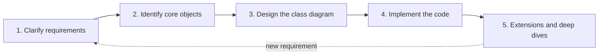
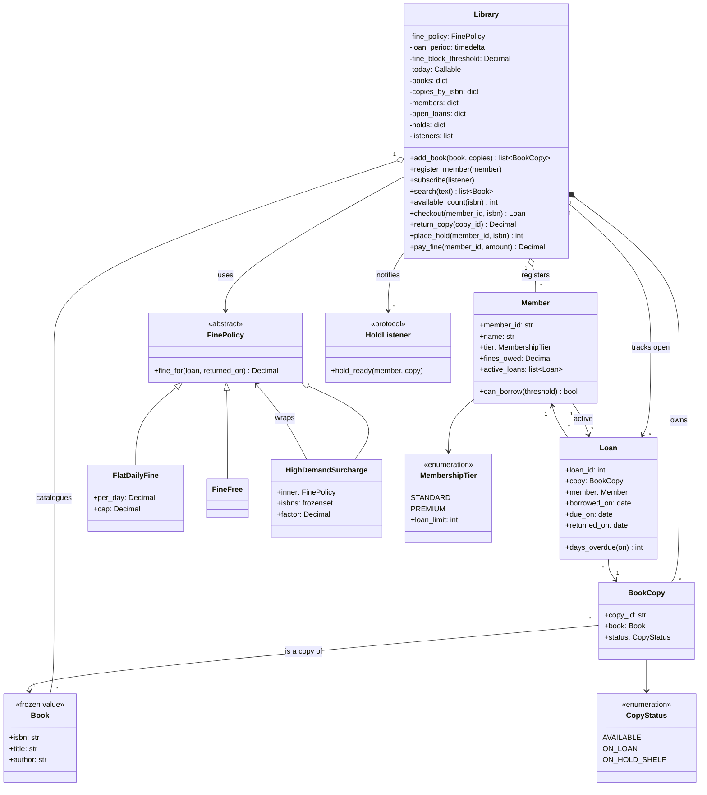

# The OOD Interview Framework: From a Vague Prompt to Working Code in 45 Minutes

An object-oriented design (OOD) interview hands you one vague sentence, such as "design a library system", and about 45 minutes. You already have the tools: classes, composition and SOLID from [OOP Fundamentals](01-oop-fundamentals.md), Strategy, State, Observer and friends from [Design Patterns](02-design-patterns.md), and a picture of how the round is scored from [What Is an OOD Interview?](03-what-is-an-ood-interview.md). What is missing is a **process**: a dependable order in which to use those tools so that, at minute 45, you have a clear design, working code and a few minutes of thoughtful discussion instead of half a diagram.

This post gives you that process. We start with a plain-language tour of the five steps, then take one running example, a library book-lending system, through every step at increasing depth, all the way to a tested Python implementation with a pluggable fine policy, hold notifications and a thread-safe variant. Along the way we compare four techniques for finding classes, lay out a minute-by-minute timeline, and show how the same steps appear in the design documents and RFCs that engineers write at real companies. This is the last post before the eleven case studies, and every one of them follows exactly these steps; the final section shows how.

---

## 1. The five steps in plain words

Before any detail, here is the whole idea through something everyone has seen: **a contractor redoing a kitchen.**

1. **Ask what the client wants.** Who cooks? How many people eat here? What is the budget? Is the dishwasher staying? A good contractor asks the questions whose answers change the plan, writes the answers down, and says out loud what is *not* included ("we are not touching the plumbing in the bathroom").
2. **List the things the kitchen is made of.** Sink, stove, fridge, counters, cabinets. Not every word the client says becomes an item: "cosy" is not something you can install.
3. **Draw the floor plan.** Where each item goes, what connects to what (the sink needs water, the stove needs gas), and who is responsible for which part. The client looks at the plan and nods *before* anyone picks up a hammer.
4. **Build it.** Start with the parts everything else depends on, check as you go, and keep the plan and the building in sync.
5. **Handle the change requests.** "Actually, could we add an island?" A well-planned kitchen absorbs that without moving the sink. A badly planned one needs the walls torn out.

An OOD interview is the same five steps, in software:

| Step | Kitchen version | Interview version | What you have at the end |
| --- | --- | --- | --- |
| 1. Clarify requirements | What does the client want, and not want? | Agree on what the system must do and what is out of scope | A short written list of requirements, non-goals and one or two example scenarios |
| 2. Identify core objects | List the sink, stove, fridge... | Find the handful of things the system is about | Candidate classes with one-line responsibilities; the main actions assigned to owners |
| 3. Design the class diagram | Draw the floor plan | Decide attributes, methods, relationships and patterns | A class diagram (or code skeleton) the interviewer has seen and agreed to |
| 4. Implement the code | Build it | Turn the design into clean code for the main use cases | Working or near-working code, with error handling |
| 5. Extensions and deep dives | "Can we add an island?" | Show the design absorbs change; discuss edge cases, concurrency, scale | Answers to "what if...?" questions and a short closing summary |



The dashed arrow matters. A new requirement in step 5 is a mini loop through steps 1 to 4: you clarify it, find which objects it touches, adjust the diagram, then the code. (Some guides merge steps 3 and 4 into one "class design and code" step. Keeping them apart makes the hand-off from diagram to code, and the check-in between them, explicit.)

That is the entire framework. The rest of this post is about doing each step *well*.

## 2. Why a framework is worth having

An OOD prompt is deliberately open. "Design a parking lot" could mean one gate and fifty painted spots, or a multi-storey garage with reservations, licence-plate cameras and surge pricing. The interviewer is watching how you turn that openness into something concrete, and that turning is the hard part. A framework helps in three ways:

- **It frees your attention for the problem.** If "what comes after requirements?" is already answered, all your thinking goes into the domain.
- **It makes you easy to follow.** Interviewers grade what they can see. As [What Is an OOD Interview?](03-what-is-an-ood-interview.md) showed, communication and structured thinking are scored alongside the design itself. A candidate who says "five minutes on requirements, then the core objects, then the classes" hands the interviewer a map.
- **It protects your time.** Most failed OOD rounds fail on time: a beautiful diagram with no code, or a pile of code that solves the wrong problem. A timeline tells you when to move on.

A framework is not a script, though. Some interviewers want to jump straight to code; some want half the round on one tricky method. Treat the steps as a default you adapt, and say out loud when you are adapting.

## 3. First, find out what deliverable is expected

OOD rounds produce one of three kinds of output, and the right plan depends on which. Ask in the first minute: *"Would you like a class diagram, a code skeleton, or a working implementation?"*

| Deliverable | What it looks like | When it is common | How to adjust the plan |
| --- | --- | --- | --- |
| **Class diagram** (usually UML, the Unified Modeling Language) | Boxes for classes with attributes and methods; lines for relationships | Whiteboard rounds, design-focused interviewers | Spend longer on relationships and responsibilities; write only one or two key methods |
| **Code skeleton** | Real class and method declarations, most bodies `...`, a few key methods filled in | The most common modern style, in a shared editor | Diagram briefly (or let the skeleton *be* the diagram), then implement the one or two trickiest methods |
| **Working code** | A runnable program, sometimes with tests | Remote rounds with a real editor; "machine coding" rounds | Keep scope tight, keep diagramming short, leave time to run the code |

If you are asked for working code, do not panic: interviewers shrink the problem to fit. And in every format, **talk while you work**. Silent coding, however good, hides the reasoning the interviewer is there to evaluate.

## 4. A 45-minute timeline

Most rounds are 45 to 60 minutes, and the first and last few minutes go on introductions and your questions for the interviewer. Plan for about 40 minutes of design time:

| Minutes | Step | What you are doing | Warning sign you are off track |
| --- | --- | --- | --- |
| 0-2 | Intro | Hear the prompt, ask what deliverable is expected | — |
| 2-8 | 1. Requirements | Ask questions, write the requirement list, walk one simple and one harder scenario | Still asking questions at minute 10 |
| 8-13 | 2. Core objects | Walk the main use case, list nouns and verbs, pick classes | Debating a class that no requirement needs |
| 13-20 | 3. Class diagram | Attributes, methods, relationships, patterns; get a nod | More than about 8 classes for a 45-minute problem |
| 20-35 | 4. Code | Core flow first, then error paths | No method body written by minute 25 |
| 35-43 | 5. Extensions | Edge cases, one or two "what if" changes, concurrency if asked | Rewriting the design instead of extending it |
| 43-45 | Wrap-up | Summarise the design and its trade-offs | — |

If the round is 60 minutes, give most of the extra time to steps 4 and 5. If the interviewer only wants a diagram, fold step 4 into step 3 and give the saved time to step 5. Glance at the clock at each step boundary; that single habit fixes most time problems.

## 5. The running example: a library book-lending system

To make every step concrete we use one prompt throughout: **"Design a system for a public library to lend books."**

It is a good OOD problem for the same reasons the classic case studies are. Everyone has a rough mental model of a library, so the domain is approachable, but it hides real modelling decisions: the difference between a *book* and a *copy of a book*, borrowing limits, overdue fines, and waiting lists.

It is also a real industry with real software. Libraries run an **integrated library system (ILS)**; open-source examples include Koha and Evergreen, and commercial vendors sell others. An ILS handles the catalogue, circulation (lending and returns), holds, fines and patron accounts. E-book apps such as Libby, from OverDrive, apply the same ideas to digital licences: a library often licenses only a few "copies" of a popular e-book, so members join a holds queue exactly as they would for a paper book. And in recent years many public libraries, including Chicago's and New York City's systems, have stopped charging overdue fines altogether. Keep that last fact in mind; it is exactly the kind of rule change a good design should absorb without surgery.

## Step 1: Clarify requirements

The goal of step 1 is a shared, written understanding of the problem. You are not trying to discover every possible feature; you are trying to agree on the smallest *interesting* system and say clearly what you are leaving out.

### Running the conversation

Here is how the opening might go. The interviewer is Priya; the candidate is Sam.

> **Priya:** Design a system for a public library to lend books.
>
> **Sam:** Before I design anything, would you like a class diagram, a code skeleton, or working code?
>
> **Priya:** Working code for the main flows would be great.
>
> **Sam:** Okay. Who uses the system: members at a self-service kiosk, librarians at a desk, or both?
>
> **Priya:** Both, but they do the same operations.
>
> **Sam:** Then I will model the operations, not the user interface. A library usually owns several copies of a popular title. Should I track individual copies?
>
> **Priya:** Yes.
>
> **Sam:** Are there borrowing limits, say a maximum number of books per member?
>
> **Priya:** Standard members can have 3 books out. There is also a premium membership with a higher limit.
>
> **Sam:** How long is a loan, and what happens when a book comes back late?
>
> **Priya:** Three weeks. Late returns cost a small daily fine, capped at some maximum.
>
> **Sam:** Can members reserve a book that is currently out?
>
> **Priya:** Good question. Let's leave that for later if there is time.
>
> **Sam:** And I will assume a single branch, printed books only, and that paying a fine just reduces the balance, with no real payment processing. Does that work?
>
> **Priya:** Sounds good.

Notice what Sam did:

- **Asked about the deliverable first**, so the rest of the plan fits.
- **Asked questions whose answers change the design.** "Track individual copies?" decides whether `Book` and `BookCopy` are separate classes. "Limits by membership type?" decides whether a `MembershipTier` exists. A question that changes nothing ("what colour is the library card?") only spends time.
- **Used domain knowledge** ("a library usually owns several copies") to sharpen questions and show product sense.
- **Stated assumptions out loud** instead of silently deciding them.
- **Parked a feature** (holds) as a possible extension rather than ignoring it or expanding scope immediately.

### A checklist of questions

Not every category applies to every problem, but these cover most OOD prompts. The right-hand column is the important one: every good question maps to a design consequence, often to a concept from the earlier posts.

| Category | Library example | What the answer decides |
| --- | --- | --- |
| Actors | Members, librarians, kiosk | Who calls which operations; whether you need roles or permissions |
| Core use cases | Search, check out, return | The public methods on your main classes |
| Entities and identity | Title versus individual copy | Which classes exist; which are entities and which are value objects ([OOP Fundamentals](01-oop-fundamentals.md)) |
| Rules and limits | Loan limit by tier, loan period | Where validation lives; which values are configuration |
| Rules that vary | Fines today, maybe none tomorrow | Candidates for a Strategy ([Design Patterns](02-design-patterns.md)) |
| Lifecycles | A copy is on the shelf, on loan, set aside | An enum of statuses, or the State pattern if behaviour differs a lot per status |
| Money | Fines, caps, payment | `Decimal`, never `float` |
| Time | Due dates, overdue checks | Inject a clock so time is testable |
| Failure cases | No copies left, member blocked | Exceptions and error types |
| Scale and concurrency | One kiosk or many at once? | Whether locking is in scope |
| Out of scope | Payments, e-books, branches | Protects your time |

### Writing down the requirements

Sam writes the agreed scope where the interviewer can see it:

**Functional requirements**

1. The library catalogues books (title, author, ISBN) and owns one or more physical copies of each.
2. Members can search the catalogue by title or author.
3. A member can check out an available copy. The loan is due 21 days later.
4. A member may have at most 3 active loans (standard) or 10 (premium).
5. A member who owes $5.00 or more in fines cannot borrow.
6. Returning a copy closes the loan. A late return adds a fine of $0.25 per day, capped at $10.00.
7. Members can pay off fines.
8. *(Extension, if time)* A member can place a hold on a title with no copy on the shelf; returned copies go to the first person waiting.

**Non-functional requirements**

- Rules that librarians change often (fine amounts, loan period) should be configuration or swappable, not hard-coded.
- The core logic must be testable without waiting real days, so the current date must be controllable.
- Single process, in memory; persistence is out of scope, but the design should not make it hard.

**Out of scope (non-goals):** payment processing, e-books, multiple branches, user interface, notifications.

### Ground it in scenarios

Lists hide edge cases; scenarios expose them. Sam walks one simple and one harder scenario:

> **Simple:** Ada checks out *Dune* on 1 March. It is due 22 March. She returns it on 20 March. The loan closes, no fine, the copy is back on the shelf.
>
> **Harder:** Ada has *Dune*, the only copy. Grace wants it, so she places a hold. Ada returns it four days late. Ada is fined $1.00. The copy should *not* go back on the open shelf; it is set aside for Grace. If Ada tries to borrow it again, she is refused, because Grace is first in line.

The harder scenario surfaces three design facts at once: copies need a status richer than "available or not", the fine rule must know the due date, and holds need a first-come-first-served queue. Ten seconds of storytelling just did the work of ten questions.

### Common mistakes in step 1

- **Skipping it.** Starting to code at minute two almost guarantees a rewrite later.
- **Asking everything.** Fifteen minutes of questions signals that you cannot prioritise. Ask what changes the design; assume the rest and say so.
- **Repeating questions** the interviewer already answered, which signals you were not listening.
- **Expanding scope yourself.** "Should we also support inter-library loans and e-book DRM?" makes the problem bigger for no reason.

## Step 2: Identify the core objects

With requirements agreed, the next job is to find the handful of things the system is about. The fastest reliable technique in an interview is to **walk the main use case and listen for nouns and verbs**.

### Walk the main use case

Sam narrates the checkout flow, out loud:

> "A **member** asks to borrow a **book**. The **library** checks the member's **loan limit** and unpaid **fines**. It finds an available **copy** of that book, creates a **loan** with a **due date**, and marks the copy as on loan. When the copy is **returned**, the library closes the loan, calculates any **fine** using the **fine rules**, and puts the copy back on the shelf, or on the **hold shelf** if someone is waiting."

### Nouns become candidate classes

Now sort the nouns. The point is not to keep every noun but to **decide, with a reason, what each one becomes**. A useful test, which every case study in this series applies: *does this noun have its own behaviour or its own rules to protect?* If not, it is probably an attribute, an enum, or nothing at all.

| Noun | Becomes | Reason |
| --- | --- | --- |
| Library | Class `Library` | Coordinates the use cases and owns the collections |
| Member | Class `Member` | Has identity, state (loans, fines) and a rule (`can_borrow`) |
| Book | Class `Book` (immutable) | Catalogue data shared by all copies |
| Copy | Class `BookCopy` | The physical thing that is lent; has its own status |
| Loan | Class `Loan` | Links a member to a copy over a period; has behaviour (`days_overdue`) |
| Fine rules | Interface `FinePolicy` | The rule most likely to change; deserves its own abstraction |
| Membership tier | `Enum` `MembershipTier` | A small fixed set of values with one property (loan limit) |
| Copy status | `Enum` `CopyStatus` | A fixed set of states |
| Due date | Attribute of `Loan` | Just a value; no behaviour of its own |
| Fine (amount) | `Decimal` attribute | Money is a value, not an object with identity |
| Loan limit | Property of `MembershipTier` | Belongs with the tier it depends on |
| Hold shelf | A status (`ON_HOLD_SHELF`) plus a lookup | Physically a shelf, but in software just a state of a copy |
| Shelf, librarian, kiosk | Not modelled | No requirement needs their behaviour; they are callers, not parts |

Two decisions in that table are the heart of this problem, and they are worth saying out loud:

- **`Book` versus `BookCopy`.** A title and a physical copy are different things. The title has an ISBN, author and name, shared by every copy. A copy has its own ID and status and is what actually goes home with a member. Merging them would force you to duplicate catalogue data, or to track "how many are out" with a counter, which breaks as soon as you need to know *which* copy someone has. Real library software makes the same split between a *bibliographic record* (the title) and an *item record* (the barcoded copy). You will meet the same "description versus instance" split in commerce: Stripe's API separates a `Product` (what you sell) from its `Price` objects (how you charge for it), and a grocery system separates a catalogue product from stock on the shelf.
- **Not every noun is a class.** Due date, fine amount and loan limit are values. Librarian and kiosk are actors outside the system. A strong candidate removes nouns as confidently as they add them.

### Verbs become methods, and each needs an owner

| Verb | Method | Owner | Why that owner |
| --- | --- | --- | --- |
| search | `search(text)` | `Library` | Only the library sees the whole catalogue |
| borrow / check out | `checkout(member_id, isbn)` | `Library` | Touches member, copy and loan together |
| check limits | `can_borrow(threshold)` | `Member` | The member holds the data the rule needs |
| create a loan | constructor of `Loan` | called by `Library` | The library has all the inputs |
| return | `return_copy(copy_id)` | `Library` | Coordinates loan, member and copy |
| compute overdue days | `days_overdue(on)` | `Loan` | The loan owns the due date |
| calculate fine | `fine_for(loan, returned_on)` | `FinePolicy` | Isolates the rule that changes |
| place a hold | `place_hold(member_id, isbn)` | `Library` | Needs the queue for the title |

"Put the method where the data is" has a name: **Information Expert**, one of Craig Larman's GRASP principles (General Responsibility Assignment Software Patterns). It is the same instinct as "tell, don't ask" from [OOP Fundamentals](01-oop-fundamentals.md), and it is the single most useful heuristic for step 2. Its opposite, a coordinator that pulls data out of passive objects and decides everything itself, is the god class with an anaemic domain model that post 1 warned about.

At this point Sam can summarise in one breath: *"The core objects are `Library`, `Member`, `Book`, `BookCopy`, `Loan` and a `FinePolicy` interface, plus enums for copy status and membership tier."*

### Comparing approaches for identifying classes

Noun/verb analysis is the classic interview technique, but it is one of several. Knowing the alternatives helps you choose, and mentioning them briefly shows depth. Here are four, each applied to the library.

#### Approach A: Noun/verb analysis

Write a description of the system, underline the nouns (candidate classes or attributes) and the verbs (candidate methods), then filter. The idea goes back to Russell Abbott's work in the early 1980s and was popularised by early object-oriented methods.

- **Library result:** the tables above.
- **Strengths:** fast, needs nothing but the requirements, easy to narrate.
- **Weaknesses:** sensitive to wording ("borrow", "lend" and "check out" might become three methods); produces too many candidates (shelf, librarian) that you must filter; misses concepts nobody says out loud, such as `FinePolicy`, which appears only when you ask "what changes?".

#### Approach B: Use-case driven

List the use cases (what each actor wants to achieve), then trace each one step by step and ask which object handles each step. This is the approach behind Ivar Jacobson's work and the use-case diagrams in UML.

- **Library result:** use cases "Search catalogue", "Check out", "Return", "Place hold", "Pay fine". Tracing "Return" (find the loan, close it, compute the fine, route the copy) reveals that routing a returned copy depends on the holds queue, an interaction a noun list does not show.
- **Strengths:** behaviour-driven, so every class exists to serve a use case; naturally produces sequence diagrams; good at revealing collaborations and ordering.
- **Weaknesses:** slower; can lead to "controller per use case" designs (`CheckoutManager`, `ReturnManager`) with anaemic data classes if you are not careful.

#### Approach C: CRC cards

CRC stands for **Class, Responsibilities, Collaborators**. Introduced by Kent Beck and Ward Cunningham in 1989, the technique uses one index card per candidate class: its name, what it is responsible for (knowing and doing), and which classes it works with. A team "plays" a scenario by moving cards around.

A `Loan` card might read:

| Class: `Loan` | |
| --- | --- |
| **Responsibilities** | **Collaborators** |
| Know which copy, which member, borrowed and due dates | `BookCopy`, `Member` |
| Know whether, and by how much, it is overdue | |
| Record when it was returned | |

- **Strengths:** forces a responsibility for every class, which exposes classes with none (delete them) or too many (split them, as the Single Responsibility Principle suggests); the collaborator column is a quick coupling check.
- **Weaknesses:** physical cards are awkward remotely (a small table works fine instead); says little about data types or inheritance.

#### Approach D: Domain-driven design (DDD)

Domain-driven design, from Eric Evans' 2003 book, starts from the language domain experts actually use (the **ubiquitous language**) and classifies concepts into **entities** (identity that persists over time), **value objects** (defined only by their values, usually immutable), **aggregates** (clusters changed together through one root object that protects their invariants) and **domain services** (operations that belong to no single entity). You met entities and value objects in [OOP Fundamentals](01-oop-fundamentals.md); DDD adds the consistency boundary. Many teams start DDD with an *event storming* workshop, where domain experts and engineers stick sticky notes for every business event ("copy returned", "hold placed") on a long wall and then group them.

- **Library result:** `Member`, `BookCopy` and `Loan` are entities; `Book`, dates and money are value objects; `FinePolicy` is a domain policy. Talking to a librarian reveals real vocabulary: "circulation", "patron", "item", "hold shelf". Asking "what must always be consistent?" gives an aggregate boundary: a copy and its open loan must change together.
- **Strengths:** the deepest model; the entity/value split directly informs code (`frozen=True` for values, identity equality for entities); aggregates are the natural unit for locking and persistence later.
- **Weaknesses:** heavy vocabulary; full DDD targets large, long-lived business systems and is overkill in 45 minutes.

#### Comparison and recommendation

| Approach | Starts from | Best at | Weak at | Interview time cost | Choose when |
| --- | --- | --- | --- | --- | --- |
| Noun/verb analysis | Requirement text | Fast first draft of classes | Over-generating; missing hidden abstractions | Low | Almost always, as the first pass |
| Use-case driven | Actor goals and flows | Collaborations and ordering | Can produce anaemic "manager" classes | Medium | Flow-heavy problems: ATM, vending machine, booking |
| CRC cards | Candidate classes | Clear responsibilities, coupling check | Data and type details | Low to medium | Validating a draft; collaborative design sessions |
| Domain-driven design | Domain language and invariants | Entity/value split, consistency boundaries | Speed; jargon | High | Deep dives on persistence and concurrency; real long-lived systems |

**Recommendation for interviews:** combine them lightly. Do a **noun/verb pass** while walking **one use case** (A and B together), give each class a **one-line responsibility** (the essence of C), and borrow two ideas from **DDD**: say which classes are entities and which are value objects, and ask "what changes most?" to discover policies like `FinePolicy`. That takes about five minutes and produces a design that is both complete and well-reasoned.

## Step 3: Design the class diagram

Step 3 turns the list of objects into a structure: attributes, methods, relationships, and the patterns that hold them together. There are two ways in.

- **Top-down:** start with the coordinator (`Library`) and the abstractions (`FinePolicy`), then fill in the concrete classes. Good when the overall flow is clear and you want to show architecture first.
- **Bottom-up:** start with the data-holding classes (`Book`, `BookCopy`, `Member`, `Loan`), then build the coordinator around them. Good when the entities are obvious and the flow is not.

For the library the entities are obvious, so Sam goes bottom-up: value objects and entities first, then the policy, then the coordinator.

### The diagram



In a real interview you would draw the core first (the top half: `Library`, the four entities, `FinePolicy` with one implementation, the two enums) and add `HighDemandSurcharge` and `HoldListener` only when step 5 asks for them. The diagram shows the finished state so you can see where they plug in.

### Reading the relationships

A class diagram is only useful if every line means something. [OOP Fundamentals](01-oop-fundamentals.md) introduced these relationships; here is what each one says about the library:

- **Composition** (filled diamond, `*--`): the whole owns the part, and the part makes no sense without it. `Library` creates its `BookCopy` objects in `add_book`.
- **Aggregation** (hollow diamond, `o--`): the whole groups parts that live independently. `Member` objects are created outside and registered; a person exists without our library.
- **Association** (plain arrow, `-->`): one class refers to another. A `Loan` refers to a `Member` and a `BookCopy` but owns neither.
- **Inheritance / realisation** (`<|--`): `FlatDailyFine`, `FineFree` and `HighDemandSurcharge` are kinds of `FinePolicy`.

Do not agonise over composition versus aggregation; interviewers rarely penalise that distinction. What they *do* care about is that you can explain who creates and owns what, because that decides lifetimes, persistence and where invariants are enforced.

### Listening for patterns

Since you know the patterns from [Design Patterns](02-design-patterns.md), step 3 is where you *recognise* them in the requirements instead of forcing them in. Each pattern has a tell, a phrase in the requirements that signals it:

| You hear... | Pattern it suggests | In the library | Elsewhere in this series |
| --- | --- | --- | --- |
| "The rule might change" / "several ways to..." | Strategy | Fine rules (`FinePolicy`) | Parking fees, cinema pricing, elevator dispatch |
| "...and on top of that, sometimes..." | Decorator | High-demand surcharge wrapping any fine policy | Peak-hour parking surcharge |
| "When X happens, tell Y" | Observer | "Your hold is ready" notifications | Locker pickup notices, elevator displays |
| "One simple entry point for the clients" | Facade | `Library` | Almost every case study's top-level class |
| "It behaves differently depending on its status" | State | Not needed here (see below) | Vending machine, ATM |
| "Undo", "queue these actions", "audit every action" | Command | Not needed here | ATM transactions, tic-tac-toe undo |
| "Nested things", "combine conditions" | Composite, Specification | Not needed here | Unix file search |

The "not needed here" rows matter as much as the others. Naming a pattern you chose *not* to use, and why, is one of the clearest signals of judgement an interviewer can see.

### Design decisions made at this step

Step 3 is where the main decisions happen. Say each one out loud with its reason, and the alternative you rejected.

**1. `Library` is a Facade.** A Facade gives callers one simple entry point to a group of collaborating objects. Callers write `library.checkout("M1", isbn)` and never touch the internal dictionaries. That keeps the public API small and puts the multi-object invariant, *a copy is on loan if and only if there is an open loan for it*, in one place. The risk is that the facade grows into a god class; the defence is to keep single-object rules on their objects (`Member.can_borrow`, `Loan.days_overdue`) and push varying rules out (`FinePolicy`). *Rejected alternative:* separate `CheckoutService`, `ReturnService` and `HoldService` classes. That is reasonable in a large codebase, but at this size it scatters one invariant across three classes.

**2. Fines are a Strategy.** Fine rules are the most likely thing to change: per-day amounts change, caps change, some libraries drop fines entirely. With a `FinePolicy` interface, going fine-free is configuration, not an edit to `return_copy`. This is the Open/Closed Principle from [OOP Fundamentals](01-oop-fundamentals.md) made concrete. *Rejected alternative:* an `if library.fines_enabled:` branch inside `return_copy`, which works for exactly one variation and then grows a new `elif` for every rule.

**3. Tiers are an enum, not subclasses.** A `PremiumMember` subclass is tempting, but the only difference between tiers is a number. Encoding the loan limit as the enum's value keeps it data. It also lets a member upgrade in place (`member.tier = MembershipTier.PREMIUM`); an object cannot change its own class cleanly. This is "composition over inheritance" from post 1 in its smallest form. If tiers later gained real behavioural differences, that would be the moment to reconsider.

**4. Copy status is an enum, not the State pattern.** A copy has three statuses, and only two methods (`_copy_for` and `_route_returned_copy`) care about them. The State pattern earns its keep when *many* operations behave differently per state, as in the [vending machine](../02-case-studies/04-vending-machine/README.md), where inserting a coin, selecting a product and cancelling all mean different things in each state. Here an enum plus two `if`s is simpler and just as clear. *When to switch:* if lost, damaged, in-transit and in-repair statuses arrive, each with its own rules for checkout, return and holds.

**5. Data structures follow the access patterns.** Lookups by ID are `dict`s (constant time on average). Open loans are keyed by `copy_id` because returns arrive with a copy in hand (a barcode scan). The holds waiting list is a `collections.deque` because it is first-in-first-out and `popleft()` is constant time, unlike `list.pop(0)`. Mentioning a choice like this takes five seconds and shows you think about efficiency without over-optimising.

**6. Time is injected.** `Library` takes a `today` callable instead of calling `date.today()` directly. That one parameter makes late-return logic testable. It is **dependency injection** (passing collaborators in rather than reaching out for them), and the Dependency Inversion Principle from post 1 in miniature: the library depends on "something that tells me the date", not on the system clock. Several of the case studies, such as the parking lot and the shipping locker, inject a clock the same way.

Before moving on, check in: *"Here is the structure. Does this match what you had in mind before I start coding?"* A nod here saves a rewrite later.

## Step 4: Implement the code

Now the design becomes code. The full, runnable implementation is in [`code/framework_example.py`](code/framework_example.py), with tests in [`code/test_framework_example.py`](code/test_framework_example.py). Below are the important pieces in the order you might write them in an interview: the core flow first, error paths second, extras last.

### Value objects and entities

```python
@dataclass(frozen=True)
class Book:
    """A title in the catalog. Immutable: one record shared by all its copies."""

    isbn: str
    title: str
    author: str


@dataclass(eq=False)  # an entity: identity matters, not field equality
class BookCopy:
    """One physical copy on a shelf. This is the thing that is actually lent."""

    copy_id: str
    book: Book
    status: CopyStatus = CopyStatus.AVAILABLE
```

`Book` is a **value object**: two `Book`s with the same ISBN, title and author are interchangeable, and nothing changes a title in place. `frozen=True` makes it immutable and gives it value-based equality and hashing for free.

`BookCopy`, `Member` and `Loan` are **entities**: their identity persists while their state changes. Two members with the same name and no loans are still different people. `eq=False` tells `dataclass` not to generate field-by-field equality, so comparisons fall back to identity. It also avoids a subtle trap: `Member` holds `Loan`s, which hold the `Member`, so generated equality could end up walking that cycle.

### Rules live with their data

```python
@dataclass(eq=False)  # an entity: identity matters, not field equality
class Member:
    """A library card holder."""

    member_id: str
    name: str
    tier: MembershipTier = MembershipTier.STANDARD
    fines_owed: Decimal = Decimal("0.00")
    active_loans: list[Loan] = field(default_factory=list)

    def can_borrow(self, fine_block_threshold: Decimal) -> bool:
        return (
            len(self.active_loans) < self.tier.loan_limit
            and self.fines_owed < fine_block_threshold
        )
```

```python
    def days_overdue(self, on: date) -> int:
        return max(0, (on - self.due_on).days)
```

`can_borrow` sits on `Member` because the member owns both inputs (its loans and its fines): Information Expert from step 2. The threshold is passed in because it is library policy, not a property of a person. `days_overdue` sits on `Loan` for the same reason. Money is `Decimal`, never `float`, because binary floating point cannot represent amounts like 0.10 exactly, and those tiny errors add up in sums.

### The Strategy for fines

```python
class FinePolicy(ABC):
    """Decides how much a late return costs."""

    @abstractmethod
    def fine_for(self, loan: Loan, returned_on: date) -> Decimal: ...


class FlatDailyFine(FinePolicy):
    """A fixed amount per late day, capped so a lost-in-a-drawer book is not ruinous."""

    def __init__(self, per_day: Decimal = Decimal("0.25"), cap: Decimal = Decimal("10.00")):
        self.per_day = per_day
        self.cap = cap

    def fine_for(self, loan: Loan, returned_on: date) -> Decimal:
        return min(self.per_day * loan.days_overdue(returned_on), self.cap)


class FineFree(FinePolicy):
    """Many public libraries have dropped overdue fines entirely."""

    def fine_for(self, loan: Loan, returned_on: date) -> Decimal:
        return Decimal("0.00")
```

The policy receives the whole `Loan`, not just a day count. That is deliberate: a future policy might charge more for DVDs than books, or waive fines for children's titles, and both need information from the loan. A narrow interface (`fine_for(days_late)`) would look tidier today and force a signature change tomorrow.

Why an `ABC` and not a `typing.Protocol`? Both work; [OOP Fundamentals](01-oop-fundamentals.md) compares them. An ABC makes "this is one of *our* fine policies" explicit and fails fast if a subclass forgets `fine_for`. For the listener interface in step 5 we use a `Protocol` instead, because listeners are often written by other teams who should not need to import and inherit from our class.

### The main use case: checkout

```python
    def checkout(self, member_id: str, isbn: str) -> Loan:
        member = self._member(member_id)
        if not member.can_borrow(self._fine_block_threshold):
            raise BorrowingBlockedError(
                f"{member.name} has {len(member.active_loans)} loans "
                f"and owes ${member.fines_owed}"
            )
        copy = self._copy_for(member, isbn)
        today = self._today()
        loan = Loan(next(self._loan_ids), copy, member, today, today + self._loan_period)
        copy.status = CopyStatus.ON_LOAN
        self._held_for.pop(copy.copy_id, None)
        member.active_loans.append(loan)
        self._open_loans[copy.copy_id] = loan
        return loan
```

The method reads like the use case Sam narrated in step 2: find the member, check they may borrow, find a copy, create the loan, update state. That resemblance is a good sign; when code and narration match, the design is probably right.

Notice the ordering: **all validation happens before any mutation.** If the member is blocked or no copy is available, an exception is raised and nothing has changed. Checks first, writes last is the simplest way to keep invariants intact without transactions.

Failures are specific exceptions (`BorrowingBlockedError`, `NotAvailableError`, `UnknownItemError`), all subclasses of `LendingError`. Callers can catch the broad type or a specific one, and the message says what went wrong. Returning `None` for "could not borrow" would force every caller to guess why.

### Returns, fines and routing the copy

```python
    def return_copy(self, copy_id: str) -> Decimal:
        """Close the loan, charge any fine, and route the copy to the next holder."""
        loan = self._open_loans.pop(copy_id, None)
        if loan is None:
            raise UnknownItemError(f"copy {copy_id} is not on loan")
        today = self._today()
        loan.returned_on = today
        loan.member.active_loans.remove(loan)
        fine = self._fine_policy.fine_for(loan, today)
        loan.member.fines_owed += fine
        self._route_returned_copy(loan.copy)
        return fine
```

`return_copy` delegates the two parts that vary (how much to charge, where the copy goes next) to the policy and to a helper. Its own job is only to keep the bookkeeping consistent: loan closed, member's active loans updated, fine recorded.

### Running it

The file ends with a `demo()` that plays the harder scenario from step 1, with a print-based listener standing in for email. Running `python3 framework_example.py` prints:

```text
Ada borrows 'Dune' (copy 9780441172719-1), due 2026-03-22
Grace places a hold, position 1 in the queue
  [notify] Grace: 'Dune' is waiting for you
Ada returns it 4 days late on 2026-03-26 and is fined $1.00
Copy status is now: on hold shelf
Ada tries to borrow it again: refused (no copy of 9780441172719 is available)
Grace picks up her hold, due 2026-04-16
```

The 21 tests (`python3 -m unittest test_framework_example` from the `code` folder) cover the main flows and the edge cases: loan limits per tier, blocking on unpaid fines, unknown IDs, on-time and late returns, the fine cap, swapping and decorating the fine policy, double returns, payments, hold ordering, duplicate holds, notifications, and twenty threads racing for one copy. Because time is injected, a test can "advance" the clock by a year in one line:

```python
    def test_fine_is_capped(self):
        loan = self.library.checkout("M1", DUNE.isbn)
        self.advance(365)
        self.assertEqual(self.library.return_copy(loan.copy.copy_id), Decimal("10.00"))
```

### Tips for the coding step in a live interview

- **Write the happy path of the main use case first.** A working `checkout` with no error handling beats a perfect `Member` class and nothing else.
- **Then add failure paths** one at a time, saying each aloud: "if no copy is available, I raise `NotAvailableError`".
- **Stub what is not essential.** `search` can be a one-line list comprehension; say "in a real system this would be an index" and move on.
- **Keep the diagram and code in sync.** If you change your mind while coding, update the diagram or say so.
- **Narrate decisions, not keystrokes.** "I am keying open loans by copy ID because returns come in as a scanned copy" is useful; "now I am typing a for loop" is not.

## Step 5: Extensions and deep dives

With the core working, the interviewer will push. This is where senior candidates separate themselves, because it tests whether the design *absorbs* change. Each follow-up is a small loop through the framework: clarify it, find what it touches, adjust the design, then the code. Measure yourself by **how little changes**.

### Extension 1: "Members can now place holds"

This was the requirement Priya parked in step 1.

- **Clarify:** First come, first served? Only when no copy is on the shelf? What happens when a copy comes back? (Yes, yes, set aside for the first person in the queue.)
- **Touches:** a new status (`ON_HOLD_SHELF`), a queue per title, a record of who each set-aside copy is for, and the "where does a returned copy go" step.
- **Changes:** `place_hold` is new; `return_copy` already delegated routing, so only `_route_returned_copy` changes; `_copy_for` must prefer a copy held for this member and skip copies held for someone else.

Nothing in `Member`, `Loan` or `FinePolicy` changed. That is the evidence a good design leaves behind: a new feature touched only the objects whose responsibilities it involves.

A follow-up to the follow-up is often "what if the person never picks it up?". Real libraries give a pickup window of a few days. The design answer is to record when the copy went onto the hold shelf and have a periodic job expire stale holds and route the copy onward, reusing `_route_returned_copy`. The [movie ticket booking](../02-case-studies/02-movie-ticket-booking/README.md) case study faces the same problem with seat holds and compares a background timer with *lazy expiry*, checking deadlines whenever someone looks.

### Extension 2: "Notify members when their hold is ready"

This is the Observer pattern's home ground. The library announces an event; any number of listeners (email, SMS, app push) react, and `Library` imports none of them. The listener interface is a `Protocol`, so anything with a `hold_ready` method qualifies:

```python
class HoldListener(Protocol):
    def hold_ready(self, member: Member, copy: BookCopy) -> None: ...
```

and the event fires at the one place that knows a hold has become ready:

```python
    def _route_returned_copy(self, copy: BookCopy) -> None:
        queue = self._holds.get(copy.book.isbn)
        if queue:
            member = queue.popleft()
            self._held_for[copy.copy_id] = member
            copy.status = CopyStatus.ON_HOLD_SHELF
            for listener in self._listeners:
                listener.hold_ready(member, copy)
        else:
            copy.status = CopyStatus.AVAILABLE
```

Two deeper points are worth raising. First, the listeners run **after** the state change, so a listener that looks at the copy sees it on the hold shelf. Second, they run synchronously, inside `return_copy`: a slow or failing email sender would slow down or break returns at the desk. In production you would put the event on a queue and let a separate worker send messages, which is the same Observer idea stretched across a process boundary. The [shipping locker](../02-case-studies/09-shipping-locker/README.md) case study goes further and fires its events only after releasing its lock.

### Extension 3: "Fines are doubled for high-demand titles" and "the library is going fine-free"

Going fine-free is one line, because fines were a Strategy: construct the library with `Library(fine_policy=FineFree())` and nothing else changes (the test `test_fine_policy_is_swappable` does exactly this).

The high-demand rule is more interesting. You could write a `HighDemandFlatDailyFine` subclass, but then you would also need `HighDemandSomethingElse` for every other base policy. Instead, write a **Decorator**: a policy that wraps *any* other policy and adjusts its result.

```python
class HighDemandSurcharge(FinePolicy):
    """Decorator: multiplies another policy's fine for titles on a high-demand list."""

    def __init__(self, inner: FinePolicy, isbns: set[str], factor: Decimal = Decimal("2")):
        self.inner = inner
        self.isbns = frozenset(isbns)
        self.factor = factor

    def fine_for(self, loan: Loan, returned_on: date) -> Decimal:
        fine = self.inner.fine_for(loan, returned_on)
        return fine * self.factor if loan.copy.book.isbn in self.isbns else fine
```

Now `HighDemandSurcharge(FlatDailyFine(), isbns={...})` and `HighDemandSurcharge(FineFree(), ...)` both work (the second, sensibly, still charges nothing). `Library` did not change at all. The [parking lot](../02-case-studies/01-parking-lot/README.md) case study uses exactly this shape for a peak-hour surcharge on top of any fee policy.

### Extension 4: "Several kiosks check out books at the same time"

Now the in-memory design has a **race condition**: a bug whose outcome depends on the timing of concurrent operations. Two kiosks call `checkout` for the last copy of *Dune* at once. Both run `_copy_for`, both see the copy as `AVAILABLE`, and both create a loan: one copy, two loans. The root cause is a **check-then-act** sequence (check the copy is free, then lend it) that another thread can interleave.

The simplest fix inside one process is to make each use case atomic with a lock. The example file includes this as a subclass, so the single-threaded `Library` stays simple:

```python
class ThreadSafeLibrary(Library):
    """Same rules, but each use case runs as one atomic step under a lock.

    One lock for the whole library is the simplest correct choice: it turns
    every check-then-act sequence (is a copy free? then lend it) into a single
    indivisible operation. Finer-grained locks are an optimisation for later.
    """

    def __init__(self, *args, **kwargs):
        super().__init__(*args, **kwargs)
        self._lock = threading.Lock()

    def checkout(self, member_id: str, isbn: str) -> Loan:
        with self._lock:
            return super().checkout(member_id, isbn)
```

A test releases twenty threads at once through a `threading.Barrier` and asserts that exactly one loan is created. Then discuss the trade-offs, because this is what the interviewer is really asking about:

| Option | How it works | Pros | Cons | Choose when |
| --- | --- | --- | --- | --- |
| One global lock | Every use case holds one `threading.Lock` | Simple, obviously correct | Serialises everything; listeners run while holding it | One process, low traffic (a branch's kiosks) |
| Lock per ISBN | A dict of locks keyed by title | Unrelated checkouts run in parallel | More code; must lock in a consistent order if one operation touches two titles | One process, real contention |
| Conditional update in the database | `UPDATE copies SET status = 'on_loan' WHERE copy_id = ? AND status = 'available'`, then check one row changed | Works across many servers; no Python lock | Needs a database; caller must handle "zero rows" by retrying another copy | Any multi-server deployment |
| Row lock in a transaction | `SELECT ... FOR UPDATE` then update | Familiar; can protect several rows together | Holds locks longer; risk of deadlock | Operations that must change several rows atomically |

The conditional update is a form of **optimistic concurrency control**: assume no conflict, and detect one at write time. The [movie ticket booking](../02-case-studies/02-movie-ticket-booking/README.md) case study builds this out in depth for cinema seats.

### Extension 5: "Scale it to a city with 40 branches"

Now the conversation crosses into system design. Useful points: `BookCopy` gains a `branch` attribute and copies can be *in transit* between branches (a new status, and perhaps the moment to revisit decision 4); holds are placed on a title across all branches, and the system picks which branch's copy to send; the dictionaries become database tables, and `Library` becomes a service whose methods are transactions. The class model survives; only its storage and boundaries change. That continuity is the whole point of designing good objects first.

### How real systems evolve through the same loop

The step-5 loop is not an interview game; it is how long-lived software grows. Two examples:

- **A library system over the years.** An ILS starts with catalogue and circulation. Holds queues arrive and change how returns are routed (our extension 1). E-book lending through platforms like OverDrive arrives, and the "copy" becomes a licence with its own lending rules: a new kind of item, not a change to members or loans. Then the fine-free movement turns the fine rule off (extension 3). Each change lands on the object that owns that responsibility. Systems where fine logic was smeared across the checkout desk code found that last change much harder than a configuration switch.
- **A SaaS checkout.** A young software-as-a-service company typically starts with one monthly price hard-coded in its checkout. Then come annual plans, coupons, per-seat pricing, regional tax, free trials, and usage-based billing. Teams that kept "how much do we charge" behind its own interface could add each rule as a new policy or a decorator around an existing one; teams that wrote `if plan == "pro" and coupon and country == ...` inside checkout found every pricing experiment needed a risky change to the payment path. Billing platforms such as Stripe Billing model this explicitly, with separate objects for products, prices, coupons and subscriptions, which is the same "separate the thing from the rule that prices it" decision as `Book` and `FinePolicy`.

### Wrapping up

End with a 30-second summary: *"The design has six core classes. `Library` is a Facade that coordinates the use cases and protects the copy-loan invariant. `Member` and `Loan` own their own rules. Fines are a Strategy because they change most often, which made going fine-free one line and the high-demand rule a Decorator. Holds slotted in by changing only how returned copies are routed, and notifications are an Observer hook at that same spot. For several kiosks I would lock each use case, and with a shared database I would switch to a conditional update."*

## When the interview does not go to plan

Real interviews are rarely linear. Here are the common curveballs and how to handle each.

| Situation | What it usually means | What to do |
| --- | --- | --- |
| New requirements keep arriving mid-design | The interviewer is testing extensibility, or hinting at a blind spot | Acknowledge, assess impact aloud, adapt locally; if the same area keeps changing, isolate it behind an interface |
| Pulled into details before the big picture exists | Curiosity, or a test of focus | Give a direction ("a queue per title here"), promise to return, sketch the rest, then actually come back |
| Your explanation feels jumbled | You are narrating code, not design | Zoom out: "There are three parts: catalogue, circulation and fines. Here is how they interact." Use the diagram as an anchor |
| The interviewer is silent | Their style, or they are taking notes | Check in once ("Would it help to focus on a particular part?"), then let clean, running code speak |
| Your decision is challenged | Usually a probe of reasoning, not a sign you are wrong | Explain the trade-off, name the alternative you considered, ask for a concrete case where it fails, change your mind if the argument is better |
| An unfamiliar term comes up | — | Ask, or state your understanding and ask how theirs differs. Guessing is worse than asking |
| Unsure how deep to go | Each problem has a natural centre of difficulty | Ask: "Would you like the high-level structure or the details of this method?" |
| Concurrency is raised | A deep-dive probe | Name the race, describe the fix (lock, conditional update, optimistic locking), show a short snippet; do not build a thread pool |
| You realise mid-code that the design is wrong | Normal; it happens to everyone | Say so, explain the better structure in one sentence, change the smallest thing that fixes it. Recovering well scores better than pretending |

## Real-world tie-in: the framework is a design doc in miniature

The five steps are not an interview invention. They are a compressed version of how engineering teams design features, where the artefact is a **design document** ("design doc") or an **RFC** (Request for Comments).

Many companies have a written design culture. Google's design docs are well known; Malte Ubl's article "Design Docs at Google" describes their typical shape: context and scope, goals and non-goals, the design, alternatives considered, and cross-cutting concerns. Amazon is known for narrative documents, including six-page memos and the "PR/FAQ", a mock press release plus FAQ written before a product is built ("working backwards" from the customer). Uber has written publicly about its RFC process for engineering changes. Many teams also keep **Architecture Decision Records (ADRs)**, a short format popularised by Michael Nygard that records one decision each: its context, the decision, its status and its consequences.

Open source makes these processes public, so you can read real examples today. Python's PEP template, Rust's RFC template and Kubernetes' KEP template line up with the framework remarkably well:

| Framework step | Python PEP | Rust RFC | Kubernetes KEP | What it contains in practice |
| --- | --- | --- | --- | --- |
| 1. Requirements | Abstract, Motivation | Summary, Motivation | Summary, Motivation: Goals and Non-Goals | The problem, who it affects, and an explicit list of what this design will *not* do |
| 1. Scenarios | Motivation (examples) | Guide-level explanation | User Stories | Concrete walk-throughs of how someone uses the change |
| 2-3. Objects and design | Specification | Reference-level explanation | Proposal, Design Details | Interfaces, data models, APIs, diagrams |
| 3. Design decisions | Rationale, Rejected Ideas | Rationale and alternatives, Drawbacks | Alternatives, Drawbacks | Each rejected option and why; often the section reviewers read most closely |
| 4. Code | Reference Implementation | (implementation follows acceptance) | Test Plan, Graduation Criteria | A proof of concept, or a staged rollout plan |
| 5. Extensions | Backwards Compatibility, Security Implications, Open Issues | Unresolved questions, Future possibilities | Risks and Mitigations, Upgrade / Downgrade Strategy | Compatibility, security, scale, migration, what comes next |

A few lessons transfer directly back to the interview:

- **Non-goals are as important as goals.** In a design doc, an explicit non-goals list prevents scope creep and endless review debates. In an interview, your out-of-scope list does the same job.
- **"Alternatives considered" is where seniority shows.** Reviewers trust a design more when they can see the rejected options and why. "I considered a `PremiumMember` subclass, but the only difference is a number, so an enum value is simpler" is the spoken version of that section. Python's "Rejected Ideas" section exists for the same reason: it stops the same debate happening twice.
- **Docs are reviewed before code is written.** Changing a paragraph is cheaper than changing a service. The check-in after step 3 is a tiny design review for the same reason.
- **Designs are living documents.** Requirements change after launch; good teams update the doc or write a new ADR. The loop from step 5 back to step 1 is the same habit.

Practising the framework for interviews is therefore practising a real job skill. The candidate who can scope, model, decide and explain in 45 minutes is the engineer who writes the design doc a team can build from.

---

## How the case studies use this framework

Every one of the eleven case studies that follow is laid out as this framework: **clarifying requirements** (step 1), **finding the core objects** (step 2), **class design** (step 3), **code** (step 4), then **comparing approaches** and **going deeper** with "the interviewer now asks..." scenarios, concurrency and scaling (step 5), and finally an **interview playbook** with a 45-minute timeline. So as you read each one, you can ask "which step is this problem really about?" Each problem has a step where most of its difficulty lives:

| Case study | Where the difficulty lives | What to watch for |
| --- | --- | --- |
| [Parking Lot](../02-case-studies/01-parking-lot/README.md) | Step 2 | The noun table deliberately does *not* make `Level` a class (YAGNI), and promotes the verb "assign a spot" into its own `SpotAllocator`. Fees are a Strategy with a peak-hour Decorator, the same shape as our fines |
| [Movie Ticket Booking](../02-case-studies/02-movie-ticket-booking/README.md) | Step 5 | Customer stays a plain ID because it has no behaviour; seat holds expire lazily; preventing double booking gets a full concurrency deep dive |
| [Unix File Search](../02-case-studies/03-unix-file-search/README.md) | Step 3 | Files and folders as a Composite, search conditions as Specification objects combined with AND/OR/NOT; "matches" belongs on the condition, not the file |
| [Vending Machine](../02-case-studies/04-vending-machine/README.md) | Step 3 | The textbook case for the State pattern, compared directly with if/else on an enum; payments as strategies |
| [Elevator System](../02-case-studies/05-elevator-system/README.md) | Steps 3 and 5 | Scheduling and dispatch as Strategies, displays and lanterns as Observer subscribers rather than core classes |
| [ATM](../02-case-studies/10-atm/README.md) | Steps 2 and 3 | A flow-heavy problem where use-case thinking pays off; the key step-2 decision is that the ATM never owns account balances, it asks the bank. State and Command patterns |
| [Shipping Locker](../02-case-studies/09-shipping-locker/README.md) | Steps 3 and 5 | A package lifecycle on an injected clock, policies as strategies, notifications as observers fired after the lock is released |
| [Restaurant Management](../02-case-studies/11-restaurant-management/README.md) | All of them | The last case study ends by stepping back over the patterns behind all eleven designs |

The [grocery store](../02-case-studies/06-grocery-store/README.md), [tic-tac-toe](../02-case-studies/07-tic-tac-toe/README.md) and [blackjack](../02-case-studies/08-blackjack/README.md) case studies follow the same steps too. A good way to practise: before reading each case study's step 2, pause, run steps 1 and 2 yourself with a timer, then compare your noun table with the post's.

Start with the [Parking Lot](../02-case-studies/01-parking-lot/README.md); it goes slowest and defines every term as it appears.

---

## Test yourself

<details>
<summary>1. The interviewer says "just a class diagram, no code". How do you reallocate the 45 minutes?</summary>

Keep requirements (about 6 minutes) and core objects (about 5 minutes) roughly the same. Merge the coding step into the diagram step: spend about 15 minutes on a detailed diagram with attributes, method signatures and relationships, perhaps sketching pseudocode for the one or two trickiest methods. Give the saved time to step 5: more extension scenarios, edge cases, and discussion of trade-offs and alternatives.
</details>

<details>
<summary>2. Why are `Book` and `BookCopy` separate classes? What would break if they were merged?</summary>

A `Book` is a catalogue record (title, author, ISBN) shared by every copy; a `BookCopy` is one physical item with its own ID and status that is actually lent. If they were merged, you would either duplicate catalogue data per copy or track availability with a counter on the book. A counter cannot tell you *which* copy a member has, cannot set aside a specific copy for a hold, and cannot represent one copy being damaged or lost while others are fine.
</details>

<details>
<summary>3. In noun/verb analysis, which nouns from the library description did not become classes, and why?</summary>

Due date, fine amount and loan limit became attributes or properties because they are plain values with no behaviour of their own. Librarian and kiosk were not modelled because they are actors outside the system that call the same operations. Shelf and hold shelf became statuses of a copy (`AVAILABLE`, `ON_HOLD_SHELF`) because the software only needs a copy's state, not a model of physical furniture.
</details>

<details>
<summary>4. Which technique for finding classes would you lean on for an ATM, and why?</summary>

Use-case driven analysis. An ATM is flow-heavy: insert card, enter PIN, choose transaction, dispense cash, eject card. Tracing those steps in order reveals the session states and the collaborations between card reader, bank, cash dispenser and account, which a noun list alone would miss. A quick noun pass is still useful to name the classes.
</details>

<details>
<summary>5. Copy status is an enum, yet the vending machine case study uses the State pattern. Is that inconsistent?</summary>

No. The State pattern pays off when many operations behave differently depending on the state, so each state class gathers its own rules. A vending machine's every input (coin, selection, cancel) means something different in each state. A library copy has three statuses that only two internal methods consult, so an enum plus two conditions is simpler. The trigger to switch would be several new statuses (lost, damaged, in transit, in repair) each changing how checkout, return and holds behave.
</details>

<details>
<summary>6. Why does `checkout` do all its validation before changing any state?</summary>

So that a failure leaves the system exactly as it was. If it marked the copy `ON_LOAN` and then discovered the member was blocked, it would need to undo that change, and any forgotten undo would break the invariant "a copy is on loan if and only if there is an open loan for it". Validate first, mutate last is the simplest way to get all-or-nothing behaviour without transactions.
</details>

<details>
<summary>7. The library wants fines doubled for high-demand titles, but only under the flat daily policy for now and possibly under others later. Why a Decorator and not a subclass of `FlatDailyFine`?</summary>

A subclass ties the surcharge to one base policy; the next base policy would need its own "high demand" subclass, and the class count multiplies. A Decorator is itself a `FinePolicy` that wraps *any* `FinePolicy` and adjusts its result, so it combines freely (`HighDemandSurcharge(FlatDailyFine(), ...)`, or around a future policy) and `Library` does not change. It works because the policy receives the whole `Loan` and can see which book was borrowed.
</details>

<details>
<summary>8. Two kiosks check out the last copy simultaneously. Describe the bug and two fixes at different scales.</summary>

Both calls read the copy as `AVAILABLE` before either marks it `ON_LOAN`, so two loans are created for one copy: a race condition caused by a check-then-act sequence. In a single process, wrap each use case in a `threading.Lock` (one global lock, or a lock per ISBN for more parallelism). With a shared database, use an atomic conditional update (`UPDATE ... SET status = 'on_loan' WHERE copy_id = ? AND status = 'available'` and check the affected row count), which is optimistic concurrency, or lock the row inside a transaction.
</details>

<details>
<summary>9. The hold-ready listeners run synchronously inside `return_copy`. What could go wrong in production, and what would you change?</summary>

A slow email or SMS provider would make every return at the desk slow, and an exception in a listener would surface as a failed return even though the loan was already closed. With a lock held, a slow listener also blocks every other kiosk. The fix is to keep the Observer shape but make delivery asynchronous: publish the event to a queue (after releasing any lock) and let a separate worker send messages with retries, so the core operation never depends on an outside service.
</details>

<details>
<summary>10. Map the framework onto a Python PEP or Rust RFC. Which section corresponds to "explain why you chose a Strategy for fines"?</summary>

The rationale and alternatives sections: "Rationale" and "Rejected Ideas" in a PEP, "Rationale and alternatives" in a Rust RFC, "Alternatives" in a Kubernetes KEP, or "Alternatives considered" in a typical company design doc. They record the options weighed, for example an `if fines_enabled` branch in `return_copy` versus a `FinePolicy` interface, and why the chosen one wins: fine rules change often, and a Strategy turns those changes into configuration rather than code edits.
</details>

<details>
<summary>11. Why inject a `today` callable instead of calling `date.today()` inside `Library`?</summary>

Because overdue fines depend on dates. With the real clock, testing a 30-day-late return would mean waiting 30 days or patching the standard library. Injecting the clock lets tests control time directly (advance it by any number of days in one line), keeps tests deterministic, and makes the time dependency visible in the constructor. It is dependency injection, and the Dependency Inversion Principle in miniature.
</details>

## Key takeaways

- Ask about the expected deliverable (diagram, skeleton or working code) first, and plan your time around it.
- Follow five steps: clarify requirements, identify core objects, design the class diagram, implement the code, then handle extensions. Budget roughly 6 / 5 / 7 / 15 / 8 minutes in a 45-minute round.
- In step 1, ask only questions that change the design, write down the scope including non-goals, and test it with a simple and a harder scenario.
- In step 2, walk the main use case, turn nouns into candidate classes and verbs into methods, and put each method with the data it needs. Removing nouns is as important as keeping them.
- In step 3, listen for the pattern tells ("the rule changes" means Strategy, "tell Y when X" means Observer), name the patterns you rejected as well as the ones you chose, and get a nod before coding.
- In step 4, write the happy path first, validate before mutating, and use specific exceptions.
- In step 5, a good design shows itself by how little changes when a requirement arrives.
- The framework is a miniature design doc: goals and non-goals, domain model, proposed design, alternatives considered, and cross-cutting concerns.

## Further reading

- Craig Larman, *Applying UML and Patterns* (Prentice Hall): responsibility-driven design and the GRASP principles, including Information Expert.
- Kent Beck and Ward Cunningham, "A Laboratory for Teaching Object-Oriented Thinking" (OOPSLA 1989), the paper that introduced CRC cards.
- Eric Evans, *Domain-Driven Design: Tackling Complexity in the Heart of Software* (Addison-Wesley, 2003).
- Malte Ubl, "Design Docs at Google": <https://www.industrialempathy.com/posts/design-docs-at-google/>
- PEP 1, "PEP Purpose and Guidelines": <https://peps.python.org/pep-0001/>, and PEP 12, the PEP template: <https://peps.python.org/pep-0012/>
- The Rust RFC process and template: <https://github.com/rust-lang/rfcs>
- Kubernetes Enhancement Proposals: <https://github.com/kubernetes/enhancements/tree/master/keps>
- Michael Nygard, "Documenting Architecture Decisions": <https://cognitect.com/blog/2011/11/15/documenting-architecture-decisions>
- Refactoring Guru on Strategy, Decorator, Observer and Facade: <https://refactoring.guru/design-patterns/catalog>

Next: put the framework to work on [Design a Parking Lot](../02-case-studies/01-parking-lot/README.md).
