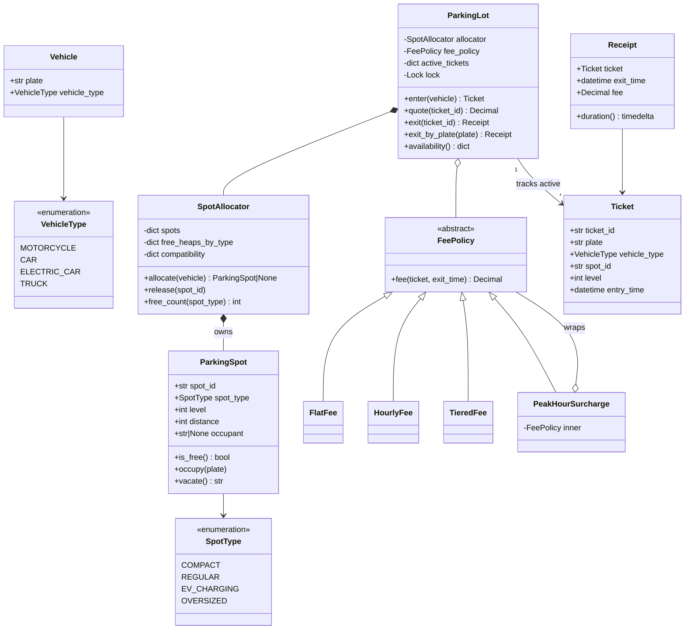
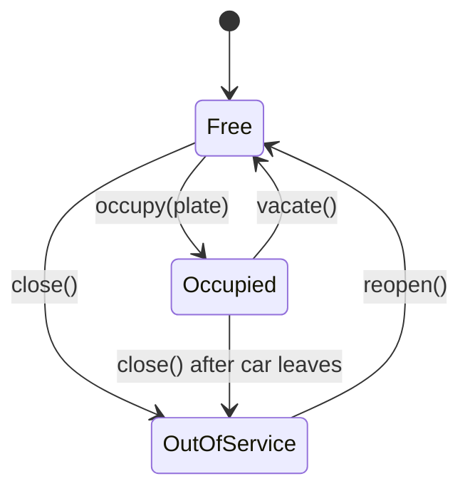
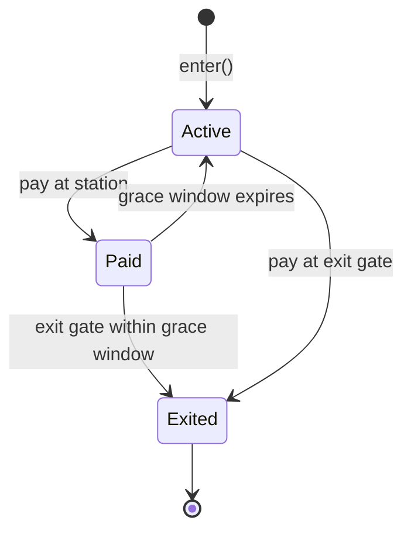

# Design a Parking Lot: From Painted Spots to a Thread-Safe Object Model

"Design a parking lot" is the classic first object-oriented design (OOD) interview question, and it is a great place to learn how OOD actually works. By the end of this post you will be able to run the requirements conversation, turn a fuzzy story into a handful of well-named classes, write a clean Python implementation, compare the competing designs at every important decision point, and talk confidently about what changes when two cars race for the same spot or when the lot becomes a real multi-level garage with cameras, EV chargers and a reservation app.

This is the first case study in the series, so we go slowly at the start and define every term as it appears. If you want a refresher on classes, inheritance and composition first, see [OOP fundamentals](../../01-foundations/01-oop-fundamentals.md); for the patterns we use (Strategy, Facade, Decorator) see [Design patterns](../../01-foundations/02-design-patterns.md); and for the step-by-step interview method this post follows, see [The OOD interview framework](../../01-foundations/04-the-ood-interview-framework.md).

All code lives next to this post:

- [`parking_lot.py`](parking_lot.py) is the recommended solution, with a runnable demo.
- [`alternatives.py`](alternatives.py) holds the competing designs we compare.
- [`test_parking_lot.py`](test_parking_lot.py) has 37 `unittest` tests. Run `python3 -m unittest discover -s . -v` from this folder.

---

## 1. The real-world system

Think about the last time you used a city garage. A gate arm blocks the entrance. You pull up, a machine prints a ticket (or a camera quietly reads your license plate), and the arm lifts. A sign said "Level 2: 14 spaces", so you drive up a ramp and find a spot. Some spots are narrow and marked "compact", a few have a charger and are reserved for electric cars, a couple near the elevator are wider for vans. Hours later you feed your ticket into a pay machine by the elevator, it shows a price, you pay, and you have a few minutes to reach the exit, where the gate opens.

The **actors** (people or systems that interact with ours) are:

- **Drivers**, who enter, park, pay and leave.
- **Entry and exit gates**, which are hardware: a ticket dispenser or plate camera, a gate arm, sometimes an intercom.
- **Pay stations** and mobile payment apps, which ask "how much does this ticket owe?".
- **The operator**, who sets prices, closes spots for repairs and reads reports.
- **Third-party apps** such as SpotHero or ParkWhiz, which sell reservations into garages.

Behind the hardware sits a piece of software that the industry calls a PARCS (Parking Access and Revenue Control System). Vendors such as SKIDATA, Amano and FlashParking sell these. Our job in the interview is to design the object model at the heart of such a system.

Why is this such a popular interview problem? Because it is small enough to finish in 45 minutes yet touches nearly every OOD skill:

- **Modeling physical things** (vehicles, spots) and **records of events** (tickets, receipts) as different kinds of objects.
- **Encapsulating a rule that will change** (pricing) behind an interface.
- **Choosing data structures** for a real query ("give me the nearest free spot that fits a truck").
- **Protecting an invariant** (a rule that must always hold: "one spot, at most one car") even when many gates act at once.

---

## 2. Clarifying requirements

An interviewer will open with something vague, like: "Design a parking lot system. Cars come in, park, pay and leave." The first five minutes should be you asking questions, not drawing classes. The goal is to turn the vague prompt into a short written list you and the interviewer agree on. Writing it down protects you from solving the wrong problem.

### Questions worth asking

| Topic | Question | Why it matters |
|---|---|---|
| Vehicles | Which vehicle types do we support? Motorcycles, cars, trucks, electric cars? | Drives the vehicle model and the fit rules. |
| Spots | What spot types exist? Can a small vehicle use a big spot? | Defines compatibility, the heart of allocation. |
| Assignment | Does the system assign a spot, or do drivers pick freely? | Assigned means we need an allocation algorithm. |
| Layout | One floor or many? Does "nearest" matter? | Determines whether spots need a position. |
| Tickets | Paper ticket, or license-plate recognition? | Decides what identifies a parking session. |
| Pricing | Flat, hourly, tiered? Different for trucks? Peak hours? | Signals that pricing must be pluggable. |
| Payment | Do we design payment processing, or just compute the fee? | Usually out of scope; saves you 10 minutes. |
| Scale | One lot or thousands? How many gates? | Tells you whether concurrency matters. |

A short sample exchange:

> **You:** Does the system pick the spot, or does the driver?
> **Interviewer:** The system assigns one at the gate and prints it on the ticket.
> **You:** If no compact spot is free, may a motorcycle take a regular spot?
> **Interviewer:** Yes, smaller vehicles can use bigger spots, never the other way round.
> **You:** How are fees calculated?
> **Interviewer:** By duration and vehicle type, and it costs more during morning rush.

### Functional requirements

1. The lot has several spot types: **compact**, **regular**, **EV charging** and **oversized**, possibly over several levels.
2. It accepts **motorcycles, cars, electric cars and trucks**.
3. On entry, the system **assigns the nearest compatible free spot** and issues a **ticket** with the plate, spot and entry time. If nothing fits, the vehicle is turned away.
4. A vehicle may use a bigger spot if its preferred type is full. Petrol cars may **not** take EV chargers.
5. On exit, the system **calculates the fee** from the duration, the vehicle type and the time of day, then **frees the spot**.
6. A pay station can **quote** the current fee without ending the session.
7. The entrance sign can show **free spots per type**.
8. A vehicle can exit by **ticket ID or by license plate** (ticketless camera exit).

### Non-functional requirements

- **Correctness under concurrency:** several gates operate at once; two vehicles must never be assigned the same spot.
- **Fast allocation:** finding a spot must not get slower as the garage grows to thousands of spots.
- **Extensibility:** new pricing rules and new vehicle or spot types should not require rewriting the core.
- **Money is exact:** use decimal arithmetic, never floating point.

### Out of scope

Card payment processing, user accounts, reservations, the hardware drivers for gates and cameras, and reporting. Say these out loud: it shows you know they exist and you are choosing to defer them. We come back to several of them in "Going deeper".

---

## 3. Finding the core objects

A reliable beginner technique is **noun/verb analysis**: read the requirements, underline the nouns (candidate classes or attributes) and the verbs (candidate methods).

From our list, the nouns are: *lot, level, spot, spot type, vehicle, vehicle type, plate, ticket, entry time, fee, pay station, gate, sign, receipt*. The verbs are: *assign, issue, enter, exit, calculate, free, quote, show*.

Not every noun deserves a class. Ask of each one: **does it have its own behavior or its own rules to protect?**

| Noun | Becomes | Reasoning |
|---|---|---|
| Vehicle | class `Vehicle` | Has identity (the plate) and a type. |
| Vehicle type, spot type | `Enum`s | A fixed set of named values with no behavior of their own. |
| Spot | class `ParkingSpot` | Has state (free or taken) and a rule to protect (one occupant). |
| Ticket | class `Ticket` | A record of the "enter" event; needed later to price and exit. |
| Receipt | class `Receipt` | A record of the "exit" event: the ticket plus exit time and fee. |
| Fee | `FeePolicy` hierarchy | The *rule* that produces a fee changes often, so the rule becomes an object. |
| Lot | class `ParkingLot` | The single front door for all operations. |
| "Assign a spot" | class `SpotAllocator` | A verb big enough to deserve its own class: it owns the free-spot data structure. |
| Level | attribute `ParkingSpot.level` | In our requirements a level has no behavior; it is just where a spot is. |
| Plate, entry time | attributes | Plain values. |
| Gate, pay station, sign | **not classes** | They are *clients* of our system. They call `enter`, `quote`, `availability`. |

Two choices deserve comment.

First, **`Level` is not a class**. Many candidates create `ParkingLot -> Level -> Spot` because the real building has floors. But if a level never does anything (no per-level rules, no per-level display), the class adds code without adding meaning. If the interviewer later asks for "Level 3 is closed for cleaning", we can introduce it then. This is the YAGNI principle ("you aren't gonna need it").

Second, **allocation gets its own class**. You could put "find a free spot" inside `ParkingLot`. But the lot already coordinates tickets and fees. Pulling allocation out follows the **Single Responsibility Principle** (each class should have one reason to change): if we change *how* spots are chosen, only `SpotAllocator` changes.

---

## 4. Class design

Here is the full picture, then each class in turn.



A quick vocabulary check for the arrows, since they come up in every interview:

- **Association** (plain arrow): one object knows about another. A `Receipt` refers to its `Ticket`.
- **Aggregation** (hollow diamond): a "has-a" where the part can live on its own. The lot *has* a fee policy, but the same policy object could be shared by several lots.
- **Composition** (filled diamond): a stronger "has-a" where the whole owns the part's life. The allocator creates and owns the spot index; it means nothing outside the lot.
- **Inheritance** (hollow triangle): an "is-a". `HourlyFee` *is a* `FeePolicy`.

### `VehicleType`, `SpotType` and the compatibility table

Two enums name the things that exist, and a plain dictionary says which vehicle may use which spot, **in order of preference**. A motorcycle tries compact first, then regular, then oversized. This table is the single place where parking *policy* lives. We compare it with the alternatives (a class hierarchy, or comparing sizes) in section 6.

### `Vehicle`

An immutable value: plate plus type. *Immutable* means it cannot change after creation, which we get from `@dataclass(frozen=True)`. It normalizes the plate to upper case, because a camera might read `abc 123` and a human might type `ABC 123`.

### `ParkingSpot`

A spot knows its ID, type, level, its `distance` (a ranking: lower means closer to the entrance or elevator) and who is in it. Its only behavior is guarding its **invariant**: `occupy` refuses a taken spot and `vacate` refuses an empty one. Even if a bug elsewhere tries to double-book, the spot itself shouts.

### `SpotAllocator`

The allocator owns all spots and an index of free ones: one min-heap per spot type, ordered by distance. It answers one question fast: "nearest free spot this vehicle may use". It is the closest thing to the "parking manager" you will see in many write-ups.

### `Ticket` and `Receipt`

Both are frozen dataclasses, i.e. **records** of something that happened. A ticket is issued at entry and never edited. When the car leaves we do not mutate the ticket to add an exit time; we create a `Receipt` that wraps it. Immutable records are easy to reason about, safe to share between threads and map naturally onto rows in a database table or events in a log.

### `FeePolicy` and its subclasses

Pricing is the part of this system that the business changes most often, so it sits behind an abstract interface. This is the **Strategy pattern**: define a family of interchangeable algorithms behind one interface so the code using them does not care which one it has. `PeakHourSurcharge` is a twist: it is also a `FeePolicy`, but it *wraps another policy* and adjusts its result. That is the **Decorator pattern**.

### `ParkingLot`

The **Facade**: a simple front door over a more complex subsystem. Gates call `enter`, pay stations call `quote`, exit gates call `exit` or `exit_by_plate`, and the sign calls `availability`. Nobody outside needs to know there is an allocator or a heap. The facade is also where the lock lives, because it is the one place that sees a whole operation from start to finish.

---

## 5. Code: the recommended solution

The full file is [`parking_lot.py`](parking_lot.py). Here we walk through it piece by piece.

### Vocabulary and policy

```python
class VehicleType(Enum):
    """The kinds of vehicle the lot accepts."""

    MOTORCYCLE = "motorcycle"
    CAR = "car"
    ELECTRIC_CAR = "electric car"
    TRUCK = "truck"


class SpotType(Enum):
    """The kinds of spot painted on the floor."""

    COMPACT = "compact"
    REGULAR = "regular"
    EV_CHARGING = "ev charging"
    OVERSIZED = "oversized"


# Which spot types each vehicle may use, best choice first.
# This is business policy, so it lives in data rather than in a class hierarchy:
# supporting a new vehicle or spot type means adding a row, not a subclass.
DEFAULT_COMPATIBILITY: Mapping[VehicleType, tuple[SpotType, ...]] = {
    VehicleType.MOTORCYCLE: (SpotType.COMPACT, SpotType.REGULAR, SpotType.OVERSIZED),
    VehicleType.CAR: (SpotType.REGULAR, SpotType.OVERSIZED),
    VehicleType.ELECTRIC_CAR: (SpotType.EV_CHARGING, SpotType.REGULAR, SpotType.OVERSIZED),
    VehicleType.TRUCK: (SpotType.OVERSIZED,),
}
```

Why enums rather than strings? A typo like `"oversize"` would silently match nothing, while `SpotType.OVERSIZE` fails loudly the moment the line runs. Enums also give your editor something to autocomplete.

Notice the tuple order: it encodes "smallest suitable spot first", so a motorcycle does not waste a truck bay while a compact spot is free.

### Physical entities and their invariant

```python
@dataclass(frozen=True)
class Vehicle:
    """A vehicle identified by its license plate. Immutable: a car does not change plates mid-visit."""

    plate: str
    vehicle_type: VehicleType

    def __post_init__(self) -> None:
        normalized = self.plate.strip().upper()
        if not normalized:
            raise ValueError("license plate must not be empty")
        # Cameras and humans write plates differently ("abc 123" vs "ABC 123").
        object.__setattr__(self, "plate", normalized)


@dataclass(eq=False)
class ParkingSpot:
    """One painted spot. It only guards its own invariant: at most one occupant."""

    spot_id: str
    spot_type: SpotType
    level: int = 0
    distance: int = 0  # rank from the entrance or elevator; lower is better
    occupant: str | None = field(default=None, init=False)

    @property
    def is_free(self) -> bool:
        return self.occupant is None

    def occupy(self, plate: str) -> None:
        if self.occupant is not None:
            raise SpotStateError(f"spot {self.spot_id} is already taken by {self.occupant}")
        self.occupant = plate

    def vacate(self) -> str:
        if self.occupant is None:
            raise SpotStateError(f"spot {self.spot_id} is already empty")
        plate, self.occupant = self.occupant, None
        return plate
```

Two small Python details are worth knowing:

- In a frozen dataclass, normal assignment is blocked, so `__post_init__` uses `object.__setattr__` to store the cleaned-up plate. This is the standard idiom.
- `ParkingSpot` uses `eq=False`. Two different spots with the same fields are still two different places, so they should compare by identity, not by value.

The spot stores the occupant's plate, not the `Vehicle` object. That keeps it a simple value that would fit in one database column.

### Allocation: one heap per spot type

A **heap** (Python's `heapq`) is a list arranged so the smallest item is always at index 0. Popping it or pushing a new item costs O(log n). We keep one heap of `(distance, spot_id)` pairs per spot type.

```python
class SpotAllocator:
    """Owns every spot and hands out the best free one for a vehicle.

    Free spots live in one min-heap per spot type, ordered by distance. Finding
    a spot checks at most a handful of heaps (one per compatible type), so it
    costs O(log n) instead of a scan over the whole garage.
    """

    def __init__(self, spots: Iterable[ParkingSpot],
                 compatibility: Mapping[VehicleType, Sequence[SpotType]] = DEFAULT_COMPATIBILITY) -> None:
        self._compatibility = dict(compatibility)
        self._spots: dict[str, ParkingSpot] = {}
        self._free: dict[SpotType, list[tuple[int, str]]] = {t: [] for t in SpotType}
        for spot in spots:
            if spot.spot_id in self._spots:
                raise ValueError(f"duplicate spot id {spot.spot_id}")
            self._spots[spot.spot_id] = spot
            if spot.is_free:
                heapq.heappush(self._free[spot.spot_type], (spot.distance, spot.spot_id))

    def allocate(self, vehicle: Vehicle) -> ParkingSpot | None:
        """Claim the nearest spot of the most preferred compatible type, or return None."""
        for spot_type in self._compatibility.get(vehicle.vehicle_type, ()):
            heap = self._free[spot_type]
            if heap:
                _, spot_id = heapq.heappop(heap)
                spot = self._spots[spot_id]
                spot.occupy(vehicle.plate)
                return spot
        return None

    def release(self, spot_id: str) -> None:
        spot = self._spots[spot_id]
        spot.vacate()
        heapq.heappush(self._free[spot.spot_type], (spot.distance, spot.spot_id))
```

`allocate` walks the vehicle's preference list and takes the top of the first non-empty heap. With four spot types that is at most four checks plus one O(log n) pop. `release` pushes the spot back, and because the heap is ordered by distance, a freed spot near the elevator goes straight to the front of the line.

The compatibility table is a constructor argument with a sensible default. That is **dependency injection** in its simplest form: hand an object the things it depends on instead of having it reach for globals. A lot with a different policy (say, "cars may use EV chargers after 10pm") just passes a different table.

Spots get their distance from a small helper, `build_level`, which numbers spots along each floor and adds `level * 1000`, so level 1 spots always rank ahead of level 2. In a real garage the operator would enter real distances or let a mapping tool compute them.

### Tickets and receipts

```python
@dataclass(frozen=True)
class Ticket:
    """Proof that a vehicle entered: who, where and when. Never mutated after issue."""

    ticket_id: str
    plate: str
    vehicle_type: VehicleType
    spot_id: str
    level: int
    entry_time: datetime


@dataclass(frozen=True)
class Receipt:
    """What the driver gets at the exit: the ticket, when they left and what they paid."""

    ticket: Ticket
    exit_time: datetime
    fee: Decimal

    @property
    def duration(self) -> timedelta:
        return self.exit_time - self.ticket.entry_time
```

The ticket copies `vehicle_type` instead of holding the whole `Vehicle`. The fee policy needs the type, and copying it means the ticket is a complete, self-contained record.

### Pricing with the Strategy pattern

```python
def billable_hours(duration: timedelta, grace: timedelta = timedelta(0)) -> int:
    """Every started hour is charged, but a stay inside the grace period is free."""
    if duration <= grace:
        return 0
    return math.ceil(duration.total_seconds() / 3600)


class FeePolicy(ABC):
    """A pricing rule. The lot asks 'how much for this ticket if they leave now?'."""

    @abstractmethod
    def fee(self, ticket: Ticket, exit_time: datetime) -> Decimal:
        ...
```

The interface is one method. Every policy gets the ticket (who, what, when they came in) and the exit time, and returns a `Decimal`. Here is the most common one:

```python
class HourlyFee(FeePolicy):
    """A per-hour rate that depends on the vehicle type, with a free grace period."""

    def __init__(self, rates: Mapping[VehicleType, Decimal],
                 grace: timedelta = timedelta(minutes=10)) -> None:
        self.rates = dict(rates)
        self.grace = grace

    def fee(self, ticket: Ticket, exit_time: datetime) -> Decimal:
        hours = billable_hours(exit_time - ticket.entry_time, self.grace)
        return (self.rates[ticket.vehicle_type] * hours).quantize(CENTS)
```

The grace period exists in real garages because people drive in, find it full or too pricey, and drive out. Charging them an hour makes for angry drivers and long arguments at the intercom.

`TieredFee` models the price boards you see at city garages ("up to 1 hour $5, up to 3 hours $12, daily max $30"): each full day costs the daily maximum and the leftover hours are priced by band, never above the daily maximum.

Then the decorator, which adds a time-of-day rule *on top of* any other policy:

```python
class PeakHourSurcharge(FeePolicy):
    """Decorator: wraps any other policy and multiplies its fee for stays that began at peak time."""

    def __init__(self, inner: FeePolicy, multiplier: Decimal, peak_hours: Iterable[int]) -> None:
        self.inner = inner
        self.multiplier = multiplier
        self.peak_hours = frozenset(peak_hours)

    def fee(self, ticket: Ticket, exit_time: datetime) -> Decimal:
        base = self.inner.fee(ticket, exit_time)
        if ticket.entry_time.hour in self.peak_hours:
            return (base * self.multiplier).quantize(CENTS)
        return base
```

Because `PeakHourSurcharge` *is* a `FeePolicy` and *holds* a `FeePolicy`, you can stack it on hourly, tiered or flat pricing without any of them knowing. `PeakHourSurcharge(TieredFee(...), Decimal("1.25"), range(7, 10))` just works.

Why `Decimal` and `quantize(CENTS)`? Binary floating point cannot represent most cents exactly (`0.1 + 0.2` is `0.30000000000000004`). Money code uses decimal arithmetic and rounds to cents explicitly.

### Time as a dependency

```python
Clock = Callable[[], datetime]


class ManualClock:
    """A clock you move by hand, so demos and tests can 'wait three hours' instantly."""

    def __init__(self, start: datetime) -> None:
        self._now = start

    def __call__(self) -> datetime:
        return self._now

    def advance(self, **kwargs: float) -> None:
        self._now += timedelta(**kwargs)
```

The lot never calls `datetime.now()` directly; it calls whatever clock it was given. In production that is `datetime.now`. In tests it is a `ManualClock`, so "park for 2 hours 20 minutes" takes zero seconds and gives the same answer every run. Injecting the clock is one of the highest-value habits in testable design.

### The facade

```python
    def enter(self, vehicle: Vehicle) -> Ticket:
        """Assign a spot and issue a ticket, or raise if that is impossible."""
        with self._lock:
            if vehicle.plate in self._ticket_by_plate:
                raise AlreadyParkedError(f"{vehicle.plate} is already parked")
            spot = self._allocator.allocate(vehicle)
            if spot is None:
                raise LotFullError(f"no free spot for a {vehicle.vehicle_type.value}")
            ticket = Ticket(
                ticket_id=f"T{next(self._ids):06d}",
                plate=vehicle.plate,
                vehicle_type=vehicle.vehicle_type,
                spot_id=spot.spot_id,
                level=spot.level,
                entry_time=self._clock(),
            )
            self._active[ticket.ticket_id] = ticket
            self._ticket_by_plate[ticket.plate] = ticket.ticket_id
            return ticket
```

`enter` does three things inside one lock: reject a plate that is already inside, claim a spot, record the ticket. The lot keeps two dictionaries: `ticket_id -> Ticket` for normal exits and `plate -> ticket_id` for duplicate checks and ticketless exits. Both are O(1) lookups.

```python
    def exit(self, ticket_id: str) -> Receipt:
        """Charge the fee, free the spot and close the session."""
        with self._lock:
            ticket = self._get_active(ticket_id)
            exit_time = self._clock()
            # Price first: if the policy raises, nothing has been changed yet.
            fee = self._fee_policy.fee(ticket, exit_time)
            del self._active[ticket_id]
            del self._ticket_by_plate[ticket.plate]
            self._allocator.release(ticket.spot_id)
            return Receipt(ticket, exit_time, fee)
```

The order of operations in `exit` is deliberate. Everything that can fail (looking up the ticket, computing the fee) happens *before* anything is changed. If the fee policy raised after we had released the spot, we would have a free spot, a missing ticket and no money: a half-finished operation. "Validate and compute first, mutate last" is a cheap way to get all-or-nothing behavior without a database transaction. There is a test for exactly this case.

Errors are a small hierarchy rooted at `ParkingError` (`LotFullError`, `AlreadyParkedError`, `UnknownTicketError`, `SpotStateError`), so a gate controller can catch `ParkingError` to show a friendly message, or catch a specific subclass to react differently ("LOT FULL" sign versus "see attendant").

### Running it

```text
$ python3 parking_lot.py
Free spots: {'compact': 1, 'regular': 4, 'ev charging': 1, 'oversized': 1}
  MOTO-1   (motorcycle) -> spot L1-C01
  CAR-1    (car) -> spot L1-R01
  EV-1     (electric car) -> spot L1-E01
  TRUCK-1  (truck) -> spot L1-O01
  CAR-2    (car) -> spot L1-R02
  truck-2 turned away: no free spot for a truck
Pay station quote for car-1: 13.50
car-1 leaves after 2:15:00, pays 13.50 (peak-hour entry)
truck-1 leaves via plate camera after 6:15:00, pays 63.00
Free spots: {'compact': 0, 'regular': 3, 'ev charging': 0, 'oversized': 1}
```

Car 1 stayed 2h15m, which is 3 started hours at $3.00, times 1.5 for entering at 08:30: $13.50. Notice the second truck is turned away even though level 2 has free regular spots: trucks only fit oversized bays.

---

## 6. Comparing approaches

Every design is a set of choices. Interviewers care less about which answer you pick than whether you can name the alternatives and say when each wins. Here are the four decisions that matter most in this problem. All the code is runnable in [`alternatives.py`](alternatives.py).

### Decision 1: how to pick a spot

All three allocators below share the same two-method interface (`allocate`, `release`), so they are interchangeable.

**A. First-available scan.** Keep a list of spots sorted by distance; walk it.

```python
    def allocate(self, vehicle: Vehicle) -> ParkingSpot | None:
        for wanted in self._compatibility.get(vehicle.vehicle_type, ()):
            for spot in self._spots:
                if spot.is_free and spot.spot_type is wanted:
                    spot.occupy(vehicle.plate)
                    return spot
        return None
```

**B. Nearest-first with one global heap.** One heap of all free spots by distance. Pop until you find a spot the vehicle may use, then push the skipped ones back.

```python
    def allocate(self, vehicle: Vehicle) -> ParkingSpot | None:
        allowed = set(self._compatibility.get(vehicle.vehicle_type, ()))
        skipped = []
        chosen = None
        while self._heap:
            entry = heapq.heappop(self._heap)
            if self._by_id[entry[1]].spot_type in allowed:
                chosen = self._by_id[entry[1]]
                break
            skipped.append(entry)
        for entry in skipped:
            heapq.heappush(self._heap, entry)
        if chosen is not None:
            chosen.occupy(vehicle.plate)
        return chosen
```

**C. Per-type free lists.** One FIFO queue (`collections.deque`) of free spot IDs per type. Pop from the front, append on release.

```python
    def allocate(self, vehicle: Vehicle) -> ParkingSpot | None:
        for wanted in self._compatibility.get(vehicle.vehicle_type, ()):
            if self._free[wanted]:
                spot = self._by_id[self._free[wanted].popleft()]
                spot.occupy(vehicle.plate)
                return spot
        return None
```

**D. Recommended: per-type heaps** (the `SpotAllocator` shown in section 5). It is option C with each queue replaced by a heap, so you get both the type partitioning of C and the "nearest first" of B.

The demo shows the difference in behavior. Three regular spots, park two cars, free the first spot, park a third car:

```text
   FirstAvailableScanAllocator  -> L1-R01
   NearestFirstHeapAllocator    -> L1-R01
   PerTypeFreeListAllocator     -> L1-R03
```

The FIFO free list sends the third car to the far end even though the spot by the elevator just opened.

| Approach | Allocate cost | Nearest first? | Pros | Cons | Choose when |
|---|---|---|---|---|---|
| A. Linear scan | O(n) | Yes | Simplest; no extra structure to keep in sync | Slows down as the lot fills, exactly at rush hour | Tiny lots, or as your first draft on the whiteboard |
| B. Global heap | O(k log n), k = incompatible spots skipped | Yes | One structure; great if all spots are alike | A truck may pop hundreds of compact spots before finding a bay | Uniform spots (e.g. a car-only surface lot) |
| C. Per-type free lists | O(1) | No | Fastest; trivial to reason about | Ignores distance; freed premium spots go to the back | Distance does not matter (valet, small lot) |
| D. Per-type heaps | O(t + log n), t = number of types | Yes | Fast and nearest-first; partitions by type | Slightly more code; heap entries can go stale if spots can be closed (see section 7) | **Default recommendation** |

**Recommendation:** start the interview by saying "a linear scan works, but it is O(n) at rush hour", then move to per-type heaps. That shows you can both get something working and improve it.

### Decision 2: how to calculate the fee

**A. Hard-coded.** All rules inline:

```python
def hard_coded_fee(vehicle_type: VehicleType, entry: datetime, exit_time: datetime) -> Decimal:
    """Approach A: every pricing rule written inline as if/elif branches.

    Works, and is easy to read today. Every new rule (weekend rate, event night,
    validation from the cinema next door) means editing and re-testing this function.
    """
    hours = billable_hours(exit_time - entry, timedelta(minutes=10))
    if vehicle_type is VehicleType.MOTORCYCLE:
        rate = Decimal("1.50")
    elif vehicle_type is VehicleType.TRUCK:
        rate = Decimal("6.00")
    else:
        rate = Decimal("3.00")
    fee = rate * hours
    if 7 <= entry.hour < 10:
        fee *= Decimal("1.5")
    return fee.quantize(CENTS)
```

This gives exactly the same answers as `PeakHourSurcharge(HourlyFee(...))` (a test checks every vehicle type at peak and off-peak). The difference is not correctness today; it is the cost of change tomorrow. Real garages run "early bird" rates, evening flat rates, event pricing, weekend rates and validation discounts, often all at once. Each one becomes another branch, and every branch risks breaking the others.

**B. Strategy: one class per pricing model** (`FlatFee`, `HourlyFee`, `TieredFee`). The lot holds a `FeePolicy` and never looks inside. A new pricing model is a new class; nothing existing is edited. This is the **Open/Closed Principle**: open for extension, closed for modification.

**C. Strategy plus Decorator for modifiers** (`PeakHourSurcharge` wrapping any base). Base models answer "how much for this stay?"; modifiers answer "adjust that how?". You get combinations (tiered + peak, hourly + peak + weekend discount) without a class for every combination.

A common variant you may see elsewhere is a **chain** (a list of policies applied in order, each receiving the previous result). It is equivalent in power, but the order of the list silently matters, and a "base fee" step that ignores its input sits in the same list as multiplier steps that depend on it. Decorators make that dependency visible in the constructor.

**D. Dynamic (demand-based) pricing.** `DemandMultiplier` in `alternatives.py` multiplies by a factor depending on how full the lot is:

```python
    def fee(self, ticket: Ticket, exit_time: datetime) -> Decimal:
        base = self.inner.fee(ticket, exit_time)
        level = self.occupancy()
        for threshold, multiplier in self.bands:
            if level >= threshold:
                return (base * multiplier).quantize(CENTS)
        return base
```

It plugs into the same interface, which proves the Strategy design works. But it also exposes a business flaw: it reads occupancy *when the driver leaves*, so the price is unknowable on the way in. Real demand pricing (on reservation apps, or on the electronic price signs some operators use) **fixes the price at entry or booking time** and stores it with the session. In our model that would mean adding a `rate_multiplier` field to `Ticket` filled in by `enter`. This is a nice thing to point out unprompted.

| Approach | Pros | Cons | Choose when |
|---|---|---|---|
| A. Hard-coded | Shortest; everything in one place | Every rule change edits core code; combinations explode; hard to test rules in isolation | One fixed rule that will never change |
| B. Strategy | Swap pricing per lot or per day; each rule unit-testable | One class per model; needs a factory or config to choose | Several distinct pricing models |
| C. Strategy + Decorator | Composable modifiers; no combination explosion | Wrapping order matters (discount then surcharge vs the reverse) | **Default recommendation** |
| D. Dynamic | Revenue optimization | Price must be locked at entry; needs live occupancy data | Busy urban garages, event venues |

### Decision 3: which vehicle fits which spot

**A. Inheritance hierarchy.** Each vehicle subclass decides where it may park:

```python
class Car(HierarchyVehicle):
    def allowed_spots(self) -> tuple[SpotType, ...]:
        return (SpotType.REGULAR, SpotType.OVERSIZED)


class ElectricCar(Car):
    def allowed_spots(self) -> tuple[SpotType, ...]:
        return (SpotType.EV_CHARGING,) + super().allowed_spots()
```

This is the "textbook OOP" answer and it reads nicely. The trouble is that "where may this vehicle park?" is not really a property of the vehicle. It is a rule of *this particular lot*. An airport garage might let cars use oversized bays; a mall might not. With inheritance, a per-lot rule means per-lot subclasses. And adding a new *spot* type (say, accessible spots) means editing every vehicle class.

**B. Size ordering.** Give vehicles and spots a size and compare:

```python
def size_fits(vehicle_type: VehicleType, spot_type: SpotType) -> bool:
    """A vehicle fits any spot at least as big as itself.

    Elegant, but it cannot say "petrol cars may not block EV chargers": the EV
    spot is MEDIUM, so a regular car fits by size alone.
    """
    return VEHICLE_SIZE[vehicle_type] <= SPOT_SIZE[spot_type]
```

This is a lovely abstraction (it is the core idea in many published solutions: the lot cares about size, not brand). It handles a new "scooter" type instantly: mark it SMALL. But real compatibility rules are not all about size. EV chargers, accessible spots, motorcycle-only areas and "reserved for monthly permit holders" are about *purpose*, and a single number cannot express them. The demo asks "may a petrol car use an EV charger?" and size ordering wrongly says yes.

**C. Recommended: enum + compatibility table.**

```python
def table_fits(vehicle_type: VehicleType, spot_type: SpotType,
               compatibility: Compatibility = DEFAULT_COMPATIBILITY) -> bool:
    """Approach C (recommended, used in parking_lot.py): look the pair up in a table."""
    return spot_type in compatibility.get(vehicle_type, ())
```

The policy is data. It can be different per lot, loaded from a config file, changed by the operator at runtime, and its tuple order doubles as the preference order the allocator needs. The test suite confirms that the hierarchy and the table agree on every vehicle and spot pair, so we lose nothing in expressiveness.

| Approach | Pros | Cons | Choose when |
|---|---|---|---|
| A. Inheritance | Feels natural; behavior lives with the type | Lot policy baked into vehicle classes; adding a spot type touches every subclass | Vehicles genuinely behave differently in other ways too |
| B. Size ordering | Tiny; new vehicle types are free | Cannot express purpose-based rules (EV, accessible, permit) | Size really is the only rule |
| C. Table | Policy as data; per-lot; gives preference order for free | One more structure to keep complete (a missing row means "fits nowhere") | **Default recommendation** |

A good interview line: "I would rather use inheritance for things that *behave* differently, and data for things that are merely *configured* differently." Vehicles here differ only in configuration.

### Decision 4: two cars grabbing the same spot

A **race condition** is a bug where the result depends on the timing of two or more threads. The classic shape is **check-then-act**: thread 1 checks "spot S1 is free", thread 2 checks "spot S1 is free", then both act, and both think they own S1.

**A. No protection:**

```python
    def claim(self, plate: str, pause: Pause = _no_pause) -> str | None:
        free = next((s for s, who in self.occupant.items() if who is None), None)
        if free is None:
            return None
        pause()  # the gap between "check" and "act" is where the race lives
        self.occupant[free] = plate
        self.claims.append((free, plate))
        return free
```

`race_two_drivers` uses a `threading.Barrier` as the pause so both threads are guaranteed to finish checking before either acts. That makes the bug happen every time instead of once a month in production:

```text
   UnsafeSpotBoard      claims=[('S1', 'CAR-B'), ('S1', 'CAR-A')] -> DOUBLE-BOOKED
   LockedSpotBoard      claims=[('S1', 'CAR-A'), ('S2', 'CAR-B')] -> ok
   OptimisticSpotBoard  claims=[('S1', 'CAR-B'), ('S2', 'CAR-A')] -> ok
```

**B. Pessimistic locking.** Hold a lock (a `threading.Lock`, which only one thread can hold at a time) across both the check and the act. "Pessimistic" because it assumes conflicts will happen and prevents them up front.

```python
    def claim(self, plate: str, pause: Pause = _no_pause) -> str | None:
        with self._lock:
            return super().claim(plate, pause)
```

This is what our `ParkingLot` does. In a database, the equivalent is `SELECT ... FOR UPDATE` inside a transaction, or using `FOR UPDATE SKIP LOCKED` so concurrent gates each grab a *different* free row without waiting on each other.

**C. Optimistic concurrency.** Do not lock while reading. When writing, say "set the occupant *only if* the row still has the version I read". If someone else changed it, retry.

```python
    def _compare_and_set(self, spot_id: str, expected_version: int, plate: str) -> bool:
        with self._row_lock:
            occupant, version = self.rows[spot_id]
            if version != expected_version or occupant is not None:
                return False
            self.rows[spot_id] = (plate, version + 1)
            self.claims.append((spot_id, plate))
            return True
```

The tiny `_row_lock` stands in for what a database gives you for free: a single `UPDATE spots SET occupant = ?, version = version + 1 WHERE id = ? AND version = ?` is atomic, and the number of affected rows (0 or 1) tells you whether you won. In the race test, exactly one retry happens: the loser re-reads, sees S1 taken and claims S2.

| Approach | Pros | Cons | Choose when |
|---|---|---|---|
| A. None | Fastest, simplest | Double-booking; wrong availability counts | Single-threaded tools only |
| B. Pessimistic lock | Simple to reason about; no retries | Serializes everyone through one lock; a single in-process lock does not protect multiple servers | **One process**, or a DB row lock when many servers share a database |
| C. Optimistic (version / CAS) | No waiting while reading; scales across servers via the database | Retry loops; under heavy contention many retries | Many servers, conflicts relatively rare |

**Recommendation:** in the interview, put a lock in the facade and explain the check-then-act race. Then add: "Once this runs on several servers, an in-memory lock is useless, so I would move the guarantee into the database, either with a conditional update or a row lock." Being able to say *where* the invariant is enforced is what separates a good answer from a great one.

---

## 7. Going deeper

### Concurrency inside our recommended design

Our `ParkingLot` uses one coarse lock. Is that a problem? Each operation is a few dictionary operations and one heap push or pop, so microseconds. Even a large garage handles maybe a few cars per second per gate. One lock is completely fine here, and simpler code is worth more than theoretical throughput. The test `test_concurrent_entries_never_share_a_spot` starts 40 threads at once on a 10-spot lot and checks that exactly 10 succeed, each with a distinct spot.

If you ever needed more throughput, you could use one lock per spot type, because a truck allocation and a motorcycle allocation touch different heaps. But be careful: a motorcycle can fall back to *three* types, so it would need several locks, and you must always acquire them in the same order to avoid **deadlock** (two threads each holding one lock and waiting forever for the other's).

Note also that `exit_by_plate` looks up the plate under the lock, releases it, then calls `exit`. If another thread exits the same car in between, `exit` raises `UnknownTicketError`, which is the correct answer. The invariant is never at risk because `exit` re-checks everything under the lock.

### "The interviewer now asks..."

**"Add accessible (handicapped) spots."** Add `SpotType.ACCESSIBLE`, and add a vehicle attribute or a separate permit check. With the table design, the only change is the table and the enum. With inheritance, every vehicle subclass is edited. This follow-up is exactly why we chose the table.

**"Let the operator close a spot for repairs."** A spot needs a status: free, occupied or out of service. Our heaps make removal of an arbitrary item awkward. The standard trick is **lazy deletion**: mark the spot closed, leave its heap entry in place, and when `allocate` pops a closed spot, discard it and pop again. When reopened, push it back.



**"Add EV charging fees."** Charging is billed by energy (kWh), not time, and real networks often add an **idle fee** when a fully charged car keeps blocking the charger. This is a new `FeePolicy` decorator that adds an energy line and an idle line, fed by data from the charger. Chargers usually speak OCPP (Open Charge Point Protocol) to a central system, which would supply those numbers.

**"Support reservations."** A reservation is a promise of a spot type for a time window. The simplest model: a `Reservation` object, and the allocator holds back enough spots of that type so that walk-in drivers cannot consume promised capacity. Reservation apps generally sell a *count* of spaces per time slot rather than a specific numbered spot, which is far easier to manage. A specific-spot reservation is a whole new problem with hold timeouts, which we tackle in the [movie ticket booking](../02-movie-ticket-booking/README.md) case study.

**"Make the lot multi-level with a sign per level."** Today `level` is just an attribute and `distance` encodes it. If each level needs its own count, either compute it by grouping spots by level or promote `Level` to a class with its own allocator, with `ParkingLot` trying levels in order. This is a natural moment to introduce the class we deliberately skipped earlier, and to say why: "now it has behavior".

**"What about lost tickets?"** Real garages charge a fixed lost-ticket fee, often the daily maximum, unless the plate camera can prove a shorter stay. With plate tracking, `exit_by_plate` already gives the answer.

### Ticket lifecycle with pay-on-foot

Our `exit` combines "pay" and "leave". Many real garages separate them: you pay at a machine near the elevator, and the ticket becomes valid to exit for a limited window (commonly around 15 minutes). If you dawdle past that window, the exit gate asks for the extra time.



To model this, `Ticket` stays immutable and the lot stores a separate session status (or appends `Payment` records). Do not be tempted to add mutable `paid` flags to the ticket; keep the "fact" (the ticket) separate from the "current state" (the session).

### From in-memory objects to a real service

In production, `ParkingLot` becomes a service and its dictionaries become database tables:

| In memory | In a database |
|---|---|
| `ParkingSpot` objects | `spots(id, type, level, distance, status, occupant, version)` |
| `_active`, `_ticket_by_plate` | `sessions(id, plate, spot_id, entry_time, exit_time, fee)` with a unique index on plate for open sessions |
| per-type heaps | an index on `(type, status, distance)`; "nearest free" is `ORDER BY distance LIMIT 1` |
| `threading.Lock` | a transaction with row locks, or a conditional update |

That unique index is the database version of `AlreadyParkedError`: the storage layer itself refuses a second open session for the same plate, no matter how many servers are running.

Ticket IDs also change. Our sequential `T000001` is fine for a demo, but sequential IDs are guessable. Real systems use random IDs (UUIDs) or signed barcodes so nobody can print their own ticket.

A subtle but important real-world point: **the gate must keep working when the network is down**. Entry and exit gates in real systems typically have local controllers that can cache state and keep issuing tickets or opening for known plates, then sync with the central server afterwards. That is a distributed-systems topic, but mentioning it in an interview shows you have thought beyond the class diagram.

### Testing strategy

The tests in [`test_parking_lot.py`](test_parking_lot.py) follow a simple layering:

- **Value objects** (`Vehicle`, `ParkingSpot`): plate normalization, the occupy/vacate invariant.
- **Allocator alone:** preference order, fallback, nearest first, reuse of freed spots, custom tables.
- **Each fee policy alone:** grace period, rounding up, bands, daily cap, surcharge only at peak. Because each policy is its own class, each is tested without building a lot at all. That is a direct payoff of the Strategy pattern.
- **The facade end to end** with a `ManualClock`: enter, quote, exit, double exit, unknown tickets, plate exit, full lot, and the "failing fee policy leaves state unchanged" case.
- **Concurrency:** 40 threads released together by a barrier against 10 spots.
- **Alternatives:** every allocator obeys the same rules; the hard-coded fee equals the strategy fee; the race demo double-books only the unsafe board.

### Failure modes worth naming

- **Sensor and camera errors:** a plate misread at entry means the exit camera cannot match. Real systems fall back to the ticket, an intercom, or fuzzy plate matching.
- **Gate opened but car did not pass** (or tailgating): real gates use ground loop detectors to confirm a vehicle crossed. Our model would see a session that never "happened" physically.
- **Driver parks in the wrong spot:** the assigned-spot model assumes obedience. Many real garages do not assign spots at all; they only count cars per level (using sensors at the ramps) and let drivers choose. Our allocator then becomes a counter, and that is a perfectly good design for that business.

---

## 8. How real systems do it

- **Ticketless entry with license-plate recognition (LPR, also called ANPR).** Cameras at the entry and exit read plates. The plate becomes the session key, which is why our design supports `exit_by_plate` and enforces one open session per plate. Paper tickets often remain as a fallback when the camera cannot read a plate.
- **Counting instead of assigning.** Most public garages do not tell you which spot to use. They count cars per level and show "LEVEL 3: FULL". Some malls and airports install a sensor above each bay with a green or red light so drivers can spot free bays from down the aisle. That is the same "free spots per type and level" query our `availability()` answers, fed by hardware instead of by our own allocations.
- **Permits and monthly parkers.** Many garages reserve capacity for monthly permit holders, who enter by plate or access card and never pay per visit. The fee policy for them is zero, but they still consume capacity.
- **Rich price tables.** Early-bird rates (enter before a certain time, leave after another), evening flat rates, weekend rates and event pricing are everyday features of PARCS software. This is why we put pricing behind an interface from the start.
- **Reservation marketplaces.** Apps such as SpotHero sell prepaid parking in garages they do not own. The garage holds back capacity for them, and the driver often enters with a barcode or by plate. The price is fixed at booking time, which is the lesson from our `DemandMultiplier` discussion.
- **Mobile and pay-by-plate payment.** Street parking and many surface lots let you pay in an app by entering your plate and zone. Enforcement officers then check plates against paid sessions instead of looking for paper on the dashboard.
- **EV charging.** Charging spots are often managed by a separate charging network, communicating via OCPP. The parking system and charging system each bill for their part, and idle fees encourage drivers to move once charged.

What production adds beyond the interview version: durable storage, audit logs for every gate event (cash handling demands it), offline-capable gate controllers, integration with card payment terminals, reporting, and operator dashboards. None of that changes the core object model; it wraps around it.

---

## 9. Interview playbook

### A 45-minute timeline

| Time | What you do | What you say |
|---|---|---|
| 0 to 5 min | Requirements | Ask the questions in section 2. Write the agreed list where the interviewer can see it. State what is out of scope. |
| 5 to 10 min | Core objects | Noun/verb analysis out loud. Explicitly say which nouns are *not* classes and why. |
| 10 to 18 min | Class diagram | Draw `Vehicle`, `ParkingSpot`, `SpotAllocator`, `Ticket`, `FeePolicy`, `ParkingLot`. Name the patterns: Facade, Strategy. |
| 18 to 35 min | Code | Start with `enter` and `exit` on the facade, then allocation, then one fee policy. Write the happy path first, then errors. |
| 35 to 45 min | Deep dives | Concurrency (check-then-act and the lock), one extensibility follow-up, trade-offs you chose. |

### What to say at key moments

- When drawing the fee policy: "Pricing is what the business changes most, so I am isolating it behind an interface. Adding a weekend rate becomes a new class, not an edit."
- When choosing the compatibility model: "Where a vehicle may park is a rule of this lot, not a property of the vehicle, so I am storing it as a table."
- When writing `enter`: "Finding a free spot and claiming it must be one atomic step, otherwise two gates can assign the same spot."
- When asked about scale: "Allocation is per-type heaps, so it is O(log n). At multi-server scale, I would move the one-car-per-spot guarantee into the database."

### Common mistakes

- **Jumping straight into code** without agreeing on requirements.
- **A class for every noun:** `Level`, `Gate`, `Floor`, `Entrance`, `DisplayBoard` with no behavior. More classes is not better design.
- **`ParkingLot` doing everything:** allocation loops, price `if` chains and ticket storage in one class. Name the responsibilities and split them.
- **Mutable tickets** with `exit_time = None` fields that half the code forgets to check.
- **Floating-point money.**
- **Calling `datetime.now()` everywhere,** which makes the code untestable.
- **Forgetting concurrency entirely,** or adding a lock around only the "act" part and not the "check".
- **Spot allocation as a nested loop over all spots** with no comment on complexity.

### Follow-up questions interviewers like

- How would you add accessible spots, EV spots or motorcycle-only areas?
- How would you support multiple entrances, each with its own "nearest" spots? (Answer: distance becomes per-entrance; keep one heap per entrance and type, or compute nearest at query time from coordinates.)
- How would you price a stay that crosses from peak into off-peak?
- What if two servers run this code?
- How do you test time-dependent pricing?
- How would reservations interact with walk-in allocation?

---

## 10. Test yourself

<details>
<summary>1. Why is <code>Level</code> not a class in the recommended design, and when would you add it?</summary>

In our requirements a level has no behavior or rules of its own; it is just a property of where a spot is, so an attribute is enough. Add a `Level` class when levels gain behavior: per-level counts on signs, closing a whole level, or per-level allocation order. Adding a class with no behavior only adds code to maintain.
</details>

<details>
<summary>2. A motorcycle arrives. Compact spots are full; one regular spot and one oversized spot are free. Which does it get and what decides that?</summary>

The regular spot. The compatibility table lists the motorcycle's preferences as compact, regular, oversized, and the allocator tries heaps in that order. Saving oversized bays for trucks is the business reason for that order.
</details>

<details>
<summary>3. What is the race condition in spot allocation, and why is putting the lock only around <code>spot.occupy()</code> not enough?</summary>

It is a check-then-act race: two threads both see the same spot as free, then both try to claim it. If the lock covers only the "act", both threads still chose the same spot during the unprotected "check"; the second one then either overwrites the first or fails with an error even though other spots were free. The lock must cover both the search and the claim.
</details>

<details>
<summary>4. The operator wants a 20% discount on weekends that stacks with the peak-hour surcharge. What do you write and what do you change?</summary>

Write a `WeekendDiscount(FeePolicy)` decorator that wraps an inner policy and multiplies its result by 0.8 when the stay began on a Saturday or Sunday. Then compose it in configuration, for example `WeekendDiscount(PeakHourSurcharge(HourlyFee(rates), ...))`. No existing class changes. Be ready to discuss that wrapping order can matter once modifiers add fixed amounts rather than just multiplying.
</details>

<details>
<summary>5. Why do we create a <code>Receipt</code> instead of setting <code>ticket.exit_time</code>?</summary>

The ticket is a record of a fact (this car entered at this time into this spot). Keeping it immutable means it is safe to share between threads, cannot be accidentally edited, and maps naturally to an append-only log or database row. The exit is a separate fact, so it gets its own record that references the ticket. It also removes the "exit time might be None" checks scattered through the code.
</details>

<details>
<summary>6. Size ordering (SMALL &lt;= MEDIUM &lt;= LARGE) is simpler than a compatibility table. Give a requirement it cannot handle.</summary>

"Petrol cars may not use EV charging spots." The EV spot is car-sized, so size ordering says a petrol car fits. Accessible spots and permit-only spots are other purpose-based rules a single size number cannot express.
</details>

<details>
<summary>7. The system now runs on three servers behind a load balancer, sharing one database. What breaks and how do you fix it?</summary>

The `threading.Lock` only protects threads inside one process, so two servers can still assign the same spot. Move the guarantee to the database: a conditional update (`UPDATE spots SET occupant=? ... WHERE id=? AND occupant IS NULL`, checking that one row changed), or a transaction using `SELECT ... FOR UPDATE SKIP LOCKED` to pick a free row. Also add a unique index on open sessions per plate so duplicate entries are rejected by the database itself.
</details>

<details>
<summary>8. Why does <code>exit</code> compute the fee before releasing the spot?</summary>

So the operation is all-or-nothing. If fee calculation raises (bad configuration, an external pricing service down), nothing has been changed and the session is still active. If we released the spot first, an exception would leave the spot free but the ticket gone and no fee charged.
</details>

<details>
<summary>9. You add <code>close()</code> to take a spot out of service. How does the per-type heap allocator handle a closed spot that is still in the heap?</summary>

Use lazy deletion: leave the entry in the heap, and when `allocate` pops a spot that is closed (or otherwise not free), discard it and pop the next one. When the spot reopens, push it again. This avoids an O(n) search to remove an arbitrary heap element. You may want a guard against pushing the same spot twice.
</details>

<details>
<summary>10. How would you design dynamic pricing so drivers know the price before they park?</summary>

Compute the multiplier (from occupancy, time, events) at entry or at booking time and store it in the ticket or reservation. The fee policy then reads the locked-in multiplier instead of current occupancy. This also makes the fee reproducible later for audits and disputes.
</details>

---

## 11. Key takeaways

- Start with **requirements**, written down and agreed. Say what is out of scope.
- Make classes for things with **behavior or rules to protect**; use enums and attributes for plain values.
- Keep **policy in data** (the compatibility table) when it varies by configuration, and use **inheritance** only when behavior genuinely differs.
- Put the rule that changes most (**pricing**) behind an interface: Strategy for models, Decorator for modifiers.
- Choose the allocation data structure deliberately: **per-type heaps** give nearest-first in O(log n).
- Records of events (**tickets, receipts**) should be immutable.
- Inject **time** and **policy** so the code is testable and configurable.
- Identify the **invariant** ("one car per spot") and the **check-then-act race** that threatens it; protect it with a lock in one process and in the database across many.
- A **Facade** gives gates, pay stations and apps one simple entry point, and is the natural home for the lock.

---

## 12. Further reading

- Gamma, Helm, Johnson, Vlissides, *Design Patterns: Elements of Reusable Object-Oriented Software* (Addison-Wesley, 1994): the original Strategy, Decorator and Facade chapters.
- Refactoring Guru: [Strategy](https://refactoring.guru/design-patterns/strategy), [Decorator](https://refactoring.guru/design-patterns/decorator), [Facade](https://refactoring.guru/design-patterns/facade).
- Martin Fowler, [Optimistic Offline Lock](https://martinfowler.com/eaaCatalog/optimisticOfflineLock.html) and [Pessimistic Offline Lock](https://martinfowler.com/eaaCatalog/pessimisticOfflineLock.html), from *Patterns of Enterprise Application Architecture*.
- Python docs: [`heapq`](https://docs.python.org/3/library/heapq.html), [`threading`](https://docs.python.org/3/library/threading.html), [`decimal`](https://docs.python.org/3/library/decimal.html), [`dataclasses`](https://docs.python.org/3/library/dataclasses.html), [`enum`](https://docs.python.org/3/library/enum.html).
- Next in this series: [Design a Movie Ticket Booking System](../02-movie-ticket-booking/README.md), where "two people grab the same seat" becomes the main event.
