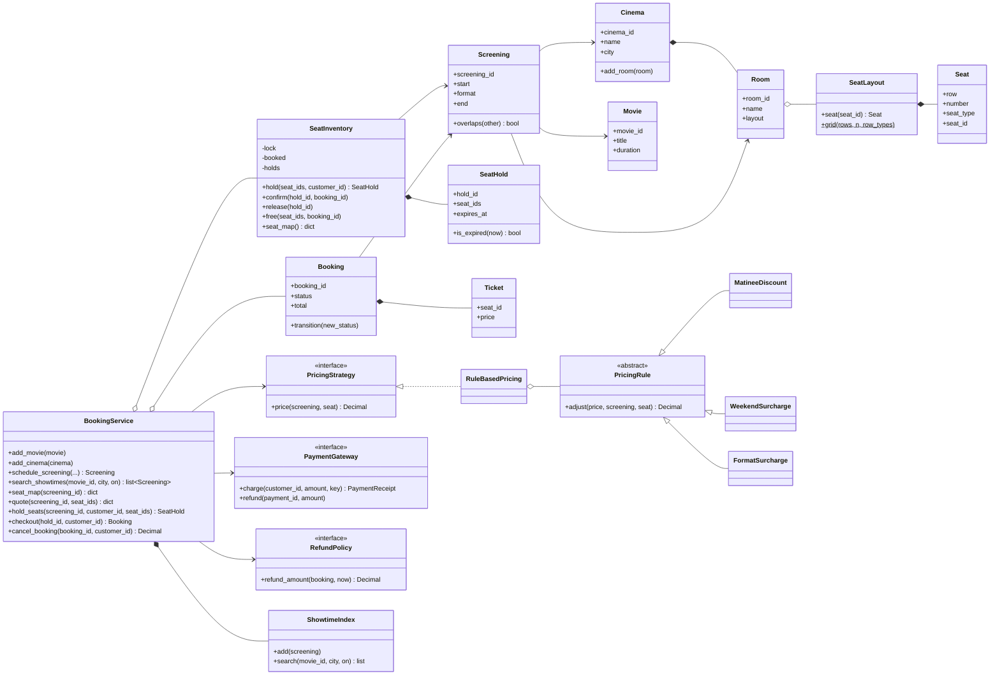
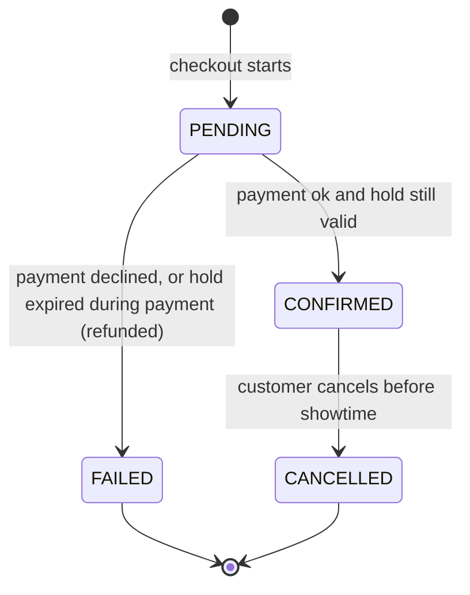

# Design a Movie Ticket Booking System: seats, holds, and the race for F7

Booking a movie ticket looks simple: pick a showtime, tap two seats, pay. Underneath, it is one of the best object-oriented design problems around, because it mixes static data (cinemas, rooms, seat maps), live shared state (which seats are taken right now), money, and a nasty concurrency problem: two people tapping the same seat in the same second.

By the end of this post you will be able to model the system from scratch in Python, explain why each class exists, compare several competing designs for seats, locking, pricing and search with working code, and discuss how real ticketing platforms such as Ticketmaster and Fandango keep a sold-out premiere from selling the same seat twice.

All code is in this folder and uses only the Python 3.13 standard library:

- [`movie_booking.py`](movie_booking.py): the recommended design, with a runnable demo.
- [`alternatives.py`](alternatives.py): the competing designs, with timing and memory experiments.
- [`test_movie_booking.py`](test_movie_booking.py): 34 `unittest` tests, including multi-threaded races.

```bash
python3 movie_booking.py
python3 alternatives.py
python3 -m unittest discover -s . -v
```

If you are new to the vocabulary used here (class, object, composition, interface), the [OOP fundamentals post](../../01-foundations/01-oop-fundamentals.md) covers it, and the [design patterns post](../../01-foundations/02-design-patterns.md) introduces Strategy and Facade, two patterns we will use. The [parking lot case study](../01-parking-lot/README.md) is a gentler warm-up with a similar shape.

---

## 1. The real-world system

Think about what happens when you open the AMC, Cineworld or Fandango app on a Friday night.

1. **Browse.** You search for a movie, or for "what's on near me tonight". The app shows a list of *showtimes*: this movie, at this cinema, in this auditorium, at 19:30, in IMAX.
2. **Pick seats.** You open a seat map. Some seats are grey (sold), some are a different colour (VIP recliners, wheelchair spaces, companion seats). You tap two.
3. **The clock starts.** Most apps now show a countdown: "We're holding your seats for 8:00". Nobody else can take those seats while the timer runs.
4. **Pay.** Card, Apple Pay, gift card or loyalty points. Prices depend on the seat, the time of day (matinees are cheaper), the day of the week and the format (IMAX and 3D cost more).
5. **Confirm.** You get a booking reference and a QR code. The seats turn grey for everyone else.
6. **Maybe cancel.** Many chains let you cancel up to some time before the show and get your money (or credit) back. The seats go back on sale.

The *actors* are the **customer**, the **cinema operator** who schedules screenings and sets prices, and external systems: the **payment provider** and, in real chains, the **theatre management system** that runs the box office and the ticket scanners at the door.

Why is this a good OOD problem? Because it forces you to separate things that look similar but behave differently:

- A **movie** ("Orbit, 130 minutes") is not a **screening** ("Orbit, Saturday 19:30, Room 1"). One movie has hundreds of screenings.
- A **seat** ("D7, VIP recliner") is not the **availability** of that seat. D7 is free for the 13:00 show and sold for the 19:30 show. The physical seat never changes; its status is per screening.
- A **price** is not a property of the seat. The same seat costs less at a matinee.

Getting those separations right is most of the design. The rest is concurrency: making sure that when twenty fans tap seat F7 at the same instant, exactly one of them gets it.

---

## 2. Clarifying requirements

An interviewer will usually open with something vague, such as "Design a system like Fandango." Your first job is to narrow it down. Ask questions that change the design, not questions whose answers you could just assume.

### Questions worth asking

| Question | Why it matters |
|---|---|
| One cinema or a chain with many cinemas, each with several rooms? | Decides whether you need `Cinema` and `Room` classes and location-based search. |
| Can the same movie play in many rooms at many times? | Confirms `Screening` as a separate class. |
| Do seats have different types and prices (standard, premium, VIP, accessible)? | Drives the pricing design. |
| Does price also depend on time, day or format? | Decides between "price stored on the seat" and a pricing policy. |
| Can one order contain several seats? Must they all succeed together? | All-or-nothing holds; `Booking` groups `Ticket`s. |
| Do we handle payment? | If yes, you must think about the gap between "seat chosen" and "money taken". |
| Can many users book at the same time? | Almost always yes, and it is the interesting part. |
| Cancellations and refunds? | Adds a state machine and a refund policy. |
| How do users search? By movie, by cinema, by city and date? | Decides which indexes to build. |

### Final requirements

**Functional**

1. The system manages many cinemas. Each cinema is in a city and has several rooms; each room has a fixed seat layout.
2. Operators add movies and schedule screenings (movie + room + start time + format). Two screenings may not overlap in the same room, including cleaning time between shows.
3. Customers search showtimes by movie, or by city and date.
4. Customers view a seat map showing each seat as available, held or booked.
5. Customers select one or more seats for one screening. The selection is held for a limited time (for example 8 minutes) and is all-or-nothing.
6. Seats have types (standard, premium, VIP, accessible). Price depends on seat type and on screening-level rules (matinee discount, weekend surcharge, format surcharge).
7. The customer pays; on success the booking is confirmed and the seats become booked. On failure the hold is released.
8. A booking groups several tickets; its total is the sum of the ticket prices, and each ticket's price is frozen at purchase.
9. Customers can cancel a confirmed booking before the show starts; the refund follows a policy (full refund until two hours before the show, nothing after).

**Non-functional**

- **Correctness first:** a seat must never be sold twice, even under heavy concurrent load.
- **Fast reads:** search and seat maps are read far more often than seats are booked.
- **Responsiveness under contention:** a rush on one blockbuster screening should not slow down bookings for other screenings.
- **Extensible pricing:** marketing will invent new discounts every month.

**Out of scope** (say this out loud in an interview): user accounts and login, concessions (popcorn), loyalty programmes, physical ticket scanning, recommendations, and the real payment network. We model payment through an interface with a fake implementation.

---

## 3. Finding the core objects

A classic technique is **noun/verb analysis**: underline the nouns and verbs in the requirements. Nouns are candidate classes or attributes; verbs are candidate methods.

**Nouns:** cinema, city, room, seat layout, seat, seat type, movie, screening, start time, format, customer, seat map, hold, timer, price, discount, surcharge, booking, ticket, payment, refund, policy, search.

**Verbs:** schedule, search, view (seat map), select / hold, expire, pay, confirm, cancel, refund, price.

Now sort them.

| Candidate | Decision | Reasoning |
|---|---|---|
| Movie | **Class** (`Movie`) | Has identity and data (title, duration, rating) reused across screenings. |
| Cinema, Room | **Classes** | A cinema *has* rooms; a room *has* a layout. Real containment. |
| Seat layout | **Class** (`SeatLayout`) | Owns seat lookup and validation; shared by every screening in a room. |
| Seat | **Class** (`Seat`) | A position plus a type. Deliberately *no* "is booked" flag (see Decision 1). |
| Seat type | **Enum** (`SeatType`) | A fixed, small set of labels with no behaviour of their own. |
| Screening | **Class** | The join of movie + room + time. The unit customers book against. |
| Seat map / availability | **Class** (`SeatInventory`) | Live, mutable, per-screening state, and the place where concurrency is handled. |
| Hold, timer | **Class** (`SeatHold`) with an `expires_at` field | A timer is just a deadline; we do not need a timer object. |
| Booking, ticket | **Classes** | A booking is the order; tickets are its lines. |
| Price, discount, surcharge | **Strategy + rules** (`RuleBasedPricing`, `PricingRule`s) | Behaviour that varies independently from seats. |
| Payment | **Interface** (`PaymentGateway`) | An external system. We depend on an abstraction. |
| Refund policy | **Interface** (`RefundPolicy`) | Business rule that changes per chain or per country. |
| Search | **Class** (`ShowtimeIndex`) | Indexes are a data structure with their own invariants. |
| Customer | **Just an id string** | We only need to know *who* holds or owns something. No behaviour, so no class (yet). |
| City, start time, format | **Attributes** | Plain values. |

Two nouns that do *not* become classes are worth calling out. **Customer** has no behaviour in our scope, so a `customer_id: str` is enough; promoting it to a class now would be speculative. **Timer** sounds like an object, but modelling it as a background thread per hold would be complex and fragile. A deadline timestamp plus "check it whenever someone looks" (lazy expiry) is simpler and just as correct.

Finally, something has to coordinate all of these for the client. That is the **facade** `BookingService`: one entry point offering browse, hold, checkout and cancel, while the real work stays in the specialised classes.

---

## 4. Class design



A quick refresher on the arrows: **composition** (filled diamond, `*--`) means the part's life is tied to the whole (a room does not exist without its cinema); **aggregation** (hollow diamond, `o--`) means the whole holds parts that could exist independently (a layout can be shared by several identical rooms); a plain arrow is an **association** (one object knows about another); `<|--` and `<|..` are **inheritance** and **interface implementation**.

### The static catalog: `Movie`, `Cinema`, `Room`, `SeatLayout`, `Seat`

These classes describe the world and almost never change once set up. Most are **frozen dataclasses**: immutable value objects. Immutability matters here for more than tidiness: an immutable object can be shared between threads without any locking, because nobody can change it.

- `Movie` holds title, duration, genre and rating. It knows nothing about where or when it plays.
- `Seat` is a row, a number and a `SeatType`. Its `seat_id` ("D7") is derived. It has **no availability flag**, which is the single most important modelling decision in this design.
- `SeatLayout` is the seat map of a room: a dictionary from seat id to `Seat`, with validation (no duplicates, no empty rooms) and a `grid()` helper for rectangular rooms. Irregular rooms (a missing seat for a pillar, wheelchair spaces) are just a different list of seats.
- `Room` pairs a name with a layout; `Cinema` composes rooms and knows its city.

### The schedule: `Screening`

A screening is the meeting point of a movie, a room and a time. It computes its own `end` and answers `overlaps(other)`, including a 20-minute turnover buffer for cleaning. Keeping that check *on the screening* means the rule lives next to the data it needs (this is the "Information Expert" principle: give a responsibility to the class that has the information).

### Live state: `SeatInventory` and `SeatHold`

`SeatInventory` is the heart of the design. There is one per screening, it owns its own lock, and it tracks three things: which seats are booked (and by which booking), which are held (and by which hold), and the holds themselves. Every method is **atomic**: it either completes fully or changes nothing, and no other thread can see it half-done.

A `SeatHold` is an immutable record: who holds which seats of which screening until when.

### Money: `PricingStrategy`, `PricingRule`, `PaymentGateway`, `RefundPolicy`

All four are *abstractions* the booking service depends on, not concrete classes. This is the **Dependency Inversion Principle**: high-level policy (the booking flow) depends on interfaces, and low-level details (Stripe vs Adyen, this chain's refund rules) plug in from outside. It is also what lets the tests use a fake payment gateway and a manual clock.

### Orders: `Booking` and `Ticket`

A `Booking` groups `Ticket`s for one screening and has a **status** that moves through a small **state machine** (a fixed set of states plus the allowed moves between them):



Each `Ticket` stores its own `price`. That is deliberate: if marketing changes prices tomorrow, yesterday's tickets must not change.

### Search: `ShowtimeIndex`

Secondary indexes from movie id, and from (city, day), to screenings sorted by start time. Discussed in Decision 4.

### Coordination: `BookingService`

The **Facade** pattern: one simple interface over a subsystem of collaborating objects. Clients never touch `SeatInventory` or the payment gateway directly, so we can change internals (say, move inventories to Redis) without touching clients.

---

## 5. Code: the recommended solution

The full implementation is in [`movie_booking.py`](movie_booking.py). Here are the parts worth understanding, in the order a request flows through them.

### 5.1 Seats without state

```python
@dataclass(frozen=True)
class Seat:
    """A physical seat. It knows its position and type, not whether it is sold."""

    row: str
    number: int
    seat_type: SeatType = SeatType.STANDARD

    @property
    def seat_id(self) -> str:
        return f"{self.row}{self.number}"
```

```python
    @classmethod
    def grid(
        cls,
        rows: str,
        seats_per_row: int,
        row_types: dict[str, SeatType] | None = None,
    ) -> SeatLayout:
        """Build a rectangular layout; ``row_types`` upgrades whole rows."""
        row_types = row_types or {}
        return cls(
            Seat(row, number, row_types.get(row, SeatType.STANDARD))
            for row in rows
            for number in range(1, seats_per_row + 1)
        )
```

One `SeatLayout` object exists per room. Every screening in that room points at the same layout. Nothing about a seat changes when it is sold, so there is nothing to copy.

### 5.2 Screenings that cannot collide

```python
    @property
    def end(self) -> datetime:
        return self.start + self.movie.duration

    def overlaps(self, other: Screening) -> bool:
        """True if both use the same room and their busy windows intersect."""
        if self.room is not other.room:
            return False
        return self.start < other.end + TURNOVER and other.start < self.end + TURNOVER
```

The overlap test is the standard interval check: two intervals `[a1, a2)` and `[b1, b2)` overlap exactly when `a1 < b2 and b1 < a2`. We stretch each interval by the turnover time. The service calls it while holding its registry lock, so two operators cannot schedule clashing shows at the same moment.

### 5.3 The seat inventory: hold, confirm, release

Here is the core of the system: holding seats.

```python
    def hold(self, seat_ids: Iterable[str], customer_id: str) -> SeatHold:
        """Hold all requested seats or none of them."""
        requested = list(seat_ids)
        if not requested:
            raise ValueError("select at least one seat")
        if len(set(requested)) != len(requested):
            raise ValueError("the same seat was selected twice")
        for seat_id in requested:
            self._layout.seat(seat_id)

        with self._lock:
            self._expire_stale_holds()
            taken = [s for s in requested if self._status_unlocked(s) is not SeatStatus.AVAILABLE]
            if taken:
                raise SeatUnavailableError(f"seats no longer available: {', '.join(taken)}")
            hold = SeatHold(
                hold_id=f"H{next(_hold_ids)}",
                screening_id=self.screening.screening_id,
                customer_id=customer_id,
                seat_ids=frozenset(requested),
                expires_at=self._clock() + self._hold_ttl,
            )
            self._holds[hold.hold_id] = hold
            for seat_id in requested:
                self._held_by[seat_id] = hold.hold_id
            return hold
```

Notice three things:

1. **Validation happens outside the lock.** Checking that the seat ids exist touches only immutable data, so there is no reason to make other threads wait for it. Keep critical sections (the code inside the lock) as short as possible.
2. **Check and act happen inside the same lock.** "Is the seat free?" and "mark it held" must be one indivisible step. If they were separate, two threads could both see "free" and both mark it. That bug is a **race condition**: the result depends on the timing of threads. We demonstrate it with real threads in Decision 2.
3. **All or nothing.** If any requested seat is taken, nothing is held. A couple wanting two seats together does not want one of them.

Expiry is **lazy**:

```python
    def _expire_stale_holds(self) -> None:
        # Lazy expiry: no background thread, stale holds are swept whenever
        # someone looks. Correct because every read and write calls this first.
        now = self._clock()
        for hold_id in [h.hold_id for h in self._holds.values() if h.is_expired(now)]:
            self._drop_hold(hold_id)
```

There is no timer thread. Instead, any operation that reads or writes the inventory first sweeps holds whose deadline has passed. The seat therefore *appears* free the instant its hold expires, which is all users can observe. (With thousands of seats you would index holds by expiry time with a heap; with a few hundred seats per screening a scan is fine.)

The clock is **injected** (`clock: Clock`, a function returning the current time). Production passes `datetime.now`; tests and the demo pass a `ManualClock` they can fast-forward. Code that calls `datetime.now()` directly is very hard to test; code that receives a clock is trivial to test.

Confirming turns a hold into a booking, but only if the hold is still alive:

```python
    def confirm(self, hold_id: str, booking_id: str) -> None:
        """Turn a live hold into a permanent booking."""
        with self._lock:
            self._expire_stale_holds()
            hold = self._drop_hold(hold_id)
            if hold is None:
                raise HoldExpiredError(f"hold {hold_id} expired before payment finished")
            for seat_id in hold.seat_ids:
                self._booked[seat_id] = booking_id
```

### 5.4 Pricing as a pipeline of rules

```python
class RuleBasedPricing:
    """Base price by seat type, then a pipeline of rules. Never below zero."""

    def __init__(
        self, base_prices: dict[SeatType, Decimal], rules: Sequence[PricingRule] = ()
    ) -> None:
        missing = set(SeatType) - base_prices.keys()
        if missing:
            raise ValueError(f"no base price for {sorted(t.value for t in missing)}")
        self._base = dict(base_prices)
        self._rules = tuple(rules)

    def price(self, screening: Screening, seat: Seat) -> Decimal:
        amount = self._base[seat.seat_type]
        for rule in self._rules:
            amount = rule.adjust(amount, screening, seat)
        return money(max(amount, Decimal("0")))
```

Each rule is a tiny class:

```python
@dataclass(frozen=True)
class MatineeDiscount(PricingRule):
    """Percentage off for shows that start before ``before_hour``."""

    before_hour: int = 16
    percent_off: Decimal = Decimal("20")

    def adjust(self, price: Decimal, screening: Screening, seat: Seat) -> Decimal:
        if screening.start.hour < self.before_hour:
            return price * (1 - self.percent_off / 100)
        return price
```

Two details: money is always `Decimal`, never `float` (`0.1 + 0.2 != 0.3` in floating point, which is unacceptable for a till), and the constructor refuses a price table that forgets a seat type, so a new `SeatType` cannot silently crash at checkout. Rounding to cents happens once, at the end.

### 5.5 Checkout: two phases with a compensating action

```python
    def checkout(self, hold_id: str, customer_id: str) -> Booking:
        """Charge the customer for a live hold, then make the seats permanent."""
        inventory = self._inventory_for_hold(hold_id)
        hold = inventory.get_hold(hold_id)
        if hold.customer_id != customer_id:
            raise InvalidStateError("this hold belongs to another customer")

        screening = inventory.screening
        booking_id = f"B{next(self._booking_ids)}"
        tickets = tuple(
            Ticket(
                ticket_id=f"{booking_id}-{seat_id}",
                booking_id=booking_id,
                screening_id=screening.screening_id,
                seat_id=seat_id,
                price=self._pricing.price(screening, screening.room.layout.seat(seat_id)),
            )
            for seat_id in sorted(hold.seat_ids)
        )
        booking = Booking(booking_id, customer_id, screening, tickets, self._clock())
        with self._registry_lock:
            self._bookings[booking_id] = booking

        # Phase 1: take the money. No lock is held during this slow call.
        try:
            receipt = self._payments.charge(customer_id, booking.total, idempotency_key=hold_id)
        except PaymentDeclinedError:
            booking.transition(BookingStatus.FAILED)
            inventory.release(hold_id)
            raise

        # Phase 2: commit the seats. If the hold ran out meanwhile, undo phase 1.
        try:
            inventory.confirm(hold_id, booking_id)
        except HoldExpiredError:
            self._payments.refund(receipt.payment_id, receipt.amount)
            booking.transition(BookingStatus.FAILED)
            raise

        booking.payment_id = receipt.payment_id
        booking.transition(BookingStatus.CONFIRMED)
        return booking
```

This is the most important method to be able to explain in an interview.

- **The seats are already safe before we pay.** The hold guarantees nobody else can take them. Payment is slow (seconds, sometimes longer with 3-D Secure), so we never hold a lock during it.
- **Phase 2 can still fail.** If the customer's bank took longer than the hold, the hold has expired and someone else may now have the seats. We must not confirm; instead we run a **compensating action**: refund the charge. This "do, and if a later step fails, undo with a compensating step" structure is a tiny version of the **saga** pattern used in distributed systems.
- **The idempotency key** is the hold id. If the network drops after the gateway charged the card and we retry, the gateway recognises the key and returns the original receipt instead of charging twice. Real gateways such as Stripe support exactly this kind of key.

```mermaid
sequenceDiagram
    participant C as Customer app
    participant S as BookingService
    participant I as SeatInventory (s1)
    participant P as PaymentGateway
    C->>S: hold_seats(s1, alice, [D3, D4])
    S->>I: hold (atomic, under s1 lock)
    I-->>S: SeatHold H1, expires 19:08
    S-->>C: H1 + countdown
    C->>S: checkout(H1, alice)
    S->>I: get_hold(H1) still alive?
    S->>P: charge(total, key=H1)
    P-->>S: receipt P1
    S->>I: confirm(H1, B1)
    alt hold still valid
        I-->>S: seats BOOKED
        S-->>C: Booking B1 CONFIRMED
    else hold expired during payment
        I-->>S: HoldExpiredError
        S->>P: refund(P1)
        S-->>C: error, money returned
    end
```



### 5.6 Cancellation and refunds

```python
    def cancel_booking(self, booking_id: str, customer_id: str) -> Decimal:
        """Cancel a confirmed booking, free its seats, refund per policy."""
        booking = self.booking(booking_id)
        if booking.customer_id != customer_id:
            raise InvalidStateError("this booking belongs to another customer")
        now = self._clock()
        if now >= booking.screening.start:
            raise InvalidStateError("the show has already started")
        booking.transition(BookingStatus.CANCELLED)  # raises unless CONFIRMED
        refund = self._refund_policy.refund_amount(booking, now)
        if refund > 0 and booking.payment_id is not None:
            self._payments.refund(booking.payment_id, refund)
        booking.refunded = refund
        self._inventory(booking.screening.screening_id).free(booking.seat_ids, booking_id)
        return refund
```

The state machine guards against double cancellation (`CANCELLED -> CANCELLED` is not an allowed transition), and `free()` only releases seats still owned by *this* booking, so a stale cancellation can never free a seat that has since been resold.

### 5.7 The demo

`python3 movie_booking.py` prints:

```text
Scheduling rejected: r1 is busy with Orbit at 13:00

Saturday showtimes in Boston:
  s2 Orbit IMAX at 13:00
  s1 Orbit IMAX at 19:30

Quote for s1: {'A1': '19.00', 'D3': '31.00'}

alice holds ['D3', 'D4'] until 09:08
bob is refused: seats no longer available: D4
alice paid 62.00 -> B1 confirmed

carol waited too long; B1 is now available
carol's checkout fails: hold H2 expired or released
mallory: card declined for mallory; C1 is available again

alice cancels and gets 62.00 back; D3 is available
Seats left for s1: 24 of 24
```

---

## 6. Comparing approaches

This is where a strong answer separates itself. For each decision we look at the realistic alternatives, run them, and choose. All of the code below is in [`alternatives.py`](alternatives.py); run it to reproduce the numbers (timings will differ on your machine, but the shape will not).

### Decision 1: how to model seats and their availability

**Approach A: seat objects per screening.** Each screening owns its own copy of every seat, and each seat carries an `is_booked` flag. This is what many people draw first, because "a seat is booked" sounds like a property of the seat.

```python
@dataclass
class BookableSeat:
    """Approach A: a mutable seat object that knows if it is booked."""

    seat_id: str
    seat_type: str
    is_booked: bool = False


class SeatObjectsPerScreening:
    """Approach A: every screening gets its own copy of every seat object."""

    def __init__(self, seat_ids: list[str]) -> None:
        self.seats = {s: BookableSeat(s, "standard") for s in seat_ids}
```

**Approach B: shared immutable layout + per-screening availability map** (what `SeatInventory` does). The layout is built once per room; each screening only stores which seat ids are taken.

```python
class LayoutWithAvailabilityMap:
    """Approach B (recommended): shared immutable layout + a set of taken ids."""

    def __init__(self, layout_ids: tuple[str, ...]) -> None:
        self.layout_ids = layout_ids  # shared by all screenings in the room
        self.booked: set[str] = set()

    def book(self, seat_id: str) -> bool:
        if seat_id in self.booked:
            return False
        self.booked.add(seat_id)
        return True
```

**Approach C: bitmap.** Number the seats once per layout and store availability as the bits of one integer. Bit 37 set means seat 37 is taken.

```python
class BitmapAvailability:
    """Approach C: one bit per seat in an int. Compact and fast set maths."""

    def __init__(self, layout_ids: tuple[str, ...], position: dict[str, int]) -> None:
        self.layout_ids = layout_ids
        self.position = position  # seat id -> bit number, shared like the layout
        self.bits = 0

    def book(self, seat_id: str) -> bool:
        mask = 1 << self.position[seat_id]
        if self.bits & mask:
            return False
        self.bits |= mask
        return True
```

Measured with `tracemalloc` for 500 screenings of a 300-seat room with 120 seats sold in each:

```text
1) Seat modeling: memory for 500 screenings, 300 seats, 120 sold each
   seat objects per screening      17,321 KiB
   shared layout + booked set       4,156 KiB
   shared layout + bitmap              74 KiB
```

| | A: seat objects per screening | B: layout + availability map | C: layout + bitmap |
|---|---|---|---|
| Memory | Highest: every seat duplicated per show | Proportional to seats *sold* | Tiny: one bit per seat |
| Clarity | Intuitive at first | Clear: static vs live state separated | Needs bit-twiddling helpers |
| Shared state risk | Mutable seats; easy to mutate the wrong show's copy | Layout immutable, shareable across threads | Same as B |
| Holds with owner/expiry | Add more fields to every seat | Natural: map seat to hold id | Needs a side table anyway |
| Persistence | One row per seat per show | One row per *sold* seat (matches a `tickets` table) | One blob per show; awkward for SQL |
| Choose when | Tiny toy systems | Almost always | Huge venues, in-memory caches, "find N adjacent free seats" via bit maths |

**Recommendation: B.** It separates what never changes (the seat) from what changes per show (availability), it maps directly onto a relational schema, and it naturally stores *who* holds a seat. Bitmaps are a great optimisation for an availability cache in front of the database (some large ticketing systems keep compact seat-status structures in memory for exactly this reason), but they do not replace the model.

### Decision 2: preventing double booking

All five contenders implement `book(screening_id, seat_id, customer) -> bool`. Each simulates a little "work" (a database round trip) inside the booking path with `time.sleep`, which also lets other threads run, exactly like real I/O.

**Approach A: no lock.** The bug everyone writes first.

```python
    def book(self, screening_id: str, seat_id: str, customer: str) -> bool:
        key = (screening_id, seat_id)
        if key in self.booked:  # check ...
            return False
        time.sleep(self.work_seconds)  # ... another thread runs here ...
        self.booked[key] = customer  # ... act (overwrites the other buyer!)
        return True
```

**Approach B: one global lock.** Correct, but every booking in the whole system queues behind every other.

```python
    def book(self, screening_id: str, seat_id: str, customer: str) -> bool:
        with self._lock:
            key = (screening_id, seat_id)
            if key in self.booked:
                return False
            time.sleep(self.work_seconds)
            self.booked[key] = customer
            return True
```

**Approach C: one lock per screening** ("lock striping": split one big lock into many independent ones so unrelated work does not contend).

```python
    def _lock_for(self, screening_id: str) -> threading.Lock:
        # Creating the lock must itself be atomic, or two threads could each
        # create (and use) a different lock for the same screening.
        with self._locks_guard:
            return self._locks.setdefault(screening_id, threading.Lock())

    def book(self, screening_id: str, seat_id: str, customer: str) -> bool:
        with self._lock_for(screening_id):
            seats = self.booked[screening_id]
            if seat_id in seats:
                return False
            time.sleep(self.work_seconds)
            seats[seat_id] = customer
            return True
```

**Approach D: temporary hold with expiry** (a *pessimistic* approach: claim first, then do the slow work). The lock protects only the claim; the slow part (payment) happens between `hold` and `confirm` with no lock held, and an abandoned hold simply times out.

```python
    def hold(self, screening_id: str, seat_id: str, customer: str) -> bool:
        key = (screening_id, seat_id)
        with self._lock:
            if key in self.booked:
                return False
            current = self.holds.get(key)
            if current is not None and current[1] > self.clock():
                return False
            self.holds[key] = (customer, self.clock() + self.ttl)
            return True
```

**Approach E: optimistic versioning.** Do not lock while working. Read a snapshot including a version number; when writing, succeed only if the version is unchanged, otherwise re-read and retry. It is *optimistic* because it assumes conflicts are rare and pays only when one happens.

```python
    def book(self, screening_id: str, seat_id: str, customer: str) -> bool:
        for _ in range(self.max_retries):
            version, booked = self.state[screening_id]  # read a snapshot
            if seat_id in booked:
                return False
            time.sleep(self.work_seconds)  # slow work, no lock held
            with self._cas_lock:  # compare-and-set
                if self.state[screening_id][0] != version:
                    self.conflicts += 1
                    continue  # someone else wrote first: re-read and retry
                self.state[screening_id] = (version + 1, booked | {seat_id})
                self.owner[(screening_id, seat_id)] = customer
                return True
        raise RuntimeError("too much contention, giving up")
```

The tiny `_cas_lock` stands in for what a database gives you for free: `UPDATE screenings SET ..., version = version + 1 WHERE id = ? AND version = ?` is atomic, and "0 rows updated" means you lost the race.

Now the experiment. First, 20 threads released at the same instant by a `threading.Barrier`, all trying to book seat F7:

```text
2) Double booking: 20 threads race for seat F7
   NaiveBooker              winners = 20
   GlobalLockBooker         winners = 1
   PerScreeningLockBooker   winners = 1
   HoldWithExpiryBooker     winners = 1
   OptimisticBooker         winners = 1
```

Twenty "successful" bookings for one seat: the naive version sold F7 twenty times, and the last writer silently overwrote the other nineteen. Every other approach is correct. So correctness alone does not pick a winner; throughput does. Next, 8 threads each book 5 seats in **8 different screenings**, with 5 ms of work per booking:

```text
   8 different shows booked in parallel (5 ms of work per booking)
   GlobalLockBooker            246 ms
   PerScreeningLockBooker       30 ms
   OptimisticBooker             32 ms
```

The global lock forces 40 bookings into one line (40 x 5 ms, roughly 200+ ms). With per-screening locks the 8 shows proceed in parallel (5 x 5 ms, roughly 25+ ms). That is the "a rush on one premiere must not slow down every other show" requirement, measured.

| | A: no lock | B: global lock | C: per-screening lock | D: hold with expiry | E: optimistic version |
|---|---|---|---|---|---|
| Correct? | **No** | Yes | Yes | Yes | Yes |
| Throughput across shows | n/a | Poor: one queue for everything | Good | Good (if striped per show) | Good |
| Hot single show | n/a | Serialised | Serialised (unavoidable) | Serialised only for the short claim | Many retries; wasted work |
| Survives slow payment | n/a | Holding a lock during payment blocks everyone | Same problem if lock spans payment | **Yes**: no lock during payment | Seat may be taken mid-payment; user loses it after paying |
| Abandoned checkouts | n/a | n/a | n/a | Expire automatically | Nothing to clean up |
| Complexity | Trivial | Trivial | Low | Medium (expiry, compensations) | Medium (retry loop, versions) |
| Choose when | Never | Prototypes, single-user tools | In-process critical sections | User-facing flows with slow steps (checkout) | Low-contention writes, e.g. admin edits to a schedule |

**Recommendation: D on top of C.** The recommended code does both: each `SeatInventory` has its own lock (C), and that lock is held only to claim or confirm a hold (D), never during payment. Optimistic versioning (E) is the right tool for low-contention edits such as an operator updating a screening's details, and a database version column is often used to make the *confirm* step safe across multiple servers. For a sold-out premiere where hundreds of people want the same seats, optimistic retries mean many users do work only to be told "sorry" at the end, which is exactly what holds avoid.

### Decision 3: pricing

**Approach A: if/else in one function.**

```python
def price_if_else(seat_type: str, start: datetime, fmt: str) -> Decimal:
    """Approach A: everything in one function. Every new rule edits this."""
    if seat_type == "vip":
        price = Decimal("24.00")
    elif seat_type == "premium":
        price = Decimal("16.00")
    else:
        price = Decimal("12.00")
    if start.hour < 16:
        price = price * Decimal("0.8")
    if start.weekday() >= 5:
        price += Decimal("2.00")
    if fmt == "IMAX":
        price += Decimal("5.00")
    return price.quantize(Decimal("0.01"))
```

**Approach B: a rate object per seat** (Strategy attached to each seat: `NormalRate`, `PremiumRate`, `VipRate`).

```python
@dataclass(frozen=True)
class SeatWithRate:
    """Approach B: each seat carries its own rate object (Strategy per seat).

    Clean for seat tiers, but the rate knows nothing about the screening, so
    time-of-day or format pricing has nowhere natural to live.
    """

    seat_id: str
    rate: SeatRate

    def price(self) -> Decimal:
        return self.rate.price()
```

**Approach C: a `PricingStrategy` with a base table by seat type plus a pipeline of rules** (the recommended `RuleBasedPricing` from section 5.4). This is the Strategy pattern at the level of the whole policy, with a chain of small rule objects inside it (close cousins of the Chain of Responsibility and Decorator patterns).

All three priced the same VIP seat for a Saturday 13:00 IMAX show:

```text
3) Pricing a VIP seat, Saturday 13:00 IMAX (only two of three get it right)
   if/else:        26.20
   per-seat rate:  24.00  (ignores time and format!)
   rule pipeline:  26.20
```

| | A: if/else | B: rate per seat | C: rules pipeline |
|---|---|---|---|
| Add a new seat type | Edit the function | New class | New entry in the price table |
| Add a new discount (student Tuesday) | Edit the function; risk breaking others | No place for it: the seat has no screening context | New `PricingRule` subclass; nothing else changes (Open/Closed Principle) |
| Per-cinema or per-region pricing | Copy-paste the function | Hard | Configure a different pipeline per cinema |
| Testability | One big test matrix | Easy but incomplete | Each rule tested alone, plus pipeline tests |
| Order of rules | Implicit in code | n/a | Explicit list; but you must decide the order (20% off then +2, or +2 then 20% off?) |
| Choose when | Two or three fixed prices, forever | Pricing truly depends only on the seat | Real cinemas |

**Recommendation: C.** Seat tier is just one input to price; time, day and format are attributes of the *screening*, so the pricing strategy must see both. Watch the ordering trap: discount-then-surcharge and surcharge-then-discount give different totals, and you should state your order explicitly (and test it, as `test_rules_stack_in_order` does).

### Decision 4: search and indexing

**Approach A: linear scan.** Keep a list of all screenings; filter on every query.

```python
    def search(self, movie_id: str | None = None, city: str | None = None,
               on: date | None = None) -> list[Screening]:
        return [
            s
            for s in self.screenings
            if (movie_id is None or s.movie.movie_id == movie_id)
            and (city is None or s.cinema.city.lower() == city.lower())
            and (on is None or s.start.date() == on)
        ]
```

**Approach B: hash indexes** (`ShowtimeIndex` in the main file). Maintain dictionaries keyed by the questions users actually ask, each holding screenings already sorted by time.

```python
    def add(self, screening: Screening) -> None:
        by_start = lambda s: (s.start, s.screening_id)  # noqa: E731
        insort(self._by_movie[screening.movie.movie_id], screening, key=by_start)
        key = (screening.cinema.city.lower(), screening.start.date())
        insort(self._by_city_day[key], screening, key=by_start)
```

**Approach C: a time-sorted list with binary search** (`bisect`), for range questions like "what starts in the next two hours?" that a hash map cannot answer.

```python
    def starting_between(self, begin: datetime, end: datetime) -> list[Screening]:
        lo = bisect_left(self._sorted, begin, key=lambda s: s.start)
        hi = bisect_left(self._sorted, end, key=lambda s: s.start)
        return self._sorted[lo:hi]
```

On 4,000 screenings, 200 identical queries:

```text
4) Search: 'Boston on Nov 3' over 4,000 screenings, 200 queries
   linear scan   116 hits,   64.6 ms
   hash indexes  116 hits,    2.9 ms
   time-sorted   116 shows start Nov 3 between 12:00 and 14:00
```

| | A: linear scan | B: hash indexes | C: sorted + bisect |
|---|---|---|---|
| Query cost | O(n) every time | O(1) lookup + size of result | O(log n) + size of result |
| Write cost | O(1) append | One `insort` per index | One `insort` |
| Memory | Minimal | One entry per index per screening | One list |
| Supports ranges | Yes, slowly | No | **Yes** |
| Supports new query types | Automatically | Need a new index | Only time-based |
| Choose when | Small data, admin tools | Known, frequent equality queries | "Starting soon", time windows |

**Recommendation: B for the main search paths, C if you need time windows**, and in production, neither: you put screenings in a database with composite indexes such as `(city, start_time)` and `(movie_id, start_time)`, which is B and C combined, and often a search engine such as Elasticsearch for text and geo queries ("cinemas within 10 km"). The OOD lesson is to **design the index around the queries**, and to start from the most selective index and filter the small result, as `ShowtimeIndex.search` does.

---

## 7. Going deeper

### 7.1 Concurrency, layer by layer

Our design has three kinds of locks, and it is worth being able to say why each exists.

| Lock | Protects | Held during | Why not bigger |
|---|---|---|---|
| `SeatInventory._lock` (one per screening) | That screening's booked/held maps | A single hold/confirm/release/read | One hot show must not block others |
| `BookingService._registry_lock` | The service's dictionaries (screenings, bookings, hold index) | Dictionary reads and writes only | Must never be held during a seat operation or payment |
| `FakePaymentGateway._lock` | The fake's own bookkeeping | One charge or refund | Belongs to the fake; a real gateway is a remote service |

Rules that keep this deadlock-free: no code ever holds two of these locks at once, and no lock is ever held during payment. A **deadlock** is two threads each holding a lock the other needs, waiting forever; the simplest prevention is to never nest locks, and the next simplest is to always take them in the same order.

Python note: the GIL (global interpreter lock in CPython) does **not** save you here. It makes single bytecode steps atomic, but "check whether the seat is in the dict, then put it in the dict" is many steps, and a thread switch can happen between them, as the naive booker's 20 winners show. Free-threaded Python builds (an option since 3.13) make explicit locking even more important.

The test `test_many_threads_one_seat_one_winner` releases 30 threads at once through a `Barrier`, each running the full hold-and-checkout flow for seat C2, and asserts exactly one booking.

### 7.2 "The interviewer now asks..."

**"Customers should not leave single empty seats between groups."** Many cinemas enforce a "no orphan seat" rule. Add a `SeatSelectionRule` interface checked inside `SeatInventory.hold` (under the lock, because it depends on current availability). The layout knows adjacency; the inventory knows status. The design absorbs it without touching pricing or payment.

**"Add dynamic pricing: prices rise as the show fills up."** Add a `DemandSurcharge(PricingRule)` that needs the occupancy. Give `PricingRule.adjust` a context object instead of separate arguments, or pass the inventory's occupancy ratio in. This is why we price at checkout, not when the layout is built. Ticketmaster and airlines do versions of this at scale.

**"Support a 10% student discount and loyalty points."** A new `PricingRule` for the discount (it needs the customer, so the price context grows a customer field). Points are a second payment method: model it as another `PaymentGateway` implementation, or a `SplitPayment` that composes two.

**"Add seat holds that the customer can extend once."** `SeatInventory.extend(hold_id)` that replaces the hold with a new deadline (holds are immutable, so we swap the record) and a counter to allow it only once.

**"Group bookings: 30 seats for a school trip, with an invoice."** The all-or-nothing hold already supports it. Payment becomes "pay later": a new booking state `RESERVED_UNPAID` with its own (longer) expiry. The explicit transition table makes adding a state a one-line change, plus the new transitions.

**"Waitlist for sold-out shows."** Observer pattern: `SeatInventory` publishes "seats freed" events (on release, expiry and cancellation); a `Waitlist` subscriber notifies the next customer and maybe auto-holds for them.

**"Multiple screens show the same movie and a user wants 'any good seat for Orbit tonight'."** That is a search + best-available algorithm across inventories. Keep it in a separate `SeatSuggester` service; do not bloat `SeatInventory`.

### 7.3 From in-memory objects to a real service

An interview usually stays in memory, but you should be able to sketch the next step.

**Schema.** `movies`, `cinemas`, `rooms`, `seats (room_id, seat_id, type)`, `screenings (id, movie_id, room_id, start, format, version)`, `bookings (id, customer_id, screening_id, status, total, payment_id)`, `tickets (booking_id, screening_id, seat_id, price)`. The decisive line is a **unique constraint on `tickets(screening_id, seat_id)`**. With it, the database itself makes double booking impossible: the second insert fails, whatever your application code does. This is Decision 1's approach B, expressed in SQL.

But a ticket row is only for *sold* seats. Where do holds live? Common options:

- **A `seat_holds` table** with the same unique constraint and an `expires_at` column, cleaned up by a periodic job or lazily, like our in-memory version.
- **Redis**, using `SET key value NX PX <ttl>`: "set only if not exists, with an expiry in milliseconds". That single atomic command is a seat hold with a countdown, and Redis deletes the key when time runs out. Many ticketing architectures use exactly this pattern for holds, with the database as the source of truth for sold seats.
- **`SELECT ... FOR UPDATE`** (pessimistic row locks) inside a short transaction to claim seats. Fine for the claim; never keep the transaction open across payment.

**Multiple servers.** Our `threading.Lock` only works inside one process. With many app servers, the lock must move to a shared place: the database (constraints, row locks, version columns) or Redis. Another approach is to **route all requests for one screening to one worker** (partition by screening id), so the in-process per-screening lock still works; this is the actor-style design some high-volume systems use.

**Payment across services.** Our two-phase checkout becomes a saga with durable steps: write a `PENDING` booking, call the gateway with an idempotency key, then confirm. If the process crashes between "charged" and "confirmed", a recovery job finds old `PENDING` bookings and asks the gateway what happened. Payment providers also offer **authorise now, capture later**: put a hold on the card first, confirm the seats, then capture the money; if the seats are lost, void the authorisation instead of refunding.

### 7.4 Testing strategy

The test file shows the layers worth testing:

- **Value objects and validation:** layouts, duplicate seats, unknown ids.
- **Business rules in isolation:** each pricing rule, rule ordering, refund boundaries (exactly two hours before is still a full refund).
- **Flows:** happy path, all-or-nothing holds, expiry, declined payment, expiry *during* payment (a `SlowGateway` subclass advances the manual clock inside `charge`), cancellation twice, cancellation by a stranger.
- **Concurrency:** 30 threads, one seat, one winner; many threads, different seats, all succeed.
- **Alternatives agree:** the three seat models and the three search approaches return the same answers; every safe booker allows exactly one winner.

Two techniques make this easy: **dependency injection** of the clock and the payment gateway, and **fakes** (working lightweight implementations) rather than mocks that only record calls. Without an injectable clock, testing an 8-minute expiry would mean an 8-minute test.

### 7.5 Failure modes

| Failure | What happens in our design | Production addition |
|---|---|---|
| Customer closes the app mid-checkout | Hold expires; seats return automatically | Same, plus an explicit "release" when the user navigates back |
| Payment succeeds, hold already expired | Compensating refund, booking `FAILED` | Prefer authorise/capture so you void instead of refund |
| Network drops after charge, client retries | Idempotency key returns the same receipt | Same; keys stored server-side by the gateway |
| Process crashes after charge, before confirm | Lost (in-memory) | Durable `PENDING` booking + reconciliation job |
| Bot grabs and holds every seat | Holds expire, but bots can re-hold | Limit seats per customer, CAPTCHAs, waiting rooms |
| Clock skew between servers | Single clock in-process | Use database or Redis time as the single source for expiry |
| Price changes during checkout | Ticket price computed and frozen at checkout | Show the quote at hold time and honour it until the hold expires |

---

## 8. How real systems do it

**Seat holds with countdowns.** Ticketmaster, Fandango, AMC and most airline seat-selection flows reserve the chosen seats for a short window and show a visible timer. If the timer runs out, the seats go back into the pool. That is precisely our `SeatHold` with `expires_at`, and the reason is the same: payment is slow and unreliable, and you cannot hold a database lock while a human types a card number.

**Virtual waiting rooms.** For huge on-sales (a major franchise premiere, a stadium tour), the problem is not just two users and one seat but millions of users and a few thousand seats. Ticketmaster's Smart Queue and products such as Queue-it put arriving users into a queue *before* they reach the seat map, then let them in at a controlled rate. This protects the booking system from overload and makes the process fairer than "whoever refreshes fastest". In OOD terms, it is admission control in front of our `BookingService`; the booking design does not change, but the traffic it sees becomes manageable. Waiting rooms are also usually combined with bot detection and per-account ticket limits.

**Payment, then confirm.** Real checkouts are two-phase, just like ours: claim inventory, take payment (often an authorisation), then commit. Payment providers such as Stripe expose idempotency keys precisely so a retried request does not double-charge. When the commit step fails, the money is released or refunded automatically.

**Cancellations, refunds and exchanges.** Policies vary by chain and country: some allow cancellation up to a fixed time before showtime, some refund only to a gift card or credit, some charge a fee, and many members' programmes allow free exchanges. Ticketmaster-style resale marketplaces add another twist: the seat is not freed but *transferred* to a new owner. All of these are reasons to keep refund logic behind a `RefundPolicy` interface rather than inside `cancel_booking`.

**Cinema back offices.** Large chains run a theatre management system (vendors such as Vista Entertainment Solutions are widely used) that owns screens, schedules, seat maps, box-office sales and door scanning. Third-party apps like Fandango integrate with it to read showtimes and reserve seats, so seat inventory has one owner and many sales channels. That is our `SeatInventory`-as-source-of-truth idea at the industry level, and it is why a seat bought at the box office disappears from the app's seat map.

**What production adds beyond the interview version:** persistence and audit trails, multi-currency and tax, accessibility rules (companion seats sold only with wheelchair spaces), promotions engines, fraud checks, notifications (email, wallet passes), analytics, and an admin UI for programming screenings weeks ahead.

---

## 9. Interview playbook

### A 45-minute timeline

| Minutes | What to do | What to say |
|---|---|---|
| 0-5 | Requirements | Ask about multiple cinemas, seat types, pricing inputs, payment, concurrency, cancellation. Write the final list. State what is out of scope. |
| 5-10 | Core objects | Noun analysis. Stress the two separations: Movie vs Screening, Seat vs availability. |
| 10-20 | Class diagram | Draw catalog classes, `Screening`, `SeatInventory`, `Booking`/`Ticket`, the pricing strategy and the facade. Mark composition vs association. |
| 20-35 | Code | `SeatInventory.hold` and `confirm` first (they are the heart), then `checkout`, then pricing. Skip boilerplate getters. |
| 35-45 | Deep dive | Concurrency: race condition, why a per-screening lock, holds with expiry vs optimistic locking, payment failure and compensation. Then one or two follow-ups. |

### Common mistakes

- Putting `is_booked` on `Seat`. The interviewer will ask "what about the 9 pm show?" and the design collapses.
- Holding a lock (or a database transaction) across payment.
- Check-then-act without a lock, or with a lock around the check but not the write.
- A single global lock "to be safe", without noticing it serialises every booking in the country.
- Storing the price on the seat, so matinees and IMAX surcharges have nowhere to go.
- Using `float` for money.
- Forgetting that holds must expire, so one abandoned checkout blocks a seat forever.
- Holding seats one at a time instead of all-or-nothing, so a couple can end up with only one of their two seats.

### Follow-ups interviewers like

- "How do you handle a payment that succeeds after the hold expired?" (Compensating refund; or authorise/capture.)
- "Pessimistic or optimistic locking, and why?" (Holds for user-facing, high-contention seat selection; optimistic for low-contention edits.)
- "How does this work with ten app servers?" (Database unique constraint, Redis `SET NX PX` for holds, or partition by screening.)
- "A new discount every week: what changes?" (One new `PricingRule` class, no edits elsewhere.)
- "How do you search 'what's on near me tonight' fast?" (Indexes on `(city, day)`; geo index in production.)
- "What happens at a 10-million-user premiere on-sale?" (Virtual waiting room, rate limiting, bot protection, per-account limits.)

---

## 10. Test yourself

<details>
<summary>1. Why does <code>Seat</code> have no <code>is_booked</code> field?</summary>

Because availability belongs to a seat *at a screening*, not to the seat. The same physical seat is free at 13:00 and sold at 19:30. Putting the flag on the seat forces you to copy every seat per screening (Decision 1, approach A), which wastes memory and invites bugs where you mutate the wrong copy. Keeping `Seat` immutable and storing availability in a per-screening `SeatInventory` separates static data from live state.
</details>

<details>
<summary>2. Two users call <code>hold_seats</code> for seat F7 at the same instant. Walk through what happens.</summary>

Both calls reach the same `SeatInventory` (one per screening). Each validates the seat id outside the lock. Then one thread acquires the inventory's lock first, sweeps expired holds, sees F7 as available, creates a hold and records `F7 -> hold id`, and releases the lock. The second thread then acquires the lock, sees F7 as `HELD`, and raises `SeatUnavailableError`. Because the check and the write happen under the same lock, there is no window in which both can see "available".
</details>

<details>
<summary>3. Why not just use one global lock around the whole booking service?</summary>

It is correct, but it serialises every booking in the system: a rush on one premiere slows down every other show in every cinema. The experiment in `alternatives.py` shows 8 independent shows taking about 8 times longer with a global lock than with per-screening locks. Bookings for different screenings never touch the same data, so they should not share a lock.
</details>

<details>
<summary>4. The card is charged, but by the time we call <code>confirm</code> the hold has expired and someone else has the seat. What should the system do, and how could it avoid this situation?</summary>

It must not confirm. It runs a compensating action: refund the charge and mark the booking `FAILED` (our `checkout` does exactly this). To reduce the chance, keep the hold long enough to cover typical payment times, check the hold is alive just before charging, and use authorise-then-capture so a failed confirm only voids an authorisation instead of refunding a real charge.
</details>

<details>
<summary>5. When would you choose optimistic locking over seat holds?</summary>

When conflicts are rare and the operation is quick, for example an operator editing a screening's format or a customer updating profile details. Optimistic locking needs no cleanup and holds no locks while working. For popular seat selection, conflicts are common, so optimistic locking would make many users do work (even pay) only to fail at the end; holds give the user a guarantee up front.
</details>

<details>
<summary>6. Marketing wants "Tuesday: all standard seats $7, but not for IMAX". What changes in the code?</summary>

Add one class, for example `TuesdayDeal(PricingRule)`, whose `adjust` returns `Decimal("7.00")` when the screening starts on a Tuesday, the format is not IMAX and the seat is standard, and otherwise returns the price unchanged. Insert it into the rule list at the right position (probably before format surcharges, or decide that it overrides them). No other class changes: that is the Open/Closed Principle at work. Add a unit test for the rule and one for its position in the pipeline.
</details>

<details>
<summary>7. Why does each <code>Ticket</code> store its own price instead of computing it from the pricing strategy when needed?</summary>

Because prices change over time and a ticket is a record of what was actually paid. If the price were recomputed later, a price increase would change old receipts and break refunds (you would refund a different amount than was charged). The test `test_ticket_price_frozen_at_purchase` swaps the pricing strategy after purchase and checks the ticket is unaffected.
</details>

<details>
<summary>8. How would you prevent double booking if the system ran on ten application servers sharing one database?</summary>

In-process `threading.Lock`s no longer help, since each server has its own. Make the database enforce it: a unique constraint on `(screening_id, seat_id)` in the tickets (and holds) table means the second insert fails no matter which server sends it. Holds can live in a holds table with `expires_at`, or in Redis using `SET key value NX PX ttl`. Alternatively, route every request for a given screening to the same worker so an in-process lock still applies.
</details>

<details>
<summary>9. Why is expiry implemented lazily instead of with a timer thread per hold?</summary>

Users can only observe a seat's status by asking the inventory, and every inventory operation sweeps expired holds first, so lazy expiry is indistinguishable from instant expiry. It avoids one thread (or timer) per hold, avoids races between the timer and the confirm step, and makes testing trivial with an injected clock. The cost is a scan of active holds on each operation, which is cheap for a few hundred seats; a heap ordered by expiry would make it efficient for larger venues.
</details>

<details>
<summary>10. The interviewer asks you to add a waitlist for sold-out screenings. Which pattern would you use and where would it hook in?</summary>

The Observer pattern. `SeatInventory` becomes a subject that publishes "seats freed" events whenever seats return to the pool: on release, on hold expiry and on cancellation. A `Waitlist` subscribes per screening, and on an event it notifies the next customer (or auto-creates a hold for them with a fresh countdown). The inventory does not need to know anything about waitlists, so the two can evolve separately.
</details>

---

## 11. Key takeaways

- Separate **static** data (movie, seat, layout) from **live** per-screening state (availability, holds). Never put `is_booked` on `Seat`.
- A `Screening` is the unit of booking; give each screening its own inventory and its own lock.
- Prevent double booking by making **check-and-claim atomic**. Prefer **holds with expiry** for user-facing flows, never hold locks across payment, and keep critical sections tiny.
- Checkout is **two-phase**: claim seats, take payment with an **idempotency key**, then confirm; if confirm fails, **compensate** with a refund.
- Model pricing as a **Strategy** that sees both the seat and the screening, built from small **rules**; freeze the price on each ticket.
- Build indexes around the **queries users actually run**; start from the most selective one.
- Inject the **clock** and the **payment gateway** so time-dependent and failure paths are easy to test.
- In production, the database (unique constraints, version columns) or Redis (`SET NX PX`) enforces what our in-process locks enforce, and virtual waiting rooms protect the whole system during massive on-sales.

---

## 12. Further reading

- Gamma, Helm, Johnson, Vlissides, *Design Patterns: Elements of Reusable Object-Oriented Software* (Strategy, Facade, State, Observer).
- Refactoring Guru: [Strategy](https://refactoring.guru/design-patterns/strategy), [Facade](https://refactoring.guru/design-patterns/facade), [State](https://refactoring.guru/design-patterns/state), [Observer](https://refactoring.guru/design-patterns/observer).
- Martin Fowler, *Patterns of Enterprise Application Architecture*: [Optimistic Offline Lock](https://martinfowler.com/eaaCatalog/optimisticOfflineLock.html) and [Pessimistic Offline Lock](https://martinfowler.com/eaaCatalog/pessimisticOfflineLock.html).
- Martin Kleppmann, *Designing Data-Intensive Applications*, chapter 7 on transactions, race conditions and write skew.
- Python docs: [`threading`](https://docs.python.org/3/library/threading.html), [`bisect`](https://docs.python.org/3/library/bisect.html), [`decimal`](https://docs.python.org/3/library/decimal.html), [`tracemalloc`](https://docs.python.org/3/library/tracemalloc.html).
- Stripe docs: [Idempotent requests](https://docs.stripe.com/api/idempotent_requests).
- Redis docs: [`SET` with `NX` and `PX`](https://redis.io/docs/latest/commands/set/).
- In this series: [What is an OOD interview?](../../01-foundations/03-what-is-an-ood-interview.md), [The OOD interview framework](../../01-foundations/04-the-ood-interview-framework.md), [OOP fundamentals](../../01-foundations/01-oop-fundamentals.md), [Design patterns](../../01-foundations/02-design-patterns.md), [Design a Parking Lot](../01-parking-lot/README.md).
