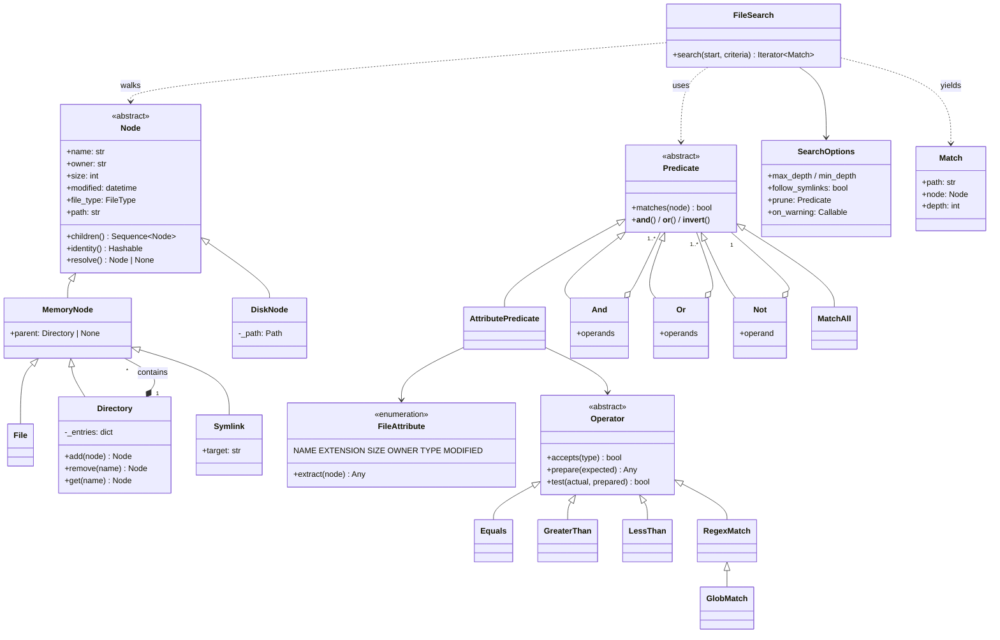
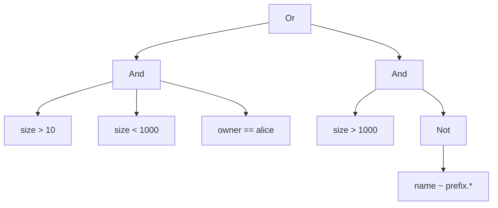

# Design a Unix File Search System: building your own `find`, from tree walking to expression trees

If you have ever typed `find . -name "*.log" -size +10M` and wondered what happens behind the prompt, this post is for you. We will design a small but serious file search library in Python: how to model files and folders as objects, how to describe "files bigger than 10 MB, owned by alice, not named `prefix*`" as data instead of hard-coded `if` statements, and how to walk millions of folders without running out of memory or getting stuck in a symlink loop. By the end you will be able to present this design in an interview, defend every choice against the alternatives, and explain how real tools like GNU `find`, `fd`, `ripgrep`, `locate` and Spotlight go further.

All the code lives next to this post and runs on Python 3.13 with only the standard library:

- [`file_search.py`](file_search.py): the recommended design, with a demo.
- [`alternatives.py`](alternatives.py): the competing designs we compare, each runnable.
- [`test_file_search.py`](test_file_search.py): 61 `unittest` tests. Run them with `python3 -m unittest discover -s .` inside this folder.

If words like *class*, *interface* or *composition* are new to you, skim [OOP fundamentals](../../01-foundations/01-oop-fundamentals.md) first. The patterns we use (Composite, Specification, Strategy, Adapter, Interpreter) are introduced in [Design patterns](../../01-foundations/02-design-patterns.md), but each one is also explained here when it first appears.

---

## 1. The real-world system

A **file system** is a tree. At the top is a root directory (`/` on Unix). Each directory contains *entries*: regular files, more directories, and special entries such as **symbolic links** (symlinks), which are tiny files that hold a path pointing somewhere else. Each entry has **metadata**: a name, a size, an owner, permission bits, timestamps such as "last modified". On Unix the metadata lives in a structure called an **inode**, and every inode has a number that is unique within its device. Remember that pair *(device, inode)*; it will save us from infinite loops later.

A **file search tool** answers questions like:

- "Where are all the `.py` files under this project?"
- "Which files under `/var` are larger than 1 GB?"
- "Which files did `bob` modify in the last week, except the ones under `node_modules`?"

There are two families of tools, and the difference matters for design:

| Family | Examples | How it answers |
|---|---|---|
| **Live walk** | `find`, `fd`, `ripgrep --files`, Python's `os.walk` | Visits the real directories right now, reading metadata as it goes. Always up to date, but the cost grows with the size of the tree. |
| **Prebuilt index** | `locate` (`mlocate`, `plocate`), macOS Spotlight, Windows Search, voidtools Everything | Walks (or watches) the disk ahead of time and stores a database. Queries are near-instant but may be stale. |

The actors are simple: a **user** (or a script) who builds a query, the **search engine** that walks the tree, and the **file system** that answers "what is in this directory?" and "what are this file's attributes?".

Why is this a good object-oriented design problem? Because it has almost no business rules and lots of *structure*. Interviewers use it to see whether you can:

1. model a recursive structure (directories inside directories) cleanly,
2. represent a user-defined boolean expression (`A and (B or not C)`) as objects instead of a growing `if` chain,
3. keep *how we walk* separate from *what we test*, so each can change on its own, and
4. reason about scale: millions of files, very deep trees, symlink cycles, permission errors.

---

## 2. Clarifying requirements

The prompt in an interview is usually one sentence: "Design a Unix file search like `find`." Your first job is to turn that into a short list of agreed requirements. Here is a requirements conversation that works well, with the reason each question matters.

| Question to ask | Why it matters | Answer we'll assume |
|---|---|---|
| Which attributes can we search on? | Decides the attribute model. | Name, extension, size, owner, type (file / directory / link), modified time. |
| What comparisons per attribute? | Strings and numbers need different operators. | Strings: equals, regex, shell glob (`*.py`). Numbers and dates: equals, greater than, less than. |
| Can criteria be combined? With what logic? | The single biggest design driver. | Yes: AND, OR, NOT, nested to any depth. |
| Do directories count as results? | Affects the walk and the predicate. | Yes, a directory is an entry like any other, with type "directory". |
| Recursive? Depth limits? | Shapes traversal options. | Recursive by default; optional min / max depth. |
| What about symlinks? | Opens the cycle problem. | Don't follow by default; optional "follow" mode must not loop forever. |
| Can we skip whole subtrees (like `node_modules`)? | Pruning is a huge real-world speedup. | Yes. |
| How big is the tree? Do we need the first result fast? | Eager list vs lazy streaming. | Up to millions of entries; results should stream. |
| Real disk or abstract model? | Testability. | Design against an abstraction; provide an in-memory model for tests and an adapter for the real disk. |

### Functional requirements

1. Search a directory tree recursively and return every entry that satisfies a condition.
2. Conditions test one attribute at a time: name, extension, size, owner, type, modification time.
3. Operators: equals, greater than, less than, regex match, glob match (case-sensitive or not).
4. Conditions combine with AND, OR and NOT, nested arbitrarily.
5. Directories themselves can match.
6. Options: minimum depth, maximum depth, prune (don't enter) directories matching a condition, follow symlinks or not.
7. Parse a `find`-style command line (`-name '*.py' -o ( -size +1M ! -user root )`) into a condition.

### Non-functional requirements

- **Scalability:** memory must not grow with the total number of files; results stream so the first hit arrives early.
- **Robustness:** no stack overflow on deep trees, no infinite loop on symlink cycles, unreadable directories produce a warning and the walk continues.
- **Extensibility:** adding a new attribute (say, permissions) or a new operator (say, "contains") must not touch the traversal code.
- **Testability:** the core logic must run against an in-memory tree, deterministically.

### Out of scope

Searching file *contents* (that's `grep`), actions such as `-delete` or `-exec`, permissions and access-time attributes, and a networked search service. We will discuss several of these in "Going deeper".

---

## 3. Finding the core objects

A classic way to find candidate classes is **noun/verb analysis**: underline the nouns and verbs in the requirements. Nouns are candidate classes or attributes; verbs are candidate methods.

> The user **searches** a **directory tree** for **entries** whose **name**, **size**, **owner** or **type** **matches** a **condition**. **Conditions** **combine** with **and/or/not**. The **search** can **follow symlinks**, **prune** **directories** and respect **depth limits**.

Now decide what each noun becomes:

| Noun | Becomes | Reasoning |
|---|---|---|
| file, directory, symlink, entry | `Node` with subclasses `File`, `Directory`, `Symlink` | They share metadata but behave differently: only directories have children, only symlinks resolve to a target. |
| name, size, owner, type, modified | attributes on `Node`, plus a `FileAttribute` enum | They are *data*, not behaviour. The enum gives us a typed handle to "which attribute" so a condition can refer to it. |
| condition | `Predicate` hierarchy | Conditions have behaviour (`matches(node)`) and they nest. |
| and / or / not | `And`, `Or`, `Not` predicates | They are conditions made of conditions. |
| comparison (equals, greater, regex) | `Operator` hierarchy | Each comparison is a small, swappable algorithm. |
| search | `FileSearch` | Owns the traversal. |
| depth limits, follow symlinks, prune | `SearchOptions` value object | Settings for one search; bundling them keeps `FileSearch`'s signature stable as options grow. |
| result | `Match` value object | A hit needs more than the node: the *path we reached it by* (which differs from the node's real path when following symlinks) and its depth. |
| user | *not a class* | The user is outside the system; they call our API. |
| tree | *not a separate class* | A tree is just the root `Directory`. Adding a `Tree` wrapper would add a name without adding behaviour. A small `FileSystem` builder exists only for convenience in tests. |

Two verbs deserve thought. **"Matches"** belongs on the predicate, not on the file: a file should not know about every possible query. **"Searches"** belongs on a separate `FileSearch` object, not on `Directory`, so that the walking algorithm (depth-first, breadth-first, parallel) can change without touching the data model. This is the **Single Responsibility Principle** at work: each class has one reason to change.

---

## 4. Class design



Notice the two places where the **Composite pattern** shows up. Composite means "a tree where single items and groups of items share one interface, so client code treats them the same". First, `Directory` is a `Node` that *contains* `Node`s. Second, `And`/`Or`/`Not` are `Predicate`s that contain `Predicate`s. The search engine never asks "is this a group or a single thing?"; it just calls `children()` or `matches()`.

Here is each class in turn.

**`Node` (abstract)** is the interface every entry implements. Its responsibility is "describe one directory entry". It exposes metadata, `children()` (empty for leaves), `identity()` (a key that is equal for two handles to the same underlying object) and `resolve()` (follow a symlink to its target). Making this abstract is what lets us search both an in-memory tree and the real disk with the same engine.

**`File`, `Directory`, `Symlink`** are the in-memory implementations. The relationship between a `Directory` and its entries is **composition** (the filled diamond): a directory *owns* its entries, an entry belongs to exactly one directory, and the directory enforces that (no duplicate names, no entry with two parents). A `Symlink` holds a *path string*, not a reference to its target, because real symlinks can point at things that don't exist yet, or anymore.

**`DiskNode`** is an **Adapter**: it wraps a real `pathlib.Path` and presents it through the `Node` interface. An adapter converts one interface into the one your code expects, the way a travel plug adapter lets a European plug fit an American socket.

**`FileAttribute`** is an enum of searchable attributes. Each member knows its value type (`SIZE` is an `int`, `NAME` a `str`) and how to `extract` itself from a node. Using an enum instead of free-form strings like `"size"` means a typo is a crash at startup, not a silent empty result.

**`Operator`** is a small **Strategy** hierarchy. Strategy means "a family of interchangeable algorithms behind one interface". `Equals`, `GreaterThan`, `LessThan`, `RegexMatch` and `GlobMatch` each implement `test(actual, expected)`, and each declares which value types it `accepts`.

**`Predicate`** is the heart of the design and follows the **Specification pattern**: a business rule packaged as an object with an `is_satisfied_by` method (ours is called `matches`), plus `and`, `or` and `not` combinators so small rules build bigger ones. `AttributePredicate` is the leaf ("size > 1000"); `And`, `Or`, `Not` are the branches. The relationship between `And` and its operands is **aggregation** (hollow diamond): an `And` *uses* its operands, but the same leaf predicate can be shared by several trees.

**`SearchOptions`** and **`Match`** are **value objects**: frozen dataclasses whose identity is just their data. `SearchOptions` holds walk settings; `Match` is one result.

**`FileSearch`** owns the traversal. It depends on `Predicate` and `Node` only through their interfaces (the dashed arrows), so it never changes when we add a new attribute or a new node type.

One deliberate difference from some textbook versions of this problem: there is no `FileSearchCriteria` class wrapping the predicate. A wrapper whose only method forwards to the thing it wraps adds a layer without adding a decision. If one day criteria need extra behaviour (say, a cost estimate for optimisation), we can add the wrapper then.

---

## 5. Code: the recommended solution

We'll walk through [`file_search.py`](file_search.py) layer by layer.

### 5.1 The Composite: nodes

The abstract base declares what every entry can do:

```python
class Node(ABC):
    """Anything that can appear in a directory listing.

    Leaves (files, symlinks) return no children; directories return their
    entries. The search code only ever talks to this interface.
    """

    name: str
    owner: str
    size: int
    modified: datetime

    @property
    @abstractmethod
    def file_type(self) -> FileType: ...

    @property
    @abstractmethod
    def path(self) -> str: ...

    @abstractmethod
    def children(self) -> Sequence[Node]:
        """Entries of a directory, sorted by name; empty for everything else."""

    @abstractmethod
    def identity(self) -> Hashable:
        """A key that is equal for two handles to the same underlying object.

        On a real disk this is (device, inode); in memory it is id(). Cycle
        detection compares identities, never names or paths.
        """

    def resolve(self) -> Node | None:
        """Follow symlinks to the final target; None if the link is dangling."""
        return self

    @property
    def is_dir(self) -> bool:
        return self.file_type is FileType.DIRECTORY
```

`children()` returns a `Sequence`, which lets leaves return an empty tuple. That is the essence of Composite: the walker can call `children()` on *anything* without first asking "is this a directory?".

`identity()` deserves a closer look. Two different `Node` objects can describe the same thing: on disk, `/home/bob/photos` and `/home/bob/link-to-photos` (after following the link) are the same directory. Comparing paths would say they differ. Comparing *(device, inode)* says they are the same. Cycle detection must use identity.

The in-memory directory guards its own invariants. An **invariant** is a rule that must always be true for an object to be valid; here, "no two entries share a name" and "an entry has at most one parent":

```python
class Directory(MemoryNode):
    """A directory: a node that owns other nodes."""

    def __init__(self, name: str, **attrs: Any) -> None:
        super().__init__(name, **attrs)
        self._entries: dict[str, MemoryNode] = {}

    @property
    def file_type(self) -> FileType:
        return FileType.DIRECTORY

    def add(self, node: MemoryNode) -> MemoryNode:
        if node.parent is not None:
            raise ValueError(f"{node.name!r} already belongs to {node.parent.path}")
        if node.name in self._entries:
            raise FileExistsError(f"{self.path.rstrip('/')}/{node.name} already exists")
        node.parent = self
        self._entries[node.name] = node
        return node

    def remove(self, name: str) -> MemoryNode:
        node = self._entries.pop(name)
        node.parent = None
        return node

    def get(self, name: str) -> MemoryNode | None:
        return self._entries.get(name)

    def children(self) -> Sequence[Node]:
        # Return a snapshot so a concurrent add() cannot break an ongoing walk.
        return tuple(self._entries[name] for name in sorted(self._entries))
```

Two small decisions hide in `children()`. Sorting by name makes output deterministic, which tests love (real `find` returns entries in whatever order the file system stores them, which is why `find` output often looks unsorted). Returning a fresh tuple means that if another thread adds a file while a search is iterating, the search sees a consistent snapshot instead of crashing with "dictionary changed size during iteration".

Symlinks store a path and resolve it lazily:

```python
class Symlink(MemoryNode):
    """A symbolic link: stores a path, not a reference, so it can dangle."""

    def __init__(self, name: str, target: str, **attrs: Any) -> None:
        super().__init__(name, size=len(target), **attrs)
        self.target = target

    @property
    def file_type(self) -> FileType:
        return FileType.SYMLINK

    def resolve(self) -> Node | None:
        return _follow(self, [MAX_SYMLINK_HOPS])
```

`_follow` walks the path one component at a time, like the kernel does, handling `..`, relative and absolute targets, and links inside links. It shares one *hop budget* across the whole chain: after 40 hops it gives up and returns `None`. That is how a link pointing at itself (`ln -s me me`) is handled; Linux makes the same choice and reports `ELOOP` ("too many levels of symbolic links").

The adapter for the real disk reads metadata once with `lstat`, which describes a link itself rather than its target:

```python
class DiskNode(Node):
    """Adapter: presents a real path on disk through the Node interface."""

    def __init__(self, path: Path | str) -> None:
        self._path = Path(path)
        st = self._path.lstat()  # lstat: describe a link itself, not its target
        self.name = self._path.name or str(self._path)
        self.size = st.st_size
        self.owner = _owner_name(st.st_uid)
        self.modified = datetime.fromtimestamp(st.st_mtime, tz=timezone.utc)
        self._mode = st.st_mode
        self._key = (st.st_dev, st.st_ino)
```

Because the walker only talks to `Node`, the same `FileSearch` works on the real disk. The demo runs it on this very folder.

### 5.2 Attributes and operators

```python
class FileAttribute(Enum):
    """A searchable property of a node and the Python type of its value."""

    NAME = ("name", str)
    EXTENSION = ("extension", str)
    SIZE = ("size", int)
    OWNER = ("owner", str)
    TYPE = ("type", FileType)
    MODIFIED = ("modified", datetime)

    def __init__(self, label: str, value_type: type) -> None:
        self.label = label
        self.value_type = value_type

    def extract(self, node: Node) -> Any:
        return _EXTRACTORS[self](node)


_EXTRACTORS: dict[FileAttribute, Callable[[Node], Any]] = {
    FileAttribute.NAME: lambda n: n.name,
    FileAttribute.EXTENSION: lambda n: PurePosixPath(n.name).suffix.lstrip("."),
    FileAttribute.SIZE: lambda n: n.size,
    FileAttribute.OWNER: lambda n: n.owner,
    FileAttribute.TYPE: lambda n: n.file_type,
    FileAttribute.MODIFIED: lambda n: n.modified,
}
```

Each enum member carries its value type. That small fact lets us reject nonsense such as "size matches regex `abc`" when the predicate is *built*, not halfway through a ten-minute walk. The extractor table maps each attribute to a one-line function; adding `PERMISSIONS` means one enum line and one table line.

Operators are tiny strategy objects:

```python
class Operator(ABC):
    """Compares an attribute's actual value with an expected value."""

    symbol: ClassVar[str]

    @abstractmethod
    def accepts(self, value_type: type) -> bool:
        """Can this operator be applied to values of `value_type`?"""

    def prepare(self, expected: Any) -> Any:
        """Pre-process the expected value once (e.g. compile a regex)."""
        return expected

    @abstractmethod
    def test(self, actual: Any, prepared: Any) -> bool: ...
```

The `prepare` hook exists for performance. A regex should be compiled *once* when the query is built, not once per file:

```python
class RegexMatch(Operator):
    """Whole-string regular-expression match (like `find -regex`)."""

    symbol = "~"

    def __init__(self, *, ignore_case: bool = False) -> None:
        self._flags = re.IGNORECASE if ignore_case else 0

    def accepts(self, value_type: type) -> bool:
        return value_type is str

    def prepare(self, expected: Any) -> re.Pattern[str]:
        try:
            return re.compile(expected, self._flags)
        except re.error as exc:
            raise ValueError(f"bad regular expression {expected!r}: {exc}") from exc

    def test(self, actual: Any, prepared: re.Pattern[str]) -> bool:
        return prepared.fullmatch(actual) is not None


class GlobMatch(RegexMatch):
    """Shell wildcard match (`*.py`, `report-??.pdf`), like `find -name`."""

    symbol = "glob"

    def prepare(self, expected: Any) -> re.Pattern[str]:
        return super().prepare(fnmatch.translate(expected))
```

`GlobMatch` reuses everything from `RegexMatch` by translating a shell wildcard like `*.py` into a regex with the standard library's `fnmatch.translate`. Note that we use `fullmatch`: `find -regex` matches the *whole* string, so `log` does not match `logger` but `log.*` does.

### 5.3 Predicates: the Specification pattern

```python
class Predicate(ABC):
    """A yes/no question about a node. Combine with `&`, `|` and `~`."""

    @abstractmethod
    def matches(self, node: Node) -> bool: ...

    def __and__(self, other: Predicate) -> Predicate:
        return And(self, other)

    def __or__(self, other: Predicate) -> Predicate:
        return Or(self, other)

    def __invert__(self) -> Predicate:
        return Not(self)
```

Overloading `&`, `|` and `~` turns query building into something that reads almost like the English requirement. The leaf validates everything up front:

```python
class AttributePredicate(Predicate):
    """Leaf test: `<attribute> <operator> <value>`, validated at construction."""

    def __init__(self, attribute: FileAttribute, operator: Operator, expected: Any) -> None:
        if not operator.accepts(attribute.value_type):
            raise TypeError(f"operator {operator.symbol!r} cannot compare {attribute.label}")
        if not isinstance(expected, attribute.value_type):
            raise TypeError(
                f"{attribute.label} needs a {attribute.value_type.__name__}, "
                f"got {type(expected).__name__}"
            )
        self.attribute = attribute
        self.operator = operator
        self.expected = expected
        self._prepared = operator.prepare(expected)  # fail fast on a bad regex

    def matches(self, node: Node) -> bool:
        return self.operator.test(self.attribute.extract(node), self._prepared)
```

This is **fail fast** design: invalid queries raise `TypeError` or `ValueError` immediately, with a message naming the attribute. The combinators are short:

```python
class _Junction(Predicate):
    _word: ClassVar[str]

    def __init__(self, *operands: Predicate) -> None:
        if not operands:
            raise ValueError(f"{type(self).__name__} needs at least one operand")
        flat: list[Predicate] = []
        for op in operands:  # (a & b) & c becomes And(a, b, c): shallower tree
            flat.extend(op.operands if type(op) is type(self) else (op,))
        self.operands: tuple[Predicate, ...] = tuple(flat)

    def __str__(self) -> str:
        return "(" + f" {self._word} ".join(str(op) for op in self.operands) + ")"


class And(_Junction):
    _word = "and"

    def matches(self, node: Node) -> bool:
        return all(op.matches(node) for op in self.operands)  # short-circuits
```

Two details matter. First, `all()` and `any()` **short-circuit**: in `size > 10_000 and name ~ "a.*"`, the regex never runs for small files. GNU `find` exploits the same property, and its optimiser goes further by reordering cheap tests (like `-name`) ahead of expensive ones (like tests that need a `stat` call) where that doesn't change the meaning. Second, the constructor **flattens** nested ANDs, so `a & b & c` becomes one `And` with three operands instead of a lopsided tree two levels deep.

Here is the nested example from the requirements, built in code. With A = `size > 10`, B = `size < 1000`, C = `owner == alice`, D = `size > 1000`, E = `name matches prefix.*`, the query is `(A and B and C) or (D and not E)`:

```python
left = where(SIZE).gt(10) & where(SIZE).lt(1000) & where(OWNER).eq("alice")
right = where(SIZE).gt(1000) & ~where(NAME).matches("prefix.*")
expr = left | right
```

`where(attribute)` is a small builder (the `Field` class) that returns leaf predicates. Printing `expr` shows the tree:

```text
((size > 10 and size < 1000 and owner == 'alice') or (size > 1000 and not name ~ 'prefix.*'))
```



Evaluating it is a recursive walk of this little tree: each node asks its children and combines their answers.

### 5.4 The search engine

Options are a frozen value object, validated on creation:

```python
@dataclass(frozen=True)
class SearchOptions:
    """Walk settings, kept apart from *what* we test (the predicate)."""

    max_depth: int | None = None
    min_depth: int = 0
    follow_symlinks: bool = False
    prune: Predicate | None = None  # directories matching this are not entered
    on_warning: Callable[[str], None] | None = None

    def __post_init__(self) -> None:
        if self.min_depth < 0 or (self.max_depth is not None and self.max_depth < 0):
            raise ValueError("depths must be non-negative")
```

And the walker itself:

```python
class FileSearch:
    """Walks a tree and yields every entry the predicate accepts."""

    def __init__(self, options: SearchOptions | None = None) -> None:
        self.options = options or SearchOptions()

    def search(self, start: Node, criteria: Predicate = MATCH_ALL) -> Iterator[Match]:
        min_depth = self.options.min_depth
        for entry in self._walk(start):
            if entry.depth >= min_depth and criteria.matches(entry.node):
                yield entry

    def _walk(self, start: Node) -> Iterator[Match]:
        opts = self.options
        stack = [_Frame(start, start.path, 0, frozenset())]
        while stack:
            frame = stack.pop()
            node = frame.node
            if opts.follow_symlinks or frame.depth == 0:
                # Like find -H/-L: look through the link; a dangling link stays a link.
                node = node.resolve() or node
            yield Match(frame.path, node, frame.depth)

            if not node.is_dir or not self._may_descend(node, frame):
                continue
            key = node.identity()
            if key in frame.ancestors:
                self._warn(f"file system loop detected at {frame.path}")
                continue
            try:
                kids = node.children()
            except OSError as exc:  # permission denied, vanished directory...
                self._warn(f"cannot read {frame.path}: {exc}")
                continue
            above = frame.ancestors | {key}
            base = frame.path.rstrip("/")
            # Push in reverse so the alphabetically first child is popped first.
            for child in reversed(kids):
                stack.append(_Frame(child, f"{base}/{child.name}", frame.depth + 1, above))

    def _may_descend(self, node: Node, frame: _Frame) -> bool:
        opts = self.options
        if opts.max_depth is not None and frame.depth >= opts.max_depth:
            return False
        return not (opts.prune is not None and opts.prune.matches(node))

    def _warn(self, message: str) -> None:
        if self.options.on_warning is not None:
            self.options.on_warning(message)
```

Let's unpack each decision.

- **Iterative, not recursive.** We keep our own stack (`stack`) instead of calling ourselves for each subdirectory. Python's default recursion limit is about 1,000 frames; a recursive walker crashes on a tree 5,000 levels deep (the alternatives demo proves it), while this one does not.
- **Generator.** `search` is a generator (it uses `yield`), so results stream to the caller one at a time. A caller that wants only the first hit calls `next(...)` and the walk stops right there. This is **lazy evaluation**: do the work only when someone asks for the result.
- **Pre-order, sorted output.** We yield a directory before its contents, and push children in reverse so the alphabetically first child pops first. Output looks like `find`'s.
- **Cycle detection with an ancestor set.** Each frame carries the identities of the directories above it. If a directory we are about to enter is already one of our ancestors, we are in a loop: warn and skip it. We'll compare this with a global "visited" set in section 6.
- **Prune and depth limits** are checked before reading children, so pruned subtrees cost nothing.
- **Errors become warnings.** A directory we can't read (`PermissionError` is a subclass of `OSError`) produces a warning through a callback, and the walk continues. `find` behaves the same way: it prints "Permission denied" to stderr and keeps going.
- **The start node is always resolved**, even without `follow_symlinks`. That mirrors `find -H`: links named as starting points are followed, links found during the walk are not. (GNU's default, `-P`, would report just the link itself, which is why people often type `find mylink/` with a trailing slash.) We chose `-H` behaviour because if you hand the tool a link to a directory, you almost always meant the directory.

### 5.5 Parsing `find`-style expressions

Real users type expressions, not Python. The **Interpreter pattern** says: represent a little language's grammar as classes and evaluate sentences by building a tree of those classes. We already have the tree classes (our predicates); we just need a **parser** that turns tokens into a tree. A **recursive-descent parser** has one function per grammar rule, and each function calls the functions for tighter-binding rules:

```python
def parse_find_expression(args: Sequence[str]) -> Predicate:
    """Turn find-style tokens into a Predicate tree.

    Grammar (lowest precedence first), mirroring GNU find:
        expr    := and_expr  ( ('-o' | '-or')  and_expr )*
        and_expr:= unary     ( ['-a' | '-and'] unary   )*   # juxtaposition = AND
        unary   := ('!' | '-not') unary | primary
        primary := '(' expr ')' | test
    """
    if not args:
        return MATCH_ALL
    parser = _Parser(list(args))
    tree = parser.parse_or()
    if parser.peek() is not None:
        raise ValueError(f"unexpected token {parser.peek()!r}")
    return tree
```

```python
    def parse_or(self) -> Predicate:
        left = self.parse_and()
        while self.peek() in ("-o", "-or"):
            self.take()
            left = left | self.parse_and()
        return left

    def parse_and(self) -> Predicate:
        left = self.parse_unary()
        while self.peek() not in (None, "-o", "-or", ")"):
            if self.peek() in ("-a", "-and"):
                self.take()
            left = left & self.parse_unary()
        return left

    def parse_unary(self) -> Predicate:
        if self.peek() in ("!", "-not"):
            self.take()
            return ~self.parse_unary()
        if self.peek() == "(":
            self.take()
            inner = self.parse_or()
            if self.peek() != ")":
                raise ValueError("missing ')'")
            self.take()
            return inner
        return self.parse_test()
```

Operator **precedence** (which operator binds tighter) falls out of the call structure: `parse_or` calls `parse_and`, which calls `parse_unary`. So `-user bob -name '*.py' -o -name '*.pdf'` means `(bob AND *.py) OR *.pdf`, exactly as in `find`. A common real-world bug is forgetting that: `find . -name '*.py' -o -name '*.txt' -print` prints only `.txt` files, because `-print` binds to the right-hand AND. Our parser has no actions, so the trap doesn't exist here, but you should mention it in an interview; it shows you know the tool.

Two simplifications are documented in the code. Our `-regex` tests the file *name*; GNU `find -regex` tests the whole path. And `-size` compares exact bytes, while GNU rounds sizes up to whole units first (so `-size -1M` matches only empty files in GNU, a famous surprise).

### 5.6 Running it

`python3 file_search.py` builds a small tree and prints:

```text
# files larger than 1 MB
  /home/alice/photos/cat.jpg  (3,500,000 B, alice)
  /home/alice/photos/prefix-draft.jpg  (2,000,000 B, alice)
  /var/log/syslog  (5,000,000 B, root)

# parsed: ((size > 10 and size < 1000 and owner == 'alice') or (size > 1000 and not name glob 'prefix*'))

# alice's small files, or big files not named prefix*
  /home/alice/notes.txt  (1,200 B, alice)
  /home/alice/photos/cat.jpg  (3,500,000 B, alice)
  /home/alice/report-2026.pdf  (250,000 B, alice)
  /home/bob/main.py  (4,096 B, bob)
  /projects/app/src/app.py  (9,000 B, bob)
  /var/log/syslog  (5,000,000 B, root)

# *.js, full walk
  /projects/app/node_modules/left-pad/index.js  (500 B, bob)

# *.js with node_modules pruned

# PDFs, following symlinks (find -L)
  /projects/app/latest-report  (250,000 B, alice)
  warnings: ['file system loop detected at /projects/app/loop']

# lazy: first file owned by bob is /home/bob/main.py (walk stopped there)

# real disk via DiskNode adapter: ['alternatives.py', 'file_search.py', 'test_file_search.py']
```

Notice four behaviours in that output: the parsed tree prints in readable form; pruning `node_modules` removes the `.js` hit; following symlinks reports the PDF under the *link's* path and warns about the `loop -> ..` cycle instead of hanging; and `next()` on the generator returns the first hit without walking the rest.

---

## 6. Comparing approaches

This is where an interview is won. For each decision we look at the realistic options, with runnable code in [`alternatives.py`](alternatives.py).

### Decision 1: how to express filters

**Option A: one function with keyword parameters.** The first thing most people write:

```python
def search_with_params(
    root: Node,
    *,
    name_glob: str | None = None,
    min_size: int | None = None,
    max_size: int | None = None,
    owner: str | None = None,
    file_type: FileType | None = None,
) -> list[str]:
    """Every new filter means a new parameter and a new if-block here."""
    results = []
    for path, node in _walk_all(root):
        if name_glob is not None and not fnmatch.fnmatchcase(node.name, name_glob):
            continue
        if min_size is not None and node.size <= min_size:
            continue
        if max_size is not None and node.size >= max_size:
            continue
        if owner is not None and node.owner != owner:
            continue
        if file_type is not None and node.file_type is not file_type:
            continue
        results.append(path)
    return results
```

It's readable and fine for a script. But every new filter adds a parameter *and* an `if`, the function can only AND things together, and there is no way to express "size > 1 MB OR owner is bob" without inventing parameters like `or_owner`. This violates the **Open/Closed Principle** (code should be open to extension but closed to modification): extending means editing.

**Option B: one Strategy class per filter, combined in a chain.**

```python
class Filter(ABC):
    """One pluggable filter (Strategy). Unaware of other filters."""

    @abstractmethod
    def apply(self, node: Node) -> bool: ...
```

```python
class NameFilter(Filter):
    def __init__(self, pattern: str) -> None:
        self.pattern = pattern

    def apply(self, node: Node) -> bool:
        return fnmatch.fnmatchcase(node.name, self.pattern)
```

```python
class FilterChain:
    """Holds a list of filters; a node must pass all of them."""

    def __init__(self, *filters: Filter) -> None:
        self.filters = list(filters)

    def search(self, root: Node) -> list[str]:
        return [p for p, n in _walk_all(root) if all(f.apply(n) for f in self.filters)]
```

New filters are new classes, which is better. But the chain hard-codes AND. You could add an `OrChain`, then realise you need nesting, and you have reinvented option C with worse names. A second issue is **class explosion**: `NameFilter`, `NameRegexFilter`, `SizeAboveFilter`, `SizeBelowFilter`... one class per attribute *times* operator.

**Option C: Specification with AND/OR/NOT (recommended).** Shown in section 5. One leaf class (`AttributePredicate`) covers every attribute-operator pair, and three combinators cover all boolean logic.

**Option D: plain functions and lambdas.**

```python
NodeTest = Callable[[Node], bool]


def all_of(*tests: NodeTest) -> NodeTest:
    return lambda node: all(t(node) for t in tests)


def any_of(*tests: NodeTest) -> NodeTest:
    return lambda node: any(t(node) for t in tests)


def negate(test: NodeTest) -> NodeTest:
    return lambda node: not test(node)


def search_with_function(root: Node, test: NodeTest) -> list[str]:
    return [path for path, node in _walk_all(root) if test(node)]
```

This is the most "Pythonic" for a quick script, and fully composable. Its weakness shows up in the demo output: printing the combined test gives `all_of.<locals>.<lambda>`. A lambda is **opaque**: you can call it, but you cannot inspect, print, validate, serialise, optimise or send it to a server. Predicate *objects* can do all of those, because the tree is data.

```text
# Decision 1: four ways to ask for 'alice's .txt files'
  A params   : ['/home/alice/notes.txt']
  B strategy : ['/home/alice/notes.txt']
  C spec     : ['/home/alice/notes.txt'] <- (name glob '*.txt' and owner == 'alice')
  D functions: ['/home/alice/notes.txt'] <- all_of.<locals>.<lambda>
```

| Option | Pros | Cons | Choose when |
|---|---|---|---|
| A. keyword params | Simplest; easy to call | AND only; every new filter edits the function; long signatures | One-off scripts, 2–3 fixed filters |
| B. Strategy per filter | New filter = new class; testable in isolation | AND only unless you add more machinery; class explosion | A fixed pipeline of independent checks (e.g. lint rules) |
| C. Specification tree | Full AND/OR/NOT nesting; validated, printable, optimisable, serialisable | More classes up front | Users build queries at run time: search UIs, `find`, rule engines |
| D. Functions / lambdas | Tiny, flexible, idiomatic | Opaque: no printing, validation, optimisation or serialisation | Internal code where queries never leave the process |

**Recommendation:** C. The requirements say users combine criteria with AND/OR/NOT, which is exactly what Specification models. Mention D as the lightweight alternative; a good answer acknowledges that in Python, a function *is* a strategy.

### Decision 2: how to traverse

All four walkers below find the same files. They differ in memory use, robustness and when results become available.

**Recursive DFS** (depth-first search: go as deep as possible before backtracking) is the shortest:

```python
def recursive_dfs(root: Node, test: NodeTest, stats: WalkStats | None = None) -> list[str]:
    stats = stats or WalkStats()
    results: list[str] = []

    def visit(node: Node, path: str) -> None:
        stats.visited += 1
        if test(node):
            results.append(path)
        for child in node.children():
            visit(child, f"{path.rstrip('/')}/{child.name}")  # one Python frame per level

    visit(root, root.path)
    return results
```

**BFS** (breadth-first search: finish each level before going deeper) uses a queue:

```python
def bfs(root: Node, test: NodeTest, stats: WalkStats | None = None) -> list[str]:
    stats = stats or WalkStats()
    results: list[str] = []
    frontier: deque[tuple[Node, str]] = deque([(root, root.path)])
    while frontier:
        stats.peak_frontier = max(stats.peak_frontier, len(frontier))
        node, path = frontier.popleft()
        stats.visited += 1
        if test(node):
            results.append(path)
        for child in node.children():
            frontier.append((child, f"{path.rstrip('/')}/{child.name}"))
    return results
```

**Iterative DFS** is BFS's code with a stack instead of a queue (`stack.pop()` instead of `popleft()`). **Lazy DFS** is iterative DFS that `yield`s instead of appending:

```python
def lazy_dfs(root: Node, test: NodeTest, stats: WalkStats | None = None) -> Iterator[str]:
    """Same as iterative_dfs, but the caller pulls results one at a time."""
    stats = stats or WalkStats()
    stack: list[tuple[Node, str]] = [(root, root.path)]
    while stack:
        stats.peak_frontier = max(stats.peak_frontier, len(stack))
        node, path = stack.pop()
        stats.visited += 1
        if test(node):
            yield path
        for child in reversed(node.children()):
            stack.append((child, f"{path.rstrip('/')}/{child.name}"))
```

The demo measures them:

```text
# Decision 2: traversal
  recursive_dfs  ['/home/bob/main.py', '/projects/app/src/app.py']
  iterative_dfs  ['/home/bob/main.py', '/projects/app/src/app.py']
  bfs            ['/home/bob/main.py', '/projects/app/src/app.py']
  first match only: eager visited 23, lazy visited 10
  recursive_dfs on a 5,000-level chain: RecursionError
  iterative_dfs on the same chain: found 1 file, 5001 levels down
  wide tree peak frontier: DFS 37, BFS 10000
```

Read those numbers carefully:

- To find the *first* `.py` file, the eager walker visits all 23 nodes; the lazy one stops after 10. On a real disk with a million files, that's the difference between an instant answer and a coffee break.
- Recursion fails on a 5,000-level chain. Real trees are rarely that deep, but a symlink loop or a malicious archive can create one, and a crash is worse than slowness.
- On a tree with 10 subfolders per folder, 4 levels deep, BFS holds 10,000 entries in its queue at once; DFS never holds more than 37. DFS memory grows with *depth × fan-out*; BFS memory grows with the *width of the widest level*, which on real disks can be enormous.

| Strategy | Memory | Deep trees | First result | Choose when |
|---|---|---|---|---|
| Recursive DFS | Call stack, O(depth) | Crashes past ~1,000 levels in Python | After full walk (if it returns a list) | Teaching; small known-shallow trees |
| Iterative DFS (list) | O(depth × fan-out) | Safe | After full walk | You need all results anyway |
| BFS (queue) | O(widest level) — can be huge | Safe | After full walk | Shallow results first matter (e.g. "nearest config file"), or `fd --max-depth`-style scans |
| **Lazy DFS (generator)** | O(depth × fan-out) | Safe | Immediately | **Default**: streaming, `head`-like usage, early termination |

**Recommendation:** lazy iterative DFS. It's what `find` effectively does (pre-order, streaming output) and what Python's own `os.walk` does (it's a generator too).

### Decision 3: how to represent comparison operators

**Strings** looked up in a dictionary:

```python
_STRING_OPS: dict[str, Callable[[Any, Any], bool]] = {
    "==": operator.eq,
    ">": operator.gt,
    "<": operator.lt,
    "~": lambda actual, pattern: re.fullmatch(pattern, actual) is not None,
}


def compare_with_string(actual: Any, op: str, expected: Any) -> bool:
    """Typos such as '=>' are only discovered when this line runs."""
    try:
        return _STRING_OPS[op](actual, expected)
    except KeyError:
        raise ValueError(f"unknown operator {op!r}") from None
```

**An enum** with a `match` statement:

```python
class Op(Enum):
    """A closed set: safe and fast, but adding one means editing this class."""

    EQ = "=="
    GT = ">"
    LT = "<"
    REGEX = "~"

    def apply(self, actual: Any, expected: Any) -> bool:
        match self:
            case Op.EQ:
                return actual == expected
            case Op.GT:
                return actual > expected
            case Op.LT:
                return actual < expected
            case Op.REGEX:
                return re.fullmatch(expected, actual) is not None
```

**Objects** implementing an `Operator` interface, as in section 5.2.

| Option | Pros | Cons | Choose when |
|---|---|---|---|
| Strings | Easy to read from config or a query string | Typos only fail at run time; no place for per-operator data (compiled regex) | At the *edge* of the system, parsed into one of the others immediately |
| Enum | Closed, type-checkable set; easy to serialise | Adding an operator edits the enum and its `match` | The set is truly fixed and small |
| Operator objects | New operator = new class; can carry state (`ignore_case`, compiled pattern) and validation (`accepts`) | A few more classes | Operators vary or carry configuration — our case |

**Recommendation:** objects inside the core, strings only at the boundary (the parser turns `-iname` into `GlobMatch(ignore_case=True)`). The deciding factor for us was state: case-insensitivity and the precompiled regex need somewhere to live.

### Decision 4: symlink cycles

If you follow symlinks, a link like `app/loop -> ..` turns the tree into a graph with a cycle. Three strategies:

**No detection.** The demo caps it at 1,000 visits; without the cap it never ends.

**A global visited set**: never enter the same directory twice anywhere in the walk:

```python
def follow_with_visited_set(root: Node) -> list[str]:
    """Never enter the same directory twice anywhere in the walk."""
    seen: set[Hashable] = set()
    results: list[str] = []
    stack: list[tuple[Node, str]] = [(root, root.path)]
    while stack:
        raw, path = stack.pop()
        node = raw.resolve() or raw
        results.append(path)
        if not node.is_dir or node.identity() in seen:
            continue
        seen.add(node.identity())
        for child in reversed(node.children()):
            stack.append((child, f"{path.rstrip('/')}/{child.name}"))
```

**An ancestor chain**: refuse to enter a directory only if it's *above us on the current path*. This is what our `FileSearch` does, and what GNU `find -L` does.

```text
# Decision 4: following symlinks with a cycle
  naive follow visited 1000 nodes before the cap
  visited set   : ['/home/bob/alias-a/cat.jpg', '/home/bob/alias-a/prefix-draft.jpg']
  ancestor chain: ['/home/bob/alias-a/cat.jpg', '/home/bob/alias-a/prefix-draft.jpg', '/home/bob/alias-b/cat.jpg', '/home/bob/alias-b/prefix-draft.jpg']
```

The difference shows when two links point to the same directory. The visited set reports the photos only under `alias-a`, silently hiding `alias-b/...` — maybe surprising to a user who searched for that path. The ancestor chain reports both, since neither is a loop; it only refuses true cycles.

| Strategy | Terminates? | Memory | Duplicates via multiple links | Choose when |
|---|---|---|---|---|
| Don't follow links (default) | Yes | — | N/A | Almost always; `find`, `fd` and `os.walk` default to this |
| No detection | **No** | — | — | Never |
| Global visited set | Yes | O(directories visited) | Reported once | Indexers, backups, copy tools: you want each real directory once |
| Ancestor chain | Yes | O(depth) per stack frame | Reported per path | Search tools that report paths, matching `find -L` |

**Recommendation:** don't follow by default; when asked to, use the ancestor chain. Either way, identity must be *(device, inode)* on disk, never a path string, because the same directory can have endless path spellings (`a/b/../b/./`).

A cost note: our frames each hold a `frozenset` of ancestors. That's simple and correct, but copies sets as we go deeper. A production walker would keep a single linked chain of parent frames, or (like `fts`) keep the current path's stack and check it. Mention this if the interviewer asks about memory.

### Decision 5: live walk vs prebuilt index

```python
class PathIndex:
    """A toy `updatedb` + `locate`: snapshot all paths, then search the list."""

    def __init__(self) -> None:
        self._paths: list[str] = []
        self.builds = 0

    def rebuild(self, root: Node) -> None:
        self._paths = sorted(path for path, _ in _walk_all(root))
        self.builds += 1

    def locate(self, substring: str) -> list[str]:
        return [p for p in self._paths if substring in p]
```

```text
# Decision 5: locate-style index goes stale
  locate 'new-notes': []
  live walk         : ['/home/alice/new-notes.txt']
```

The index is a list scan instead of a tree walk with metadata reads, so on a real disk it's dramatically faster. But a file created after the last rebuild is invisible until the next one.

| Approach | Freshness | Query speed | Cost | Choose when |
|---|---|---|---|---|
| Live walk (`find`) | Exact | Grows with tree size and disk speed | Nothing in the background | Scripts, builds, anything that must be correct now |
| Periodic index (`locate`) | Stale up to one rebuild interval | Very fast | Periodic full scan; disk space | Interactive "where is that file?" |
| Event-driven index (Spotlight, Everything) | Near real time | Very fast | A background service; must handle missed events | Desktop search |

**Recommendation for the interview problem:** live walk, since the prompt is "like `find`". Bring up the index as the answer to "it's too slow on a 50-million-file volume".

---

## 7. Going deeper

### 7.1 Concurrency

There are two separate concurrency questions.

**Can we walk in parallel?** On a real disk, most time is spent waiting on system calls (`readdir`, `stat`). In CPython those calls release the GIL (the Global Interpreter Lock, which normally lets only one thread run Python code at a time), so threads genuinely overlap the waiting. `fd` and `ripgrep` both walk directories in parallel for this reason. A work-queue walker:

```python
def parallel_search(root: Node, test: NodeTest, workers: int = 4) -> list[str]:
    """Workers pull directories from a shared queue and push subdirectories.

    On a real disk, listing a directory is a system call that releases the GIL,
    so several threads can wait on I/O at once. Output order is not stable, so
    we sort at the end (fd does the same when you ask for sorted output).
    """
    work: queue.Queue[tuple[Node, str] | None] = queue.Queue()
    results: list[str] = []
    errors: list[BaseException] = []
    lock = threading.Lock()

    def worker() -> None:
        while (item := work.get()) is not None:
            node, path = item
            try:
                if test(node):
                    with lock:  # list.append is atomic in CPython, but say what we mean
                        results.append(path)
                for child in node.children():
                    work.put((child, f"{path.rstrip('/')}/{child.name}"))
            except Exception as exc:  # a dead worker would otherwise be silent
                with lock:
                    errors.append(exc)
            finally:
                work.task_done()  # must run even on error, or join() hangs forever
        work.task_done()

    threads = [threading.Thread(target=worker, daemon=True) for _ in range(workers)]
    for t in threads:
        t.start()
    work.put((root, root.path))
    work.join()  # returns once every queued directory has been processed
    for _ in threads:
        work.put(None)
    for t in threads:
        t.join()
    if errors:
        raise errors[0]
    return sorted(results)
```

The tricky parts are classic concurrency bugs:

- **Knowing when you're done.** No single worker knows if others will add more directories. `queue.Queue.join()` solves this: it waits until every `put()` has a matching `task_done()`.
- **A forgotten `task_done()` hangs forever.** That's why it's in `finally`. A **race condition** is a bug whose outcome depends on timing; a hang that only happens when a predicate throws on one specific file is a nasty example.
- **Silent worker death.** An exception in a thread doesn't reach the caller by default. We collect errors and re-raise after the join.
- **Unstable order.** Parallel output order depends on scheduling, so we sort. `fd` similarly needs extra work if you want deterministic output.

**What if the tree changes during a walk?** It will, on a real system. Files vanish between `readdir` and `stat` (we skip `FileNotFoundError` in `DiskNode.children`), and directories appear after we've listed their parent. A walk is never an atomic snapshot of a live file system; `find` has the same property. For the in-memory tree, `Directory.children()` returns a snapshot tuple, so a concurrent `add()` cannot break an iteration in progress. If writers needed stronger guarantees (no one sees a half-built subtree), the next step would be a `threading.RLock` per directory or copy-on-write subtrees.

There's also a security angle: **TOCTOU** (time-of-check to time-of-use). If `find` checks that a path is a directory and then enters it, an attacker could swap it for a symlink in between. GNU `find` defends against this by opening directories and working relative to the open handle instead of re-resolving paths. Mentioning this in an interview shows real depth.

### 7.2 Extensibility: "the interviewer now asks…"

**"Add a search by permissions."** Add `PERMISSIONS = ("permissions", int)` to `FileAttribute`, one line in `_EXTRACTORS`, and the field to `Node`. No change to predicates or traversal. Under option A (params) you'd add a parameter and an `if`; under option B, a new class.

**"Add a 'contains substring' operator."** One new class:

```python
class Contains(Operator):
    symbol = "contains"
    def accepts(self, value_type): return value_type is str
    def test(self, actual, prepared): return prepared in actual
```

Nothing else changes. That's Open/Closed in action.

**"Search file contents, like grep."** Add a predicate leaf that reads content. It's I/O-heavy, so with short-circuiting, users (or an optimiser) should place it last: a query like "name is `*.py` AND content contains `TODO`" then reads only Python files.

**"Respect `.gitignore`."** That's pruning with a predicate that knows about ignore files. Because rules in nested `.gitignore` files apply only below their folder, the prune decision depends on the *path*, not just the node. You'd pass the walk context (the stack of active ignore rules) into the prune check. This is exactly what the `ignore` crate behind `ripgrep` and `fd` does.

**"Add actions: delete, print size, exec."** Keep actions separate from tests. A `search` yields matches; an action consumes them. Mixing them, as `find` does in one expression, is powerful but is also why `-delete` placed before a test is a well-known way to delete everything.

**"Make it a service."** The predicate tree is data, so it can be serialised (say, to JSON) and sent to a server that runs the query against an index. A lambda could not be sent. This is the strongest argument for option C over D.

### 7.3 From in-memory OOD to real scale

On a real disk, the cost of a search is dominated by system calls, not Python logic:

- **Avoid `stat` when you can.** A directory listing already tells you each entry's name and (on most file systems) whether it's a file, directory or link. Python's `os.scandir` exposes this, which is why `os.walk` got much faster when it switched to `scandir`. A name-only query never needs a full `stat`. Our `DiskNode` stats eagerly for simplicity; a production adapter would stat lazily, only when a predicate asks for size or owner.
- **Order tests by cost.** Evaluate name tests before tests that need metadata, and metadata tests before content tests.
- **Prune aggressively.** Skipping `node_modules` or `.git` often cuts the work by an order of magnitude.
- **Don't cross into other file systems** unless asked (`find -xdev`); compare the device part of identity with the start's device.
- **Cache nothing by default**; caching is what an index is, with all its staleness.

### 7.4 Testing strategy

The in-memory model is what makes this testable. The test file is organised by layer:

- **Model tests:** paths, duplicate names, a node with two parents, invalid names, the snapshot behaviour of `children()`.
- **Symlink resolution:** absolute, relative, chains, links through linked directories, dangling links, self-loops.
- **Operators and predicates:** validation errors at construction, whole-string regex, case-insensitive glob, short-circuiting (verified with a spy predicate that records calls), readable `str()`.
- **Search:** order, depth limits, prune, symlink modes, loop warnings, laziness (counting predicate calls before the first result), permission errors (a `Directory` subclass whose `children()` raises), a 5,000-level tree.
- **Parser:** precedence, `!` with parentheses, size units, error messages for malformed input.
- **Disk adapter:** a real temporary directory with a real symlink cycle, proving the identity-based detection works with actual inodes.
- **Alternatives:** that all filter styles and walkers agree, and that their documented weaknesses (recursion limit, stale index, duplicates hidden by a visited set) actually occur.

### 7.5 Failure modes

| Failure | What happens here | What real tools do |
|---|---|---|
| Permission denied on a directory | Warning; walk continues | `find` prints to stderr, continues, exits non-zero |
| File deleted mid-walk | Skipped silently in `DiskNode.children` | Same; occasionally reported as "No such file" |
| Symlink cycle when following | Ancestor check warns and skips | `find -L`: "File system loop detected" |
| Dangling symlink when following | Reported as a link | `find -L` treats it as a link too |
| Invalid regex or type mismatch | Raised when the query is built | `find` refuses to start |
| Extremely deep tree | Fine (explicit stack) | `fts`-based walkers handle it; some recursive tools crash |
| Very wide directory (millions of entries) | `children()` materialises a list | Real walkers stream `readdir` results in chunks |

---

## 8. How real systems do it

**GNU `find`** parses its command line into an expression tree of predicate nodes, very much like ours. It distinguishes **options** (`-maxdepth`, `-xdev`) that configure the walk, **tests** (`-name`, `-size`) and **actions** (`-print`, `-exec`, `-delete`), joined by operators with the precedence `()` > `!` > `-a` (implicit) > `-o` > `,`. If you give no action, it appends `-print` for you. It walks with the `fts` library from gnulib, offers `-P` (never follow links), `-H` (follow links named on the command line) and `-L` (follow all links), detects loops by device and inode, and has optimisation levels (`-O1` to `-O3`) that reorder tests by estimated cost. It also uses `d_type` from directory listings to avoid `stat` calls where it can.

**`fd` and `ripgrep`** are Rust tools by different authors that share the `ignore` crate (written by ripgrep's author) for walking. It walks directories with a pool of threads, reads `.gitignore`, `.ignore` and global ignore files as it descends, and skips hidden files by default. That's pruning as a first-class feature: most of their speed advantage on code repositories comes from *not looking* at build output and dependency folders. `fd` takes a regex by default and offers glob with a flag; its defaults are designed around "the files a developer cares about".

**`locate`** splits the problem in two: `updatedb` periodically (typically daily via cron or a systemd timer) walks the whole disk and writes a database; `locate` searches it. `mlocate` made rebuilds cheaper by reusing entries for directories whose modification time hadn't changed, and checks at query time that you're allowed to see each result. `plocate` adds an index of three-letter substrings (trigrams) so a query only scans candidate entries instead of the whole list.

**Spotlight** (macOS) and **Everything** (Windows, by voidtools) are event-driven indexes. Spotlight learns about changes through the FSEvents framework and runs importer plugins that extract metadata (and content) from files. Everything reads the NTFS Master File Table directly to build its index very quickly, then keeps it fresh with the NTFS change journal. Both trade a background service and some disk space for instant answers.

**Python's standard library** has its own versions of the pieces: `os.walk` (a lazy, top-down, scandir-based generator that doesn't follow links by default and lets you prune by editing the `dirnames` list in place), `pathlib.Path.rglob` and, since Python 3.12, `pathlib.Path.walk`.

What production systems add beyond our interview version: streaming `readdir` for huge directories, lazy `stat`, ignore-file stacks, cross-device rules, locale-aware and case-folding name matching, safe handling of hostile file names (newlines in names are legal on Unix, hence `find -print0`), TOCTOU-safe traversal with directory file descriptors, and exit codes that distinguish "nothing found" from "some directories failed".

---

## 9. Interview playbook

A 45-minute plan:

| Time | What to do | What to say |
|---|---|---|
| 0–5 min | Clarify | Attributes, operators, AND/OR/NOT, directories as results, symlinks, scale, pruning. Write requirements down. |
| 5–10 min | Core objects | Noun/verb table. Call out the two Composites (nodes, predicates) and the separation of walk vs test. |
| 10–20 min | Class diagram | `Node` hierarchy, `FileAttribute`, `Operator`, `Predicate` + `And/Or/Not`, `FileSearch`, `SearchOptions`. |
| 20–35 min | Code | `Predicate` and combinators first (the interesting part), then the iterative generator walk. Build the nested example query live. |
| 35–45 min | Deep dive | Traversal trade-offs, symlink cycles with inode identity, laziness, extensibility scenarios, parallelism, find vs locate. |

**Common mistakes:**

- One giant `search(name=None, size=None, ...)` function: shows you didn't hear "and/or/not".
- Putting `matches_query(...)` on the `File` class: files shouldn't know about queries.
- Recursion with no mention of depth limits or stack overflow.
- Returning a list when the tree has millions of files, with no mention of streaming.
- Detecting cycles by path string, which never matches because each lap adds to the path.
- Forgetting directories can match, or that a regex should be compiled once.
- Over-engineering: a `FileSearchFactory`, a `PredicateBuilderManager`. Each class needs a reason.

**Follow-ups interviewers like:** "How would you add OR if you only had a filter list?" (Specification.) "How do you stop at the first 10 results?" (Generator + `itertools.islice`.) "It's too slow on a big disk." (Prune, avoid `stat`, parallel walk, then index.) "What about symlinks?" (Default off; ancestor-chain with inode identity.) "How would you test it?" (In-memory Composite + adapter.) "How does `find` parse `-a` and `-o`?" (Precedence via recursive descent.)

---

## 10. Test yourself

<details>
<summary>1. Why is <code>children()</code> declared on <code>Node</code> instead of only on <code>Directory</code>?</summary>

So the walker can treat every entry uniformly (the Composite pattern). Leaves return an empty sequence, so the traversal code never needs `isinstance` checks, and a new node type (say, a mounted archive that behaves like a directory) plugs in without touching the walker.
</details>

<details>
<summary>2. A colleague proposes detecting symlink loops by keeping a set of visited <em>paths</em>. What goes wrong?</summary>

Every lap around a loop produces a *new* path (`/a/loop`, `/a/loop/loop`, ...), so no path repeats and the walk never ends (or ends only when paths hit the OS length limit). Loops must be detected by object identity, which on disk is the *(device, inode)* pair.
</details>

<details>
<summary>3. When would you pick BFS over DFS for a file search?</summary>

When results near the top of the tree are more valuable and you'll likely stop early, for example "find the nearest `pyproject.toml`" or a UI that should show shallow matches first. The cost is memory: BFS holds an entire level in its queue, which can be enormous on wide trees.
</details>

<details>
<summary>4. The interviewer adds: "search by file permissions". Which classes change in our design?</summary>

`FileAttribute` gets a new member, `_EXTRACTORS` gets one entry, and `Node` (plus its implementations) exposes the permission bits. Predicates, operators and `FileSearch` don't change, because they depend only on the abstractions.
</details>

<details>
<summary>5. Why validate types in <code>AttributePredicate.__init__</code> instead of letting <code>matches()</code> fail?</summary>

Fail fast: a bad query (regex on size, a string compared with `>` to a number) is reported before any work is done, with a clear message. Otherwise it might fail ten minutes into a walk, or worse, silently match nothing.
</details>

<details>
<summary>6. What does <code>find . -name '*.py' -o -name '*.txt' -print</code> print, and why?</summary>

Only `.txt` files. The implicit `-a` binds tighter than `-o`, so it parses as `-name '*.py' -o ( -name '*.txt' -a -print )`. When the left side is true for a `.py` file, the OR short-circuits and `-print` never runs; and because an explicit action exists, no default `-print` is added. Fix: `find . \( -name '*.py' -o -name '*.txt' \) -print`.
</details>

<details>
<summary>7. Why does our design store a symlink's target as a path string rather than a reference to a <code>Node</code>?</summary>

That's what real symlinks are: a path, resolved when used. The target may not exist yet, may be deleted later (a dangling link), or may be replaced by something else. A direct reference would model a hard link, which is a different thing.
</details>

<details>
<summary>8. Lambdas are shorter than predicate classes. Give two concrete things the predicate tree can do that a lambda can't.</summary>

Any two of: print itself as a readable expression (for logging and debugging); validate itself at construction; be inspected and reordered by an optimiser (cheap tests first); be serialised and sent to a remote index or saved as a "saved search". A lambda is opaque code; the tree is data.
</details>

<details>
<summary>9. Your search is fast on SSDs but users with 30 million files complain. Outline your plan in order.</summary>

First measure. Then: prune known-irrelevant folders (VCS, dependencies, caches); avoid `stat` for name-only queries by using directory-entry types; evaluate cheap tests first; walk in parallel since the work is I/O-bound; and if queries are frequent and slight staleness is acceptable, move to an index, ideally updated by file-system events rather than full rescans.
</details>

<details>
<summary>10. In the parallel walker, what happens if <code>task_done()</code> is not in a <code>finally</code> block and the predicate raises?</summary>

The queue's unfinished-task counter never reaches zero, so `work.join()` in the main thread blocks forever. The worker thread also dies, so the error is never seen. That's why the code calls `task_done()` in `finally` and collects exceptions to re-raise after the join.
</details>

---

## 11. Key takeaways

- Model the file system as a **Composite** (`Node` → `File`, `Directory`, `Symlink`), and adapt the real disk to the same interface so the engine is testable in memory.
- Model the query as a **Specification** tree (`AttributePredicate`, `And`, `Or`, `Not`). It handles arbitrary boolean nesting, and because it's data, it can be printed, validated, optimised and sent elsewhere.
- Keep **what to test** (predicates) separate from **how to walk** (`FileSearch`): each changes for different reasons.
- Walk with an **iterative, lazy DFS**: no recursion limit, memory proportional to depth, and early termination for free.
- Don't follow symlinks by default; when you do, detect cycles with **identity** (device + inode) on the **ancestor chain**.
- **Fail fast**: validate types and compile regexes when the query is built.
- At scale, the wins are **pruning**, **avoiding `stat`**, **parallel I/O** and, when freshness can slip, an **index**.

---

## 12. Further reading

- Gamma, Helm, Johnson, Vlissides, *Design Patterns: Elements of Reusable Object-Oriented Software* (Composite, Strategy, Interpreter, Adapter).
- Eric Evans and Martin Fowler, ["Specifications"](https://martinfowler.com/apsupp/spec.pdf), the paper that named the Specification pattern.
- Refactoring Guru: [Composite](https://refactoring.guru/design-patterns/composite), [Strategy](https://refactoring.guru/design-patterns/strategy), [Adapter](https://refactoring.guru/design-patterns/adapter).
- GNU findutils manual: [Finding Files](https://www.gnu.org/software/findutils/manual/html_mono/find.html).
- Python docs: [`os.walk`](https://docs.python.org/3/library/os.html#os.walk), [`os.scandir`](https://docs.python.org/3/library/os.html#os.scandir), [`fnmatch`](https://docs.python.org/3/library/fnmatch.html), [`pathlib`](https://docs.python.org/3/library/pathlib.html).
- PEP 471, [`os.scandir()` function – a better and faster directory iterator](https://peps.python.org/pep-0471/).
- [`fd`](https://github.com/sharkdp/fd) and [`ripgrep`](https://github.com/BurntSushi/ripgrep) on GitHub; Andrew Gallant's blog post ["ripgrep is faster than {grep, ag, git grep, ucg, pt, sift}"](https://burntsushi.net/ripgrep/).
- Related posts in this series: [Design patterns](../../01-foundations/02-design-patterns.md), [The OOD interview framework](../../01-foundations/04-the-ood-interview-framework.md), [Parking lot case study](../01-parking-lot/README.md).
