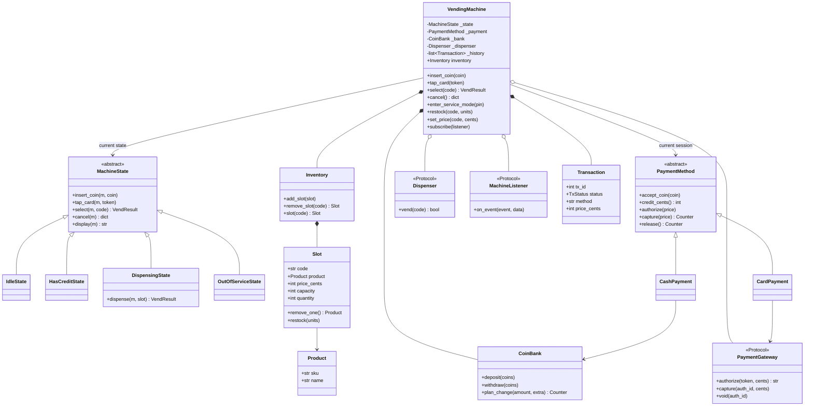
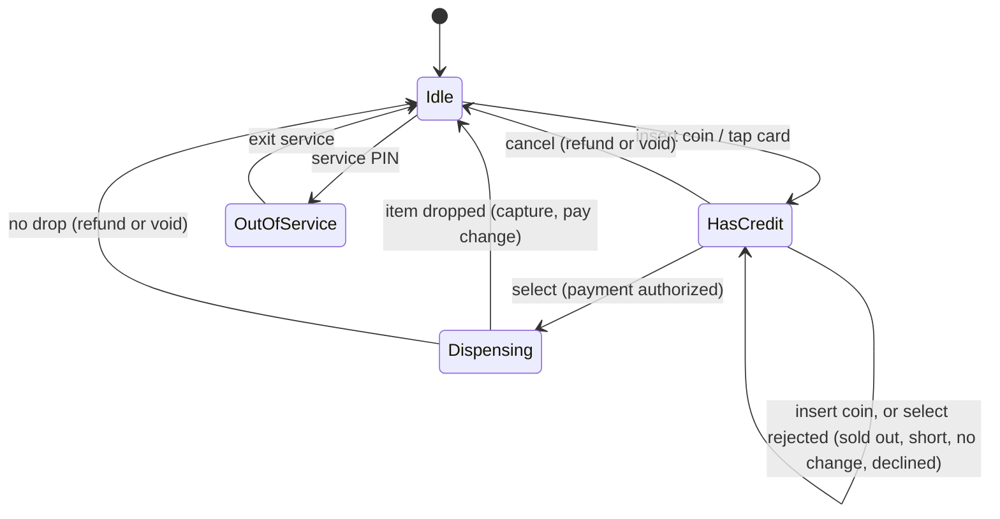

# Design a Vending Machine: State Machines, Change-Making and Cashless Payments

A vending machine looks like the simplest object-oriented design question there is: some products, some money, a button. It is also one of the best, because hiding inside it are three ideas that show up all over real software: a **state machine** that decides which actions are legal right now, a surprisingly tricky **algorithm** (giving correct change from a limited supply of coins), and a **payment boundary** where money must never be taken for a product that did not come out.

By the end of this post you will be able to design a vending machine from scratch in an interview, explain why the State pattern beats a pile of `if` statements (and when it does not), write a change-making algorithm that cannot be fooled by an empty coin tube, plug in card payments without touching the core logic, and talk credibly about how real machines from companies like Crane, Coca-Cola bottlers' fleets and smart-fridge startups actually work.

All code is Python 3.13, standard library only, and runs as-is:

- [`vending_machine.py`](vending_machine.py): the recommended design.
- [`alternatives.py`](alternatives.py): the competing designs compared below.
- [`test_vending_machine.py`](test_vending_machine.py): 37 `unittest` tests. Run them with `python3 -m unittest discover -s 04-vending-machine -v` from the `02-case-studies` folder.

If you are new to the vocabulary used here (class, composition, interface, design pattern), the foundation posts on [OOP fundamentals](../../01-foundations/01-oop-fundamentals.md) and [design patterns](../../01-foundations/02-design-patterns.md) are a good warm-up.

---

## 1. The real-world system

Walk up to a snack machine in an office lobby and a lot happens in a few seconds:

1. You drop in a dollar coin and two quarters. A **coin mechanism** (coin mech) measures each coin's size and metal, accepts or rejects it, and routes it into a **tube** of its own kind so it can later be paid back out as change. A **bill validator** does the same for paper money, holding each bill in an **escrow** position until the sale is certain.
2. The display shows your **credit**: `$1.50`.
3. You type `A1`. The machine checks that A1 is not sold out, that your credit covers the price, and that it can pay the change it would owe you.
4. A motor turns the spiral behind A1. An infrared **drop sensor** across the delivery bin watches for the item to fall.
5. If something fell, the sale is final: your coins are kept and your change (a quarter) drops into the coin cup. If nothing fell, a good machine refunds you or lets you pick again.
6. Behind the scenes the sale is logged. On newer machines, a small modem sends it to the operator's cloud so the route driver knows what to restock before driving out.

The "brain" doing all of this is the **vending machine controller** (VMC): a small embedded computer running firmware. It talks to the coin mech, bill validator and card reader over a standard serial bus called **MDB** (Multi-Drop Bus), which the vending industry's trade association (NAMA) maintains so that any manufacturer's coin mech works with any manufacturer's controller.

**The actors**

| Actor | What they do |
|---|---|
| Customer | Inserts money or taps a card, selects a product, collects the product and change, may cancel. |
| Operator / route driver | Opens the service door, restocks slots, sets prices, loads change coins, collects cash. |
| Peripherals | Coin mech, bill validator, cashless reader, motors, drop sensor. They report events and obey commands. |
| Back office | Receives sales and stock telemetry, settles card payments. |

**Why this is a good OOD problem.** The happy path is short, but almost every step can fail: sold out, not enough money, not enough *change*, card declined, motor jammed, customer walks away, service door opened mid-sale. A design that handles these cleanly needs clear states, clear ownership of money, and clear boundaries around hardware. That is exactly what interviewers want to see you reason about.

---

## 2. Clarifying requirements

An interview prompt is usually one vague sentence ("design a vending machine"). Your first job is to turn it into a concrete, bounded problem. Ask questions in four groups and write the answers down where the interviewer can see them.

**Products and layout**
- Are products arranged in **slots** (also called racks, columns, spirals) with a code like `A1`? *Yes, one product type per slot, a fixed capacity per slot.*
- Is the price a property of the product or of the slot? *Operators set prices per machine and per slot.* (This is worth asking; the answer changes the model.)
- Do we need to track expiry dates? *Not for this version (snacks and drinks).* We will still look at what changes if we do.

**Payment**
- Cash only, or cards too? *Coins first; card support is a likely follow-up, so design for it.*
- Can the customer insert money a bit at a time? *Yes, credit accumulates until they select or cancel.* (Some interview versions say "one payment only"; accumulating credit is what real machines do and is barely harder.)
- Does the machine give change? From a limited coin supply? *Yes, and it must not accept a sale it cannot make change for.*

**Failure handling**
- What happens if the product is sold out, the money is short, or the item gets stuck? *Show a message; never take money without delivering.*
- Can the customer cancel and get their coins back? *Yes.*

**Admin and operations**
- Who can restock and change prices? *Only an operator, via a service mode protected by a PIN.*
- Do we need a transaction log or reporting? *Yes, an audit trail of every session, plus stock alerts.*

### Final requirements

**Functional**
1. Customers can insert coins (5¢, 10¢, 25¢, $1); credit accumulates and is shown on a display.
2. Customers can tap a card instead of inserting coins.
3. Customers select a product by slot code. The machine vends only if the slot has stock, the payment covers the price, and (for cash) it can pay exact change.
4. The machine returns correct change using as few coins as possible from the coins it actually has.
5. Customers can cancel and get their inserted coins back.
6. If the item does not drop, the customer is not charged.
7. Operators can enter a PIN-protected service mode to add or remove slots, restock, change prices, load change coins and collect cash.
8. Every session produces an audit record; sales and low-stock events are reported to listeners (telemetry).

**Non-functional**
- **Correctness of money above all.** No floating-point money; no lost coins; no charge without a vend.
- **Safety against misuse.** Customer actions cannot happen in service mode; service mode cannot start mid-sale.
- **Robustness to concurrent events.** Hardware events and remote commands can arrive on different threads.
- **Extensibility.** New payment types (mobile wallet, QR) and new hardware should not require rewriting the core.
- **Testability.** The logic must run without real motors or card networks.

**Out of scope**: bill validation physics, the real MDB byte protocol, multi-machine fleet management, refrigeration, age-restricted products, user interface layout.

---

## 3. Finding the core objects

A simple, reliable technique is **noun/verb analysis**: underline the nouns in the requirements (candidate classes) and the verbs (candidate methods).

> Customers **insert** *coins*; *credit* accumulates and is **shown** on a *display*. Customers **tap** a *card*. Customers **select** a *product* by *slot code*. The *machine* **vends** if the *slot* has *stock*, the *payment* covers the *price*... **returns** *change* from its *coins*... **cancels**... *operators* **restock**... every *session* produces an *audit record*...

Now decide what each noun becomes:

| Noun | Becomes | Why |
|---|---|---|
| Machine | `VendingMachine` | The entry point every input goes through. |
| Product | `Product` | Identity of an item (SKU, name). Immutable. |
| Slot | `Slot` | Physical position with a product, a price, a capacity and a count. |
| (all slots) | `Inventory` | Lookup by code, add/remove slots. |
| Coin | `Coin` (Enum) | A fixed, small set of values. An enum, not a class hierarchy. |
| Coins the machine holds | `CoinBank` | Tube counts and change planning. |
| Payment | `PaymentMethod` with `CashPayment`, `CardPayment` | Two very different ways to pay behind one interface. |
| Session / audit record | `Transaction` | Immutable record of what happened. |
| "Has credit", "dispensing"... | `MachineState` subclasses | The rules change depending on what the machine is doing. |
| Motor + drop sensor | `Dispenser` (Protocol) | A hardware boundary we want to fake in tests. |
| Card network | `PaymentGateway` (Protocol) | An external system we want to fake in tests. |

Some nouns deliberately do **not** become classes:

- **Credit** is a number derived from the current payment, not an object with behaviour.
- **Display** is just a string computed by the current state. A `Display` class would have no logic.
- **Price** is an integer number of cents. Wrapping it in a `Money` class is a reasonable upgrade in a multi-currency system, but here it adds ceremony without protecting against any real mistake.
- **Customer** and **Operator** are actors outside the system. The machine never needs to know *who* you are, only what you did. (The operator is represented by the PIN check, not by a class.)
- **Change** is the output of an algorithm (a `{coin: count}` mapping), not a long-lived thing.

A common mistake is to create a class for every noun. A good rule: a noun earns a class when it has **behaviour or invariants** of its own. An **invariant** is a rule that must always be true about an object, like "a slot's quantity is between 0 and its capacity".

---

## 4. Class design



Reading the arrows: a filled diamond (`*--`) is **composition** (the part's life is owned by the whole: the machine creates and owns its inventory, coin bank and history). An open diamond (`o--`) is **aggregation** (the part is handed in from outside and could outlive the machine: the dispenser driver, gateway and listeners). A plain arrow is an **association** (one object uses another). A hollow triangle is **inheritance**.

**`VendingMachine`** is two things at once. It is a **Facade**: one simple interface (`insert_coin`, `select`, `cancel`, service operations) in front of many collaborators, so the keypad driver or a test never has to wire them up. It is also the **context** of the State pattern: it holds a reference to the current state object and forwards every customer action to it. It stays small because it decides nothing about *whether* an action is allowed; the state does. It does own the lock, the history and the event list.

**`MachineState` and its four subclasses** encode the rules of each mode. The base class rejects every action by default; each subclass overrides only the actions that make sense for it. `IdleState` allows inserting a coin or tapping a card. `HasCreditState` allows more coins, selecting and cancelling. `DispensingState` allows nothing from the customer while the motor runs. `OutOfServiceState` allows nothing from the customer at all.

**`PaymentMethod`** is a **Strategy** (an interchangeable algorithm behind a common interface). The states call `authorize`, `capture` and `release` without knowing whether coins or a card are behind them. `CashPayment` keeps the inserted coins and plans change; `CardPayment` talks to a `PaymentGateway`.

**`Inventory`, `Slot`, `Product`.** `Product` is immutable identity. `Slot` is the mutable physical position: its quantity changes with every sale and it carries the selling price. `Inventory` is a dictionary of slots with friendly errors. This separation is discussed in detail in the comparison section.

**`CoinBank`** owns the coin tubes and the change-making algorithm.

**`Dispenser`, `PaymentGateway`, `MachineListener`** are `typing.Protocol`s: interfaces satisfied by any object with the right methods. They mark the edges of our system. Real implementations would talk to motors, an MDB cashless reader, or a telemetry modem; tests pass in fakes.

**`Transaction`** is a frozen dataclass: an immutable audit record.

---

## 5. Code: the recommended solution

The full file is [`vending_machine.py`](vending_machine.py). Here are the important pieces, in the order a reader should meet them.

### 5.1 Money is integer cents

Every amount is an `int` number of cents. The coins are an `Enum` whose value is their worth:

```python
class Coin(Enum):
    """Coins the coin mechanism accepts. The value is the coin's worth in cents."""

    NICKEL = 5
    DIME = 10
    QUARTER = 25
    DOLLAR = 100

    @property
    def cents(self) -> int:
        return self.value
```

Pennies are simply not in the enum, which mirrors how coin mechs are configured to reject coins the operator does not want. Why integers rather than floats is covered in the comparison section; the short answer is that `0.1 + 0.2 != 0.3` in binary floating point, and a machine that loses a fraction of a cent per sale is a machine with an accounting bug.

### 5.2 Products and slots

```python
@dataclass(frozen=True)
class Product:
    """What an item *is*. Immutable, shared by every slot that stocks it."""

    sku: str
    name: str


@dataclass
class Slot:
    """One physical spiral/column: a product, its selling price and how many units are loaded.

    Price lives here rather than on Product because operators price per machine
    and per position (the same can may cost more in an airport than in a factory).
    """

    code: str
    product: Product
    price_cents: int
    capacity: int
    quantity: int = 0

    def __post_init__(self) -> None:
        if self.price_cents <= 0:
            raise ValueError("price must be positive")
        if self.capacity <= 0:
            raise ValueError("capacity must be positive")
        if not 0 <= self.quantity <= self.capacity:
            raise ValueError("quantity must be between 0 and capacity")
```

`__post_init__` enforces the slot's invariants at construction, and `remove_one` / `restock` keep them true afterwards. Nothing outside `Slot` writes `quantity` directly. That is **encapsulation** doing real work: if a bug ever produces a negative quantity, there are only two methods to look at.

### 5.3 States: the heart of the design

A **state machine** (formally, a finite-state machine) is a model where a system is always in exactly one of a fixed set of states, and each input either moves it to another state or is rejected. Vending machines are the textbook example because their behaviour truly depends on mode: pressing `A1` with no money shows the price; pressing it with enough money vends; pressing it while the motor runs does nothing.

Here is the machine's state diagram:



The base class rejects everything, so a state only lists what it *allows*:

```python
class MachineState(ABC):
    """One mode of the machine. Every action is rejected unless a state overrides it.

    States hold no data of their own (the machine does), so one shared instance
    of each is enough.
    """

    name: str = "abstract"

    def insert_coin(self, m: VendingMachine, coin: Coin) -> None:
        raise InvalidStateError(f"cannot insert coins while {self.name}")

    def tap_card(self, m: VendingMachine, card_token: str) -> None:
        raise InvalidStateError(f"cannot tap a card while {self.name}")

    def select(self, m: VendingMachine, code: str) -> VendResult:
        raise InvalidStateError(f"cannot select while {self.name}")

    def cancel(self, m: VendingMachine) -> dict[Coin, int]:
        raise InvalidStateError(f"cannot cancel while {self.name}")

    @abstractmethod
    def display(self, m: VendingMachine) -> str:
        """Text for the customer display."""
```

This "deny by default" choice matters. If someone adds a new action later, say `apply_coupon`, every existing state rejects it automatically until it is deliberately allowed. The opposite default ("allow unless forbidden") is how security holes are born.

The states are **stateless** objects: all data (current payment, inventory) lives on the machine, and each state receives the machine as `m`. That lets us create one shared instance of each (`IDLE`, `HAS_CREDIT`, ...) instead of allocating new state objects on every transition. (The GoF book calls sharing such objects the Flyweight idea.)

The `HasCreditState.select` method is where most of the business rules meet:

```python
    def select(self, m: VendingMachine, code: str) -> VendResult:
        assert m._payment is not None
        slot = m.inventory.slot(code)
        if slot.is_sold_out:
            raise SoldOutError(f"{slot.code} is sold out; choose another")
        # May raise InsufficientCredit / ExactChangeRequired / PaymentDeclined.
        # We stay in HasCredit so the customer can add coins, choose again or cancel.
        m._payment.authorize(slot.price_cents)
        m._set_state(DISPENSING)
        return DISPENSING.dispense(m, slot)
```

Notice the order: we check stock, then **authorize** payment, and only after both succeed do we move to `Dispensing`. If any check fails, an exception propagates *before* any state change, so the customer is still in `HasCredit` with their credit intact. This "validate everything, then commit" ordering is the simplest way to keep a multi-step operation consistent.

`DispensingState` resolves the vend:

```python
    def dispense(self, m: VendingMachine, slot: Slot) -> VendResult:
        assert m._payment is not None
        if m._dispenser.vend(slot.code):
            product = slot.remove_one()
            change = m._payment.capture(slot.price_cents)
            m._record(TxStatus.COMPLETED, slot, returned_cents=coins_value(change))
            m._emit("sale", {"slot": slot.code, "price_cents": slot.price_cents,
                             "method": m._payment.name})
            if slot.quantity <= m._low_stock_threshold:
                m._emit("low_stock", {"slot": slot.code, "quantity": slot.quantity})
            m._end_session()
            return VendResult(product, dict(change), f"ENJOY YOUR {product.name.upper()}")

        # Drop sensor saw nothing: never charge for an item the customer didn't get.
        refund = m._payment.release()
        m._record(TxStatus.VEND_FAILED, slot, returned_cents=coins_value(refund))
        m._emit("vend_failed", {"slot": slot.code})
        m._end_session()
        return VendResult(None, dict(refund), "VEND FAILED - PAYMENT RETURNED")
```

The money is only **captured** (made final) after the hardware confirms the drop. That single rule ("authorize before, capture after") is the most important correctness property of the whole design, and it is exactly how cashless vending works in the real world.

### 5.4 The machine as a thin context

```python
    # -- customer actions: all delegated to the current state --------------
    def insert_coin(self, coin: Coin) -> None:
        with self._lock:
            self._state.insert_coin(self, coin)

    def tap_card(self, card_token: str) -> None:
        with self._lock:
            self._state.tap_card(self, card_token)

    def select(self, code: str) -> VendResult:
        with self._lock:
            return self._state.select(self, code)

    def cancel(self) -> dict[Coin, int]:
        with self._lock:
            return self._state.cancel(self)
```

Each public method is one line of delegation wrapped in a lock. The lock is a `threading.RLock` (a re-entrant lock, which the same thread may acquire again without deadlocking). Why a lock at all is explained in the concurrency section.

Service operations use a guard instead of the state methods, because they are not customer actions:

```python
    def enter_service_mode(self, pin: str) -> None:
        with self._lock:
            if not hmac.compare_digest(pin, self._service_pin):
                self._emit("bad_pin", {})
                raise AuthorizationError("wrong service PIN")
            if self._state is not IDLE:
                raise InvalidStateError("finish or cancel the current sale first")
            self._set_state(OUT_OF_SERVICE)
            self._emit("service_mode", {"open": True})
```

`hmac.compare_digest` compares strings in constant time, so an attacker cannot learn the PIN digit by digit from how long a wrong guess takes. It is a small touch, but it shows the interviewer you think about security, which the requirements asked for. Failed PIN attempts are also emitted as an event, so a telemetry backend could alert on repeated guessing.

### 5.5 Payments as strategies

```python
class PaymentMethod(ABC):
    """Strategy for one customer's payment session.

    Three phases, mirroring cashless vending: ``authorize`` reserves the price
    before the motor turns, ``capture`` finalises after the drop sensor confirms
    the vend, ``release`` undoes everything on cancel or failed vend.
    """

    name: str = "abstract"

    def accept_coin(self, coin: Coin) -> None:
        raise InvalidStateError(f"{self.name} session in progress; coins not accepted")
```

Cash implements the three phases with coins:

```python
    def authorize(self, price_cents: int) -> None:
        credit = self.credit_cents()
        if credit < price_cents:
            raise InsufficientCreditError(
                f"price {format_cents(price_cents)}, credit {format_cents(credit)}"
            )
        # The customer's own coins can be used to pay their change.
        plan = self._bank.plan_change(credit - price_cents, extra=self._inserted)
        if plan is None:
            raise ExactChangeRequiredError("cannot make change; use exact change")
        self._change_plan = plan

    def capture(self, price_cents: int) -> Counter[Coin]:
        if self._change_plan is None:
            raise InvalidStateError("capture before authorize")
        change = self._change_plan
        self._bank.deposit(self._inserted)
        self._bank.withdraw(change)
        self._inserted, self._change_plan = Counter(), None
        return change

    def release(self) -> Counter[Coin]:
        refund = self._inserted
        self._inserted, self._change_plan = Counter(), None
        return refund
```

For cash, "authorize" means "I have enough credit **and** I can pay the change". This is the "EXACT CHANGE ONLY" light on real machines: the machine refuses the sale *before* vending rather than discovering afterwards that it owes you 30¢ it does not have. Note the subtle detail in `plan_change(..., extra=self._inserted)`: the customer's own coins count toward the change pool, because once the sale completes they will be in the tubes. A machine with empty tubes can still sell a $1.25 item to someone who inserted a dollar and two quarters, by handing one of their quarters back.

Card implements the same three phases with a gateway:

```python
    def authorize(self, price_cents: int) -> None:
        if price_cents > self._limit:
            raise InsufficientCreditError("price exceeds the card session limit")
        self._auth_id = self._gateway.authorize(self._token, price_cents)

    def capture(self, price_cents: int) -> Counter[Coin]:
        if self._auth_id is None:
            raise InvalidStateError("capture before authorize")
        self._gateway.capture(self._auth_id, price_cents)
        self._auth_id = None
        return Counter()

    def release(self) -> Counter[Coin]:
        if self._auth_id is not None:
            self._gateway.void(self._auth_id)
            self._auth_id = None
        return Counter()
```

The states never ask "is this cash or card?". The one place they read `m._payment.name` is to pick display text, which is presentation, not logic.

### 5.6 Change-making with a limited coin supply

```python
def make_change(amount: int, available: Mapping[int, int]) -> dict[int, int] | None:
    """Fewest coins that sum to ``amount`` using at most ``available[d]`` coins of value d.

    This is a bounded-knapsack dynamic programme.  ``best[s]`` is the fewest-coin
    combination found so far that totals ``s`` cents.  We add one denomination at a
    time; keeping only the best combination per subtotal is safe because the
    denominations still to come do not care *how* a subtotal was reached.

    Returns ``None`` when no combination exists (the caller must refuse the sale).
    """
    if amount < 0:
        raise ValueError("amount must be non-negative")
    best: dict[int, dict[int, int]] = {0: {}}
    for denom, limit in sorted(available.items(), reverse=True):
        if denom <= 0 or limit <= 0:
            continue
        extended = dict(best)
        for subtotal, combo in best.items():
            used = sum(combo.values())
            for k in range(1, limit + 1):
                total = subtotal + k * denom
                if total > amount:
                    break
                current = extended.get(total)
                if current is None or used + k < sum(current.values()):
                    extended[total] = {**combo, denom: k}
        best = extended
    return best.get(amount)
```

**Dynamic programming** means solving a big problem by building up answers to smaller sub-problems and reusing them. Here the sub-problem is "what is the fewest-coins way to make `s` cents using only the denominations considered so far?". Each denomination can be used 0 to `limit` times, which makes this a **bounded** knapsack (as opposed to the textbook version where you have unlimited coins). With amounts of a few dollars and a handful of denominations, it runs in microseconds. The next section shows why the simpler greedy approach is not good enough.

### 5.7 Hardware and telemetry boundaries

```python
class Dispenser(Protocol):
    """Motor + drop sensor. ``vend`` returns True only if an item was seen falling."""

    def vend(self, slot_code: str) -> bool: ...
```

A `Protocol` is Python's structural interface: any object with a matching `vend` method qualifies, no inheritance needed. The production implementation would drive a motor and read a sensor; `SimulatedDispenser` has a `jammed` set so tests can force failures. This is the **Dependency Inversion Principle**: the high-level policy (states, payments) depends on an abstraction, and the low-level hardware detail plugs into it.

Telemetry is the **Observer** pattern: listeners subscribe, and the machine calls `on_event` for sales, failed vends, low stock, service-door events and bad PIN attempts. The machine does not know or care whether the listener writes to a log, a modem or a test list.

### 5.8 Running it

```text
$ python3 vending_machine.py
Display: INSERT COINS OR TAP CARD
Display: CREDIT $1.50
ENJOY YOUR COLA; change = 1xquarter
Rejected: Chips costs $0.90; insert coins or tap card
Display: CARD READY - MAKE A SELECTION
ENJOY YOUR CHIPS; card balance now $4.10
Rejected: B1 is sold out; choose another
Coin return: 1xdollar
VEND FAILED - PAYMENT RETURNED; card balance still $4.10

Transactions:
  #1 completed   cash  A1  paid $1.25
  #2 completed   card  B1  paid $0.90
  #3 cancelled   cash  -   paid $0.00
  #4 vend_failed card  A1  paid $0.00
Telemetry events: ['service_mode', 'service_mode', 'sale', 'low_stock', 'sale', 'low_stock', 'vend_failed']
```

---

## 6. Comparing approaches

This is where an interview is won. For each decision there are several reasonable designs; what matters is that you can name them, show what they look like, and say when each is the right call. All the alternatives below are runnable in [`alternatives.py`](alternatives.py).

### 6.1 Decision 1: how to handle state

**Approach A: a status enum and `if/elif` in every method.**

```python
    def select(self, code: str) -> int:
        """Vend and return change in cents."""
        if self.status is Status.IDLE:
            raise RuntimeError("insert coins first")
        elif self.status is Status.HAS_CREDIT:
            if self.stock.get(code, 0) == 0:
                raise RuntimeError("sold out")
            if self.credit < self.prices[code]:
                raise RuntimeError("insufficient credit")
            self.stock[code] -= 1
            change, self.credit = self.credit - self.prices[code], 0
            self.status = Status.IDLE
            return change
        elif self.status is Status.OUT_OF_SERVICE:
            raise RuntimeError("out of service")
        raise AssertionError("unreachable")
```

This is perfectly readable at three states and three actions. The trouble is that the logic for one state is smeared across every method. Add a `DISPENSING` state and you must edit `insert_coin`, `select`, `cancel`, and every future method, and forgetting one branch is a silent bug.

**Approach B: the State pattern** (the recommended solution). Each state is a class; the context forwards to it. The rules for "has credit" all live in `HasCreditState`. Adding a state means adding a class; adding an action means adding a method to the base class (rejecting by default) and overriding it where allowed.

**Approach C: a table-driven state machine.** The transitions are data:

```python
    TABLE: dict[tuple[Status, Event], tuple[Callable[..., bool], Action | None, Status]] = {
        (Status.IDLE, Event.COIN): (_always, _add_credit, Status.HAS_CREDIT),
        (Status.IDLE, Event.CANCEL): (_always, None, Status.IDLE),
        (Status.IDLE, Event.SERVICE_OPEN): (_always, None, Status.OUT_OF_SERVICE),
        (Status.HAS_CREDIT, Event.COIN): (_always, _add_credit, Status.HAS_CREDIT),
        (Status.HAS_CREDIT, Event.SELECT): (_can_vend, _vend, Status.IDLE),
        (Status.HAS_CREDIT, Event.CANCEL): (_always, _refund, Status.IDLE),
        (Status.OUT_OF_SERVICE, Event.SERVICE_CLOSE): (_always, None, Status.IDLE),
    }

    def handle(self, event: Event, payload: object = None) -> object:
        entry = self.TABLE.get((self.status, event))
        if entry is None:
            raise RuntimeError(f"{event.name} not allowed in {self.status.name}")
        guard, action, next_status = entry
        if not guard(self, payload):
            raise RuntimeError(f"guard rejected {event.name} in {self.status.name}")
        result = action(self, payload) if action else None
        self.status = next_status
        return result
```

A **guard** is a condition that must hold for a transition to fire. The whole behaviour of the machine is visible in one dictionary, which you could print as a diagram, load from a config file, or check automatically ("is there any state with no way out?"). This is how a lot of embedded firmware is actually written, often as a C array of structs, and it is also how workflow engines and protocol implementations tend to work.

| | Enum + if/elif | State pattern | Table-driven |
|---|---|---|---|
| Where the rules for one state live | Spread across every method | One class | One block of rows |
| Adding a state | Edit every method | Add one class | Add rows |
| Adding an action | Add one method with all branches | Add a base method, override where allowed | Add an event and rows |
| Complex per-state behaviour (timers, messages, retries) | Gets messy fast | Natural: it is just methods | Awkward: actions become many small functions |
| Visualising / verifying all transitions | Read the code | Read several classes | Print the table |
| Default for unknown action | Whatever the `else` does | Deny (in our base class) | Deny (missing key) |
| Best when | Two or three states, prototype | Rich behaviour per state, OOD interview | Many states, simple actions, generated or audited machines |

**Recommendation.** Use the State pattern in an OOD interview: it is what the question is probing, and it scales gracefully to the follow-ups (dispensing, service mode, faults). Mention that a table-driven machine is a strong alternative when the number of states grows and behaviour per transition is small, and that the two combine well: state classes for behaviour, a table to declare which transitions are legal.

### 6.2 Decision 2: how to make change

**Approach A: greedy.** Take the largest coin that fits, repeat.

```python
def greedy_change(amount: int, denominations: list[int]) -> list[int] | None:
    """Largest coin first, unlimited supply. Optimal only for 'canonical' coin systems."""
    coins: list[int] = []
    for d in sorted(denominations, reverse=True):
        while amount >= d:
            amount -= d
            coins.append(d)
    return coins if amount == 0 else None
```

For US coins (1, 5, 10, 25) with unlimited supply, greedy is always optimal. Coin systems where greedy is always optimal are called **canonical**. But not every system is canonical. With coins of 1, 3 and 4, greedy makes 6 as 4+1+1 (three coins) while the best answer is 3+3 (two coins). Historic British coinage before decimalisation had the same flaw. Running `alternatives.py`:

```text
coins [1, 3, 4], amount 6: greedy [4, 1, 1], dp [3, 3]
first greedy counterexample for [1, 3, 4] -> 6
first greedy counterexample for US coins -> None
tubes {25: 1, 10: 3, 5: 0}, owe 30c: greedy None, dp {10: 3}
```

The last line is the one that matters for a real machine, even with ordinary US coins. **Limited inventory breaks greedy.** Suppose the tubes hold one quarter, three dimes and no nickels, and the machine owes 30¢. Greedy grabs the quarter, needs 5¢ more, has no nickel, and gives up. But three dimes would have worked. A greedy machine would light "EXACT CHANGE ONLY" and lose a sale it could have made.

```python
def greedy_change_limited(amount: int, available: Mapping[int, int]) -> dict[int, int] | None:
    """Greedy, but each denomination has a finite count (real coin tubes)."""
    plan: dict[int, int] = {}
    for d in sorted(available, reverse=True):
        take = min(available[d], amount // d)
        if take:
            plan[d] = take
            amount -= take * d
    return plan if amount == 0 else None
```

**Approach B: unlimited-supply DP.** The classic `fewest[a] = 1 + min(fewest[a - d])` table fixes non-canonical systems but still assumes infinite coins, so it does not solve the tube problem.

**Approach C: bounded DP** (recommended, `make_change` in section 5.6). Fixes both problems.

`alternatives.py` also has `find_greedy_counterexample`, which tests whether a coin system is canonical. It relies on a result by Kozen and Zaks: if greedy ever fails, it fails for some amount smaller than the sum of the two largest coins, so a short search is enough.

| | Greedy | Unlimited DP | Bounded DP |
|---|---|---|---|
| Correct for canonical systems, unlimited coins | Yes | Yes | Yes |
| Correct for non-canonical systems | No | Yes | Yes |
| Correct with limited coin tubes | No (can fail when an answer exists) | No (may plan coins you do not have) | Yes |
| Cost | O(number of denominations) | O(amount x denominations) | O(amount x total coins usable) |
| Code size | 6 lines | 15 lines | 20 lines |

**Recommendation.** Bounded DP. The amounts in a vending machine are tiny (a few hundred cents), so the extra cost is irrelevant, and refusing a sale you could have made is a real lost-revenue bug. Say out loud in an interview that greedy is fine for US coins *only if supply is unlimited*, then show the 30¢ example; it is a memorable moment.

**A note on tube management.** Real coin mechs also try to keep tubes balanced: paying change from whichever tube is fullest, or keeping a minimum float of each coin. That is a policy you could add as a tie-breaker in the DP (prefer combinations that leave more of the scarcest coin).

### 6.3 Decision 3: how to model inventory and products

**Approach A: quantity on the product.**

```python
@dataclass
class ProductWithQuantity:
    """Approach A: stock count lives on the product itself.

    Breaks as soon as the same product sits in two slots, or two machines share
    one catalogue entry: whose count is it?
    """

    code: str
    name: str
    price_cents: int
    quantity: int = 0
```

Simple, and wrong as soon as Cola is loaded into both `A1` and `A2` (very common for best-sellers). It also mixes what an item *is* (name, SKU) with how many happen to be in one machine.

**Approach B: product is identity; slot holds product, price, capacity and count** (recommended). This mirrors the physical machine and what operators call a **planogram** (the map of which product goes in which slot at which price). Price lives on the slot because the same SKU is priced differently by location and even by slot.

**Approach C: the slot tracks individual units.**

```python
    def vend(self, today: date) -> Unit:
        if not self.sellable(today):
            raise RuntimeError(f"{self.code}: empty or front item expired")
        return self.units.popleft()  # front of the spiral drops first

    def pull_expired(self, today: date) -> list[Unit]:
        expired = [u for u in self.units if u.best_before < today]
        self.units = deque(u for u in self.units if u.best_before >= today)
        return expired
```

Each `Unit` has a lot number and a best-before date, kept in a FIFO (first in, first out) queue that matches the physical spiral. This is what fresh-food machines and "smart fridge" micro-markets need, where selling an expired sandwich is a health problem and recalls are by lot.

| | Quantity on Product | Slot with count | Slot with units |
|---|---|---|---|
| Same product in two slots | Broken | Works | Works |
| Per-location pricing | Hard | Natural | Natural |
| Expiry / recalls | No | No | Yes |
| Memory and complexity | Lowest | Low | Highest |
| Best when | Toy examples | Snacks and drinks | Fresh food, pharmaceuticals |

**Recommendation.** Slot with count. Mention units-per-slot as the extension for fresh food. A related design choice: should `Slot` know how to dispense itself? We keep motors out of `Slot` and behind the `Dispenser` protocol, so the data class stays pure and the hardware stays swappable.

### 6.4 Decision 4: how to support multiple payment methods

**Approach A: branch on a method string.**

```python
def checkout_if_else(method: str, price_cents: int, **details: object) -> str:
    """Approach A: one function that knows every payment type."""
    if method == "cash":
        inserted = int(details["inserted_cents"])  # type: ignore[arg-type]
        if inserted < price_cents:
            raise RuntimeError("insufficient cash")
        return f"cash ok, change {inserted - price_cents}c"
    elif method == "card":
        balance = int(details["balance_cents"])  # type: ignore[arg-type]
        if balance < price_cents:
            raise RuntimeError("card declined")
        return "card captured"
    elif method == "mobile":
        if not details.get("wallet_token"):
            raise RuntimeError("no wallet token")
        return "mobile wallet captured"
    raise ValueError(f"unknown payment method {method!r}")
```

Every new method edits this function (violating the **Open/Closed Principle**: open for extension, closed for modification), the `**details` bag loses all type safety, and there is no natural home for each method's state (inserted coins, an authorization id).

**Approach B: Strategy** (recommended). `CashPayment` and `CardPayment` implement `authorize / capture / release`. A mobile wallet or QR-code payment would be one new class; no state class changes.

**Approach C: a separate state machine per payment type** (for example `CashHasCreditState`, `CardSessionState`). This is sometimes right, because card and cash flows really do differ in the real world (cash: pay then select; card: often select, then tap, then wait for approval). But it doubles the number of states. In our design the difference is absorbed by the strategy: tapping a card enters `HasCredit` with a "credit" equal to the session limit, which is exactly how MDB cashless readers present themselves to the controller ("funds available").

| | if/elif on string | Strategy | Separate state machines |
|---|---|---|---|
| Adding a payment type | Edit central function | New class | New states and transitions |
| Per-method data | Loose dict | Fields on the object | Fields on states or context |
| Shared vend / refund logic | Duplicated per branch | Shared in states | Duplicated per machine |
| Best when | Exactly one method forever | Methods share a lifecycle | Methods have truly different flows |

**Recommendation.** Strategy with a three-phase interface. The `authorize / capture / release` shape is worth explaining in an interview, because it is how card payments work everywhere (hotels, petrol pumps, ride-hailing), and it is the reason "never charge without a vend" is easy to guarantee.

### 6.5 Decision 5 (short): how to represent money

```text
float  0.10 + 0.20 = 0.30000000000000004
Decimal 0.10 + 0.20 = 0.30
cents   10 + 20     = 30
```

| | `float` | `Decimal` | `int` cents |
|---|---|---|---|
| Exact for currency | No | Yes | Yes |
| Handles fractions of a cent (tax, FX) | Inexactly | Yes, with explicit rounding | No |
| Speed / simplicity | Fast | Slower, needs context for rounding | Fastest, simplest |
| Fits hardware | No | No | Yes (coin mechs and MDB report in scaled integer units) |

**Recommendation.** Integer cents for a vending machine: every price is a whole number of cents and the hardware thinks in integers too. Use `Decimal` when you compute percentages (tax, discounts, currency conversion), and convert back to cents with explicit rounding. Never use `float` for money.

---

## 7. Going deeper

### 7.1 Concurrency: what breaks without the lock

It is tempting to say "a vending machine has one customer, so concurrency does not matter". In the firmware it matters a lot. Events arrive from several independent sources: the coin mech reports coins, the keypad reports presses, the cashless reader reports approvals, the telemetry modem receives a remote price change, and a timer may decide to cancel an abandoned session. If those run on different threads (or interrupt handlers), they can interleave.

A **race condition** is a bug where the result depends on the unpredictable timing of two operations. Two concrete races:

1. **Lost credit.** `self._inserted[coin] += 1` is a read-modify-write. If two coin events interleave, both can read the same old count and one coin disappears. The customer paid; the machine did not notice.
2. **Double vend.** Two "select" events for the last can arrive close together (say, a bouncy key). Both check `is_sold_out` (false), both authorize, both run the motor. Or worse: both capture the payment.

The fix in our design is one `RLock` around every public method, which makes each customer action **atomic** (it happens completely or not at all, with nothing interleaved). Since states and payments are only ever called through those methods, they need no locks of their own. The tests prove it:

```python
    def test_two_racing_selections_vend_once(self) -> None:
        vm, dispenser, _, _ = make_machine(cola_qty=1)
        vm.insert_coin(Coin.DOLLAR)
        vm.insert_coin(Coin.QUARTER)
        errors: list[Exception] = []

        def press() -> None:
            try:
                vm.select("A1")
            except Exception as exc:  # noqa: BLE001 - collecting for the assertion
                errors.append(exc)

        threads = [threading.Thread(target=press) for _ in range(2)]
        for t in threads:
            t.start()
        for t in threads:
            t.join()
        self.assertEqual(dispenser.vended, ["A1"])
        self.assertEqual(len(errors), 1)
```

The second press finds the machine back in `Idle` and is rejected. A related subtlety: our lock is held while the motor runs (inside `select`). On a real controller a vend takes a second or two, and you would not want to block telemetry reads for that long. Production firmware therefore splits dispensing into "start motor" and a later "drop sensed / timeout" event, with `Dispensing` as a real waiting state, and keeps every *transition* short and atomic. Our synchronous `Dispenser.vend` is the interview-sized version of that.

Many real controllers avoid threads entirely and use a single **event loop** (the "superloop" in embedded jargon): interrupts put events on a queue, and one loop takes events off the queue and feeds them to the state machine one at a time. That gives the same atomicity guarantee as our lock, with no lock. It is worth mentioning as the industrial answer.

### 7.2 Extensibility: "the interviewer now asks..."

**"Add a timeout: if the customer walks away with credit, return it after 60 seconds."** Add a `tick(now)` action to `MachineState` (rejecting by default). `HasCreditState.tick` checks how long the session has been idle and calls the same refund path as `cancel`. For cards, this is important: an abandoned card session holds an authorization that should be voided. With the State pattern this is one new method and one override; with if/elif it is a new branch in a growing function.

**"Add bills."** Bills are just larger tokens of credit, with one twist: the validator holds the bill in **escrow** and can still return it. Model a `Bill` enum and let `CashPayment` accept both. On cancel, escrowed bills come back; on capture they are stacked. Also add a policy: do not accept a $20 bill if the machine cannot make $18.75 in change, which reuses `plan_change`.

**"Add a mobile wallet / QR payment."** A new `PaymentMethod` subclass that talks to the wallet provider. Zero changes to states, inventory or change-making. This is the Strategy pattern paying off.

**"Support combo deals or promotions."** Put a `PricingPolicy` strategy between the slot and the payment: `price_for(slot, session) -> int`. The slot keeps its list price; the policy can discount. This keeps promotion logic out of `Slot`.

**"Some machines have a robotic arm or elevator instead of spirals."** That is a different `Dispenser` implementation. The protocol does not change.

**"Report the machine as out of service automatically when every slot is empty or the coin mech faults."** Add a `FaultState` (or reuse `OutOfServiceState`) entered on a fault event. Because customer actions are denied by default in the base class, the new state is safe the moment it exists.

**"Allow the customer to buy several items in one card session."** Change `DispensingState.dispense` to return to `HasCredit` (instead of `Idle`) for card sessions with remaining limit, and add a "done" action that ends the session. This is how many cashless readers support "multi-vend".

### 7.3 From in-memory objects to a real service

Our objects live in RAM. A real machine must survive a **power cut mid-sale**: if power drops after the motor turned but before the sale was recorded, the books do not balance. Firmware handles this by writing a small journal to non-volatile memory (flash or EEPROM) before and after each critical step ("vend started for A1, credit 150", "vend completed"), and replaying it on boot. This is the same idea as a database write-ahead log. In our design, the `Transaction` record and the `Dispensing` state are the natural points to persist.

For a fleet of machines, the cloud side looks like a normal backend: an event stream of sales and stock levels per machine (our `MachineListener` events), a planogram service that pushes prices and slot assignments down to machines, and a card-settlement service. The machine must work **offline**: cash sales continue without a network, and many cashless setups can store transactions and forward them later, accepting a small risk of declined cards in exchange for not losing sales.

### 7.4 Testing strategy

- **Unit tests for pure logic.** `make_change` is tested against a brute-force search over small coin counts, which catches subtle DP mistakes much better than a few hand-picked cases.
- **Behaviour tests through the facade.** Each test builds a machine with a fake dispenser and fake gateway and drives it like a customer: exact payment, change, sold out, unknown slot, cancel, exact-change-required, declined card, jam with cash, jam with card.
- **State rule tests.** Every "this action is illegal here" rule has a test (insert coin during a card session, select in service mode, enter service mid-sale).
- **Concurrency tests.** Many threads inserting coins (no lost credit), two threads racing for the last item (exactly one vend).
- **Fakes, not mocks.** `SimulatedDispenser` and `InMemoryGateway` are small working implementations. Tests read naturally ("the card balance is unchanged after a jam") instead of asserting on call counts.

### 7.5 Failure modes and how the design handles them

| Failure | Handling |
|---|---|
| Item stuck in the spiral | Drop sensor reports no drop; payment released; `vend_failed` event; stock unchanged. |
| Tubes cannot make change | Refused at authorize time with "exact change only"; customer can add exact coins or cancel. |
| Card declined | Exception during authorize; still in `HasCredit`; customer can cancel. |
| Card approved but vend fails | Authorization voided, not captured. |
| Wrong service PIN | Rejected with constant-time comparison; `bad_pin` event for alerting. |
| Restock over capacity | `ValueError` from `Slot.restock`; nothing changes. |
| Service door opened mid-sale | Refused until the sale finishes or is cancelled. |

---

## 8. How real systems do it

**Embedded controllers.** The VMC is a microcontroller running firmware written mostly in C. It has a watchdog timer (hardware that reboots the controller if the software stops responding), non-volatile memory for configuration and audit counters, and drivers for motors, sensors, the display and the keypad. Its main logic is a state machine, often literally a table of states and events, because state machines are easy to reason about, easy to test exhaustively, and predictable in timing and memory, which matters on small chips.

**Why real machines are state machines.** Every peripheral speaks in events ("coin accepted", "key pressed", "vend approved", "drop detected", "door opened"), and the correct reaction depends entirely on what the machine is currently doing. A state machine makes the illegal combinations impossible by construction: a coin event during `Dispensing` either queues or is rejected, never accidentally starts a new sale. Safety-critical and regulated devices across the industry (payment terminals, elevators, traffic lights) are designed the same way. See the [elevator](../05-elevator-system/README.md) and [ATM](../10-atm/README.md) case studies for two more.

**MDB, the bus between the controller and the money.** MDB/ICP is a serial protocol maintained by NAMA. The controller is the single master; the coin changer, bill validator and cashless readers are peripherals with fixed addresses, and the controller polls each one in turn. A coin changer reports coins deposited and routed (to a tube or to the cash box) and pays out change on command; it also reports tube levels, which is how the controller knows when to show "exact change only". A bill validator reports a bill in escrow and waits for the controller to say "stack" or "return". Because the bus is standardised, an operator can swap in any compliant card reader without changing the machine's controller, which is exactly the benefit our `PaymentMethod` abstraction mirrors in software.

**Cashless readers.** Card and phone payments arrive through a cashless reader (companies such as Nayax and Cantaloupe build these). Over MDB the flow is roughly: the reader tells the controller a session has begun with some funds available; the customer selects; the controller sends a vend request with the item and price; the reader asks the payment network for approval and replies approved or denied; the controller vends and reports success or failure; the reader then completes or reverses the charge and the session ends. That is the `authorize / capture / release` lifecycle from section 5.5. Many readers pre-authorize a fixed amount when the card is tapped and capture the actual price later, which is why you sometimes see a temporary hold on your statement that differs from what you paid.

**Telemetry and remote inventory.** Machines have long recorded sales and cash counters in a standard audit format called DEX/UCS (and the related EVA-DTS format in Europe). Route drivers used to plug a handheld into each machine to download it. Today, cellular telemetry (often built into the cashless reader) uploads this data continuously, so operators can plan routes ("only visit machines that need restocking"), detect faults remotely, change prices, and decide what to stock based on what actually sells. Our `MachineListener` events are the interview-sized version of this.

**What production adds beyond the interview version.**
- Coin routing policy: which coins go to tubes versus the cash box, and minimum tube levels.
- Bill escrow and anti-fishing sensors (detecting a bill pulled back on a string).
- Retry policy on a failed drop (try once more, or offer another selection) before refunding.
- Power-fail recovery with a journal in non-volatile memory.
- Secure handling of card data: the controller never sees card numbers; the reader is a separate, certified device.
- Age verification for restricted products, temperature monitoring for refrigerated products, and health-timer lockouts that stop selling perishables if the fridge was too warm for too long.
- Remote planogram updates and dynamic pricing from the operator's back office.

---

## 9. Interview playbook

**A 45-minute timeline**

| Minutes | What to do |
|---|---|
| 0-5 | Clarify: slots and codes, payment types, partial payments, change from limited coins, failure handling, admin access. Write requirements down. |
| 5-10 | Nouns to classes: Product, Slot, Inventory, CoinBank, PaymentMethod, Transaction, VendingMachine, states. Say which nouns are not classes and why. |
| 10-15 | Draw the state diagram first. It is the spine of the design and interviewers love seeing it early. |
| 15-25 | Class diagram and responsibilities. Point out Facade (machine), State (states), Strategy (payments), Observer (telemetry). |
| 25-38 | Code the key parts: base state with deny-by-default, `HasCredit.select`, `Dispensing.dispense`, cash authorize with change planning. |
| 38-45 | Deep dives the interviewer chooses: change-making correctness, concurrency, card flow, power failure, extensions. |

**What to say out loud**
- "Money is integer cents; I won't use floats."
- "I authorize before the motor turns and capture only after the drop sensor confirms, so a customer is never charged for nothing."
- "Every action is denied by default in the base state; each state allows only what it should."
- "Greedy change works for US coins with unlimited supply, but tubes run out. Here is a case where greedy refuses a sale that bounded DP can make."
- "Hardware is behind small interfaces so I can test without a machine."

**Common mistakes**
- Using `float` for money.
- Putting stock count on `Product`.
- A `VendingMachine` god class that does everything itself (the facade should delegate).
- Forgetting the "cannot make change" case, or checking it after vending.
- Taking the money before confirming the vend.
- States that silently ignore illegal actions instead of reporting them.
- Over-modelling: a `Display` class, a `Customer` class, a `Button` class with no behaviour.

**Follow-ups interviewers ask**
- How do you add card payments? (Strategy, three phases.)
- What if the item gets stuck? (Drop sensor, release, refund.)
- How do you handle concurrent events? (Lock or single event loop; atomic transitions.)
- How would an operator know a machine is empty without visiting? (Observer, telemetry.)
- What happens on power loss mid-vend? (Journal in non-volatile memory.)
- Why not just use if/else for states? (Comparison table above.)

---

## 10. Test yourself

<details>
<summary>1. Why does the base <code>MachineState</code> reject every action by default instead of allowing it?</summary>

Deny-by-default makes new actions and new states safe automatically. If you add `apply_coupon` or a `FaultState`, nothing is allowed until someone deliberately overrides the relevant method. With allow-by-default, forgetting an override would let a customer, for example, insert coins while the machine is out of service.
</details>

<details>
<summary>2. The machine has one quarter, three dimes and no nickels, and owes 30¢. What does greedy do, and what does the recommended design do?</summary>

Greedy takes the quarter, then needs 5¢ and has no nickel, so it fails and the machine would refuse the sale ("exact change only"). Bounded DP finds three dimes. The recommended design uses bounded DP, so the sale goes through.
</details>

<details>
<summary>3. Give a coin system where greedy is not optimal even with unlimited coins.</summary>

Coins of 1, 3 and 4: greedy makes 6 as 4+1+1 (three coins), but 3+3 uses two. Such systems are called non-canonical. By Kozen and Zaks, if greedy fails at all, it fails below the sum of the two largest coins, so you only need to check a small range.
</details>

<details>
<summary>4. Why does <code>CashPayment.authorize</code> include the customer's inserted coins when planning change?</summary>

Because after the sale completes, those coins are in the machine's tubes and can be paid back out. A machine with empty tubes can still sell a $1.25 item to someone who inserted $1.00 + 25¢ + 25¢ by returning one of their quarters. Ignoring the inserted coins would refuse sales unnecessarily.
</details>

<details>
<summary>5. Why is the price on <code>Slot</code> rather than on <code>Product</code>?</summary>

Price is a decision made per machine (and sometimes per slot), not an intrinsic property of the item. The same can of cola may cost more in an airport than in an office, and an operator may price a best-seller differently in an eye-level slot. Product holds identity (SKU, name); Slot holds placement, price and count.
</details>

<details>
<summary>6. The interviewer asks you to add Apple Pay. What changes?</summary>

Add a `MobileWalletPayment(PaymentMethod)` that authorizes, captures and voids through the wallet provider's gateway, and an action (or reuse `tap_card`) that starts the session. No state classes, inventory or change-making code changes. That is the Open/Closed Principle in action via Strategy.
</details>

<details>
<summary>7. What race condition does the lock prevent, and what is the alternative used in many real controllers?</summary>

It prevents interleaving of read-modify-write operations: two coin events losing one coin, or two selections both vending the last item and both capturing payment. Many embedded controllers instead use a single event loop: interrupts enqueue events and one loop processes them one at a time, which gives the same atomicity without locks.
</details>

<details>
<summary>8. Design change: add a 60-second timeout that refunds abandoned credit. Where does the code go in each state-handling approach?</summary>

State pattern: add `tick(m, now)` to the base class (no-op or reject by default) and override it in `HasCreditState` to call the refund path. Enum + if/elif: add a new method with branches for every status, plus a timestamp field. Table-driven: add a `TIMEOUT` event and a row `(HAS_CREDIT, TIMEOUT) -> (guard: elapsed > 60s, refund, IDLE)`. State pattern and table both absorb it cleanly; if/elif grows another branching method.
</details>

<details>
<summary>9. Why must payment be captured only after the drop sensor confirms the vend?</summary>

Because the vend can fail after payment is authorized (jammed spiral, item caught on the glass). If you capture first, a failed vend requires a refund, which for cards means a separate reversal that can fail or take days, and for cash means paying out coins you may have already counted. Authorize first, capture after confirmation, and release on failure keeps "never charge without a vend" true by construction.
</details>

<details>
<summary>10. When would you choose a table-driven state machine over State pattern classes?</summary>

When there are many states and events but little behaviour per transition, when the machine must be generated, loaded from configuration, or audited (for example, proving every state has an exit), or in memory-constrained firmware. State classes are better when each state has rich behaviour such as its own messages, timers and validation.
</details>

---

## 11. Key takeaways

- A vending machine is a **state machine**. Model the states explicitly; deny every action by default and allow only what each state permits.
- The `VendingMachine` class is a thin **Facade** and State **context**; real decisions live in states, payments, inventory and the coin bank.
- Payments follow **authorize, capture, release**. Capture only after the hardware confirms the vend.
- **Greedy change-making** fails on non-canonical coin systems and, more practically, on **limited coin tubes**. Bounded dynamic programming is cheap and correct.
- Keep `Product` (what it is) separate from `Slot` (where it is, at what price, how many).
- Money is **integer cents** (or `Decimal` when you need fractional math). Never `float`.
- Hardware and external systems sit behind **Protocols**, which makes the logic testable with simple fakes.
- Real machines use MDB to talk to coin mechs, bill validators and cashless readers, and telemetry to report sales and stock remotely.

---

## 12. Further reading

- Gamma, Helm, Johnson, Vlissides, *Design Patterns: Elements of Reusable Object-Oriented Software* (1994): the State, Strategy, Facade and Observer chapters.
- Refactoring Guru: [State](https://refactoring.guru/design-patterns/state), [Strategy](https://refactoring.guru/design-patterns/strategy), [Facade](https://refactoring.guru/design-patterns/facade), [Observer](https://refactoring.guru/design-patterns/observer).
- Python docs: [`decimal`](https://docs.python.org/3/library/decimal.html), [`enum`](https://docs.python.org/3/library/enum.html), [`typing.Protocol`](https://docs.python.org/3/library/typing.html#typing.Protocol), [`threading`](https://docs.python.org/3/library/threading.html).
- Wikipedia: [Change-making problem](https://en.wikipedia.org/wiki/Change-making_problem) and [Finite-state machine](https://en.wikipedia.org/wiki/Finite-state_machine).
- Dexter Kozen and Shmuel Zaks, "Optimal bounds for the change-making problem", *Theoretical Computer Science* (1994).
- NAMA, the vending industry association that maintains the MDB/ICP standard: [namanow.org](https://www.namanow.org/).
- Other case studies in this series: [Parking lot](../01-parking-lot/README.md), [Elevator system](../05-elevator-system/README.md), [ATM](../10-atm/README.md).
