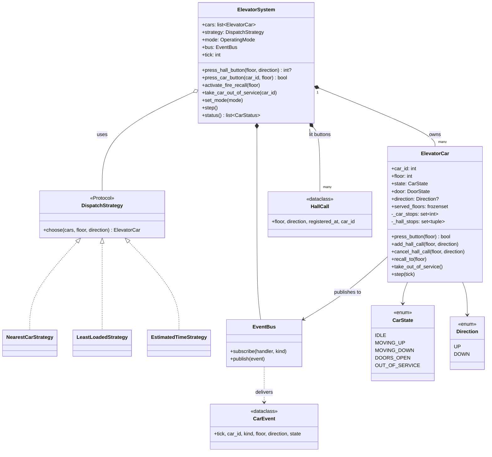
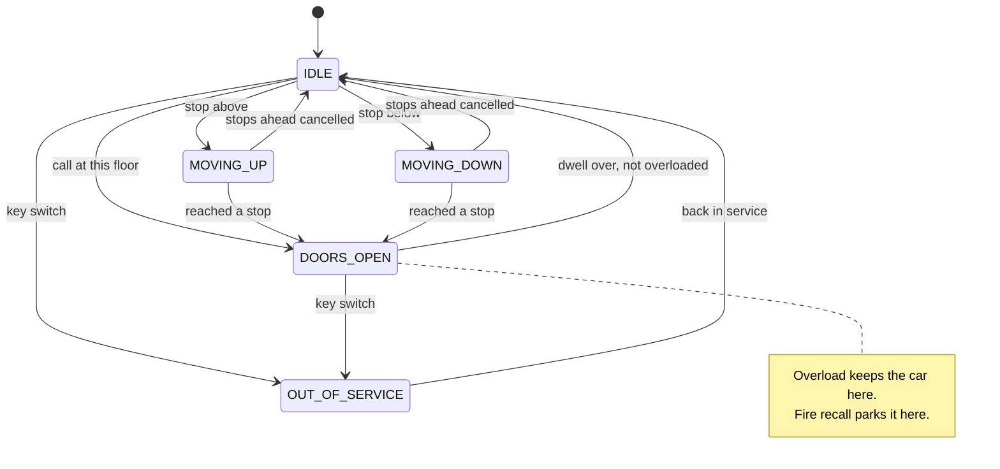

# Design an Elevator System: scheduling, dispatch and state machines in Python

An elevator bank looks simple from the lobby: you press a button, a car shows up. Underneath it is one of the best object-oriented design problems around, because it mixes a **state machine** (each car), a **scheduling algorithm** (the order a car visits floors), an **optimization policy** (which car answers which call) and **safety rules** that must never be broken. By the end of this post you will be able to design the whole thing from scratch, explain why each class exists, compare the competing designs with real numbers, and talk about what production systems from Otis, KONE and Schindler add on top.

All the code is plain Python 3.13 with the standard library only. It lives next to this post:

- [`elevator_system.py`](elevator_system.py) - the recommended design, with a runnable `demo()`
- [`alternatives.py`](alternatives.py) - the competing designs we compare, also runnable
- [`test_elevator_system.py`](test_elevator_system.py) - 39 `unittest` tests (`python3 -m unittest discover -s .`)

If you are new to classes, composition and design patterns, the foundations posts [OOP fundamentals](../../01-foundations/01-oop-fundamentals.md) and [design patterns](../../01-foundations/02-design-patterns.md) cover the vocabulary used here. This post defines each term again when it first appears, so you can also read it on its own.

---

## 1. The real-world system

Picture a 20-storey office tower with a bank of four identical cars. There are three kinds of actors:

- **Passengers** press buttons. On each floor's landing there is an "up" and a "down" button, called a **hall call** (the top floor has only "down", the lobby only "up"). Inside each car is a panel with one button per floor, called a **car call**.
- **The group controller** (sometimes called the dispatcher) is a computer that sees every hall call in the building and decides which car should answer it.
- **Each car's own controller** drives one car: it opens and closes the doors, runs the motor, and decides the order in which to visit the floors it has been asked to visit.

Two more actors appear in real buildings: **building staff and maintenance technicians**, who can take a car out of service with a key switch, and the **fire alarm system**, which can force every car back to the ground floor.

The words *hall call* and *car call* are not invented for this post. They are the standard terms in the elevator industry, and using them in an interview signals that you understand the domain. The distinction matters: a hall call has a **direction** (the person on floor 7 pressed "down") but no destination, while a car call has a **destination** but no direction of its own.

Why is this a great object-oriented design problem?

1. **State is everywhere.** A car is idle, moving up, moving down, standing with its doors open, or out of service. What a button press means depends on that state.
2. **Policies change.** The building manager wants to try a different dispatching rule during the morning rush. A good design lets you swap the rule without touching the cars.
3. **Many things react to one event.** When a car opens its doors at floor 7 heading down, the hall lamp must go out, the lantern above the doors must light, the display must update, and the group controller must stop counting that call as waiting.
4. **Safety invariants.** An **invariant** is a rule that must hold at every moment, no matter what. "A car never moves with its doors open" is the most important invariant in the whole system.

---

## 2. Clarifying requirements

In an interview the prompt is usually vague: "Design an elevator system for an office building." Spend the first five minutes turning it into a precise list. Good questions to ask, and the answers we will assume:

| Question | Why it matters | Assumed answer |
|---|---|---|
| What kind of building? Office, hospital, freight? | Freight and hospital cars have different priorities. | Office building. |
| How many floors and cars? | Affects whether dispatch is even interesting. | Configurable, e.g. 10-20 floors, 2-4 cars. |
| Do all cars serve all floors? | Zoned and express cars change dispatch. | Yes by default, but zoning should be easy to add. |
| How do we pick which car answers a call? | This is the heart of the problem. | Configurable; we should be able to swap the rule. |
| What happens if someone inside presses a floor behind the car? | A real behaviour question. | Ignore it while the car is committed to the other direction. |
| Do we need to show car position and direction? | Displays and lanterns. | Yes, each car reports its floor and state. |
| Any special modes? | Rush hour, fire, maintenance. | Out-of-service, fire recall, up-peak and down-peak parking. |
| Do we model real time, motors and physics? | Scope control. | No: a discrete-time simulation, one floor per tick. |

That last answer is a design decision worth explaining out loud. A **discrete-time simulation** advances the world in fixed steps called ticks. On each tick each car does exactly one thing: moves one floor, counts down its door timer, or decides where to go next. There is no `sleep()` and no wall clock, so every scenario is **deterministic**: run it twice and you get the same result, which makes it testable.

**Functional requirements**

- The building has N floors and M cars; each car serves a set of floors (all floors by default).
- Passengers on a landing press "up" or "down"; the system assigns a car to the call.
- Passengers inside a car press a destination floor; the car will stop there.
- A car going up does not pick up someone who wants to go down, and vice versa (unless it is turning around at that floor).
- A car call in the direction opposite to the car's committed travel is ignored.
- Each car exposes its current floor, state and direction for displays.
- The dispatching rule is configurable at runtime.
- A car can be taken out of service; its pending hall calls are handed to other cars.
- Fire recall sends every car to a recall floor, opens the doors and ignores all buttons.
- Up-peak and down-peak modes park idle cars where demand is expected.

**Non-functional requirements**

- Safety invariants (no motion with doors open, no closing on an overloaded car) are enforced in one place and cannot be bypassed by a new feature.
- Deterministic and unit-testable.
- Thread-safe API: buttons may be pressed from many threads while the simulation steps.
- Easy to extend with new dispatch strategies and new modes.

**Out of scope:** motor control, acceleration curves, door hardware, the electrical safety chain, billing, and the network protocol between controllers. We will mention them in "How real systems do it", but we will not model them.

---

## 3. Finding the core objects

A reliable technique is **noun/verb analysis**: underline the nouns in the requirements (candidate classes or attributes) and the verbs (candidate methods).

Nouns: building, floor, car, elevator, hall button, car button, call, direction, door, display, state, dispatcher, rule/strategy, mode, passenger, load, recall floor.
Verbs: press, assign, move, stop, open, close, serve, ignore, display, recall, park, take out of service.

Now decide what each noun becomes:

| Noun | Becomes | Reasoning |
|---|---|---|
| Car / elevator | `ElevatorCar` class | Has state that changes over time and behaviour (move, open doors). Core class. |
| Building / elevator system | `ElevatorSystem` class | Owns the cars, receives hall calls, owns the operating mode. It is the **facade**: the single entry point outside code talks to. |
| Dispatcher / rule | `DispatchStrategy` protocol plus concrete classes | The requirement says "swappable", which is the definition of the Strategy pattern. |
| Direction | `Direction` enum | A fixed set of values with a small behaviour (`opposite`). |
| State | `CarState` enum plus a transition table | A fixed set of values; transitions must be validated. |
| Door | `DoorState` enum on the car | A door has no behaviour of its own in our model, but tracking it separately from `CarState` lets us state the safety interlock explicitly. |
| Hall call | `HallCall` dataclass in the controller; a `(floor, direction)` tuple inside the car | It has data (floor, direction, when it was pressed, which car) but little behaviour. |
| Car call | just an `int` in the car's stop set | A car call is a floor number. Wrapping it in a class adds nothing. |
| Display, lamp, lantern | **Subscribers** to events, not core classes | They only react to what cars do. We model them with the `EventBus` (Observer pattern). |
| Event | `CarEvent` dataclass | Immutable record of what happened, when, to which car. |
| Hall button / car button | **Methods** (`press_hall_button`, `press_button`) | A button has no state worth modelling beyond "lit", which the controller already tracks. Making a `Button` class for every floor would add objects without adding behaviour. |
| Floor | an `int` | Floors have no behaviour here. A `Floor` class would just wrap a number. |
| Passenger | Not modelled | The system never knows who is inside, only which buttons were pressed and what the load sensor says. |
| Mode | `OperatingMode` enum | Normal, up-peak, down-peak, fire recall. |

Notice how many nouns *did not* become classes. A frequent beginner mistake is to create `Floor`, `Button`, `Passenger`, `Door` and `Display` classes with no behaviour. Interviewers read that as not understanding what a class is for. The rule of thumb: **make a class when something has state that changes and behaviour that depends on that state, or when you need to swap implementations.**

---

## 4. Class design



A quick refresher on the relationship arrows:

- **Composition** (filled diamond, `*--`): the whole owns the part and the part does not outlive it. The system creates its cars, its hall-call records and its event bus.
- **Aggregation** (hollow diamond, `o--`): the whole uses a part that has its own life. A dispatch strategy is passed in from outside and could be shared.
- **Realization** (`<|..`): a class implements an interface. Here the interface is a `typing.Protocol`, which means any class with a matching `choose` method qualifies, no inheritance needed. This is called **structural typing** or "duck typing with type-checker support".

### `ElevatorCar`

**Responsibility:** everything about one car. It knows its floor, its state, its door, its committed direction and its two sets of stops. It runs the **LOOK algorithm** (explained in section 5) to decide where to go next. It enforces the safety rules for itself.

Why two sets of stops instead of one list of floors? Because a hall call carries a direction and a car call does not. If you flatten both into one list of floor numbers, the car can no longer tell "someone on 5 wants to go down" from "someone inside wants to get off at 5", and it will stop at 5 on the way up for a passenger who wants to go down. We compare these designs in section 6.5.

### `ElevatorSystem`

**Responsibility:** the group controller and facade. It validates and records hall calls (the lit buttons), asks the strategy which car should answer, owns the building operating mode, and steps the simulation. It does **not** know how a car schedules its stops. That separation means you could replace the car's scheduling algorithm without touching the controller, and replace the dispatch rule without touching the car.

### `DispatchStrategy` and its implementations

**Responsibility:** given the eligible cars and a hall call, pick one. This is the **Strategy pattern**: a family of interchangeable algorithms behind one interface, chosen at runtime. The controller holds a reference to "some strategy" and never branches on which one it is.

### `EventBus` and `CarEvent`

**Responsibility:** decouple "something happened" from "who cares". Cars publish events such as `DOORS_OPENED` and `HALL_CALL_SERVED`; the controller, the displays and a logger subscribe. This is the **Observer pattern** (also known as publish/subscribe).

### Enums: `Direction`, `CarState`, `DoorState`, `OperatingMode`

Enums give names to fixed sets of values and make typos impossible. `Direction.UP` has `value = 1` and `Direction.DOWN` has `value = -1`, which turns "floor ahead of me" into one multiplication instead of an `if`.

---

## 5. Code: the recommended solution

### 5.1 Value types and the state machine table

```python
class Direction(Enum):
    UP = 1
    DOWN = -1

    @property
    def opposite(self) -> Direction:
        return Direction.DOWN if self is Direction.UP else Direction.UP


class CarState(Enum):
    IDLE = "idle"
    MOVING_UP = "moving up"
    MOVING_DOWN = "moving down"
    DOORS_OPEN = "doors open"
    OUT_OF_SERVICE = "out of service"
```

A **state machine** is a model where an object is always in exactly one of a finite set of states, and only certain moves (transitions) between states are legal. The car's complete state machine is a single table:

```python
ALLOWED_TRANSITIONS: dict[CarState, frozenset[CarState]] = {
    CarState.IDLE: frozenset(
        {CarState.MOVING_UP, CarState.MOVING_DOWN, CarState.DOORS_OPEN, CarState.OUT_OF_SERVICE}
    ),
    CarState.MOVING_UP: frozenset({CarState.DOORS_OPEN, CarState.IDLE}),
    CarState.MOVING_DOWN: frozenset({CarState.DOORS_OPEN, CarState.IDLE}),
    CarState.DOORS_OPEN: frozenset({CarState.IDLE, CarState.OUT_OF_SERVICE}),
    CarState.OUT_OF_SERVICE: frozenset({CarState.IDLE}),
}
```

Here it is as a diagram:



Notice what is **missing**: there is no arrow from `DOORS_OPEN` to `MOVING_UP`. A car must close its doors (passing through `IDLE`) before it moves. There is also no arrow from moving to `OUT_OF_SERVICE`: you cannot switch off a car between floors. Those missing arrows are safety rules expressed as data.

Every state change goes through one method:

```python
    def _set_state(self, new: CarState) -> None:
        self._require_transition(new)
        if new in (CarState.MOVING_UP, CarState.MOVING_DOWN) and self.door is DoorState.OPEN:
            raise SafetyInterlockError(f"car {self.car_id} cannot move with doors open")
        self.state = new
        self._emit(EventKind.STATE_CHANGED, state=new)
```

This is the software version of a **safety interlock**: a mechanism that makes a dangerous action impossible rather than merely unlikely. Even if a future feature has a bug that tries to start the motor with the door open (say, a faulty sensor sets `door = OPEN` at the wrong moment), the car raises an error instead of moving. There is a test, `test_interlock_prevents_moving_with_doors_open`, that does exactly that.

### 5.2 One tick of a car

```python
    def step(self, tick: int) -> None:
        self._tick = tick
        match self.state:
            case CarState.OUT_OF_SERVICE:
                return
            case CarState.DOORS_OPEN:
                self._step_doors()
            case CarState.IDLE:
                self._decide()
            case CarState.MOVING_UP | CarState.MOVING_DOWN:
                self._step_moving()
```

Python's `match` statement makes the per-state behaviour readable. Each branch is short because the details live in small helper methods.

The door logic holds the second safety rule, the **overload interlock**. Cars have a load-weighing sensor; if the car is over its rated capacity, the doors stay open until someone steps out:

```python
    def _step_doors(self) -> None:
        if self.recalled and self.floor == self._recall_floor:
            return  # parked for firefighters with doors open
        self._door_timer -= 1
        if self._door_timer > 0:
            return
        if self.load_kg > self.capacity_kg:
            self._door_timer = 1  # interlock: an overloaded car keeps its doors open
            self._emit(EventKind.OVERLOAD)
            return
        self.door = DoorState.CLOSED
        self._emit(EventKind.DOORS_CLOSED)
        self._set_state(CarState.IDLE)
        self._decide()
```

### 5.3 The LOOK algorithm: which floor next?

Disk drives had the same problem as elevators decades ago: a read head moving across a disk has to serve requests scattered over many tracks. The classic solutions are named after the disk world:

- **FCFS** (first come, first served): serve requests in arrival order. Fair in theory, but it can zig-zag across the building.
- **SSTF** (shortest seek time first): always go to the nearest request. Efficient on average, but it can **starve** a far-away request. **Starvation** means a request waits forever because other requests keep winning.
- **SCAN**: sweep in one direction all the way to the end, then sweep back. Bounded waiting, but it travels to the top floor even if nobody asked.
- **LOOK**: like SCAN, but reverse at the last request instead of the end. This is what people mean by "the elevator algorithm".

Our car uses LOOK, with one elevator-specific twist: hall calls have directions. The car stops at a floor when any of these is true:

```python
    def _should_stop_here(self) -> bool:
        floor, d = self.floor, self.direction
        if floor in self._car_stops:
            return True
        if d is None:
            return any(f == floor for f, _ in self._hall_stops)
        if (floor, d) in self._hall_stops:
            return True
        # Turn-around point: someone wants the other way and nothing is beyond us.
        return (floor, d.opposite) in self._hall_stops and not self.has_stops_ahead(d)
```

In words: always stop for a passenger who wants to get off here; stop for a waiting passenger going my way; and stop for a passenger going the *other* way only if this is where I turn around anyway. In the elevator industry this behaviour is called **directional collective control**: the car "collects" calls, but only those in its direction of travel.

Choosing a direction is the "keep going while there is work ahead, otherwise reverse" rule:

```python
    def _choose_direction(self) -> Direction:
        d = self.direction
        if d is not None and self.has_stops_ahead(d):
            return d
        if d is not None and self.has_stops_ahead(d.opposite):
            return d.opposite
        nearest = min(self.stop_floors(), key=lambda f: (abs(f - self.floor), -f))
        return Direction.UP if nearest >= self.floor else Direction.DOWN
```

`has_stops_ahead` uses the `Direction.value` trick: `(f - self.floor) * direction.value > 0` is true exactly when floor `f` lies ahead.

### 5.4 Car calls, and the "wrong direction" rule

```python
    def press_button(self, floor: int) -> bool:
        """A passenger inside the car pressed ``floor``. Returns True if accepted."""
        self._check_floor(floor)
        if self.recalled or not self.in_service:
            return False
        if floor == self.floor and self.state is CarState.DOORS_OPEN:
            self._door_timer = self.door_dwell_ticks  # behaves like "door open" button
            return True
        if floor == self.floor and self.state is CarState.IDLE:
            self._car_stops.add(floor)
            return True
        if (
            self.ignore_opposite_car_calls
            and self.direction is not None
            and (floor - self.floor) * self.direction.value <= 0
            and self.has_stops_ahead(self.direction)
        ):
            return False  # committed to the other direction: likely a mis-press
        self._car_stops.add(floor)
        return True
```

The requirement said "ignore a car call in the opposite direction". Read the condition carefully: we only ignore it while the car is **committed**, that is, while it still has stops ahead. If someone steps into an empty car that has just arrived at the top floor, every floor is "behind" the car, and refusing all of them would be absurd. The method returns `bool` so the panel can flash the button to tell the passenger the press was not accepted.

The policy is a constructor flag (`ignore_opposite_car_calls`) because buildings differ. Many real installations accept the call and serve it after reversing; with LOOK that costs nothing extra.

### 5.5 The group controller

```python
    def press_hall_button(self, floor: int, direction: Direction) -> int | None:
        """Register a hall call. Returns the id of the assigned car, if any."""
        with self._lock:
            self._validate_hall_button(floor, direction)
            if self.mode is OperatingMode.FIRE_RECALL:
                return None  # hall buttons are disabled during recall
            key = (floor, direction)
            if key in self._hall_calls:
                return self._hall_calls[key].car_id  # pressing again changes nothing
            call = HallCall(floor, direction, registered_at=self.tick)
            self._hall_calls[key] = call  # register before assigning: the car may serve it at once
            self._assign(call)
            return call.car_id
```

Four decisions are packed in here:

1. **Validation at the boundary.** Pressing "up" on the top floor raises `ValueError`. Invalid input is rejected where it enters the system, so the cars never see it.
2. **Idempotency.** Pressing an already-lit button five times (everyone does it) changes nothing. An **idempotent** operation gives the same result no matter how many times you repeat it.
3. **Ordering.** We record the call *before* assigning it, because a car that is standing at this floor with doors open will serve it instantly and publish `HALL_CALL_SERVED`, and the handler needs the record to exist.
4. **Assignment happens once, at press time.** That is how most real group controllers behave for conventional buttons, and it lets a hall lantern light early to tell people which car to walk to.

The lamp goes out when any car publishes `HALL_CALL_SERVED` for that floor and direction:

```python
    def _on_hall_call_served(self, event: CarEvent) -> None:
        assert event.direction is not None
        key = (event.floor, event.direction)
        call = self._hall_calls.pop(key, None)
        if call is None:
            return
        self.wait_times.append(event.tick - call.registered_at)
        if call.car_id is not None and call.car_id != event.car_id:
            # Another car got there first: release the assigned one.
            self.car(call.car_id).cancel_hall_call(*key)
```

Look at the last two lines. Suppose car 1 was assigned "floor 7, up", but car 0 happened to stop at 7 going up to drop someone off. The waiting passenger boards car 0, so car 1 must forget the call, or it will make a pointless trip. The controller learns about this through an event, not by polling every car. The test `test_other_car_serving_a_call_releases_the_assigned_car` covers this scenario.

`step()` is the heartbeat:

```python
    def step(self) -> None:
        with self._lock:
            self.tick += 1
            for call in list(self._hall_calls.values()):
                if call.car_id is None:
                    self._assign(call)
            for car in self.cars:
                car.step(self.tick)
            self._park_idle_cars()
```

Calls with no eligible car (for example, every car is out of service) stay lit with `car_id = None` and are retried every tick, so they are never lost.

### 5.6 Dispatch strategies

```python
class DispatchStrategy(Protocol):
    """Pick which car answers a hall call. ``cars`` is never empty."""

    def choose(self, cars: Sequence[ElevatorCar], floor: int, direction: Direction) -> ElevatorCar: ...


class NearestCarStrategy:
    """Closest car by floor distance, ignoring where it is heading."""

    def choose(self, cars: Sequence[ElevatorCar], floor: int, direction: Direction) -> ElevatorCar:
        return min(cars, key=lambda c: (abs(c.floor - floor), c.car_id))
```

The controller filters out ineligible cars first (out of service, recalled, or not serving that floor), so every strategy can assume the list is valid and non-empty. That keeps the strategies small and keeps the zoning rule in one place.

The recommended strategy estimates how long each car would take to arrive, given where it is already heading:

```python
def estimate_arrival_ticks(car: ElevatorCar, floor: int, direction: Direction) -> int:
    """Rough time for ``car`` to reach a hall call, following its LOOK route."""
    stop_cost = car.door_dwell_ticks + 1
    d = car.direction
    if d is None or not car.has_work:
        return abs(floor - car.floor)
    call_ahead = (floor - car.floor) * d.value >= 0
    if call_ahead and direction is d:
        # On the way: pay for the stops between here and there.
        between = [f for f in car.stop_floors() if 0 < (f - car.floor) * d.value < (floor - car.floor) * d.value]
        return abs(floor - car.floor) + len(between) * stop_cost
    # Must finish this sweep first, then come back.
    turn = car.furthest_stop(d)
    if call_ahead:
        turn = max(turn, floor) if d is Direction.UP else min(turn, floor)
    travel = abs(turn - car.floor) + abs(turn - floor)
    return travel + car.workload * stop_cost
```

A car two floors away that is heading the wrong way may be much "further" than a car eight floors away heading toward you. Nearest-car cannot see that; this cost function can.

### 5.7 Operating modes: fire recall, up-peak, down-peak

**Fire service Phase I recall** is required by elevator safety codes (in North America, ASME A17.1; in Europe, the EN 81 family). When a smoke detector trips, every car stops accepting calls, returns to a designated recall floor, opens its doors and stays there so firefighters can take control. In code:

```python
    def activate_fire_recall(self, recall_floor: int | None = None) -> None:
        """Phase I recall: cancel every call and send all cars to the recall floor."""
        with self._lock:
            floor = self.lobby if recall_floor is None else recall_floor
            self.mode = OperatingMode.FIRE_RECALL
            self._hall_calls.clear()
            for car in self.cars:
                if car.in_service:
                    car.recall_to(floor)
```

The car side clears its stops, sets a single stop at the recall floor, closes its doors early if they were open elsewhere, and refuses new buttons. A car moving away from the recall floor continues one more floor and then reverses, which mirrors the fact that a real car must decelerate to a stop before it can change direction.

**Up-peak** is the morning rush when almost everyone arrives at the lobby and goes up. **Down-peak** is the evening rush in the other direction. A simple but effective policy is to **park** idle cars where the next passengers are likely to be: all at the lobby during up-peak, spread over the upper floors during down-peak. The controller does this in `_park_idle_cars()` after every tick.

### 5.8 Running the demo

`python3 elevator_system.py` prints:

```text
Starting positions:
  Car 0: floor  0 | idle           | heading -
  Car 1: floor  5 | idle           | heading -
  Car 2: floor  9 | idle           | heading -

Hall calls:
  floor 4 UP   -> car 1
  floor 8 DOWN -> car 2
  floor 1 UP   -> car 0

Passengers board and choose floors:
  car 1 button 7: accepted
  car 2 button 0: accepted
  car 0 button 3: accepted
  car 2 button 9 while heading down: ignored

All calls served after 11 more ticks. Door openings:
  t=14 car 0 opened doors at floor 1
  t=14 car 1 opened doors at floor 4
  t=14 car 2 opened doors at floor 8
  t=18 car 0 opened doors at floor 3
  t=19 car 1 opened doors at floor 7
  t=24 car 2 opened doors at floor 0
Hall-call wait times (ticks): [2, 2, 2]

Fire alarm! Recalling every car to the lobby.
  Car 0: floor  0 | doors open     | heading -
  Car 1: floor  0 | doors open     | heading -
  Car 2: floor  0 | doors open     | heading -
```

Each hall call went to the car with the lowest estimated arrival time, the passenger in car 2 who pressed 9 while heading down was ignored, and the fire recall parked every car at the lobby with its doors open.

---

## 6. Comparing approaches

This is where an interview is won. For each decision there are several reasonable designs; what matters is that you can name them, show what they look like, and say when you would pick each.

### 6.1 Per-car scheduling: FCFS vs SSTF vs SCAN vs LOOK

All four schedulers in [`alternatives.py`](alternatives.py) implement one tiny interface, `next_target(floor, direction, pending) -> int`, and run in the same single-car simulator. SSTF and LOOK look like this:

```python
class SstfScheduler:
    """Shortest seek time first: always go to the nearest pending floor."""

    name = "SSTF"

    def next_target(self, floor: int, direction: int, pending: Sequence[Request]) -> int:
        return min(pending, key=lambda r: (abs(r.floor - floor), r.arrival)).floor
```

```python
class LookScheduler:
    """Like SCAN, but reverse at the last request instead of the shaft end."""

    name = "LOOK"

    def next_target(self, floor: int, direction: int, pending: Sequence[Request]) -> int:
        d = direction or 1
        ahead = [r.floor for r in pending if (r.floor - floor) * d > 0]
        if ahead:
            return min(ahead, key=lambda f: abs(f - floor))
        behind = [r.floor for r in pending if (r.floor - floor) * d < 0]
        return min(behind, key=lambda f: abs(f - floor)) if behind else floor
```

The only difference is one idea: LOOK remembers a **direction** and refuses to turn back while there is work ahead. That single piece of memory is what prevents starvation.

**The starvation demo.** The car starts at floor 4. At tick 0 someone calls from floor 9, and then a steady trickle of requests arrives at floors 2 and 4. Running `python3 alternatives.py`:

```text
1) Per-car scheduling, starvation scenario (car starts at 4)
   FCFS  floor-9 wait:     5  served: 39  travelled: 40 floors
   SSTF  floor-9 wait: never  served: 38  travelled: 40 floors
   SCAN  floor-9 wait:     5  served: 37  travelled: 40 floors
   LOOK  floor-9 wait:     5  served: 39  travelled: 40 floors
```

SSTF never serves floor 9 in 40 ticks. There is always a closer request, so the person on 9 waits forever. That is starvation, and it is the textbook reason elevators do not use pure SSTF.

**Random traffic.** Averaged over 10 random seeds on a 20-floor building:

```text
   Random traffic, 20 floors, 10 seeds (mean / worst wait, ticks)
   FCFS   13.1 / 62
   SSTF   12.6 / 74
   SCAN   12.7 / 37
   LOOK   12.1 / 37
```

The averages are close, but the **worst case** tells the story. SSTF has a decent average and a terrible tail; FCFS is fair in order but wastes travel and also has a long tail; SCAN and LOOK bound the worst wait, because every floor is visited at least once per round trip. LOOK beats SCAN slightly because it does not travel to empty ends of the shaft.

| Scheduler | Pros | Cons | Choose when |
|---|---|---|---|
| FCFS | Trivial; obviously fair in order | Zig-zags; long tail; ignores geometry | Single-call systems (dumbwaiters), or as a teaching baseline |
| SSTF | Low average wait under light load | Starvation; unpredictable for users | Almost never for passengers; fine for internal batch work with aging |
| SCAN | Bounded wait; simple | Travels to empty ends | Very tall single shafts with uniform traffic |
| **LOOK** | Bounded wait; no wasted travel; matches what passengers expect | Slightly more state (direction) | **Default for passenger elevators** |

**Recommendation:** LOOK with directional collective control, as in `ElevatorCar`. If you must use SSTF for some reason, add **aging** (each request's priority grows with waiting time) to prevent starvation.

### 6.2 Multi-car dispatch: nearest vs least-loaded vs estimated time

Once you have several cars, a new question appears: which car answers a hall call? We implemented all three options as strategies and fed identical random traffic (16 floors, 4 cars, 400 ticks) through the real `ElevatorSystem`:

```text
2) Multi-car dispatch on identical random traffic (mean / max wait, ticks)
   nearest car       13.2 / 60
   least loaded       9.3 / 34
   estimated time     6.6 / 38
```

```python
class LeastLoadedStrategy:
    """Car with the fewest pending stops; distance breaks ties."""

    def choose(self, cars: Sequence[ElevatorCar], floor: int, direction: Direction) -> ElevatorCar:
        return min(cars, key=lambda c: (c.workload, abs(c.floor - floor), c.car_id))
```

Why does nearest-car do so badly? It **bunches** cars. Once one car is near a busy area it keeps winning, gets overloaded, and the other cars sit idle. Least-loaded spreads the work but ignores geometry, so it sometimes sends an empty car from the far end of the building. The estimated-time strategy combines both signals: distance, direction of travel, and the stops already queued.

| Strategy | Pros | Cons | Choose when |
|---|---|---|---|
| Nearest car | Simple, easy to explain | Ignores direction and load; bunching; long waits | Two-car buildings with light traffic |
| Least loaded | Balances work; simple | Ignores distance and direction | As a tiebreaker or a component of a cost |
| **Estimated time (direction-aware cost)** | Best average wait; extensible (add energy, crowding, priority terms) | Needs a model of the car's route; heuristic | **Default for group control** |

How to make the choice, not just the strategy, swappable: the controller depends on the `DispatchStrategy` protocol and `set_strategy()` swaps it at runtime. The alternative, an `if mode == "nearest": ... elif ...` chain inside the controller, would mean editing the controller for every new rule, which violates the **Open/Closed Principle** (open for extension, closed for modification).

**Recommendation:** Strategy pattern with an estimated-time cost function as the default. It is also the natural place for real-world refinements like penalizing a car that is already full.

### 6.3 Car state: enum + transition table vs the State pattern

The **State pattern** (from the "Gang of Four" design patterns book) turns each state into its own class. The car (the "context") holds a reference to its current state object and delegates every event to it. The alternative in `alternatives.py` looks like this:

```python
class IdleBehavior(CarStateBehavior):
    name = "idle"

    def tick(self, car: StatefulCar) -> None:
        if not car.stops:
            return
        if car.floor in car.stops:
            car.change(DoorsOpenBehavior(car.dwell))
            return
        nearest = min(car.stops, key=lambda f: abs(f - car.floor))
        car.change(MovingBehavior(1 if nearest > car.floor else -1))
```

```python
class OutOfServiceBehavior(CarStateBehavior):
    name = "out of service"

    def press(self, car: StatefulCar, floor: int) -> bool:
        return False

    def tick(self, car: StatefulCar) -> None:
        pass
```

The recommended solution instead uses an `Enum`, a `match` in `step()`, and the `ALLOWED_TRANSITIONS` table.

| Approach | Pros | Cons | Choose when |
|---|---|---|---|
| Boolean flags (`is_moving`, `doors_open`, ...) | Quick to write | Illegal combinations are representable (moving *and* doors open); bugs hide in flag combinations | Never for anything safety-related |
| **Enum + transition table** | Whole machine visible in one table; easy to draw and to test exhaustively; transitions validated in one place | Per-state behaviour lives in one class, so a very large machine gets a long `match` | **Few states, behaviour mostly shared** (our case) |
| State pattern | Each state's behaviour isolated; adding a state means adding a class; per-state data (e.g. door timer) lives in the state object | More classes; transitions scattered across classes, so the overall machine is harder to see and validate | Many states with very different behaviour, e.g. Phase II firefighter operation, independent service, attendant mode, earthquake mode |

The deciding factor for us is that the five car states share most of their data (floor, stops, direction) and the safety rules are about **transitions**. A single table that a test can check (`test_every_state_has_transition_entry`) is easier to audit than transitions spread across five classes. If the interviewer adds four more service modes, each with its own button semantics, switch to the State pattern; the enum table can stay as a guard either way.

### 6.4 Event flow: central polling vs Observer

How does the controller learn that a button was pressed or that a car opened its doors?

**Polling:** the controller wakes up periodically and inspects everything.

```python
class PollingController:
    """Scans every panel on each tick and assigns anything new."""

    def __init__(self, panel: PollingHallPanel, scan_every: int = 1) -> None:
        self.panel = panel
        self.scan_every = scan_every
        self.assigned_at: dict[tuple[int, Direction], int] = {}
        self.tick = 0

    def step(self) -> None:
        self.tick += 1
        if self.tick % self.scan_every:
            return
        for key in self.panel.lamps:
            self.assigned_at.setdefault(key, self.tick)
```

**Observer:** the source notifies its subscribers the moment something happens.

```python
class ObservableHallPanel:
    """Buttons notify subscribers the moment they are pressed."""

    def __init__(self) -> None:
        self._listeners: list[HallListener] = []

    def subscribe(self, listener: HallListener) -> None:
        self._listeners.append(listener)

    def press(self, floor: int, direction: Direction) -> None:
        for listener in self._listeners:
            listener(floor, direction)
```

With a polling interval of 3 ticks, a press at tick 1 is noticed at tick 3; the observer notices it at tick 1. More importantly, the poller has to know the internal structure of every panel (`panel.lamps`), while the observable panel only knows that "someone" listens.

| Approach | Pros | Cons | Choose when |
|---|---|---|---|
| Central polling | Simple control flow; easy to reason about timing; natural fit for hardware scan loops | Latency up to one interval; the poller couples to every component's internals; wasted work when nothing changes | Hardware I/O scanning (PLCs genuinely work this way), very small systems |
| **Observer / events** | Immediate; publishers do not know subscribers; adding a display or logger is one `subscribe` call | Control flow is less obvious; handlers that call back into the publisher need care (re-entrancy) | **Notifications: lamps, lanterns, displays, metrics, call bookkeeping** |
| Message queue between processes | Survives crashes, scales across machines | Infrastructure, ordering and delivery semantics | Building-management integration, cloud monitoring |

**Recommendation: a hybrid**, which is what `elevator_system.py` does. Motion is driven by the tick (`step()`), which keeps timing deterministic, and everything that *reacts* to motion (clearing lamps, releasing a car whose call was taken, logging) is an event subscriber. Note the `RLock` (re-entrant lock) in `ElevatorSystem`: an event handler runs inside `step()` while the lock is held and may call `press_car_button`, which takes the same lock again. A plain `Lock` would deadlock there.

### 6.5 Hall calls vs car calls

**Design A: one mixed queue of floor numbers.** Every button becomes an `int` in a FIFO.

```python
class SingleQueueCar:
    """Every button, inside or outside, becomes a bare floor in one FIFO queue."""
```

**Design B: typed calls**, as in `ElevatorCar`: car calls are `int`s, hall calls are `(floor, Direction)` pairs, and LOOK treats them differently.

The demo puts a car on its way to floor 8, then someone on floor 5 presses "down":

```text
5a) Mixed queue: car heading to 8, someone on 5 wants DOWN
   single queue stops (floor, travel dir): [(5, 1), (8, 1)]
   typed calls stops (floor, leaving dir):  [(8, 'DOWN'), (5, 'DOWN')]
```

The mixed queue stops at 5 *while going up* (travel direction `1`). The person who wanted to go down either gets in and rides up to 8 first, or waits for nothing. With typed calls the car passes 5, serves 8, turns, and stops at 5 heading down.

**Design C: destination dispatch.** There are no up/down buttons at all. Passengers enter their destination on a keypad or touchscreen in the lobby, and the system answers with a car letter. Because the controller knows destinations before boarding, it can **group** passengers going to the same floors:

```python
    def cost(self, car: DestinationCar, origin: int, destination: int) -> int:
        new_stops = len({origin, destination} - car.stops)
        riders_delayed = len(car.passengers) + 1
        return abs(car.floor - origin) + new_stops * self.STOP_COST * riders_delayed
```

The key term is `riders_delayed`: every extra stop delays *everyone* already assigned to that car, so the cost of adding a stop grows with the car's occupancy.

```text
5b) Destination dispatch at the lobby kiosk
   lobby ->  7: go to car A
   lobby ->  7: go to car A
   lobby -> 12: go to car B
   lobby -> 12: go to car B
   lobby ->  7: go to car A
```

| Approach | Pros | Cons | Choose when |
|---|---|---|---|
| Mixed queue of floors | Simplest possible | Picks up passengers going the wrong way; cannot tell lanterns which way the car is going | Never for passengers; maybe a two-stop freight lift |
| **Typed hall/car calls (conventional)** | Matches the familiar button panel; direction-correct pickups; works with LOOK | Controller learns destinations only after boarding, so it cannot group trips | **Most buildings, and the interview default** |
| Destination dispatch | Groups trips, fewer stops per trip, better handling capacity in heavy up-peak; enables access control at the kiosk | Unfamiliar to users; kiosks on every floor; a passenger who boards the wrong car breaks the plan | Busy towers, especially with strong up-peak traffic |

**Recommendation:** typed calls, designed so destination dispatch can be added as another kind of request plus another strategy. That is the kind of extension an interviewer loves to ask about.

---

## 7. Going deeper

### 7.1 Concurrency

In a real building, button presses arrive asynchronously from dozens of panels, while the controller runs its own loop. In our Python model, that means several threads calling `press_hall_button` while another thread calls `step()`.

What breaks without a lock? Consider two threads pressing "floor 6, up" at the same moment. Both check `if key in self._hall_calls`, both see `False`, both create a `HallCall`, and both assign a car. Now two cars drive to floor 6 for one passenger. This is a **race condition**: the result depends on the timing of threads. Another race: the ticking thread iterates over `self._hall_calls.values()` while a pressing thread inserts into the dict, which raises `RuntimeError: dictionary changed size during iteration`.

The fix in `ElevatorSystem` is coarse-grained but correct: every public method takes `self._lock` (a `threading.RLock`). A tick is atomic with respect to button presses. The test `test_concurrent_button_presses_are_all_served` starts a ticking thread plus six pressing threads and checks that every call is eventually served.

Two refinements you can mention for a real service:

- **Command queue (inbox).** Button handlers only append a command to a thread-safe `queue.Queue`; the controller thread drains it at the start of each tick. The controller becomes single-threaded internally, which is how many real-time controllers and game engines are structured.
- **Fine-grained locks** per car are tempting but risky: dispatch reads all cars at once, so you would need to lock them in a consistent order to avoid deadlock. The single lock is the better trade-off at this scale.

### 7.2 Extensibility: "the interviewer now asks..."

**"Some cars only serve certain floors."** Express cars that skip floors 1-9 are common in tall buildings. Our `ElevatorCar` already takes `served_floors`, and `can_serve()` filters cars before any strategy runs:

```python
    def can_serve(self, floor: int) -> bool:
        return self.in_service and not self.recalled and floor in self.served_floors
```

No strategy had to change, because the eligibility check lives in the controller's `_assign`. See `test_zoned_cars_only_get_calls_for_their_floors`.

**"Add a VIP / hospital priority mode."** Add a `priority` field to `HallCall`, make a `PriorityAwareStrategy` that returns a car immediately for priority calls, and add a car-level "exclusive service" flag that clears other calls. The Strategy design absorbs most of this; the car needs one new flag.

**"Add destination dispatch."** Add a `press_destination(origin, destination)` method to the controller, a `DestinationRequest` value type, and a strategy that scores cars as in section 6.5. The car does not change: once assigned, the controller adds a hall call at the origin and a car call at the destination.

**"Minimize energy instead of wait time."** Add an energy term to the cost function (moving an empty car up uses different energy from moving a full car down, because of the counterweight). One new strategy class, no other changes.

**"Firefighter Phase II."** After recall, a firefighter uses a key in the car to operate it manually: the car only moves while the button is held, doors only open while the open button is held. Behaviour differs so much from normal operation that this is where the State pattern earns its keep.

### 7.3 Persistence and scaling

An elevator controller is not a web service, but the question "how would this run for real?" still has a good answer:

- **Process boundaries.** Each car controller is a separate embedded computer near its machine room, talking to a group controller over a field bus (CAN-based protocols are common). If the group controller fails, cars fall back to a simple local mode so people are never trapped without service.
- **State that must survive restarts** is small: which cars are in service, the operating mode, and configuration (zoning, parking floors). Hall calls are deliberately *not* persisted: after a reboot, lit buttons are reset and people press again.
- **Cloud connectivity.** Modern installations stream events (door cycles, faults, trip counts) to the manufacturer's cloud for **predictive maintenance**: spotting a door that is getting slower before it fails. This is exactly the Observer pattern again, with a network subscriber.
- **Configuration as data.** Floors served, parking policies and mode schedules (up-peak 8:00-9:30) belong in configuration, not in code, so a technician can change them without a software release.

### 7.4 Testing strategy

The discrete-time design pays off here. Every test is "set up, run N ticks, assert". The test file is organised by concern:

- **Car movement:** LOOK order, direction-aware pickup, ignoring opposite car calls (and accepting them when the policy is off), holding doors.
- **State machine and safety:** every state has a transition entry, illegal transitions raise `InvalidTransition`, the door interlock raises `SafetyInterlockError`, overload keeps doors open.
- **Dispatch:** each strategy picks the expected car; duplicate presses are idempotent; invalid buttons rejected; zoning; out-of-service hand-off; calls waiting when no car is available.
- **Modes:** fire recall parks all cars and disables buttons; up-peak and down-peak parking.
- **Concurrency:** many threads pressing while one thread ticks.
- **Alternatives:** SSTF starves, LOOK has a lower worst case than FCFS and SSTF, estimated-time beats nearest-car, observer beats poller, destination dispatch groups trips.

A useful extra in a real project is a **property-based** or randomized test: generate random traffic, run it, and assert invariants on every tick (no car outside `[min_floor, max_floor]`, never `MOVING` with `DoorState.OPEN`, every hall call eventually served). Our `compare_dispatchers` harness is the start of that.

### 7.5 Failure modes

| Failure | What our design does | What a real system adds |
|---|---|---|
| A car breaks down with assigned calls | `take_car_out_of_service` reassigns its hall calls | Automatic fault detection, and passenger rescue procedures |
| No car can serve a floor | Call stays lit and is retried each tick | Alarm to building management |
| Door sensor reports "open" while moving | `SafetyInterlockError`; the car refuses to move | A hardware safety circuit cuts motor power independently of software |
| Overload | Doors stay open, `OVERLOAD` event | Buzzer and "car full" indicator; the car also stops accepting hall calls when nearly full |
| Fire alarm | Phase I recall to the lobby | Alternate recall floor if the lobby itself has smoke |
| Software bug in dispatch | Strategy errors could leave a call unassigned | Watchdog timers and a fallback dispatcher |

---

## 8. How real systems do it

**Group control with estimated time of arrival.** Major manufacturers use dispatch algorithms that estimate, for each candidate car, how long it would take to answer a call and how much that assignment would delay passengers already on board. That is the same idea as our `EstimatedTimeStrategy`, refined with real travel times, door times, and learned traffic patterns. Many systems keep re-evaluating assignments as conditions change, rather than fixing them at press time.

**Destination dispatch.** Otis (CompassPlus), KONE (its destination control system) and Schindler (PORT technology) all sell systems where passengers enter their destination before boarding and are told which car to take. Schindler's PORT terminals can also read access cards, so the elevator system becomes part of building security: your badge knows which floors you may visit. The main benefit is grouping passengers by destination, which reduces stops per trip and raises handling capacity during the morning rush.

**Traffic modes.** Controllers detect up-peak, down-peak and lunchtime two-way traffic, either from schedules or from observed call patterns, and change parking and dispatch rules accordingly. During up-peak, some systems split the building into zones and dedicate cars to each zone to shorten round trips.

**Fire service.** Phase I recall sends cars to the designated level (or an alternate level if the designated lobby's smoke detector triggered). Phase II gives firefighters manual in-car control with special button semantics. Some modern buildings also allow controlled use of elevators for occupant evacuation, a significant change from the old "never use elevators in a fire" advice.

**Safety layers.** Software is only one layer. Hoistway doors have **mechanical door locks** wired into a **safety chain**: if any landing door is open, the circuit breaks and the motor cannot run, regardless of software. An **overspeed governor** trips **safety gear** that clamps the guide rails if the car falls too fast. Load-weighing devices prevent travel when overloaded. Our `SafetyInterlockError` is the software echo of those hardware guarantees, not a replacement.

**Other production features:** independent service (a key that takes one car out of group control, used for moving furniture), attendant mode, earthquake operation (cars stop at the nearest floor when seismic sensors trigger), emergency power operation (a generator can run only some cars at a time, so the controller brings them down one by one), and remote monitoring for predictive maintenance.

---

## 9. Interview playbook

**A 45-minute timeline:**

| Minutes | What to do | What to say |
|---|---|---|
| 0-5 | Clarify requirements | Ask about building type, zoning, dispatch rule, wrong-direction car calls, special modes. Propose a discrete-time model to keep it testable. |
| 5-10 | Core objects | Noun/verb analysis. Say out loud why `Floor`, `Button` and `Passenger` are *not* classes. Introduce hall calls vs car calls. |
| 10-18 | Class diagram | `ElevatorSystem` (facade + group controller), `ElevatorCar`, `DispatchStrategy` protocol, enums, `EventBus`. |
| 18-23 | Car state machine | Draw the state diagram; point out the missing `DOORS_OPEN -> MOVING` arrow as the safety interlock. |
| 23-35 | Code | `ElevatorCar.step`, LOOK (`_should_stop_here`, `_choose_direction`), `press_hall_button`, one strategy. |
| 35-42 | Trade-offs | SSTF starvation vs LOOK; nearest vs estimated time; enum vs State pattern; polling vs events. |
| 42-45 | Extensions | Zoning, destination dispatch, fire recall, concurrency. |

**Common mistakes:**

- One queue of floor numbers for everything (loses the direction of hall calls).
- Using SSTF ("nearest floor next") without noticing starvation.
- Boolean flags for state, so "moving with doors open" is representable.
- Putting the dispatch rule inside an `if/elif` chain in the controller.
- Modelling every noun as a class (`Floor`, `Button`, `Display`) with no behaviour.
- Forgetting that the top floor has no up button and the bottom floor no down button.
- Running real threads with `sleep()` in the design, which makes it untestable.

**Follow-ups interviewers ask, with one-line answers:**

- *How do you prevent starvation?* LOOK bounds the wait to one round trip; with SSTF, add aging.
- *What if a car breaks down?* Out-of-service transition, reassign its hall calls.
- *How would you add express elevators?* `served_floors` plus an eligibility filter before the strategy.
- *How do displays stay in sync?* They subscribe to car events.
- *Is your system thread-safe?* Yes, one re-entrant lock around the controller; a command queue is the next step.
- *How would destination dispatch change your design?* New request type and strategy; the car is unchanged.

---

## 10. Test yourself

<details>
<summary>1. Why does the car store hall calls as (floor, direction) pairs but car calls as plain floors?</summary>

A hall call is made by someone who has not boarded yet, and the only thing we know about their trip is its direction. The car must use that direction to avoid picking them up while travelling the wrong way. A car call is made by someone already on board; the car is going wherever it is going, and the passenger only needs it to stop at a floor. Merging them loses the direction and causes wrong-way pickups (section 6.5).
</details>

<details>
<summary>2. Show a scenario where SSTF starves a request, and explain why LOOK cannot.</summary>

Car at floor 4, request at 9, then new requests keep arriving at floors 2 and 4. SSTF always picks the nearest request, so the car oscillates between 2 and 4 forever. LOOK commits to a direction: once it heads up (toward 9), it keeps going up while there is anything ahead, so floor 9 is served within one sweep. Every request waits at most about one round trip.
</details>

<details>
<summary>3. Nearest-car dispatch had a mean wait of 13.2 ticks, estimated-time 6.6. What causes the difference?</summary>

Nearest-car ignores direction and workload. It assigns calls to a car that is close but heading away, and it keeps assigning calls to the same busy car (bunching), while other cars sit idle. Estimated-time accounts for the car's current sweep and the stops already queued.
</details>

<details>
<summary>4. Where is the "never move with doors open" rule enforced, and why there?</summary>

In `ElevatorCar._set_state`, the single method every state change goes through, plus the transition table which has no `DOORS_OPEN -> MOVING_*` edge. Putting it in the one choke point means no future feature can bypass it accidentally. In real elevators, a hardware safety chain enforces it again independently.
</details>

<details>
<summary>5. The building adds four new modes: independent service, attendant, earthquake and firefighter Phase II. Would you keep the enum design?</summary>

Probably not for the behaviour. These modes change what buttons mean and how the car moves, so a `match` in `step()` plus `if mode ==` checks in every method would grow quickly. Move to the State pattern: one class per mode/state, each implementing `press`, `tick`, and so on. Keep a transition table as a guard so the allowed transitions are still checkable in one place.
</details>

<details>
<summary>6. Why is `ElevatorSystem._lock` an RLock rather than a Lock?</summary>

Events are published synchronously inside `step()` and `press_hall_button()`, while the lock is held. A subscriber (for example, a passenger simulator that presses a car button when doors open) may call back into the system, which takes the lock again on the same thread. A plain `Lock` would deadlock; a re-entrant lock lets the same thread acquire it again.
</details>

<details>
<summary>7. How would you add destination dispatch without rewriting the car?</summary>

Add a `press_destination(origin, destination)` API to the controller, and a strategy that scores cars by distance plus the delay added to riders already assigned (as in `DestinationDispatcher.cost`). After choosing a car, the controller gives it a hall call at the origin (with the direction implied by origin and destination) and a car call at the destination. The car's LOOK logic already knows how to serve both.
</details>

<details>
<summary>8. A car is assigned "floor 7, up", but another car stops at 7 going up first. What should happen, and how does our design do it?</summary>

The passenger boards whichever car arrives, so the assigned car should drop the call to avoid an empty trip. The car that stopped publishes `HALL_CALL_SERVED (7, UP)`; the controller's handler pops the call, records the wait time, sees that a different car served it, and calls `cancel_hall_call` on the originally assigned car.
</details>

<details>
<summary>9. Why is the simulation discrete-time instead of using threads and sleep?</summary>

Determinism. With real time, tests are slow and flaky because thread scheduling varies. With ticks, the same inputs always produce the same outputs, so tests can assert exact floors and wait times. The design still supports threads at the boundary (button presses) through a lock.
</details>

---

## 11. Key takeaways

- Separate **hall calls** (floor + direction) from **car calls** (floor only); the direction is what makes pickups correct.
- Use **LOOK** per car: keep going while there is work ahead, then reverse. It bounds waiting and avoids SSTF's starvation.
- Make multi-car **dispatch a Strategy**. A direction-aware estimated-time cost beats nearest-car by a wide margin.
- Model the car as an explicit **state machine**; put transitions in one table and safety interlocks in one method.
- Use **events (Observer)** for anything that reacts to cars: lamps, displays, call bookkeeping. Drive motion with the tick.
- A **discrete-time simulation** makes the whole system deterministic and testable.
- Real systems add destination dispatch, traffic-mode detection, fire service, and hardware safety layers beneath the software.

---

## 12. Further reading

- Gamma, Helm, Johnson, Vlissides, *Design Patterns: Elements of Reusable Object-Oriented Software* (1994): the Strategy, State and Observer chapters.
- Refactoring Guru: [Strategy](https://refactoring.guru/design-patterns/strategy), [State](https://refactoring.guru/design-patterns/state), [Observer](https://refactoring.guru/design-patterns/observer).
- Wikipedia: [Elevator algorithm](https://en.wikipedia.org/wiki/Elevator_algorithm) and [Destination dispatch](https://en.wikipedia.org/wiki/Destination_dispatch).
- Gina Barney, *Elevator Traffic Handbook: Theory and Practice*: the standard reference on traffic analysis and dispatching.
- Python docs: [`enum`](https://docs.python.org/3/library/enum.html), [`typing.Protocol`](https://docs.python.org/3/library/typing.html#typing.Protocol), [`threading`](https://docs.python.org/3/library/threading.html), [`unittest`](https://docs.python.org/3/library/unittest.html).
- Related posts in this series: [Design patterns](../../01-foundations/02-design-patterns.md), [Parking lot](../01-parking-lot/README.md) (Strategy for pricing), [Vending machine](../04-vending-machine/README.md) (State pattern in depth).
