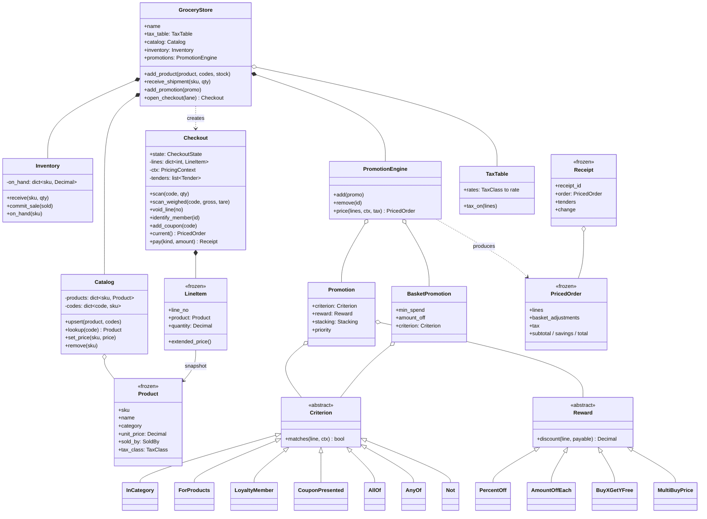
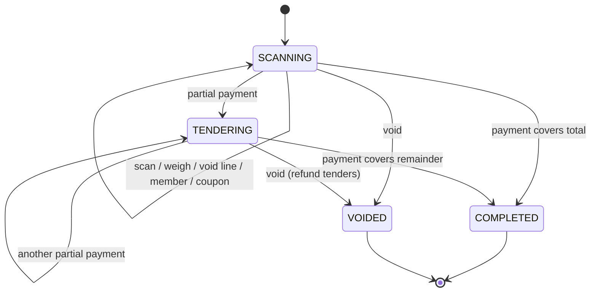

# Design a Grocery Store System: Checkout, Inventory and a Promotion Engine That Doesn't Fall Apart

A grocery checkout looks simple: scan, total, pay. Underneath it sit some of the most interesting modeling problems in everyday software: money that must be exact to the cent, bananas sold by the kilogram, "buy 2 get 1 free" deals that fight with "10% off all drinks", coupons, loyalty prices, and sales tax that differs by product and by county. By the end of this post you will be able to design the whole system from scratch in an object-oriented design (OOD) interview, defend every major decision against its alternatives, and talk credibly about how real point-of-sale systems handle the same problems.

All code is in Python 3.13 with only the standard library:

- [`grocery_store.py`](grocery_store.py): the recommended design, with a runnable demo
- [`alternatives.py`](alternatives.py): the competing designs from the comparison section, runnable side by side
- [`test_grocery_store.py`](test_grocery_store.py): 43 `unittest` tests (`python3 -m unittest discover -s .`)

If you are new to classes, interfaces and composition, the [OOP fundamentals post](../../01-foundations/01-oop-fundamentals.md) and the [design patterns post](../../01-foundations/02-design-patterns.md) cover the background. This post assumes only that you can read Python.

---

## 1. The real-world system

Walk into any supermarket and you will see the front end of a **point-of-sale (POS)** system: the lane computer, barcode scanner, scale, receipt printer, card terminal and cash drawer. Big chains run POS software from vendors such as NCR (now NCR Voyix), Toshiba Global Commerce Solutions or Diebold Nixdorf; smaller grocers and cafés often use cloud POS products such as Square. The software differs but the jobs are the same.

**The actors:**

- **Cashier** (or the customer at a self-checkout): scans items, weighs produce, keys in codes, voids mistakes, takes payment.
- **Receiving clerk** (shipment handler): records deliveries so stock counts go up.
- **Merchandising or pricing team** (usually at head office): maintains the product catalog and prices, and sets up promotions.
- **Customer**: may present a loyalty card or a coupon, and walks away with a receipt.

**The codes on the products** are worth knowing before you design anything:

- A **UPC** (Universal Product Code, 12 digits, common in North America) or **EAN** (13 digits, used in most of the world) is the barcode printed on packaged goods. The last digit is a check digit, so a misread scan is usually detected by the scanner itself.
- A **PLU** (price look-up) code is the 4 or 5 digit number on the little sticker on loose produce. For example, 4011 is the standard PLU for regular bananas. PLUs are standardized internationally so a cashier anywhere can key them in.
- Many stores also use **variable-weight barcodes** for meat and deli packages: the store's own label printer encodes the item and the price (or weight) inside a barcode that starts with a reserved prefix.

So "the barcode" is not the product's identity. One product can have several codes (a UPC and a store SKU; a case barcode and a unit barcode), and codes get reassigned over time. That observation will shape our catalog.

**Why this is a good OOD problem:** it has a natural split into modules (catalog, inventory, checkout, promotions, tax), a rules engine that must stay open to new kinds of deals, value objects (money, receipts) that must never change after the fact, shared state touched by many lanes at once (stock counts), and a small state machine (a transaction being scanned, paid, completed or voided). An interviewer can push on any of these.

---

## 2. Clarifying requirements

An interviewer's prompt is usually vague on purpose: "Design the system a grocery store uses to ring up customers, manage its products and stock, and apply discounts." Your first job is to turn that into a list you can design against. Spend about five minutes here.

### Questions worth asking

| Question | Why it matters | Answer we'll assume |
|---|---|---|
| Who uses it: cashiers only, or also receiving and head office? | Decides which modules exist | Cashiers, receiving, admins |
| How are items entered? Barcode, typed code, scale? | Weighted items change the quantity type | Barcode/PLU scan, manual code, and scale for produce |
| Do items belong to categories? | Category-wide promotions need it | Yes (dairy, produce, beverages…) |
| What kinds of discounts? | The single biggest design driver | Percent off, amount off, buy X get Y, multi-buy ("3 for $5"), loyalty-only prices, coupons, spend-threshold deals |
| If several discounts apply, what happens? | Conflict resolution policy | Best single "exclusive" promo per item, plus explicitly "stackable" ones on top; basket coupons last |
| Is there tax? Does it vary by product? | Tax classes and rounding | Yes, by product tax class, one jurisdiction per store |
| How does payment work? | Split tender and change | Cash (with change) and card, possibly combined |
| What if recorded stock says zero but the item is in the customer's hand? | Strict vs lenient inventory | Configurable; strict by default for the interview |
| Many lanes at once? | Concurrency on shared stock | Yes |

### Functional requirements

1. **Catalog:** admins add, update (including price changes) and remove products. A product has a name, category, price, how it is sold (per item or per kilogram) and a tax class. A product can be found by any of its codes (UPC/EAN, PLU, internal SKU).
2. **Inventory:** receiving clerks record shipments, which increase stock. Completed sales decrease stock automatically.
3. **Checkout:** a cashier scans or keys items, weighs produce, voids lines, attaches a loyalty member and coupons, sees a live running total with discounts, takes one or more payments, gives change and prints a receipt.
4. **Promotions:** admins define promotions targeting products, categories, loyalty members or coupon holders, with start and end dates. The system applies them automatically with a clear policy for conflicts.
5. **Tax:** computed by tax class after discounts.

### Non-functional requirements

- **Exact money.** Every total must be correct to the cent, every time, and must add up on the receipt.
- **Clear errors** for the cashier: unknown code, wrong quantity, not enough stock, invalid payment.
- **Modularity:** catalog, inventory, promotions and checkout can be replaced independently (for example, moving inventory into a database service later).
- **Thread safety** for anything shared between lanes.
- **Fast enough per scan:** re-pricing a basket of a few hundred lines must feel instant.

### Out of scope

Payment-card processing internals (that's the [ATM post](../10-atm/README.md) territory), returns and refunds (we'll discuss them in "Going deeper"), supplier purchase orders, employee shifts, and hardware drivers.

---

## 3. Finding the core objects

A reliable technique is **noun/verb analysis**: underline the nouns and verbs in your requirements, then decide which nouns deserve to be classes, which are just attributes, and which verbs become methods.

**Nouns:** store, product, item, barcode, PLU, category, price, catalog, stock, shipment, inventory, cashier, lane, checkout, basket/order, line, quantity, weight, scale, promotion, discount, coupon, loyalty member, tax, receipt, payment, cash, card, change.

**Verbs:** scan, weigh, void, look up, receive (shipment), decrement (stock), apply (discount), calculate (total, tax), pay, print (receipt).

Now sort them:

- **Product** becomes a class. Note the subtle split between a *product* (the definition "Whole Milk 1 gal, $3.99") and an *item* (a physical jug). The system never tracks individual jugs, only counts, so "item" is not a class.
- **Catalog** becomes a class: the lookup table from codes to products.
- **Barcode / PLU** do *not* become classes: they are strings that map to a product. Making a `Barcode` class adds nothing unless you validate check digits, which you could add later.
- **Category** stays a string. It has no behavior. (In a real system it would be a tree: "Beverages > Soda > Cola", which is a nice follow-up.)
- **Inventory** becomes a class, separate from the catalog (see decision 2 below for why).
- **Shipment** is just a call, `receive(sku, quantity)`. It would become a class if we tracked suppliers and purchase orders.
- **Checkout** becomes a class: one customer's transaction at one lane, with a lifecycle.
- **Line** becomes `LineItem`: a product snapshot plus a quantity. **Basket/order** is the collection of lines inside the checkout.
- **Promotion** becomes a small family of classes. The key insight, which we'll develop below, is that a promotion is two independent things: a rule that says *who qualifies* (`Criterion`) and a rule that says *how much they save* (`Reward`).
- **Coupon** and **loyalty member** do *not* need their own promotion classes. They are facts about the transaction (a `PricingContext`) that a criterion can test.
- **Tax** becomes a `TaxTable` keyed by `TaxClass`.
- **Receipt** becomes an immutable class. **Payment** becomes `Tender` (the retail word for "a form of payment handed over").
- **Cashier, scale, lane** are actors or hardware. The lane is just an ID on the checkout.
- **Store** becomes a **facade**: one object that wires the modules together and gives callers a simple entry point.

---

## 4. Class design

Some vocabulary first, because the diagram uses it:

- **Association**: one object knows about another (a `Checkout` uses the store's `Catalog`).
- **Aggregation**: a "has-a" where the parts can live on their own (a `Promotion` has a `Criterion` that could be shared by other promotions).
- **Composition**: a "has-a" where the parts live and die with the whole (a `Checkout` owns its `LineItem`s; when the transaction is discarded, so are they).
- **Inheritance / realization**: "is-a" (a `PercentOff` *is a* `Reward`).
- An **invariant** is a rule that must always hold, such as "a line's discount never exceeds its price" or "stock never goes negative in strict mode". Good class design puts each invariant in exactly one place.



**`Product`** is an immutable **value object** (an object defined entirely by its data, which never changes once created). A price change creates a *new* `Product`. That sounds wasteful, but it buys a lot: every line in a basket and every receipt can hold a reference to the exact product version it was sold at, with no risk of it changing underneath.

**`Catalog`** owns two maps: SKU to product, and code to SKU. The second map is what lets one product have many codes, and lets the cashier type a SKU, a PLU or a UPC into the same box.

**`Inventory`** owns stock counts keyed by SKU. It knows nothing about prices or names. It is shared by every lane, so it is the main concurrency hot spot.

**`Checkout`** is one transaction. It **composes** its lines, its pricing context (loyalty ID, coupons, timestamp) and its tenders, and it moves through a small state machine. It *uses* (association) the store's catalog, engine and inventory.

**`PromotionEngine`** stores promotions and turns a list of lines into a `PricedOrder`. It is a pure calculation from the caller's point of view: same lines and context in, same price out.

**`Promotion`** = `Criterion` + `Reward` + stacking rule + validity window. **`BasketPromotion`** handles order-level deals like "$5 off when you spend $25".

**`Criterion`** subclasses form a **Composite** (a pattern where single objects and groups of objects share one interface, so `AllOf(a, b)` is itself a criterion). **`Reward`** subclasses are **Strategies** (interchangeable algorithms behind one interface).

**`PricedOrder`** and **`Receipt`** are frozen results. The receipt is a snapshot, never a live view.

**`GroceryStore`** is a **facade**: it wires everything up and gives the outside world a short list of methods that map one-to-one onto the requirements. In an interview, pointing at the facade's method list is a quick way to show you covered every requirement.

### The checkout lifecycle

A **state machine** is a model where an object is always in exactly one of a fixed set of states, and only certain events move it between them. Making this explicit prevents bugs like "scan an item after the customer has paid".



Once a partial payment is taken the basket is frozen. Otherwise a customer could pay $20 in cash, then have the cashier add more items, and the amount due would shift under an in-flight card authorization.

---

## 5. Code: the recommended solution

Full file: [`grocery_store.py`](grocery_store.py). Here are the pieces that carry the design.

### Money: one function, one rounding rule

```python
CENT = Decimal("0.01")
ZERO = Decimal("0.00")


def to_money(value: Decimal | int | str) -> Decimal:
    """Round to whole cents, half away from zero (the usual retail rule)."""
    if isinstance(value, float):
        # Decimal(0.1) silently captures the binary error; make callers say what they mean.
        raise TypeError("use Decimal or str for money, never float")
    return Decimal(value).quantize(CENT, rounding=ROUND_HALF_UP)
```

Every place that produces a money amount goes through `to_money`. That gives us one rounding mode and one place to change it. Rejecting `float` is deliberate: `Decimal(0.1)` is `0.1000000000000000055511151231257827…`, because the float was already wrong before `Decimal` saw it. Decision 3 below explains the options in detail.

### Catalog: products and codes

```python
@dataclass(frozen=True)
class Product:
    """A sellable product definition. Immutable: a price change is a new Product."""

    sku: str
    name: str
    category: str
    unit_price: Decimal  # per item, or per kg when sold by weight
    sold_by: SoldBy = SoldBy.EACH
    tax_class: TaxClass = TaxClass.GROCERY
```

```python
    def lookup(self, code: str) -> Product:
        """Resolve whatever the cashier scanned or typed: a barcode, a PLU or a SKU."""
        code = code.strip()
        with self._lock:
            sku = self._codes.get(code, code)
            product = self._products.get(sku)
        if product is None:
            raise UnknownCodeError(f"No product for code '{code}'. Re-scan or key it in.")
        return product
```

`SoldBy` (each vs weight) and `TaxClass` (grocery, prepared food, general) are enums on the product. That one `sold_by` field is the whole weighted-item design, as we'll see. The error message is written for a cashier, not a developer, because the requirements asked for user-friendly errors.

### Inventory: all-or-nothing sale commits

```python
    def commit_sale(self, sold: Mapping[str, Decimal]) -> None:
        """Decrement stock for a whole basket, all or nothing."""
        with self._lock:
            if not self.allow_negative:
                short = [sku for sku, qty in sold.items() if self._on_hand[sku] < qty]
                if short:
                    raise InsufficientStockError(f"Not enough stock for: {', '.join(sorted(short))}")
            for sku, qty in sold.items():
                self._on_hand[sku] -= qty
```

Two choices here. First, stock is decremented when the sale **completes**, not at each scan. If we decremented on scan, every voided line and abandoned basket would need a compensating increment, and a crash mid-transaction would leave stock wrong. Second, the check and the decrement happen inside one lock, so the whole basket either commits or nothing changes. Checking "is there stock?" and then decrementing in a separate step would be a **race condition** (a bug where the result depends on the timing of two threads): two lanes could both see "1 left" and both sell it.

### Lines: snapshots of the product

```python
@dataclass(frozen=True)
class LineItem:
    """One line on the receipt. Holds the Product *as it was when scanned*."""

    line_no: int
    product: Product
    quantity: Decimal  # count, or kg for weighed products

    @property
    def unit_price(self) -> Decimal:
        return self.product.unit_price

    @property
    def extended_price(self) -> Decimal:
        return to_money(self.product.unit_price * self.quantity)
```

Quantity is a `Decimal` so it can be 3 jugs or 1.235 kg. "Extended price" is the retail term for unit price times quantity. Because the line holds the frozen `Product`, a head-office price change that lands mid-transaction doesn't reprice a basket the customer is already watching on the display.

### Promotions: criterion times reward

This is the heart of the design. A promotion answers two independent questions:

1. *Which lines qualify?* Cola only; anything in "beverages"; dairy for loyalty members; everything, if coupon SAVE5 was presented.
2. *How much do they save?* 10%; 50 cents each; buy 2 get 1 free; 3 for $5.

If those two questions are fused into one class per promotion type, you need a class for every combination (category-percent, product-percent, category-BOGO, member-BOGO…). That is the **class explosion** problem. Keeping them separate means N criteria and M rewards give N × M promotions with only N + M classes.

```python
class Criterion(ABC):
    """Decides whether a line qualifies. Combine with &, | and ~."""

    @abstractmethod
    def matches(self, line: LineItem, ctx: PricingContext) -> bool: ...

    def __and__(self, other: Criterion) -> Criterion:
        return AllOf((self, other))

    def __or__(self, other: Criterion) -> Criterion:
        return AnyOf((self, other))

    def __invert__(self) -> Criterion:
        return Not(self)
```

The operator overloads are a small Python nicety: `InCategory("dairy") & LoyaltyMember()` reads like the business rule it represents. `AllOf`, `AnyOf` and `Not` are the Composite pattern; the leaves are simple:

```python
@dataclass(frozen=True)
class LoyaltyMember(Criterion):
    def matches(self, line: LineItem, ctx: PricingContext) -> bool:
        return ctx.loyalty_id is not None


@dataclass(frozen=True)
class CouponPresented(Criterion):
    code: str

    def matches(self, line: LineItem, ctx: PricingContext) -> bool:
        return self.code in ctx.coupons
```

Notice that a coupon is *not* a special kind of discount. It is just a criterion on the transaction context. The same goes for loyalty pricing. That collapses three features (promotions, coupons, member prices) into one mechanism.

Rewards take the line and the amount *still payable* on it, so they compose correctly when stacked:

```python
@dataclass(frozen=True)
class BuyXGetYFree(Reward):
    buy: int
    get: int

    def discount(self, line: LineItem, payable: Decimal) -> Decimal:
        if line.product.sold_by is not SoldBy.EACH:
            return ZERO
        free_units = (int(line.quantity) // (self.buy + self.get)) * self.get
        return min(payable, to_money(free_units * line.unit_price))
```

With 3 colas and "buy 2 get 1", `3 // 3 * 1 = 1` free unit. With 5 colas it is still 1 (the second group of 3 is incomplete); with 6 it is 2.

```python
@dataclass(frozen=True)
class Promotion:
    """A line-level promotion: a criterion plus a reward, with a stacking rule."""

    promo_id: str
    name: str
    criterion: Criterion
    reward: Reward
    stacking: Stacking = Stacking.EXCLUSIVE
    priority: int = 100  # lower runs first; also breaks ties between equal discounts
    starts: datetime | None = None
    ends: datetime | None = None
```

### The engine and its conflict policy

When several promotions match one line, *something* has to decide. Our policy, stated in the engine's docstring and implemented in `_price_line`:

1. Among **exclusive** promotions, the single best one for the customer wins.
2. **Stackable** promotions (typically loyalty bonuses) then apply, in priority order, to whatever is still payable.
3. **Basket** promotions apply last, to the post-line amounts.

```python
        exclusive = [p for p in matching if p.stacking is Stacking.EXCLUSIVE]
        if exclusive:
            # max() keeps the first of equal values, and the list is already in priority order.
            best, amount = max(
                ((p, min(payable, p.reward.discount(line, payable))) for p in exclusive),
                key=lambda pair: pair[1],
            )
            if amount > 0:
                adjustments.append(Adjustment(best.promo_id, best.name, amount))
                payable -= amount

        for promo in (p for p in matching if p.stacking is Stacking.STACKABLE):
            amount = min(payable, promo.reward.discount(line, payable))
            if amount > 0:
                adjustments.append(Adjustment(promo.promo_id, promo.name, amount))
                payable -= amount
```

The `min(payable, …)` caps are the invariant "a line never goes below zero" enforced in exactly one place, even if a badly configured reward returns too much. Ties are broken deterministically by priority then ID, so the same basket always prices the same way: important when a customer asks why a reprint differs, and for tests.

**The whole basket is repriced on every scan.** `Checkout.current()` calls `engine.price(...)` with all lines. It is tempting to price each line once when scanned, but a promotion like "buy 2 get 1" changes meaning when the third unit arrives, and a basket coupon depends on the total. Repricing a few hundred lines is microseconds of work; incremental pricing is an optimization you would only add with measurements in hand. Real POS displays do the same thing: you see "Cola buy 2 get 1 −$4.49" appear the moment the third six-pack is scanned.

### Basket discounts are allocated back to lines

A "$5 off $25" coupon is one number on the receipt, but tax is computed per tax class, and a later return of one item needs to know how much of the coupon that item "used". So the engine splits the basket discount across the eligible lines in proportion to their price:

```python
def allocate(total: Decimal, weights: list[Decimal]) -> list[Decimal]:
    """Split `total` across `weights` proportionally, in whole cents.

    Uses the largest-remainder method so the parts always add up to exactly
    `total` -- no cent is created or lost by rounding.
    """
    cents = int(total / CENT)
    weight_sum = sum(weights)
    if weight_sum <= 0:
        raise ValueError("cannot allocate across zero weight")
    raw = [Decimal(cents) * w / weight_sum for w in weights]
    parts = [int(r) for r in raw]  # all values are >= 0, so int() floors
    leftover = cents - sum(parts)
    by_remainder = sorted(range(len(raw)), key=lambda i: raw[i] - parts[i], reverse=True)
    for i in by_remainder[:leftover]:
        parts[i] += 1
    return [Decimal(p) * CENT for p in parts]
```

Splitting $1.00 three ways naively gives 0.33 + 0.33 + 0.33 = 0.99: a cent vanishes. The **largest-remainder method** floors every share, then hands the leftover cents to the shares that lost the most in rounding. The parts always sum exactly. This tiny function is the kind of detail that separates a "works in the demo" design from one an accountant would sign off.

### Tax by class, rounded once per class

```python
    def tax_on(self, lines: Iterable[PricedLine]) -> Decimal:
        by_class: dict[TaxClass, Decimal] = defaultdict(Decimal)
        for pl in lines:
            by_class[pl.line.product.tax_class] += pl.taxable
        # Round once per tax class, not once per line, so many small lines don't drift.
        return sum(
            (to_money(amount * self.rates.get(cls, ZERO)) for cls, amount in by_class.items()),
            ZERO,
        )
```

Tax is calculated on the *taxable* amount: price after line discounts and after the line's share of basket discounts. Rounding per line would let forty 6-cent tax fractions each round down and lose money; rounding per class keeps the total honest. (Whether a given jurisdiction requires per-line or per-invoice rounding is a legal question; the point is that the rule lives in one method.)

### Checkout: scanning, weighing, paying

```python
    def scan_weighed(
        self, code: str, gross_kg: Decimal | str, tare_kg: Decimal | str = "0"
    ) -> PricedOrder:
        self._require(CheckoutState.SCANNING)
        product = self._store.catalog.lookup(code)
        if product.sold_by is not SoldBy.WEIGHT:
            raise InvalidQuantityError(f"{product.name} is sold per item, not by weight")
        net = to_quantity(gross_kg) - to_quantity(tare_kg)
        if net <= 0:
            raise InvalidQuantityError("Net weight must be above zero; check the scale and tare")
        self._add_line(product, net)  # every weighing is its own line
        return self.current()
```

**Tare** is the weight of the container (the produce bag or deli tray) subtracted from the scale reading. Each weighing gets its own line, while repeated scans of the same packaged product merge into one line with a higher quantity (which is also what makes "buy 2 get 1" see all the colas).

Payment is where the state machine and inventory meet:

```python
        if amount < due:
            self._tenders.append(Tender(kind, amount))
            self.state = CheckoutState.TENDERING
            return None

        # This tender completes the sale. Commit stock first: if it fails, nothing is recorded.
        sold: dict[str, Decimal] = defaultdict(Decimal)
        for line in self._lines.values():
            sold[line.product.sku] += line.quantity
        self._store.inventory.commit_sale(sold)

        self._tenders.append(Tender(kind, amount))
        self.state = CheckoutState.COMPLETED
```

The ordering matters: stock is committed *before* the final tender is recorded and the state changes. If the stock check fails, the checkout is exactly as it was and the cashier can void the problem line. Card tenders cannot exceed the amount due (nobody gives change on a card), while cash can, and the excess becomes change.

### The demo

Running `python3 grocery_store.py` rings up milk (member price), bananas by weight, three cola 6-packs (where "buy 2 get 1" beats "beverages 10% off"), sparkling water (only the 10% applies), chips, and a $5-off-$25 coupon:

```
              FreshMart #12
Lane 3  R-000001  2026-10-31 00:15
------------------------------------------
Whole Milk 1 gal                      7.98
  2 @ 3.99
    Member price                     -1.00
Bananas                               1.84
  1.235 kg @ 1.49/kg
Cola 6-pack                          13.47
  3 @ 4.49
    Cola buy 2 get 1                 -4.49
Sparkling Water                       5.00
  4 @ 1.25
    Beverages 10% off                -0.50
Sea Salt Chips                        3.49
Coupon $5 off $25+                   -5.00
------------------------------------------
SUBTOTAL                             31.78
YOU SAVED                            10.99
TAX                                   0.68
TOTAL                                21.47
CASH                                 30.00
CHANGE                                8.53
Member LOY-4471
```

Check the tax by hand: only the drinks are in the taxable "general" class. Their post-promo amounts are 8.98 and 4.50; the $5 coupon is spread over all five lines (25.79 eligible), so the drinks absorb about $2.61 of it, leaving about $10.87 taxable at 6.25% = $0.68.

---

## 6. Comparing approaches

This is where interviews are won. For each decision, here are the realistic options, with runnable code in [`alternatives.py`](alternatives.py).

### Decision 1: the discount engine

**1A. Hard-coded `if/elif`.**

```python
def ifelse_discount(item: SimpleItem) -> Decimal:
    """Every promotion is a branch. Changing a promo means editing and redeploying code."""
    line = item.price * item.qty
    if item.sku == "COLA-6" and item.qty >= 3:
        return (item.qty // 3) * item.price          # buy 2 get 1
    elif item.category == "beverages":
        return to_money(line * Decimal("0.10"))      # 10% off beverages
    elif item.sku == "MILK-1G":
        return Decimal("0.50") * item.qty            # 50c off milk
    return Decimal("0")
```

It works, and for a single store with two permanent deals it is honestly fine. But promotions change weekly, are set by merchandisers rather than engineers, and have start and end dates. Every change is a code deploy, and the *conflict policy* is hidden in branch order (the first matching branch wins, whether or not it is the best deal).

**1B. One Strategy class per promotion type.** The **Strategy pattern** puts each algorithm behind a common interface so they can be swapped at runtime.

```python
class DiscountStrategy(ABC):
    """Strategy pattern: each promotion type is a class; each promo knows its targets."""

    @abstractmethod
    def applies_to(self, item: SimpleItem) -> bool: ...

    @abstractmethod
    def discount(self, item: SimpleItem) -> Decimal: ...
```

Promotions are now data (instances) and can be added at runtime. The problem is that each class welds a targeting rule to a calculation: `CategoryPercentStrategy`, `SkuBuyXGetYStrategy`. The day someone wants "buy 2 get 1 on any snack" you write `CategoryBuyXGetYStrategy`, and the class count grows with targets × rewards.

**1C. Composable criterion + reward (recommended).** Split targeting (Composite of `Criterion`s) from calculation (Strategy of `Reward`s), and put the conflict policy in one engine. The demo in `alternatives.py` builds "snacks buy 2 get 1" from existing parts with zero new classes:

```python
    engine.add(Promotion("CAT-B2G1", "Snacks buy 2 get 1", InCategory("snacks"), BuyXGetYFree(2, 1)))
```

**1D. Decorator stacking.** The **Decorator pattern** wraps an object in another object with the same interface, adding behavior. Each discount wraps the previous price calculator:

```python
@dataclass
class PercentOffDecorator:
    inner: PriceCalc
    percent: Decimal

    def price(self, base: Decimal) -> Decimal:
        return to_money(self.inner.price(base) * (1 - self.percent / 100))
```

Decorators are elegant for a *fixed, known sequence* of adjustments. But the order of wrapping silently changes the answer:

```
decorators on $10 : $2-then-10% = 7.20, 10%-then-$2 = 7.00
```

and the decorator chain has no natural place to express "pick the best of these" or "this one can't combine with that one". Those rules end up encoded in whoever builds the chain.

| Approach | Pros | Cons | Choose when |
|---|---|---|---|
| if/elif | Simplest, obvious | Redeploy per promo; hidden conflict policy; untestable in isolation | Prototype, 1–2 permanent deals |
| Strategy per type | Promos are data; Open/Closed for new types | Class explosion (targets × rewards); conflict logic often scattered | Few promo types, each with fixed targeting |
| Criterion + Reward + engine | N + M classes for N × M promos; coupons/loyalty are just criteria; one explicit conflict policy | More pieces to explain; engine policy needs careful design | Real retail, interviews that probe extensibility |
| Decorator chain | Clear for a fixed sequence of adjustments | Order-dependent results; no "best of" or exclusion | Fixed pipelines (e.g., price → markdown → member) |

**Recommendation:** 1C. It is what lets you answer every follow-up ("member-only?", "coupon?", "category BOGO?", "expires Sunday?") with "that's a new instance, not new code". Mention that the *ordering idea* from decorators survives inside the engine as stacking priority.

### Decision 2: combining conflicting promotions

Even with a great engine, you must choose a **stacking policy**. Three options, each tried on a $10 item with 20%, 15% and 70% promotions:

```python
def stack_best_only(price: Decimal, percents: list[Decimal]) -> Decimal:
    """Only the single best promo applies (what the interview spec asks for)."""
    best = max(percents, default=Decimal("0"))
    return to_money(price * best / 100)


def stack_sequential(price: Decimal, percents: list[Decimal]) -> Decimal:
    """Each promo applies to what the previous ones left (compounding)."""
    remaining = price
    for p in percents:
        remaining -= to_money(remaining * p / 100)
    return price - remaining


def stack_on_original_price(price: Decimal, percents: list[Decimal]) -> Decimal:
    """Every promo uses the original price. Can exceed the price itself: a real bug."""
    return sum((to_money(price * p / 100) for p in percents), Decimal("0"))
```

```
best only   : 7.00
sequential  : 7.96
on original : 10.50 <- more than the price!
```

| Policy | Pros | Cons | Choose when |
|---|---|---|---|
| Best only | Predictable, retailer-safe, easy to explain on a receipt | Customer may expect a member bonus on top of a sale | Default for most item promos |
| Sequential (compounding) | Lets bonuses stack without exceeding the price | Order-dependent; needs explicit priority | Loyalty bonuses on top of sale prices |
| Sum on original price | Simple arithmetic | Can exceed 100% and pay the customer | Never, without a cap |
| Hybrid: exclusive best + stackable in order + basket last (ours) | Expresses what retailers actually configure | More concepts | Real systems, and our recommendation |

The hybrid is essentially what commercial promotion engines expose as configuration: each deal has a priority, a flag for whether it can combine with others (or with which "exclusion groups"), and order-level deals run after item-level ones. A good follow-up to mention is **basket optimization**: when promotions compete for the *same units* ("buy 2 get 1 on cola" vs "any 3 drinks for $10" across a mixed basket), choosing the customer-best assignment is a combinatorial problem. Engines handle it with greedy heuristics or small searches, and some retailers simply guarantee "best price" by trying the main alternatives.

### Decision 3: money representation

```python
def float_total(prices: list[str]) -> float:
    # A running total, the way a register adds each scan. (Python 3.12+'s built-in
    # sum() uses compensated summation and can hide this error, so we don't use it.)
    total = 0.0
    for p in prices:
        total += float(p)
    return total
```

```
float  : 0.6000000000000001 == 0.6 ? False
Decimal: 0.60
cents  : 0.60
round 0.125 (half-up, half-even): (Decimal('0.13'), Decimal('0.12'))
```

Binary floating point cannot represent 0.1 exactly, so sums drift. A single drifted cent will make a receipt not add up, fail an end-of-day cash reconciliation, or flip a `total >= 25` threshold check. (Fun detail: since Python 3.12 the built-in `sum()` uses a more accurate summation algorithm for floats, which happens to hide this particular example. A running `+=` total, like a register's, still shows it.)

The two correct options:

- **`decimal.Decimal`**: exact base-10 arithmetic with explicit rounding modes. Readable (`Decimal("3.99")`), and Python's `quantize` makes the rounding rule visible.
- **Integer minor units** (cents): exact, fast, trivially serializable, and the convention in many payment APIs (Stripe, for example, takes amounts as integers in the smallest currency unit). But every division (percent off, tax, allocation) needs a hand-written rounding rule, and currencies with different minor units (the Japanese yen has none) need care.

And whichever you choose, you must **decide a rounding rule**. Python's `Decimal` defaults to **half-even** ("banker's rounding": 0.125 → 0.12, because ties go to the even digit, which avoids systematic upward bias across millions of operations). Retail receipts in most places use **half-up** (0.125 → 0.13). Tax authorities sometimes specify their own rule.

| Option | Pros | Cons | Choose when |
|---|---|---|---|
| `float` | Fast, built in | Wrong. Drifts, breaks equality and thresholds | Never for money |
| `Decimal` + one `to_money()` | Exact; readable; explicit rounding | Slower than ints (irrelevant at POS scale); must avoid `Decimal(float)` | Business logic in Python (our choice) |
| Integer cents | Exact; fast; easy to store and send | Rounding scattered unless wrapped; currency minor units vary | Storage, wire formats, payment APIs |

**Recommendation:** `Decimal` in the domain model, quantized through one function, and integer cents (or `NUMERIC` columns) at the storage and network boundaries. In an interview, saying "I'll never use float for money, and here's my rounding rule" earns real credit.

### Decision 4: catalog vs inventory (Item vs Product vs stock)

The tempting first design is one class:

```python
@dataclass
class ItemWithStock:
    """Merged design: product facts and stock count live in one object."""

    sku: str
    name: str
    price: Decimal
    stock: int
```

Now imagine head office pushes the weekly price file. It contains product data and no stock, so the naive update writes `stock=0`:

```
merged stock after price push: 0
split stock after price push : 40
```

That's a contrived bug, but it points at the real reasons to split:

- **Different owners and rates of change.** Head office changes the catalog weekly; every lane changes stock every second.
- **Different scope.** A chain has one catalog but stock *per store* (and per backroom vs shelf). With the split, `Inventory` can be per store while the catalog is shared.
- **Different concurrency needs.** Stock needs locking or atomic updates; catalog reads are mostly read-only and cache well.
- **Different identities.** Inventory is keyed by SKU; the catalog is keyed by SKU *and* indexed by every barcode and PLU.

There is a third level some designs add: **Product vs Item vs Lot**. If you need to track expiry dates, recalls or serial numbers, each received batch (a "lot") gets its own stock record. That's a natural extension of the split, and impossible with the merged class.

| Approach | Pros | Cons | Choose when |
|---|---|---|---|
| Merged `ItemWithStock` | One lookup; trivially simple | Catalog updates clobber stock; no per-store stock; one lock for everything | Single tiny shop, interview warm-up |
| Catalog + Inventory (ours) | Single Responsibility; per-store stock; independent scaling | Two lookups; must keep SKUs consistent | Almost always |
| Catalog + lot-level inventory | Expiry, recalls, FIFO | More complex receiving and selling | Perishables, pharmacy, regulated goods |

### Decision 5: receipt generation

```python
@dataclass
class LiveOrder:
    """Receipt as a live view: prints by reading current catalog prices."""

    catalog: dict[str, Decimal]
    skus: list[str]

    def receipt_total(self) -> Decimal:
        return sum((self.catalog[s] for s in self.skus), Decimal("0"))
```

```
live view reprint : 4.19 (wrong: customer paid 3.99)
snapshot reprint  : 3.99
```

A receipt is a **legal and financial record**. If it is computed on demand from current prices and promotions, a reprint next week shows a different total than the customer paid. Our `Receipt` is a frozen snapshot containing the `PricedOrder` (with frozen `Product` versions), tenders and change. Formatting is a separate function, `render_text`, so the same data can become a thermal-printer layout, an email receipt or JSON for the loyalty app without touching business logic.

| Approach | Pros | Cons | Choose when |
|---|---|---|---|
| Live view over `Order` | No duplication | Reprints drift; audit nightmare | Never for completed sales (fine for the on-screen running total) |
| Snapshot with `print()` method on it | Correct data | Presentation mixed with data; one format only | Single output format |
| Snapshot data + separate renderers (ours) | Correct; many formats; testable | One more function | Real systems (paper, email, app) |

### Decision 6: weighted items

```python
@dataclass
class IntQtyLine:
    """Quantity as int: can't represent 1.235 kg of bananas at all."""
```

Options: integer quantity (can't represent weight), a `WeighedItem` subclass with its own pricing (works, but every promotion and report must check which subclass it got, and "is sold by weight" can't change without changing the object's type), or a `sold_by` field on the product plus a `Decimal` quantity (ours). With the flag, an `AmountOffEach(0.30)` reward naturally means "30 cents off per kg" for bananas, and `BuyXGetYFree` declines to apply to weighed items explicitly.

| Approach | Pros | Cons | Choose when |
|---|---|---|---|
| `int` quantity | Simple | Can't sell by weight | Store without produce or deli |
| Subclass per pricing mode | Polymorphic pricing | Type checks spread to promos, tax, reports | Pricing modes truly behave differently (e.g., rentals) |
| `SoldBy` enum + `Decimal` quantity (ours) | One line type; promos just check a flag | Must validate whole numbers for EACH | Groceries, hardware stores (rope by the metre) |

---

## 7. Going deeper

### Concurrency: what breaks with many lanes

Shared state in our design: the catalog (written by admins, read by every lane), the promotion engine (same), inventory (written by every lane and by receiving), and the receipt counter.

1. **Overselling the last unit.** Covered by `commit_sale` doing check-and-decrement under one lock. The test `test_concurrent_lanes_cannot_oversell` starts 20 threads racing for one item and asserts exactly one wins.
2. **Price change mid-basket.** Lines hold frozen `Product` snapshots, so a basket keeps one consistent price. A new basket picks up the new price.
3. **Promotion added mid-pricing.** `PromotionEngine.price` copies the active promotion list under the lock and prices *outside* the lock, so a slow pricing call doesn't block admins and never sees half-edited state.
4. **Duplicate receipt numbers.** `next_receipt_id` uses a lock around an `itertools.count`.
5. **The checkout itself** is used by one cashier thread, so it has no lock. Documenting that assumption is better than adding a lock that hides a design mistake.

In a real deployment the lock becomes the database: `UPDATE stock SET on_hand = on_hand - :qty WHERE sku = :sku AND on_hand >= :qty` is the same check-and-decrement as one atomic statement, or optimistic concurrency with a version column.

### Offline-first lanes

Supermarket lanes must keep selling when the network to head office drops. Production POS terminals keep a local copy of the price and promotion files and a local transaction journal, then sync upstream. That has a design consequence: **inventory decrements become events** ("lane 3 sold 2 × MILK at 14:05") that are applied later, not synchronous calls. It's another reason real stores allow negative stock: the lane cannot ask a central server for permission on every scan.

### "The interviewer now asks…"

**"Add a 'spend $100 on electronics, get 10% off; spend $200, get 20%' tier."** One new `Reward` or `BasketPromotion` variant whose amount depends on the eligible base. No change to criteria, engine policy or checkout. The design absorbs it.

**"Add mix-and-match: any 3 yogurts from these 12 SKUs for $5."** This is the honest weak spot: our rewards work per line, and mix-and-match spans lines. The fix is a group-level reward that receives all matching lines, picks which units to discount (retailers usually discount the cheapest), and allocates the saving back with `allocate`. The engine gets a third phase between line and basket promos. The criterion side needs no change, which is the payoff of separating "who" from "how much".

**"Promotions should only run Saturday 8–10 am."** Already supported by `starts`/`ends`; for recurring windows, add a `DuringHours` criterion that reads `ctx.at`. No engine change.

**"Support returns."** A return references the original receipt. Because the receipt is a snapshot with basket discounts allocated per line, refunding one item is "that line's net minus its basket share, plus its tax", and if the return drops the remaining basket below a coupon threshold, the store's policy decides whether to claw back the coupon. This is a classic follow-up, and allocation is what makes it answerable.

**"Each store is in a different tax jurisdiction."** `TaxTable` is injected into the store, so each store gets its own. In the US, sales tax can differ by state, county and city, and the same product can be taxable in one place and exempt in another, which is why retailers often buy tax engines (Avalara and Vertex are well-known vendors) rather than maintain rate tables themselves. In our design that's a `TaxCalculator` interface with the table as one implementation.

**"Manufacturer coupons vs store coupons."** In some jurisdictions a manufacturer coupon (reimbursed by the brand) does not reduce the taxable price while a store coupon does. That's a flag on the basket promotion telling `tax_on` whether its allocation reduces `taxable`. Again: one place.

**"Add a loyalty points program."** Points earned are a *consequence* of a completed sale, not a price adjustment. Publish a `SaleCompleted` event (the **Observer** pattern: interested parties subscribe to events instead of the checkout calling them directly) and let a loyalty service compute points from the receipt.

### From in-memory objects to a service

| In this post | In production |
|---|---|
| `Catalog` dict | Product master data in a database, distributed to stores as versioned price files |
| `Inventory` dict + lock | Per-store stock tables with atomic updates, or an event-sourced stock ledger |
| `PromotionEngine` | A promotion service with an admin UI, approval workflow, and versioned rule sets pushed to lanes |
| `Receipt` object | An append-only transaction log (the "electronic journal") used for audits, returns and analytics |
| Facade methods | API endpoints, with authentication per role (cashier vs admin) |

### Testing strategy

The test file follows the module boundaries: money helpers (rounding, allocation sums exactly), catalog and inventory (lookups, all-or-nothing commits, a threaded oversell test), scanning (merging, weights, tare, bad quantities, voids, mid-basket price change), promotions (best-wins, stacking on the remaining price, caps, multi-buy, criteria operators, expiry, coupon thresholds and allocation), tax after discounts, payment (change, split tender, card overpay, out-of-stock rollback, terminal states), and a full end-to-end scenario checking the demo's exact totals. Because `PromotionEngine.price` is a pure function of lines and context, most promotion tests need no checkout at all. In production you'd add **golden receipt tests**: a library of real baskets with known correct totals that must not change when the engine is refactored.

### Failure modes worth naming

- **Scanner misread**: caught by check digits at the scanner; unknown codes raise `UnknownCodeError` with a "re-scan or key it in" message.
- **Scale not zeroed or tare forgotten**: we reject non-positive net weight; real lanes also certify scales legally.
- **Payment declined after stock committed**: in our design stock is committed only when the final tender is accepted; in production the card authorization happens before the commit, and a voided sale emits a reversing stock event.
- **Promotion misconfiguration** (100% off by typo): the line cap prevents negative prices; real systems add approval workflows and maximum-discount guards.

---

## 8. How real systems do it

- **POS vendors** (NCR Voyix, Toshiba, Diebold Nixdorf in large grocery; Square, Lightspeed and others for smaller retail) all separate item master data, pricing, promotions, tender and the electronic journal into distinct modules, much like our classes. Lanes run locally and sync with store and head-office servers.
- **Item lookup** goes through a table that maps every barcode, PLU and internal item number to the item record. Variable-weight barcodes (store-printed labels on meat and deli) are decoded at scan time to extract the item and the embedded price or weight.
- **Promotion engines** at large retailers are dedicated systems. Deals are configured by merchandising teams as data: eligibility (items, categories, customer segments, coupons), reward type, dates, priority and exclusivity, with "best deal" logic and receipt descriptions. The criterion/reward split you built here is the same idea.
- **Loyalty programs** (most large grocers run one) do two things: member-only prices at the till (a criterion on the transaction, exactly like ours) and points or personalized offers, often computed after the sale from the transaction log.
- **Tax** is usually driven by a tax code per item and a jurisdiction per store, frequently using a third-party tax engine because rates and rules change often.
- **Inventory** at the shelf level is famously inaccurate (theft, damage, mis-scans), which is why stores allow negative stock, run cycle counts, and treat POS sales as one input among many to replenishment systems.

---

## 9. Interview playbook

**A 45-minute plan:**

| Minutes | What to do |
|---|---|
| 0–5 | Clarify: actors, entry methods (scan, PLU, scale), discount types, conflict policy, tax, payment, concurrency. Write the requirement list. |
| 5–10 | Core objects via noun/verb analysis. Say out loud which nouns are *not* classes and why (barcode, category, coupon). |
| 10–20 | Class diagram. Highlight: Catalog vs Inventory split, frozen Product snapshots, Criterion + Reward, engine policy, frozen Receipt, Checkout state machine. |
| 20–35 | Code the core: `Product`, `Catalog.lookup`, `LineItem`, `Criterion`/`Reward` with two implementations each, `PromotionEngine._price_line`, `Checkout.scan` and `pay`. |
| 35–45 | Deep dives the interviewer picks: stacking policies, money and rounding, concurrency on stock, mix-and-match, returns, tax jurisdictions. |

**Things to say early** because they signal experience: "Money is `Decimal` with one rounding function." "The basket is repriced from scratch on every scan because promotions depend on the whole basket." "Receipts are snapshots." "Stock is decremented on completion, atomically."

**Common mistakes:**

- Using `float` for prices.
- One giant `Item` class holding price, stock and discount rules.
- A class per promotion type with targeting baked in (class explosion), or an `if/elif` ladder.
- Applying each discount to the original price, so stacked discounts exceed the price.
- Pricing each line once at scan time, so "buy 2 get 1" never triggers.
- Receipt computed live from the order, so reprints change.
- Forgetting weighed items, or modeling quantity as `int`.
- Decrementing stock on scan, then forgetting to restore it on void.

**Follow-ups to expect:** mix-and-match deals; tiered thresholds; returns with coupons; multiple stores and tax jurisdictions; offline lanes; how to stop two lanes selling the last unit; how promotions are changed safely at 6 am on a Saturday; how loyalty points are computed.

---

## 10. Test yourself

<details>
<summary>1. Why is a coupon modeled as a <code>Criterion</code> rather than its own discount class?</summary>

Because a coupon doesn't define *how much* is saved, only *who qualifies*. "$5 off $25 with code SAVE5" is a basket reward ($5 off above a threshold) gated by a criterion (coupon SAVE5 presented). Modeling it as a criterion lets any reward be coupon-gated ("buy 2 get 1 with coupon", "20% off produce with coupon") without new classes, and it can be combined with others, e.g. `CouponPresented("X") & InCategory("produce")`.
</details>

<details>
<summary>2. A cashier scans 2 colas (buy 2 get 1 is active), then a third. Why must the engine reprice the whole basket rather than just the new scan?</summary>

The saving depends on the total quantity of that product: with 2 colas the deal gives nothing (and the 10% beverage deal may win), with 3 it gives one free. Basket coupons similarly depend on the total. Pricing only the newly scanned unit would never see the group. Repricing from scratch is cheap and always consistent; incremental pricing is an optimization you'd add only with evidence.
</details>

<details>
<summary>3. Why does <code>Inventory.commit_sale</code> check all SKUs before decrementing any?</summary>

To make the sale **atomic**: either all stock decrements happen or none do. If it decremented milk and then found cola short, it would leave milk reduced for a sale that never completed. Doing check and decrement under one lock also prevents the race where two lanes both see "1 left" and both sell it.
</details>

<details>
<summary>4. Split a $1.00 basket discount across three equal lines. What goes wrong with naive rounding, and how does the code avoid it?</summary>

Each share is 33.33… cents; rounding each gives 0.33 three times, total 0.99, so a cent disappears (and the receipt's per-line refunds wouldn't add up). The `allocate` function uses the largest-remainder method: floor each share to whole cents, then give the leftover cents to the shares with the biggest fractional remainders. The parts always sum exactly to the total.
</details>

<details>
<summary>5. The interviewer says "members get an extra 5% on top of any sale price". What changes?</summary>

Only configuration: `Promotion("MBR5", "Member 5%", LoyaltyMember(), PercentOff(Decimal("5")), Stacking.STACKABLE)`. The engine applies the best exclusive promotion first, then stackable ones to the remaining payable amount, so the 5% compounds on the sale price and can never push the line below zero.
</details>

<details>
<summary>6. Why should <code>Product</code> be immutable, and how does a price change work then?</summary>

Lines and receipts hold references to the product. If the product were mutable, a price change would silently reprice baskets in progress and rewrite history on old receipts. With a frozen dataclass, `Catalog.set_price` creates a new `Product` via `dataclasses.replace` and swaps it into the map; existing lines keep the old version, new scans get the new one.
</details>

<details>
<summary>7. Should a lane refuse to sell an item whose recorded stock is zero?</summary>

Usually not in real stores: the item is physically in the customer's hand, so the *record* is wrong (missed delivery scan, mis-scan of a similar item, miscount). Refusing the sale annoys the customer and fixes nothing. Real systems allow negative stock and flag it for a recount. The interview spec may ask for strict checks, which is why our `Inventory` has an `allow_negative` switch, and saying this trade-off out loud is a strong signal.
</details>

<details>
<summary>8. How would you support "any 3 of these 12 yogurt flavors for $5"?</summary>

Add a group-level phase to the engine: a promotion whose criterion selects lines (any of the 12 SKUs) and whose reward sees *all* matching lines together. It forms bundles of 3 units (typically choosing which units to discount by a stated rule, such as the cheapest), computes the saving, and uses `allocate` to spread it back across the lines for tax and returns. Criteria are reused unchanged; only a new reward type and an engine phase are added.
</details>

<details>
<summary>9. Why is the receipt rendered by a separate function instead of a <code>print()</code> method on the receipt?</summary>

Separation of data from presentation. The same receipt data needs a 42-column thermal layout, an email version, JSON for the loyalty app, and maybe an audit export. Keeping `Receipt` as pure data means new formats never touch business logic, and tests can check totals without parsing text.
</details>

<details>
<summary>10. Why does Python's <code>Decimal</code> default rounding surprise people building receipts?</summary>

The default context rounds half-even ("banker's rounding"), so `0.125` quantizes to `0.12`, while most people (and many retail rules) expect half-up, `0.13`. Our `to_money` passes `ROUND_HALF_UP` explicitly so the rule is visible and consistent everywhere.
</details>

---

## 11. Key takeaways

- Split **what you sell** (Catalog) from **how much you have** (Inventory): different owners, rates of change, scope and concurrency needs.
- Make products and receipts **immutable snapshots**; price changes create new versions, history never changes.
- Model a promotion as **criterion (who) × reward (how much)** and put the **conflict policy in one engine**: best exclusive, then stackable on what remains, then basket deals.
- Coupons and loyalty prices are **just criteria** on the transaction context.
- **Reprice the whole basket** on every change; promotions depend on the basket, not the scan.
- Money is `Decimal` (or integer cents) with **one rounding function**; allocate shared discounts with the largest-remainder method so cents never vanish.
- Weighed items need only a `sold_by` flag and a `Decimal` quantity.
- Decrement stock **atomically on completion**, and know why real stores let stock go negative.

---

## 12. Further reading

- Gamma, Helm, Johnson, Vlissides, *Design Patterns: Elements of Reusable Object-Oriented Software* (Strategy, Composite, Decorator, Facade, Observer).
- Refactoring Guru: [Strategy](https://refactoring.guru/design-patterns/strategy), [Composite](https://refactoring.guru/design-patterns/composite), [Decorator](https://refactoring.guru/design-patterns/decorator), [Facade](https://refactoring.guru/design-patterns/facade).
- Eric Evans, *Domain-Driven Design* (value objects, aggregates) and the **Specification pattern** by Evans and Fowler, which is the formal name for our composable `Criterion`: [martinfowler.com/apsupp/spec.pdf](https://martinfowler.com/apsupp/spec.pdf).
- Martin Fowler, *Patterns of Enterprise Application Architecture*, the "Money" pattern (including allocation without losing pennies).
- Python docs: [`decimal`](https://docs.python.org/3/library/decimal.html), [`dataclasses`](https://docs.python.org/3/library/dataclasses.html), [`enum`](https://docs.python.org/3/library/enum.html), [`threading`](https://docs.python.org/3/library/threading.html).
- Python docs: [Floating-Point Arithmetic: Issues and Limitations](https://docs.python.org/3/tutorial/floatingpoint.html).
- GS1 (the standards body behind UPC/EAN barcodes): [gs1.org](https://www.gs1.org/), and the IFPS PLU code list: [ifpsglobal.com](https://www.ifpsglobal.com/).
- Related posts in this series: [Parking Lot](../01-parking-lot/README.md) (pricing strategies), [Vending Machine](../04-vending-machine/README.md) (state machines and change-making), [Unix File Search](../03-unix-file-search/README.md) (Composite filters), [ATM](../10-atm/README.md) (payments).
