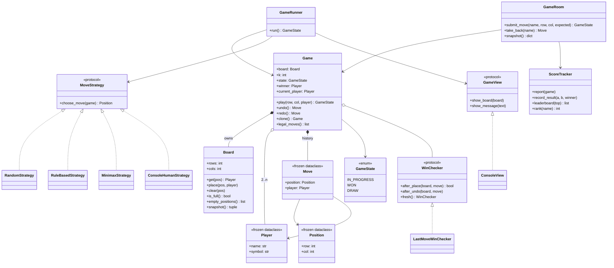
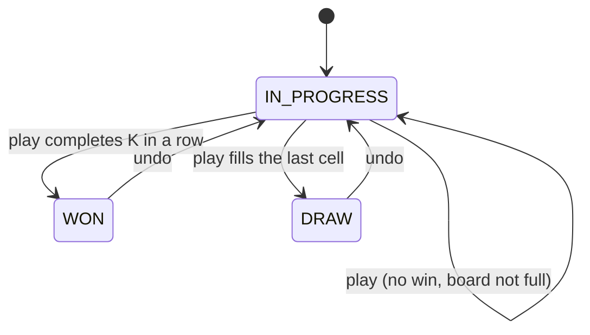

# Design a Tic Tac Toe Game: From a 3x3 Grid to Gomoku, Unbeatable AI and an Authoritative Game Server

Tic-tac-toe looks like a toy problem, which is exactly why interviewers like it. The rules fit on a napkin, so all of your time goes into the *design*: where win detection lives, how players (human or computer) plug in, how undo works, and how to keep the rules separate from the screen. By the end of this post you will be able to design and code a tic-tac-toe engine that handles any N x N board with K-in-a-row, plays perfectly with minimax and alpha-beta pruning, supports undo and redo, tracks Elo ratings on a leaderboard, and runs safely behind a multiplayer game server. You will also be able to explain, with code, why each design choice beats its alternatives.

All the code is in this folder and runs on plain Python 3.13 with no third-party packages:

- [`tic_tac_toe.py`](tic_tac_toe.py): the recommended design, with a `demo()`.
- [`alternatives.py`](alternatives.py): the competing designs we compare, plus Connect Four and Gomoku extensions.
- [`test_tic_tac_toe.py`](test_tic_tac_toe.py): 49 `unittest` tests. Run them with `python3 -m unittest discover -s .` from this folder.

If you are new to classes, interfaces and design patterns, skim [OOP fundamentals](../../01-foundations/01-oop-fundamentals.md) and [design patterns](../../01-foundations/02-design-patterns.md) first. The interview framework used here is described in [The OOD interview framework](../../01-foundations/04-the-ood-interview-framework.md).

---

## 1. The real-world system

Tic-tac-toe (called "noughts and crosses" in the UK) is played by two people on a 3x3 grid. One plays X, the other O, and they take turns writing their symbol into an empty square. Whoever first gets three of their symbols in a line (a row, a column, or one of the two diagonals) wins. If all nine squares fill up without a line, the game is a draw.

It is a *solved game*: if both sides play perfectly, every game is a draw. That makes it a classic first exercise for game-playing AI, and it is why a well-written computer opponent should never lose.

In software, "a tic-tac-toe game" is really a small instance of something much bigger: a **turn-based game engine**. The same skeleton powers:

- **Online board games** such as chess on Chess.com or Lichess, where a server holds the official board, checks every move against the rules, and broadcasts the new position to both players.
- **Bigger cousins of tic-tac-toe.** *Gomoku* is "five in a row" on a 15x15 board. *Connect Four* is four in a row on a 6x7 board where pieces drop to the bottom of a column. Both are the same idea with different board sizes, a different K, or a different rule for where a piece may go.
- **Rating systems.** Competitive games rank players with rating formulas such as Elo (used in chess), Glicko-2 (used by Lichess) and Microsoft's TrueSkill (built for Xbox Live matchmaking).

The actors are few: two **players** (each could be a human at a keyboard, a human in a browser, or a computer opponent), the **game** that enforces the rules, and often a **scoreboard** that remembers results across games.

Why is this a good object-oriented design (OOD) problem? Because the domain is tiny, every design decision is visible. A messy design is obvious (one 200-line `while` loop that reads input, checks rules and prints the board), and a clean one shows off the core skills: assigning responsibilities, using the **Strategy** pattern for interchangeable behaviour, using **Memento** or **Command** for undo, modelling a **state machine**, and keeping the core logic independent of input and output.

---

## 2. Clarifying requirements

An interviewer will usually open with something vague like "design a tic-tac-toe game." Your first job is to turn that into a precise list of what you will build. Ask questions; do not assume.

### The questions to ask

| Question | Why it matters | Typical answer |
|---|---|---|
| Is the board always 3x3? Could it be N x N, or need K in a row with K < N? | Decides whether win detection can be hard-coded or must be general. | "Start with 3x3, but don't paint yourself into a corner." |
| Two players only? Human vs human, or also vs computer? | Decides whether "player" is just data or also behaviour. | "Two players. A computer opponent would be nice." |
| How should invalid moves be handled? | Exceptions vs return codes; who reprompts the user. | "Reject with a clear message and let them try again." |
| Do we need undo? | Decides whether we keep a move history. | "Yes, as a follow-up." |
| Do we track results across games, like a leaderboard? | Introduces a scoreboard that outlives a single game. | "Yes, ratings and rankings." |
| Is this a local console game or online multiplayer? | Concurrency, validation on the server, stale moves. | "Design the core; we may ask about online play." |
| What UI? Console, GUI, web? | Tells you the UI must be swappable. | "Console is fine, but keep it replaceable." |

### Functional requirements

1. Two players take turns placing their own symbol in an empty cell. The first player is X.
2. The board is 3x3 by default, but the design supports any rows x cols board and a configurable K-in-a-row to win.
3. After each move the system reports the game state: **in progress**, **won** (with the winner), or **draw**.
4. Invalid moves are rejected with a clear reason: cell taken, off the board, not your turn, or game already over. A rejected move must not change anything.
5. A player can be a human or a computer. Computer players come in several strengths: random, rule-based, and perfect (minimax).
6. Players can undo and redo moves.
7. A scoreboard records wins, losses and draws per player across games, maintains a rating, and answers "what is my rank?" and "who are the top players?"

### Non-functional requirements

- **Separation of concerns:** game rules must not depend on the console, so the same engine can drive a GUI, a web page or a bot.
- **Extensibility:** new board sizes, new AI levels, or variants like Connect Four should be additive changes, not rewrites.
- **Correctness under concurrency** when used by a server: two simultaneous requests must never both be applied.
- **Testability:** every rule should be testable without typing into a terminal.
- **Performance:** move validation and win detection should be fast even on large boards (Gomoku is 15x15).

### Out of scope

Networking protocols, user accounts and authentication, graphics, chat, timers and matchmaking. We will discuss some of these in "Going deeper," but we will not build them.

---

## 3. Finding the core objects

A simple, reliable technique is **noun/verb analysis**: underline the nouns and verbs in the requirements. Nouns are candidate classes or attributes; verbs are candidate methods.

> Two **players** take **turns** placing their **symbol** in an empty **cell** of the **board**. After each **move** the **game** reports its **state**: in progress, won, or draw. A **scoreboard** records **results** and **ratings**. A player can be a **human** or a **computer**.

Now decide which nouns earn a class.

| Candidate | Decision | Reasoning |
|---|---|---|
| Board | **Class** `Board` | Owns the grid and the cell-level rules: in bounds? empty? full? |
| Cell | **Not a class** (`Position` value instead) | A cell has no behaviour. A `Position(row, col)` value object plus `Player | None` stored in the grid is enough. Making 9 (or 225) cell objects adds memory and no meaning. |
| Player | **Class** `Player` | A name and a symbol. Immutable data. |
| Human / Computer | **Strategy objects**, not Player subclasses | "How a move is chosen" is behaviour that varies independently of who the player is. We will compare this choice with inheritance in section 6. |
| Move | **Class** `Move` | Bundles position + player. Becomes the unit of history for undo. |
| Game | **Class** `Game` | Coordinates turns, validates moves, decides the outcome. |
| State | **Enum** `GameState` | A closed set of values: `IN_PROGRESS`, `WON`, `DRAW`. |
| Turn | **Not a class** | Whose turn it is can be *derived* from the number of moves played. Storing it separately invites bugs. |
| Symbol | **Attribute** of `Player` | A single character; no behaviour. |
| Win / line | **Strategy** `WinChecker` | Win detection has several valid algorithms with different trade-offs, so it gets its own interface. |
| Scoreboard, rating | **Class** `ScoreTracker` | Ratings span many games and many players, so they cannot live in `Game` or `Player`. |
| Console, screen | **Adapters** `ConsoleView`, `ConsoleHumanStrategy` | I/O sits at the edge of the system, not inside the rules. |

Two of these are worth pausing on, because they are where beginners usually go wrong.

**Why not store the rating on `Player`?** A rating is not a fact about one person; it is a fact about how that person did *against others*. Updating one rating always updates another, and the same person could have different ratings in different leagues. That logic belongs in a class that sees the whole population: `ScoreTracker`.

**Why not store `current_player_index` on `Game`?** You can, and the ByteByteGo-style answer does. But then undo must remember to step the index back, redo must step it forward, and every new code path is a chance to forget. If the current player is computed as `players[len(history) % len(players)]`, it is always right by construction. This idea, keep one **source of truth** and derive everything else, comes up again and again in good designs.

---

## 4. Class design



A quick vocabulary reminder: **composition** (filled diamond) means the part lives and dies with the whole: a `Board` is created by its `Game` and is meaningless without it. **Aggregation** (hollow diamond) means the whole uses parts that exist independently: the same `Player` objects take part in many games. **Realization** (dotted arrow with a triangle) means a class implements an interface; in Python we express those interfaces with `typing.Protocol`, which uses *structural typing*: any class with the right methods qualifies, no inheritance required.

The design has three layers, and it helps to see them before reading the classes one by one:

1. **Domain model** (`Player`, `Position`, `Move`, `Board`, `WinChecker`, `Game`): the rules. Pure Python, no I/O.
2. **Players and AI** (`MoveStrategy` and its implementations): decide *which* move to make. They read the game, never change it.
3. **Application edge** (`GameRunner`, `ConsoleView`, `ConsoleHumanStrategy`, `ScoreTracker`, `GameRoom`): connect the model to people, screens, networks and long-term records.

### The classes, one by one

**`Player`, `Position`, `Move` (value objects).** A *value object* is defined only by its data: two `Position(1, 1)` objects are interchangeable. Making them `frozen` dataclasses gives us equality, hashing (so they can be dictionary keys and set members) and immutability (so a `Move` in the history can never be edited after the fact).

**`GameState` (enum).** An **enum** is a closed set of named values. The game is in exactly one of three states, and only `IN_PROGRESS` accepts moves. This is a tiny **state machine**: a model where a system is always in one of a fixed set of states, and specific events move it between them.



**`Board`.** Responsible for *cells*, and nothing else: is a position on the board, is it empty, place a mark, clear a mark, is the board full. It does not know about turns or winners. It keeps a `_filled` counter so `is_full()` is O(1) instead of scanning every cell.

**`WinChecker` (Strategy).** One question: "did the move just placed win?" It is an interface because there are three reasonable algorithms (section 6 compares them). It has an `after_undo` hook because some algorithms keep running totals that must be rolled back, and `fresh()` so a cloned game gets its own independent checker.

**`Game`.** The heart of the model. It owns the board and the history, enforces turn order, rejects illegal moves, asks the `WinChecker` whether a move won, and moves the state machine. It also offers `undo`, `redo` and `clone` (a cheap copy the AI can experiment on).

**`MoveStrategy` (Strategy).** "Given this game, which position would you play?" Human input, random play, heuristics and minimax are all just implementations. A strategy *reads* the game; it never mutates it. That rule matters: an AI that experiments on the real game could corrupt it, and in a server it would be a race condition.

**`GameView`, `ConsoleView`, `ConsoleHumanStrategy` (adapters).** The **Adapter** idea (in the "ports and adapters" or *hexagonal architecture* sense) is that the core defines the interfaces it needs, and the outside world plugs in. The console is one adapter; a GUI or a WebSocket would be others.

**`GameRunner`.** The loop that drives a local game: ask the current player's strategy for a move, apply it to the `Game`, show the result on the `GameView`, repeat. This is the *controller* in model-view-controller (MVC).

**`ScoreTracker`.** Long-lived, shared across games, thread-safe. Keeps wins, losses, draws and an Elo rating per player name.

**`GameRoom`.** The server-side wrapper around one `Game` for online play: it serializes concurrent requests with a lock, rejects stale moves, and reports the result to the `ScoreTracker` exactly once.

---

## 5. Code: the recommended solution

The full file is [`tic_tac_toe.py`](tic_tac_toe.py). Here are the important pieces, in the order you would build them in an interview.

### Errors as a small hierarchy

```python
class GameError(Exception):
    """Base class for every rule violation the game can report."""


class InvalidMoveError(GameError):
    """The target cell is off the board or already taken."""


class NotYourTurnError(GameError):
    """Someone tried to move out of turn."""


class GameOverError(GameError):
    """A move was attempted after the game finished."""
```

Specific exception types let each caller react differently: the console UI reprompts on `InvalidMoveError`, while a server might return HTTP 409 for a `StaleMoveError` and 403 for `NotYourTurnError`. A shared base class lets a caller catch "any game rule violation" in one `except GameError`.

### Value objects

```python
@dataclass(frozen=True)
class Player:
    """A participant identified by name, playing with a one-character symbol."""

    name: str
    symbol: str

    def __post_init__(self) -> None:
        if len(self.symbol) != 1 or self.symbol in ". ":
            raise ValueError(f"symbol must be one visible character, got {self.symbol!r}")


@dataclass(frozen=True)
class Position:
    """A cell coordinate, zero-based, row first."""

    row: int
    col: int


@dataclass(frozen=True)
class Move:
    """An immutable record of who placed a mark where."""

    position: Position
    player: Player
```

`__post_init__` enforces an **invariant** (a rule that must always hold for an object to be valid) at construction time: a symbol is exactly one visible character. Validating once, at the boundary, means no other code ever has to wonder.

### The board

```python
    def place(self, pos: Position, player: Player) -> None:
        if self.get(pos) is not None:
            raise InvalidMoveError(f"cell ({pos.row}, {pos.col}) is already taken")
        self._cells[pos.row][pos.col] = player
        self._filled += 1
```

`get` raises `InvalidMoveError` for an off-board position, so `place` gets bounds checking for free. Note that the grid stores `Player` objects, not strings. Storing the player (rather than `"X"`) means win detection compares identities, and a future feature like "highlight Alice's cells" needs no lookup.

### Win detection: only look where something changed

```python
class LastMoveWinChecker:
    """Looks only at the four lines through the last move.

    A new win must include the cell just played, so nothing else can have
    changed. Cost is O(K) per move, it works for any board shape and any K,
    and it keeps no state, so undo is free.
    """

    def __init__(self, k: int) -> None:
        if k < 1:
            raise ValueError("k must be at least 1")
        self.k = k

    def after_place(self, board: Board, move: Move) -> bool:
        for dr, dc in DIRECTIONS:
            run = 1
            run += self._count(board, move, dr, dc)
            run += self._count(board, move, -dr, -dc)
            if run >= self.k:
                return True
        return False

    def _count(self, board: Board, move: Move, dr: int, dc: int) -> int:
        """Count consecutive marks of the mover, walking away from the move."""
        count = 0
        r, c = move.position.row + dr, move.position.col + dc
        while count < self.k - 1:
            pos = Position(r, c)
            if not board.in_bounds(pos) or board.get(pos) != move.player:
                break
            count += 1
            r, c = r + dr, c + dc
        return count
```

The key insight: before this move nobody had won (otherwise the game would have ended), so if somebody has won now, the winning line *must pass through the cell just played*. There are only four line directions through any cell (`DIRECTIONS` is horizontal, vertical, and the two diagonals). For each direction we walk outwards both ways counting the mover's marks, and stop after K-1 steps each way. Total work: at most 4 x 2 x (K-1) cell reads, so **O(K)** per move, regardless of board size. On 3x3 that is trivial; on Gomoku's 15x15 it is the difference between checking 225 cells and checking at most 32.

### The game

```python
    @property
    def current_player(self) -> Player:
        return self._players[len(self._history) % len(self._players)]
```

Whose turn it is falls out of the history. It cannot drift out of sync.

```python
    def play(self, row: int, col: int, player: Player | None = None) -> GameState:
        """Place the current player's mark. Validates everything before mutating."""
        if self.is_over:
            raise GameOverError(f"game already finished: {self._state.name}")
        mover = self.current_player
        if player is not None and player != mover:
            raise NotYourTurnError(f"it is {mover.name}'s turn, not {player.name}'s")
        self._apply(Move(Position(row, col), mover))
        self._redo.clear()  # a new move invalidates the redo branch
        return self._state
```

```python
    def _apply(self, move: Move) -> None:
        self.board.place(move.position, move.player)  # raises before any change
        self._history.append(move)
        if self._win_checker.after_place(self.board, move):
            self._state, self._winner = GameState.WON, move.player
        elif self.board.is_full():
            self._state = GameState.DRAW
```

Three design decisions are packed in here:

1. **Validate, then mutate.** Every check that can fail runs before anything changes. `board.place` is the last check and the first mutation; if it raises, the history, the state and the redo stack are untouched. This is what "a rejected move must not change anything" means in code, and there is a test for it.
2. **The `player` argument is optional.** A local hot-seat game does not need to say who is moving. A server *must* (to stop Bob from moving on Alice's turn), so it passes the player and gets `NotYourTurnError` on a mismatch.
3. **Win before draw.** The last cell can complete a line *and* fill the board. Checking the win first gets that case right.

### Undo, redo and clone

```python
    def undo(self) -> Move:
        if not self._history:
            raise NothingToUndoError("no moves to undo")
        move = self._history.pop()
        self.board.clear(move.position)
        self._win_checker.after_undo(self.board, move)
        # Any finished game becomes unfinished once its last move is removed.
        self._state, self._winner = GameState.IN_PROGRESS, None
        self._redo.append(move)
        return move
```

Undo is just "pop the last move and clear its cell." We do not store snapshots of the board, because a `Move` already contains everything needed to reverse it. The turn fixes itself because it is derived from the history length. Undoing a winning move reopens the game, which is exactly what the AI search needs (more on that below).

Redo replays from a second stack, and any fresh `play` clears that stack, which is how every text editor behaves: after you undo and type something new, the old "future" is gone.

`clone()` builds a new `Game` with the same configuration and replays the history into it. Strategies use it so they can experiment freely without touching the real game.

### Player strategies

```python
class MoveStrategy(Protocol):
    """Anything that can pick the next move for the player whose turn it is."""

    def choose_move(self, game: Game) -> Position: ...
```

One method. A human at the console, a random bot, and a perfect AI all satisfy it. The rule-based bot uses the classic priorities a child learns: win if you can, otherwise block the opponent's win, otherwise take the centre, otherwise a corner, otherwise anything.

```python
class RuleBasedStrategy:
    """Classic heuristics: win, else block, else centre, else corner, else anything."""

    def choose_move(self, game: Game) -> Position:
        me = game.current_player
        moves = game.legal_moves()
        for pos in moves:
            if _wins_at(game, pos, me):
                return pos
        for opponent in (p for p in game.players if p != me):
            for pos in moves:
                if _wins_at(game, pos, opponent):
                    return pos
```

This is good, but not perfect. It can be beaten by a *fork* (a move that creates two winning threats at once, so blocking one leaves the other).

### The perfect player: minimax with alpha-beta and memoization

**Minimax** is the textbook algorithm for two-player, zero-sum, perfect-information games (games where one player's gain is the other's loss and nothing is hidden). Imagine the tree of every possible continuation. At the leaves, score the result: win, loss or draw. Walk back up: on my turn I pick the child with the highest score; on my opponent's turn they pick the lowest. The value at the root is the best result I can guarantee against a perfect opponent.

We use the **negamax** formulation, a common simplification: since my gain is your loss, the score of a position for me is the negation of its score for you. That way one function handles both players.

Two optimizations make it fast:

- **Alpha-beta pruning.** While searching, keep two bounds: *alpha* (the best score I am already guaranteed elsewhere) and *beta* (the best score my opponent is already guaranteed elsewhere). If a branch proves that the opponent can force something worse for me than alpha, I will never choose that branch, so stop searching it. The answer is identical to plain minimax; only the work shrinks.
- **Memoization with a transposition table.** The same position can be reached by different move orders (X at A then B, or X at B then A). A *transposition table* is a dictionary from position to already computed score. With alpha-beta there is a subtlety: a pruned search does not produce an exact score, only a bound ("at least 3" or "at most 0"). So each entry records whether its value is `EXACT`, a `LOWER` bound or an `UPPER` bound, and we only reuse it in ways that are still correct.

```python
    def _negamax(self, game: Game, depth: int, alpha: float, beta: float) -> float:
        self.nodes_searched += 1
        if game.state is GameState.WON:
            # The player who just moved won, so this is a loss for the side to move.
            return -(1 + len(game.board.empty_positions()))
        if game.state is GameState.DRAW:
            return 0
        if self.max_depth is not None and depth >= self.max_depth:
            return 0  # unknown: treat as neutral

        key = self._key(game, depth)
        alpha_orig = alpha
        if self.memoize and key in self._table:
            value, bound = self._table[key]
            if bound is _Bound.EXACT:
                return value
            if bound is _Bound.LOWER:
                alpha = max(alpha, value)
            else:
                beta = min(beta, value)
            if alpha >= beta:
                return value

        best = -math.inf
        for pos in self._ordered(game):
            game.play(pos.row, pos.col)
            score = -self._negamax(game, depth + 1, -beta, -alpha)
            game.undo()
            best = max(best, score)
            alpha = max(alpha, score)
            if alpha >= beta:
                break  # the opponent will never allow this line
```

A few details are worth calling out:

- **The win score includes the number of empty cells.** A win with more empty cells left happened sooner. Without this, the AI might see that it wins either now or in three moves, score both the same, and dawdle.
- **Play and undo on a clone.** The search walks the tree by calling `play` and `undo` on its private copy. Our cheap undo is what makes this fast: no board copying per node.
- **Move ordering.** `_ordered` tries centre cells first. Alpha-beta prunes more when good moves are searched early, and in tic-tac-toe central cells are usually best.
- **`max_depth` for big boards.** Searching a 15x15 Gomoku tree to the end is hopeless, so the strategy can stop at a fixed depth and call the position neutral. Real engines replace that `0` with an *evaluation function* (for example, counting open threes and fours).

How much do the optimizations buy? `alternatives.py` measures the number of positions searched to choose one reply after X opens in a corner:

```
plain minimax       59,704 nodes
alpha-beta           2,515 nodes
alpha-beta + memo      975 nodes
```

Roughly a 60x reduction for the same, provably identical, answer.

### Keeping I/O at the edge

```python
class GameRunner:
    """Application layer for a local game: asks strategies for moves, feeds the
    model, and tells the view what happened."""
```

```python
    def run(self) -> GameState:
        self._view.show_board(self.game.board)
        while not self.game.is_over:
            player = self.game.current_player
            pos = self._controllers[player].choose_move(self.game)
            try:
                self.game.play(pos.row, pos.col, player)
            except InvalidMoveError as exc:
                self._view.show_message(f"Invalid move: {exc}. Try again.")
                continue
            self._view.show_message(f"{player.name} plays ({pos.row}, {pos.col})")
            self._view.show_board(self.game.board)
```

The runner never calls `print` or `input`. It talks to a `GameView` and to strategies. A human is just `ConsoleHumanStrategy`, which parses text like `"1 2"` and reprompts on garbage. To test the whole loop we inject fake input and capture output into a list, with no terminal involved.

### Scoreboard with Elo ratings

**Elo** is a rating system invented for chess. Each player has a number. Before a game, the formula predicts each player's expected score from the rating gap. After the game, each rating moves by `K x (actual - expected)`. Beating a stronger player earns more than beating a weaker one, and the points one player gains, the other loses.

```python
    def record_result(self, a: Player, b: Player, winner: Player | None) -> None:
        if winner is not None and winner not in (a, b):
            raise ValueError("winner must be one of the two players")
        score_a = 0.5 if winner is None else (1.0 if winner == a else 0.0)
        with self._lock:
            ra = self._records.get(a.name, PlayerRecord(rating=self._initial))
            rb = self._records.get(b.name, PlayerRecord(rating=self._initial))
            expected_a = 1 / (1 + 10 ** ((rb.rating - ra.rating) / 400))
            delta = self._k * (score_a - expected_a)
            self._records[a.name] = self._bump(ra, score_a, ra.rating + delta)
            self._records[b.name] = self._bump(rb, 1 - score_a, rb.rating - delta)
```

The lock matters: reading two ratings, computing, and writing both back is a *read-modify-write* sequence. If two threads report games for the same player at once without a lock, one update can overwrite the other (a **race condition**: the result depends on the timing of threads). Records are immutable `PlayerRecord` dataclasses replaced as a whole, so a reader never sees a half-updated record.

Running `python3 tic_tac_toe.py` plays a scripted game, demonstrates undo and redo, pits minimax against minimax (draw), the rule-based bot (draw) and a random bot (minimax wins), plays a 5x5 four-in-a-row game, shows the server rejecting a stale move, and prints the leaderboard.

---

## 6. Comparing approaches

This is where an interview is won or lost. Anyone can produce *a* design; a strong candidate can name the alternatives and argue for one. All alternatives below are runnable in [`alternatives.py`](alternatives.py).

### Decision 1: How do we detect a win?

**Approach A: scan the whole board after every move.** For each cell and each direction, check whether K equal marks start there.

```python
    def find_winner(self, board: Board) -> Player | None:
        for r in range(board.rows):
            for c in range(board.cols):
                first = board.get(Position(r, c))
                if first is None:
                    continue
                for dr, dc in ((0, 1), (1, 0), (1, 1), (1, -1)):
                    end_r, end_c = r + dr * (self.k - 1), c + dc * (self.k - 1)
                    if not board.in_bounds(Position(end_r, end_c)):
                        continue
                    if all(board.get(Position(r + dr * i, c + dc * i)) == first
                           for i in range(self.k)):
                        return first
        return None
```

**Approach B: check only the lines through the last move.** This is the recommended `LastMoveWinChecker` from section 5.

**Approach C: running counters per line.** For an N x N board where K = N, a player wins when they own all N cells of some row, column or diagonal. Keep a counter per (player, row), (player, column), and one per diagonal. Each move increments at most four counters; if one reaches N, that player wins. Undo decrements them.

```python
    def _update(self, move: Move, step: int) -> bool:
        p, r, c = move.player, move.position.row, move.position.col
        counts = [self._bump(self._rows, (p, r), step), self._bump(self._cols, (p, c), step)]
        if r == c:
            counts.append(self._bump(self._diag, p, step))
        if r + c == self.n - 1:
            counts.append(self._bump(self._anti, p, step))
        return any(count == self.n for count in counts)
```

Measured on a 25x25 board with K = 25 (numbers from `python3 alternatives.py` on one laptop; yours will differ, the ratios are the point):

```
full scan      765.9 us
last move        8.6 us
counters         2.3 us
```

| | A: full scan | B: last move (recommended) | C: counters |
|---|---|---|---|
| Time per move | O(N² x K) as written (O(N²) when K = N, since only one start per line fits) | O(K) | O(1) |
| Extra memory | none | none | O(N) per player |
| Supports K < N (Gomoku)? | yes | yes | **no**: a counter cannot tell "5 in a row" from "5 scattered in the row" |
| Supports non-square boards (Connect Four)? | yes | yes | no |
| Undo cost | free | free | must decrement, easy to get wrong |
| Can answer "who has won?" from a loaded board with no history? | **yes** | no | no |
| Best for | validating saved/imported positions, tests | the general engine | LeetCode 348 style "N x N, K = N" at huge scale |

**Recommendation: B.** It is fast enough for any realistic board, stateless (so undo and cloning are trivial), and general. Mention C to show you know the O(1) trick, and explain why its restriction makes it a poor default. Keep A around as a *test oracle*: our tests play 200 random 4x4 games and assert that all three checkers agree, which is a cheap way to catch an off-by-one in the clever ones.

Because all three implement the same `WinChecker` protocol, swapping is a constructor argument: `Game(players, win_checker=CounterWinChecker(3))`. That is the Strategy pattern paying off.

### Decision 2: How do we model human and computer players?

**Approach A: a type tag and an if/else chain.**

```python
def choose_move_with_if_else(kind: str, game: Game,
                             input_fn: Callable[[str], str] = input) -> Position:
    """Approach A: one function that switches on a type tag. Every new AI
    level means editing this function (violates the Open/Closed Principle)."""
    if kind == "human":
        row, col = map(int, input_fn("row col: ").split())
        return Position(row, col)
    if kind == "random":
        return random.choice(game.legal_moves())
    if kind == "first-free":
        return game.legal_moves()[0]
    raise ValueError(f"unknown player kind {kind!r}")
```

**Approach B: inheritance, one `Player` subclass per behaviour.**

```python
class InheritedPlayer(ABC):
    """Approach B: behaviour baked into a Player subclass hierarchy. Identity
    (name, symbol) and behaviour (how to pick a move) are welded together, so
    a human cannot switch to 'AI takes over' mid-game without a new object."""

    def __init__(self, name: str, symbol: str) -> None:
        self.identity = Player(name, symbol)

    @abstractmethod
    def next_move(self, game: Game) -> Position: ...
```

**Approach C: composition with the Strategy pattern (recommended).** `Player` is pure identity; a separate `MoveStrategy` decides moves; `GameRunner` maps each player to a strategy.

```python
    GameRunner(game, {
        alice: ScriptedStrategy([(0, 0), (1, 1), (2, 2)]),
        bob: ScriptedStrategy([(0, 1), (0, 2)]),
    }, view).run()
```

| | A: if/else | B: subclass per type | C: Strategy (recommended) |
|---|---|---|---|
| Add a new AI level | edit the function (risky, every caller affected) | new subclass | new class, nothing else changes |
| Swap behaviour mid-game ("let the computer finish for me", "hint mode") | change the tag | must create a new player object, breaking identity in history and the scoreboard | change one dictionary entry |
| Same AI for both sides (self-play) | yes | needs two instances of the subclass with different identities | one strategy object serves both seats |
| Testability | needs monkeypatching | fine | trivially inject `ScriptedStrategy` |
| Simplicity for a 10-minute answer | highest | high | high |

**Recommendation: C.** It follows "favour composition over inheritance" and the **Open/Closed Principle** (open for extension, closed for modification). The killer argument is that identity and behaviour vary independently: the same person can play as a human today and delegate to an AI tomorrow, and their rating must follow their *identity*.

Within approach C there is a second choice: *which* AI.

| Strategy | Strength on 3x3 | Cost | When to choose |
|---|---|---|---|
| `RandomStrategy` | weak | O(1) | "easy" difficulty, fuzz tests |
| `RuleBasedStrategy` | decent, loses to forks | O(cells x K) | "medium" difficulty, explainable behaviour |
| `MinimaxStrategy` (alpha-beta + memo) | perfect, never loses | 975 nodes for one reply on 3x3; exponential on large boards | "hard" difficulty on small boards; with `max_depth` and a real evaluation function on large ones |

Our tests check that minimax never loses to a random player across 40 games, and that minimax against itself always draws (as theory says it should).

### Decision 3: How do we manage game state and turns?

**Approach A: boolean flags and a mutable turn index.**

```python
class FlagsGame:
    """Approach A: booleans and a mutable turn index.

    Nothing stops `is_over=False` with `winner` set, or a forgotten turn
    flip after undo: the flags can drift into combinations that mean nothing.
    """
```

With `is_over`, `is_draw` and `winner` there are many representable combinations but only three meaningful ones. Every method must keep them consistent by hand.

**Approach B: an enum plus a derived turn (recommended).** `GameState` has exactly the three legal values, and the turn is `len(history) % len(players)`.

**Approach C: the State pattern.** Each state is a class that implements `play` its own way; the game delegates to its current state object.

```python
class _Won(_State):
    name = "WON"

    def __init__(self, winner: Player) -> None:
        self.winner = winner

    def play(self, game: StatePatternGame, row: int, col: int) -> None:
        raise GameOverError(f"{self.winner.name} already won")
```

| | A: flags | B: enum + derived turn (recommended) | C: State pattern |
|---|---|---|---|
| Illegal combinations possible? | yes | no | no |
| Lines of code | fewest | few | most (a class per state) |
| Where state-specific behaviour lives | `if` checks scattered in every method | one `if self.is_over` guard | inside each state class |
| Good when | never, really | few states, little per-state behaviour | many states with very different behaviour (e.g. lobby, placement phase, playing, paused, finished) |

**Recommendation: B.** Tic-tac-toe has three states and only one behaviour differs between them ("moves are allowed or not"), so a full State pattern is ceremony. Say out loud that you would switch to C if the interviewer adds phases such as "waiting for opponent," "paused," or "timed out"; that is the moment the per-state `if` checks would start to multiply. The vending machine and ATM posts in this series are good examples of where the State pattern does earn its keep.

### Decision 4: How do we implement undo?

**Approach A: Memento (full snapshots).** Before every move, store a deep copy of the board. Undo restores the previous copy.

```python
class SnapshotHistory:
    """Caretaker that stores a snapshot before every move. O(N^2) memory per move."""

    def __init__(self) -> None:
        self._stack: list[BoardMemento] = []

    def save(self, board: Board) -> None:
        self._stack.append(BoardMemento(copy.deepcopy(board)))
```

In the **Memento** pattern, the *originator* (the board) produces a *memento* (a snapshot of its private state), and a *caretaker* (the history) stores mementos without looking inside them.

**Approach B: Command objects.** Each action is an object with `execute()` and `undo()`.

```python
class PlaceMarkCommand:
    """Approach B (Command): an object that knows how to do and undo itself."""

    def __init__(self, board: Board, position: Position, player: Player) -> None:
        self.board, self.position, self.player = board, position, player

    def execute(self) -> None:
        self.board.place(self.position, self.player)

    def undo(self) -> None:
        self.board.clear(self.position)
```

**Approach C: a move log (recommended).** Store immutable `Move` records and let `Game.undo()` reverse the last one. This is Command-style undo where the "command" is plain data and the reversing logic lives in one place, the `Game`. It is also a tiny form of **event sourcing**: the history of events is the source of truth, and the current state is derived from it.

| | A: snapshots (Memento) | B: Command objects | C: move log (recommended) |
|---|---|---|---|
| Memory per move | O(rows x cols) | O(1) | O(1) |
| Undo correctness | trivially correct, even for complex moves | each command must reverse itself correctly | `Game.undo` must reverse correctly |
| Works for moves with complex side effects (captures in chess, Othello flips) | yes, no extra code | each command records what it changed | the move record must carry what it changed |
| Serializable for replays / network | heavy | needs care (commands hold object references) | trivially: a list of (row, col) |
| Derives turn and state | no, must snapshot them too | no | yes |

**Recommendation: C**, with an honest note that the board here is tiny, so snapshots (A) would also be fine for 3x3. The move log wins because it doubles as a replay format, a save-game format and the network message format, and it makes the AI's play/undo search cheap. Choose snapshots when undoing a move is hard to compute (a physics simulation, an image editor applying filters). Choose explicit Command objects when there are many kinds of actions (place, swap, resign, offer draw) that each need their own undo logic.

### Decision 5: Where does input and output live?

**Approach A: one monolithic loop.**

```python
    def play(self) -> str:
        symbol = "X"
        for _ in range(9):
            while True:
                row, col = map(int, self.input(f"{symbol} row col: ").split())
                if self.grid[row][col] == " ":
                    break
                self.print("taken, try again")
            self.grid[row][col] = symbol
```

It works, and for a 30-line script that is fine. But to test it you must fake stdin, and to put it on a web page you must rewrite it. A malformed input like `"9 9"` crashes with an `IndexError` deep inside the rules.

**Approach B: model + view + runner, with I/O as adapters (recommended).** `Game` knows only rules. `GameView` and `MoveStrategy` are ports. `ConsoleView` and `ConsoleHumanStrategy` are the console adapters. `GameRunner` wires them.

| | A: monolith | B: separated (recommended) |
|---|---|---|
| Unit-test the rules | hard (fake stdin) | trivial (`game.play(1, 1)`) |
| New UI (GUI, web, Discord bot) | rewrite | new adapter, rules untouched |
| Run the rules on a server | no | yes, as `GameRoom` does |
| AI can simulate moves | no, simulation would print | yes |
| Code size for a toy | smallest | a few more classes |

**Recommendation: B.** This is the same principle game engines follow: the simulation updates a model, and rendering reads that model. It is also what makes everything else in this post possible; the AI, the server and the tests all reuse the very same `Game` without modification.

---

## 7. Going deeper

### Concurrency: playing over a network

Locally there is one thread and one keyboard, so nothing can interleave. Online, two players' requests arrive on different threads at any moment, and the same player may double-click and send a move twice. Three things can go wrong:

1. **Lost or double moves.** Two requests both read "it is X's turn, cell empty" and both write. Fix: a lock around the whole read-check-write sequence, so moves are applied one at a time. (In a multi-server deployment the lock becomes "route each game to one owner" or a database transaction.)
2. **Stale moves.** Bob's screen shows move 3, but Alice already undid a move, so the server is at move 2. Bob's click was based on a board that no longer exists. Fix: **optimistic concurrency control**. The client sends the move number it saw; the server rejects the request if that number is out of date, and the client refreshes. "Optimistic" because we do not lock anything while the player thinks; we only verify at submit time.
3. **Cheating.** A modified client sends "I play (1,1)" when (1,1) is taken, or sends a move for the opponent. Fix: the server is **authoritative**. Clients only *request* moves; the server owns the real `Game`, validates everything, and broadcasts the result.

```python
    def submit_move(self, player_name: str, row: int, col: int,
                    expected_move_number: int) -> GameState:
        with self._lock:
            player = self._player(player_name)
            # Optimistic concurrency: reject moves made against an old board.
            if expected_move_number != self.game.move_count:
                raise StaleMoveError(
                    f"move #{expected_move_number} is stale; game is at #{self.game.move_count}"
                )
            state = self.game.play(row, col, player)
            if self.game.is_over and self._tracker and not self._reported:
                self._tracker.report(self.game)
                self._reported = True
            return state
```

The test `test_concurrent_submissions_only_one_wins_the_race` releases nine threads at once, all trying to make move #0 on different cells. Exactly one succeeds and eight get `StaleMoveError`. Also note the `_reported` flag: the result is reported to the scoreboard **exactly once**, and after that take-backs are refused, because un-winning a game that already changed two ratings would require compensating updates.

The `take_back` rule ("only your own last move, only before the result is recorded") is a policy decision made in the room, not in `Game`. The model offers a mechanism (`undo`); the application decides who may use it and when. Keeping mechanism and policy apart is why the AI can use unrestricted `undo` while human players cannot.

### Extensibility: "the interviewer now asks..."

**"Support an N x N board and K in a row."** Already done: `Game(players, rows=15, cols=15, k=5)` is Gomoku. The only components that ever cared about size are `Board` (parameterized) and `WinChecker` (the recommended one is size-agnostic). This is why it pays to avoid hard-coding "3" even when the interviewer says "just 3x3."

**"Make it Connect Four."** Connect Four changes *where* a piece may go: it drops to the lowest empty cell of a column. The board (6x7) and the win rule (4 in a row) are configuration.

```python
    def drop(self, col: int, player: Player | None = None) -> GameState:
        if not 0 <= col < self.board.cols:
            raise InvalidMoveError(f"column {col} does not exist")
        for row in range(self.board.rows - 1, -1, -1):
            if self.board.get(Position(row, col)) is None:
                return super().play(row, col, player)
        raise InvalidMoveError(f"column {col} is full")
```

This `ConnectFourGame` subclass is the quick interview answer, and it works. But be ready to critique it: it overrides `play` to raise an error, which breaks the **Liskov Substitution Principle** (code written for a `Game` that calls `play(row, col)` now fails). Its `clone()` also returns a plain `Game` without gravity, so `MinimaxStrategy` would happily consider floating pieces. The production-quality fix is one more strategy: a `PlacementRule` with `legal_moves(board)` and `resolve(board, input) -> Position`, injected into `Game` just like `WinChecker`. Tic-tac-toe uses "any empty cell"; Connect Four uses "lowest empty cell in the column"; *Gomoku variants* like Renju add forbidden moves for the first player. Then `Game` never needs subclassing.

**"Three players."** `Game` accepts any number of players with distinct symbols, and `current_player` cycles through them. What breaks is the AI (minimax assumes two-player zero-sum; you would need the "max^n" generalization or a heuristic) and Elo (defined for pairs; multi-player rating systems such as TrueSkill exist for this). `ScoreTracker.report` raises for non-two-player games rather than producing nonsense, which is the right failure mode.

**"Add a timer per move."** Time is an input the model should not read directly (it would make tests flaky). Pass a clock into the `GameRoom` and have it check deadlines on each request or via a scheduler; a timeout becomes a new terminal state (`TIMEOUT` or "won by time"), which is the moment to consider the State pattern from Decision 3.

**"Add spectators and live updates."** Add an observer list to `GameRoom`: after each successful `submit_move`, push `snapshot()` to every subscriber. The **Observer** pattern keeps the room unaware of whether a subscriber is a WebSocket, a logger, or a TV broadcast overlay.

**"Replays."** The move log is already a replay. Persist `[(row, col), ...]` and replay it into a fresh `Game`, exactly as `clone()` does.

### Persistence and scaling

Moving from an in-memory object to a real service:

- **Game storage.** Store each game as a row (`id`, players, config, state, winner) plus an append-only moves table (`game_id`, `move_number`, `row`, `col`, `player_id`). A unique constraint on `(game_id, move_number)` gives the database the same stale-move protection our `expected_move_number` check gives in memory: two concurrent inserts for move 5 cannot both succeed.
- **Live games in memory, finished games in the database.** A game is tiny and short-lived, so a game server typically holds active games in memory (one owner process per game, found via consistent hashing or a routing table) and writes moves through to storage for crash recovery.
- **Scoreboard.** Ratings change on every finished game and leaderboards are read constantly. A common shape is a relational table as the source of truth plus a sorted set in a cache (Redis sorted sets are a popular choice) for "top 100" and "my rank" queries, updated after each result.
- **Idempotency.** Networks retry. If "report result for game 123" is delivered twice, ratings must not change twice. Our `_reported` flag is the in-memory version; in a service, use the game ID as an idempotency key.

### Testing strategy

The test file has 49 tests in a few layers, and the design is what makes each layer easy:

- **Unit tests for the model:** every win line (row, column, both diagonals), draw, K < N, three-of-four not winning, invalid moves leaving state untouched, turn order, undo of a winning move reopening the game, redo invalidation.
- **Cross-checking implementations:** the three win checkers must agree on 200 random 4x4 games. The slow, obviously-correct full scan acts as an oracle for the fast ones.
- **Behavioural tests for AI:** takes an immediate win, blocks an immediate loss, never loses to random, draws against itself, and does not mutate the game it is asked about.
- **Adapter tests:** a scripted human types garbage, then a taken cell, then valid moves; we assert on the captured output. No terminal needed.
- **Concurrency tests:** many threads hammering `ScoreTracker` and `GameRoom`; assert nothing is lost and exactly one racing move succeeds.

### Failure modes to mention

- **Silent invalid moves.** A board that ignores a move to an occupied cell (instead of raising) lets the game advance a turn with nothing placed. Always fail loudly and atomically.
- **Off-by-one in win detection**, especially on anti-diagonals and at board edges. Property-style tests against a simple oracle catch these.
- **AI corrupting the real game** by experimenting in place. Always search on a clone.
- **Double-reporting results** after undo-then-replay, or on retried network requests.
- **Players with the same symbol**, which makes the board ambiguous. The `Game` constructor rejects it.

---

## 8. How real systems do it

- **Authoritative servers.** Online chess sites keep the official game on the server and treat the client as a display plus an input device; a move the client shows is only a request until the server confirms it. Fast-action games (Valve's Source engine is a well-documented example) go further: the client *predicts* the result of your input locally so the game feels instant, then reconciles with the server's authoritative state when it arrives. Turn-based games rarely need prediction, but they share the "server decides" rule.
- **Rules engines as libraries.** Lichess's rules engine (scalachess) is a separate library from the website, and the same idea shows up across the industry: the rules are a pure model that the web server, analysis tools and bots all reuse. That is Decision 5 at production scale.
- **Model / view separation in game engines.** Engines run a game loop that updates the simulation and then renders it. Keeping game state independent of rendering is what allows headless servers, replays and automated testing. Some real-time strategy games used *deterministic lockstep*: every client runs the same simulation and only the players' commands are sent over the network, which is our move log taken to its logical conclusion.
- **Rating systems.** Chess federations use Elo. Lichess uses Glicko-2, which adds a "rating deviation" (how confident we are in the number) so new players' ratings move faster. Xbox Live matchmaking was built on TrueSkill, which handles teams and more than two players. All of these live outside the game itself, in a ratings service fed by game results, just as `ScoreTracker` sits outside `Game`.
- **Solved games and AI.** Tic-tac-toe is a draw with perfect play. Connect Four was solved in 1988 (the first player wins with perfect play), and freestyle Gomoku on 15x15 was solved in the 1990s (also a first-player win), which is why tournament variants such as Renju add restrictions for the first player. For games too large to solve, engines combine search (alpha-beta, or Monte Carlo tree search) with an evaluation function, often learned.
- **Anti-cheat and audit.** Because every move is logged, servers can replay games, detect impossible timing, and compare players' moves against engine suggestions. The append-only move log is the foundation.

---

## 9. Interview playbook

### A 45-minute timeline

| Minutes | What to do | What to say |
|---|---|---|
| 0-5 | Clarify requirements | Ask about board size and K, AI players, undo, scoreboard, online play. Write the final list. |
| 5-10 | Core objects | Do noun analysis out loud. Explain why `Cell` and `Turn` are not classes and why the rating is not on `Player`. |
| 10-18 | Class diagram | `Player`, `Position`, `Move`, `GameState`, `Board`, `WinChecker`, `Game`, `MoveStrategy`, `ScoreTracker`. Mark composition vs aggregation. |
| 18-32 | Code | `Board.place`, `Game.play` (validate then mutate), `LastMoveWinChecker`, derived `current_player`, `undo`. |
| 32-40 | Trade-offs | Win detection A/B/C with complexities; Strategy for players; enum vs State pattern; move log vs snapshots. |
| 40-45 | Extensions | N x N/K, Connect Four via a placement rule, minimax with alpha-beta, server authority and stale moves. |

### Common mistakes

- Hard-coding eight winning lines for 3x3, then being unable to answer "what about N x N?"
- Putting `print` and `input` inside `Game`.
- Storing the turn separately and forgetting to roll it back on undo.
- Letting `Board` silently ignore an occupied-cell move.
- Making `HumanPlayer` and `ComputerPlayer` subclasses and then struggling with "hint mode" or "AI takes over."
- Storing ratings on `Player`.
- Describing minimax but not knowing why alpha-beta preserves the answer, or reusing pruned scores from a memo table as if they were exact.

### Follow-ups interviewers like

- "How fast is your win check? Can it be O(1)?" (Counters for K = N; explain why not for K < N.)
- "Make the computer unbeatable." (Minimax; then alpha-beta; then memoization and symmetry.)
- "Now it is online. What changes?" (Authoritative server, locking, stale moves, idempotent result reporting.)
- "Add undo. Memento or Command?" (Move log; explain the memory trade-off.)
- "Connect Four?" (Placement rule strategy; LSP critique of subclassing.)

---

## 10. Test yourself

<details>
<summary>1. Why is it enough to check only the lines through the last move when detecting a win?</summary>

Before the move, the game was still in progress, so no line was complete. The move changed exactly one cell. Any line that is complete now but was not before must contain that cell. So only the (at most four) lines through it can have become winning lines.
</details>

<details>
<summary>2. The O(1) counter approach seems strictly better. Why isn't it the default?</summary>

It only works when K equals the board side length on a square board, because it counts how many cells of a whole row/column/diagonal a player owns, not whether they are consecutive. For Gomoku (K = 5 on 15x15) or Connect Four (6x7, K = 4) it gives wrong answers. It also keeps state that undo must roll back. O(K) per move is already negligible, so generality wins.
</details>

<details>
<summary>3. Your Game stores no "current player index." How does it know whose turn it is, and why is that better?</summary>

It derives it: `players[len(history) % len(players)]`. There is one source of truth (the history), so undo, redo, clone and replay automatically get the turn right. A separately stored index has to be updated in every code path that changes the history, and forgetting once creates a bug.
</details>

<details>
<summary>4. Why is the rating kept in ScoreTracker rather than as an attribute of Player?</summary>

A rating is relational: it depends on results against other players, and each result updates two ratings together. The same person might have separate ratings in separate leagues or game types. It also needs cross-game, thread-safe updates. All of that is a responsibility of a component that sees the whole population, not of an individual player value object.
</details>

<details>
<summary>5. Alpha-beta pruning skips parts of the tree. How can it still return the same move as plain minimax?</summary>

It only skips branches that provably cannot affect the result: if the opponent already has a reply in this branch that is worse for me than an option I am guaranteed elsewhere (score at or below alpha), the opponent would pick that reply, so I would never enter the branch, and its other children do not matter. The value at the root is unchanged. Move ordering affects how much is pruned, not the answer.
</details>

<details>
<summary>6. What goes wrong if you memoize alpha-beta results as plain numbers, and how does the code avoid it?</summary>

When a search is cut off, the returned number is only a bound (the true value is at least, or at most, that number), not the exact value. Storing it as exact and reusing it in a search with a different alpha-beta window can produce wrong moves. The transposition table stores a flag (`EXACT`, `LOWER`, `UPPER`) and only uses lower and upper bounds to tighten the window, returning early only if the window closes.
</details>

<details>
<summary>7. The interviewer adds Connect Four. Sketch the change and critique the subclassing shortcut.</summary>

Board 6x7 and K = 4 are configuration. The new rule is gravity: a move names a column and lands in the lowest empty cell. A quick subclass with `drop(col)` works, but overriding `play` to raise breaks Liskov substitution, and `clone()` returns a plain `Game` so the AI would consider illegal floating moves. Better: inject a `PlacementRule` strategy (`legal_moves`, `resolve`) into `Game`, the same way `WinChecker` is injected. Tic-tac-toe and Connect Four become two small rule classes, and AI and server code need no changes.
</details>

<details>
<summary>8. Two clients submit a move at the same moment for the same game. What protects the game, and what does each client see?</summary>

The `GameRoom` lock serializes the requests. Each carries the move number the client saw. The first one through matches the current move count and is applied; the second now carries a stale number and is rejected with `StaleMoveError`, so that client refreshes its view. Even without the stale check, the turn check and the occupied-cell check would reject an illegal second move, but the stale check also catches *legal-looking* moves made against an outdated board.
</details>

<details>
<summary>9. Snapshots (Memento) or a move log for undo in chess? What about in an image editor?</summary>

Chess: a move log, as long as each move record carries what it changed (captured piece, castling rights, en-passant square), because positions are small but games are long and the log doubles as notation, replay and network format. An image editor: often snapshots or tile-level snapshots, because reversing an arbitrary filter is hard or impossible, so storing "before" data is the only reliable undo. The rule is: log operations when they are cheaply reversible, snapshot when they are not.
</details>

<details>
<summary>10. Why should a server call undo only through a policy method like take_back, while the AI is allowed to call Game.undo freely?</summary>

`Game.undo` is a mechanism with no notion of who is asking. The AI uses it on its own private clone, so nobody else is affected. On the shared, authoritative game, undo affects both players and possibly the scoreboard, so the application decides the policy: only your own last move, only while the game is unrecorded. Separating mechanism (in the model) from policy (in the application layer) lets each be reused and changed independently.
</details>

---

## 11. Key takeaways

- Keep the **model pure**: `Board` and `Game` contain rules only. Views, input, AI and networking plug in from the edges, and that is what makes the same engine power the console, tests, AI search and a server.
- **Check only what changed**: win detection through the last move is O(K), general for any board and K, and stateless. Know the O(1) counter trick and its limits.
- Model players as **identity plus a strategy**. Human, random, rule-based and minimax are interchangeable `MoveStrategy` objects.
- Use an **enum for a small state machine** and derive the turn from the history. Reach for the State pattern only when per-state behaviour grows.
- A **move log** gives undo, redo, cloning, replays and network messages from one data structure.
- **Minimax + alpha-beta + a transposition table with bound flags** plays perfectly and searches about 60x fewer positions than plain minimax on 3x3.
- Online, the server is **authoritative**: lock per game, reject stale moves with a move number, report results exactly once.

---

## 12. Further reading

- Erich Gamma, Richard Helm, Ralph Johnson, John Vlissides, *Design Patterns: Elements of Reusable Object-Oriented Software* (Strategy, State, Memento, Command, Observer).
- Refactoring Guru: [Strategy](https://refactoring.guru/design-patterns/strategy), [State](https://refactoring.guru/design-patterns/state), [Memento](https://refactoring.guru/design-patterns/memento), [Command](https://refactoring.guru/design-patterns/command).
- Robert Nystrom, *Game Programming Patterns*, especially the [Command](https://gameprogrammingpatterns.com/command.html) chapter on undo and replays.
- Wikipedia: [Alpha-beta pruning](https://en.wikipedia.org/wiki/Alpha%E2%80%93beta_pruning) and [Elo rating system](https://en.wikipedia.org/wiki/Elo_rating_system).
- Gabriel Gambetta, [Fast-Paced Multiplayer: Client-Server Game Architecture](https://www.gabrielgambetta.com/client-server-game-architecture.html).
- Valve Developer Community, [Source Multiplayer Networking](https://developer.valvesoftware.com/wiki/Source_Multiplayer_Networking).
- Python docs: [`dataclasses`](https://docs.python.org/3/library/dataclasses.html), [`enum`](https://docs.python.org/3/library/enum.html), [`typing.Protocol`](https://docs.python.org/3/library/typing.html#typing.Protocol), [`unittest`](https://docs.python.org/3/library/unittest.html).
- Other posts in this series: [Parking lot](../01-parking-lot/README.md), [Vending machine](../04-vending-machine/README.md) (State pattern in depth), [Blackjack](../08-blackjack/README.md) (another game design).
