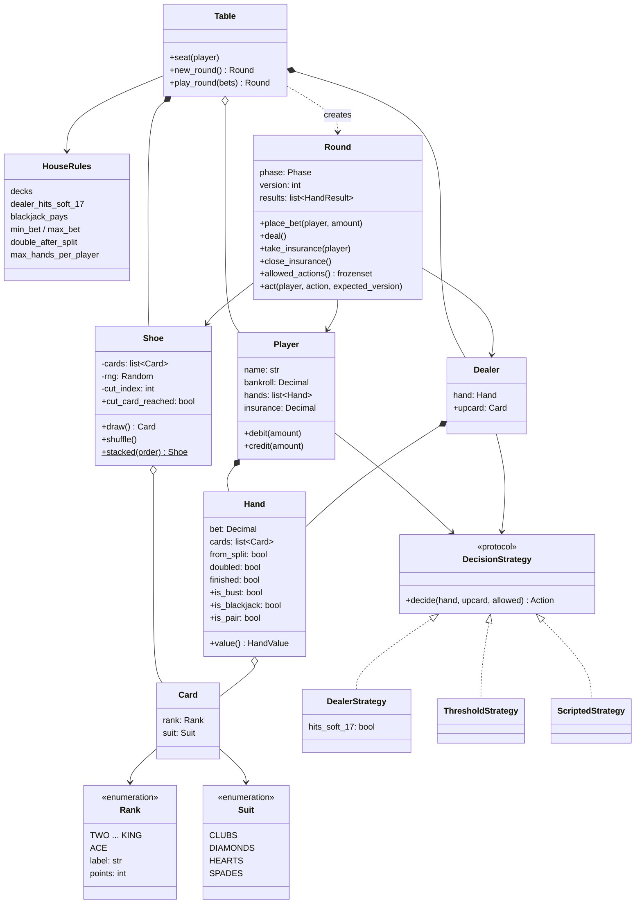
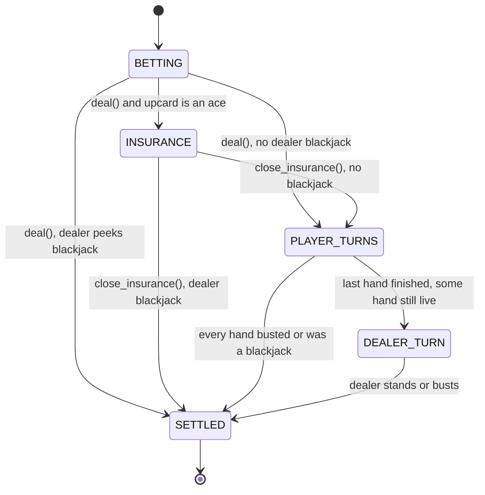

# Design a Blackjack Game: Aces, Strategies and a Round That Can't Be Cheated

Blackjack looks like a toy problem: deal some cards, add them up, compare with the dealer. But the moment you write it down you hit real design questions. How do you count an ace that is worth 1 *or* 11? Is the dealer "a kind of player", or something else? How do you stop a player from hitting after they've stood, or a double-click from drawing two cards? And how do you leave room for split, double down and insurance without rewriting everything?

By the end of this post you will be able to design blackjack from a blank whiteboard, defend each choice against at least one serious alternative, write a deterministic test for any card sequence, and talk about how real casinos and regulated online operators actually run the game.

All code is Python 3.13, standard library only, and runs as-is:

- [`blackjack.py`](blackjack.py) is the recommended design, with a demo.
- [`alternatives.py`](alternatives.py) holds runnable versions of the competing designs.
- [`test_blackjack.py`](test_blackjack.py) has 44 `unittest` tests. Run them with `python3 -m unittest discover -s 08-blackjack -v` from the `02-case-studies` folder.

---

## 1. The real-world system

Picture a blackjack table on a casino floor. Up to seven players sit in a half-circle. Each one has chips. A dealer stands on the other side with a **shoe**, a plastic box holding several shuffled decks (six or eight is common on the Las Vegas Strip). The felt has the house rules printed on it, for example "Blackjack pays 3 to 2" and "Dealer must stand on all 17s".

A **round** goes like this:

1. Each player puts a bet in their betting circle.
2. The dealer deals one card face-up to each player, one to themselves face-up (the **upcard**), then a second card to each player and a second card to themselves face-down (the **hole card**).
3. If the dealer's upcard is an ace, players may buy **insurance**, a side bet that the dealer has blackjack.
4. If the upcard is an ace or a ten-value card, the dealer **peeks** at the hole card. If it makes blackjack, the round ends right away.
5. Players act one at a time, left to right. They can **hit** (take a card), **stand** (stop), **double down** (double the bet, take exactly one card) or **split** a pair into two hands.
6. The dealer reveals the hole card and plays by a fixed rule: draw until reaching 17 or more.
7. Each player hand is compared with the dealer's. Wins pay 1:1, a natural blackjack (ace plus ten-value card as the first two cards) pays 3:2, ties are a **push** (the bet is returned), and a player who goes over 21 (**busts**) loses even if the dealer busts afterwards. That last rule is where the house edge comes from.

The cast of actors is small (players, dealer, the "house" that owns the money), but there are a lot of *rules*, and the rules vary from table to table. That makes blackjack a great object-oriented design (OOD) problem. It tests:

- **Modelling a domain with enums and value objects**: cards, ranks, suits.
- **Encapsulating a tricky calculation**: the ace.
- **Choosing between inheritance and composition**: is a dealer a player?
- **Modelling a process with states**: a round has phases and only some actions are legal in each.
- **Designing for change**: split, double, insurance, surrender, side bets, 6:5 tables.

It is also a real product. Casinos run electronic blackjack tables, and online operators run blackjack for millions of players under strict regulation. Those systems care about the same things we will: correct rules, provably fair shuffling and a server that cannot be tricked by a client.

---

## 2. Clarifying requirements

In an interview, the prompt is usually one sentence: "Design a blackjack game." Your first job is to turn that into a list you can build against. Ask questions that change the design, not trivia.

**Questions worth asking, and the answers we'll assume:**

| Question | Why it matters | Our answer |
|---|---|---|
| One player or several against the dealer? | Turn order, collections of players | Several |
| Is the dealer automated? | Whether dealer decisions are code | Yes, it follows a fixed rule |
| Hit/stand only, or also split, double, insurance? | Size of the state machine | Hit/stand core; we will also build double, split and insurance to show how the design absorbs them |
| Does the dealer hit a soft 17? | This is a table setting, not a constant | Configurable (S17 default) |
| What does blackjack pay? | Money math | 3:2 by default, configurable (6:5 tables exist) |
| How many decks? When do we shuffle? | Shoe and cut card | Multi-deck shoe, reshuffle when the cut card comes out |
| Is there betting with real balances? | Money type, validation | Yes; balances, table min/max |
| Human players through a UI, or bots? | Where decisions come from | Both should be possible |
| Single process or a server with remote clients? | Validation, concurrency | Design for a server: the game must reject illegal commands |

### Functional requirements

1. A table seats several players and one dealer.
2. Players place a bet within the table minimum and maximum before cards are dealt; the bet is taken from their balance.
3. Each player and the dealer get two cards; the dealer's first card is visible.
4. Aces count as 1 or 11, whichever is best for the hand without going over 21.
5. On their turn a player may hit or stand; they may also double down on two cards and split a pair.
6. When the upcard is an ace, players may take insurance; the dealer peeks for blackjack with an ace or ten showing.
7. After all players finish, the dealer draws until reaching at least 17, with a house rule for soft 17.
8. Each hand is settled: blackjack 3:2 (configurable), win 1:1, push returns the stake, loss or bust loses the stake.
9. The shoe holds several decks and is reshuffled between rounds once the cut card is reached.

### Non-functional requirements

- **Correctness and fairness**: no illegal state is reachable; money is never created or lost by rounding errors (use `Decimal`).
- **Testability**: any card sequence can be reproduced exactly.
- **Extensibility**: house rules and new player actions should not require rewriting the core flow.
- **Server-authoritative**: the game logic validates every command; a client is just a view.

### Out of scope

Graphics, persistence, user accounts, side bets (Perfect Pairs, 21+3), surrender (we discuss it as an extension), and card counting detection.

---

## 3. Finding the core objects

A reliable trick for the first pass is **noun/verb analysis**: underline the nouns in the requirements (candidate classes or attributes) and the verbs (candidate methods).

**Nouns**: table, player, dealer, card, rank, suit, deck, shoe, cut card, hand, bet, balance, round, turn, upcard, hole card, insurance, house rules, payout, outcome.

**Verbs**: place bet, deal, hit, stand, double, split, take insurance, peek, draw, shuffle, compare, settle, pay.

Now decide what each noun becomes:

| Noun | Becomes | Reasoning |
|---|---|---|
| Suit, Rank | `Enum` | A fixed, known set of values. An enum is type-safe (you can't make a rank of "11"), and each rank can carry its point value. |
| Card | Immutable `dataclass` | A **value object**: two "ace of spades" cards are interchangeable, and a card never changes. |
| Deck, Shoe, cut card | One `Shoe` class | A deck is just a shoe with one deck. The cut card is not an object, it is a position (an integer) inside the shoe. |
| Hand | `Hand` class | Owns cards *and* the logic for their value. Also carries the bet, because after a split one player has two hands with two separate bets. |
| Player | `Player` class | Identity, bankroll (balance) and a way of making decisions. |
| Dealer | `Dealer` class | Has a hand and a rule but no money. This difference drives one of our big decisions. |
| Bet | An attribute (`Decimal`) on `Hand` | It has no behaviour of its own. |
| Balance | An attribute on `Player` | Same. |
| Round | `Round` class | A process with phases. It is the heart of the design. |
| Turn | Cursor inside `Round` | "Whose turn" is a pointer, not an object. |
| Upcard, hole card | Properties | Just `hand.cards[0]` and `hand.cards[1]`. |
| House rules | Frozen `dataclass` | Configuration: S17/H17, payout ratio, number of decks, limits. |
| Outcome | `Enum` | BLACKJACK, WIN, PUSH, LOSS. Payout amounts become a lookup. |
| Table | `Table` class | Owns the long-lived objects (seats, shoe, rules) and starts rounds. |
| Insurance | Attribute on `Player` + methods on `Round` | A side bet with no behaviour beyond "pays 2:1 if the dealer has blackjack". |

The verbs then land on the class that owns the data they change. "Hit" changes a hand and draws from the shoe, and it must be validated against whose turn it is, so it belongs to `Round`. "Shuffle" and "draw" belong to `Shoe`. "Compute value" belongs to `Hand`. "Decide whether to hit" belongs to whoever is deciding, which leads us to a **strategy** object.

Notice two separations here that beginners often merge:

- **Deciding vs. doing.** A player *decides* to hit; the round *performs* the hit. Keeping them apart means a bot, a web UI and the dealer's fixed rule can all plug into the same flow.
- **Table vs. round.** The table lives all night; a round lives for one deal. Splitting them keeps per-round state (whose turn, current phase) from leaking into the next round.

---

## 4. Class design



A quick refresher on the arrows. **Composition** (filled diamond, `*--`) means the part's life is bound to the whole: a table's shoe has no meaning without the table. **Aggregation** (hollow diamond, `o--`) means the whole holds parts that can exist on their own: players exist before they sit down. **Association** (plain arrow) means "uses or knows about". **Realization** (dotted triangle) means "implements an interface".

What each class is responsible for:

- **`Suit`, `Rank`, `Card`.** Pure data. `Rank` stores its *hard* point value with ace as 1. The "or 11" part is not a property of the card; it depends on the whole hand, so it belongs to `Hand`.
- **`Shoe`.** Holds a shuffled list of cards, hands them out one at a time and knows where the cut card is. Its random number generator (RNG) is passed in, a technique called **dependency injection**: instead of the class reaching out for a global resource, the caller hands it in. That one decision makes the whole game testable.
- **`Hand`.** Cards, the bet riding on them, a few flags (was this hand created by a split? was it doubled? is it finished?), and the value calculation. A player has a *list* of hands because splitting creates more.
- **`DecisionStrategy`.** A `typing.Protocol`: anything with a `decide(hand, upcard, allowed)` method. The dealer's rule, a bot, a test script or a web UI adapter can all satisfy it.
- **`Player` and `Dealer`.** Two separate classes that both *have* a strategy (composition). Neither inherits from the other. The dealer has no bankroll, so it doesn't have to pretend to place bets.
- **`HouseRules`.** All the knobs printed on the felt, frozen so they cannot change mid-round.
- **`Round`.** An explicit **state machine**: a model where the object is always in exactly one of a fixed set of states (here called phases), and each command is only valid in certain states and moves it to a defined next state. `Round` validates every command, mutates hands and bankrolls, and records an event log.
- **`Table`.** Seats players, owns the shoe between rounds, reshuffles at the cut card and offers `play_round`, which drives a round using each player's strategy.

---

## 5. Code: the recommended solution

We'll walk through `blackjack.py` from the bottom up. The full file is about 750 lines including the demo.

### Cards: enums that carry data

```python
class Rank(Enum):
    """Each rank carries its label and its *hard* point value (ace = 1)."""

    TWO = ("2", 2)
    THREE = ("3", 3)
    FOUR = ("4", 4)
    FIVE = ("5", 5)
    SIX = ("6", 6)
    SEVEN = ("7", 7)
    EIGHT = ("8", 8)
    NINE = ("9", 9)
    TEN = ("10", 10)
    JACK = ("J", 10)
    QUEEN = ("Q", 10)
    KING = ("K", 10)
    ACE = ("A", 1)

    def __init__(self, label: str, points: int) -> None:
        self.label = label
        self.points = points
```

Each member's value is a tuple; Python passes the tuple to `__init__`, so every rank gets `label` and `points` attributes. Jack, queen and king all have 10 points but stay distinct ranks. That matters for splitting (most tables let you split two jacks, some let you split a jack and a king; our rule uses the stricter "same rank").

`Card` is a frozen dataclass, so it is immutable and hashable:

```python
@dataclass(frozen=True)
class Card:
    rank: Rank
    suit: Suit

    def __str__(self) -> str:
        return f"{self.rank.label}{self.suit.value}"
```

### The shoe: injectable randomness and a cut card

```python
    def __init__(
        self,
        decks: int = 6,
        penetration: float = 0.75,
        rng: random.Random | None = None,
    ) -> None:
        if decks < 1:
            raise ValueError("a shoe needs at least one deck")
        if not 0 < penetration <= 1:
            raise ValueError("penetration must be in (0, 1]")
        self._decks = decks
        self._penetration = penetration
        # Production code would pass a certified generator (e.g. SystemRandom
        # or a hardware RNG); tests pass random.Random(seed).
        self._rng = rng if rng is not None else random.SystemRandom()
        self._cards: list[Card] = []
        self._cut_index = 0
        self.dealt = 0
        self.shuffle()
```

**Penetration** is the casino term for how deep into the shoe the cut card sits. At 0.75, three quarters of the cards are dealt before a reshuffle. The default RNG is `random.SystemRandom`, which reads from the operating system's cryptographically secure source. Tests pass `random.Random(42)`, which produces the same "random" sequence every time.

For tests that need an *exact* sequence ("the player gets an 8 and an 8, the dealer shows a 6"), there is a stacked shoe:

```python
    @classmethod
    def stacked(cls, order: Sequence[Card]) -> Shoe:
        """A shoe that deals exactly ``order`` (first element first). For tests."""
        shoe = cls.__new__(cls)
        shoe._decks = 0
        shoe._penetration = 1.0
        shoe._rng = random.Random(0)
        shoe._cards = list(reversed(order))  # pop() from the end is O(1)
        shoe._cut_index = len(order)
        shoe.dealt = 0
        return shoe
```

Together with a small helper, `cards("8", "6", "8", "10")`, any scenario can be written in one line. This is the single most useful idea for testing card games.

### Hand value: one pass, soft or hard

The ace is the famous trap. Here is the whole insight: **at most one ace in a hand can ever count as 11**, because two of them would already be 22. So count every ace as 1, and if the hand contains an ace and adding 10 doesn't bust, count one ace as 11. A total that uses an ace as 11 is called **soft** (it can't bust on the next card, since the ace can drop back to 1). Every other total is **hard**.

```python
    def value(self) -> HandValue:
        hard = sum(card.rank.points for card in self.cards)
        has_ace = any(card.rank is Rank.ACE for card in self.cards)
        # At most one ace can ever count as 11 (two would already be 22).
        if has_ace and hard + 10 <= 21:
            return HandValue(hard + 10, soft=True)
        return HandValue(hard, soft=False)
```

It returns a `HandValue(total, soft)` rather than a bare `int`, because the soft flag matters to the dealer's soft-17 rule and to any real player strategy (you play soft 18 very differently from hard 18).

The other hand predicates are short, and one of them hides a rule people forget:

```python
    @property
    def is_blackjack(self) -> bool:
        # 21 on a split hand is just 21, not a natural blackjack.
        return len(self.cards) == 2 and self.total == 21 and not self.from_split
```

### Decisions as strategies

The **Strategy pattern** puts each interchangeable algorithm behind a common interface so the code that uses it doesn't care which one it got. Our interface is a `Protocol`, Python's way of saying "anything with this method shape fits", with no inheritance required:

```python
class DecisionStrategy(Protocol):
    """Anything that can pick an action for a hand: a bot, a UI, the dealer."""

    def decide(
        self, hand: Hand, dealer_upcard: Card, allowed: frozenset[Action]
    ) -> Action: ...
```

The `allowed` argument is important. The *round* decides what is legal (you can't double on three cards); the *strategy* only picks from the legal set. A UI would grey out the buttons not in `allowed`.

The dealer's "draw to 17" rule is simply one implementation, with the soft-17 house rule as a constructor argument:

```python
class DealerStrategy:
    """The house rule: draw to 17. Optionally also hit a soft 17 (H17)."""

    def __init__(self, hits_soft_17: bool = False) -> None:
        self.hits_soft_17 = hits_soft_17

    def decide(
        self, hand: Hand, dealer_upcard: Card, allowed: frozenset[Action]
    ) -> Action:
        value = hand.value()
        if value.total < 17:
            return Action.HIT
        if value.total == 17 and value.soft and self.hits_soft_17:
            return Action.HIT
        return Action.STAND
```

### Player and dealer: composition

```python
@dataclass(eq=False)
class Player:
    """A seat at the table: identity, money and a way of deciding."""

    name: str
    bankroll: Decimal
    strategy: DecisionStrategy
    takes_insurance: bool = False
    hands: list[Hand] = field(default_factory=list)
    insurance: Decimal = Decimal("0")
```

```python
@dataclass(eq=False)
class Dealer:
    """The house. It has a hand and a rule, but no bankroll and no bets."""

    strategy: DecisionStrategy
    hand: Hand = field(default_factory=Hand)
```

`eq=False` keeps identity-based equality: two players who happen to share a name and balance are still different seats. Money is `Decimal`, never `float`, because `0.1 + 0.2 != 0.3` in binary floating point and a casino ledger must balance to the cent.

### The round as a state machine

The round moves through five phases:



The transitions are data, so they are easy to read and to check:

```python
TRANSITIONS: dict[Phase, frozenset[Phase]] = {
    Phase.BETTING: frozenset({Phase.INSURANCE, Phase.PLAYER_TURNS, Phase.SETTLED}),
    Phase.INSURANCE: frozenset({Phase.PLAYER_TURNS, Phase.SETTLED}),
    Phase.PLAYER_TURNS: frozenset({Phase.DEALER_TURN, Phase.SETTLED}),
    Phase.DEALER_TURN: frozenset({Phase.SETTLED}),
    Phase.SETTLED: frozenset(),
}
```

```python
    def _require(self, phase: Phase) -> None:
        if self.phase is not phase:
            raise InvalidPhase(f"expected {phase.name}, round is in {self.phase.name}")

    def _move_to(self, phase: Phase) -> None:
        if phase not in TRANSITIONS[self.phase]:
            raise InvalidPhase(f"cannot go from {self.phase.name} to {phase.name}")
        self._log(f"phase {self.phase.name} -> {phase.name}")
        self.phase = phase
```

Every public method starts with `_require(...)`. Every state change goes through `_move_to(...)`, which refuses any transition not in the table. Two layers of protection: commands can't run in the wrong phase, and even a bug in our own code can't jump from BETTING straight to DEALER_TURN.

Dealing follows the casino order (everyone once, dealer last, twice), then branches to insurance or the peek:

```python
    def deal(self) -> None:
        with self._lock:
            self._require(Phase.BETTING)
            seated = [p for p in self.players if p.hands]
            if not seated:
                raise IllegalAction("nobody has placed a bet")
            self.players = seated  # players who sat out do not get cards
            for _ in range(2):  # one card each, dealer last, twice
                for player in self.players:
                    self._deal_to(player.hands[0])
                self._deal_to(self.dealer.hand)
            self._log(f"dealer shows {self.dealer.upcard}")
            if self.rules.offer_insurance and self.dealer.upcard.rank is Rank.ACE:
                self._move_to(Phase.INSURANCE)
            else:
                self._peek_then_play()
```

### Player commands: validate, then act

This is the method a server would call when a client sends "HIT":

```python
    def act(
        self, player: Player, action: Action, expected_version: int | None = None
    ) -> None:
        with self._lock:
            if expected_version is not None and expected_version != self.version:
                raise StaleCommand(
                    f"command built for v{expected_version}, round is at v{self.version}"
                )
            self._require(Phase.PLAYER_TURNS)
            current_player, hand = self.current  # type: ignore[misc]
            if player is not current_player:
                raise NotYourTurn(f"it is {current_player.name}'s turn")
            if action not in self.allowed_actions():
                raise IllegalAction(f"{action.name} is not allowed on {hand}")
            handler = {
                Action.HIT: self._hit,
                Action.STAND: self._stand,
                Action.DOUBLE: self._double,
                Action.SPLIT: self._split,
            }[action]
            handler(player, hand)
            self._advance()
```

Four checks before anything changes: is the command stale, is it the right phase, is it this player's turn, is the action legal for this hand. Only then does a small handler run. The legality rules live in one place:

```python
    def allowed_actions(self) -> frozenset[Action]:
        turn = self.current
        if turn is None:
            return frozenset()
        player, hand = turn
        allowed = {Action.HIT, Action.STAND}
        can_afford = player.bankroll >= hand.bet
        if (
            len(hand.cards) == 2
            and can_afford
            and (not hand.from_split or self.rules.double_after_split)
        ):
            allowed.add(Action.DOUBLE)
        if (
            hand.is_pair
            and can_afford
            and len(player.hands) < self.rules.max_hands_per_player
        ):
            allowed.add(Action.SPLIT)
        return frozenset(allowed)
```

Splitting is the most involved handler. It moves one card to a new hand with an equal bet, deals one card to each, and applies the near-universal rule that split aces receive one card only:

```python
    def _split(self, player: Player, hand: Hand) -> None:
        player.debit(hand.bet)
        moved = hand.cards.pop()
        twin = Hand(bet=hand.bet, cards=[moved], from_split=True)
        hand.from_split = True
        index = player.hands.index(hand)
        player.hands.insert(index + 1, twin)
        self._deal_to(hand)
        self._deal_to(twin)
        split_aces = moved.rank is Rank.ACE
        for h in (hand, twin):
            # Split aces get one card each and no more: a near-universal rule.
            if split_aces or h.total == 21:
                h.finished = True
        self._log(f"{player.name} splits: {hand} and {twin}")
```

The turn cursor is just `(player index, hand index)`. After every command, `_advance` skips hands that are already finished, so split hands are naturally played one after another:

```python
    def _advance(self) -> None:
        """Move the turn cursor to the first unfinished hand, or end the turns."""
        p, h = self._turn
        while p < len(self.players):
            hands = self.players[p].hands
            while h < len(hands):
                hand = hands[h]
                if hand.is_blackjack or hand.total >= 21:
                    hand.finished = True
                if not hand.finished:
                    self._turn = (p, h)
                    return
                h += 1
            p, h = p + 1, 0
        self._finish_player_turns()
```

### Dealer turn and settlement

The dealer only plays if some player hand could still win or push against it. If everyone busted, real dealers just collect the chips:

```python
    def _play_dealer(self) -> None:
        hand = self.dealer.hand
        self._log(f"dealer reveals {hand}")
        allowed = frozenset({Action.HIT, Action.STAND})
        while not hand.is_bust:
            action = self.dealer.strategy.decide(hand, self.dealer.upcard, allowed)
            if action is not Action.HIT:
                break
            card = self._deal_to(hand)
            self._log(f"dealer draws {card}: {hand}")
        self._log(f"dealer finishes with {hand}")
```

Settlement is split into "what happened" and "what does it pay". The outcome function is ordered carefully, since order *is* the rules here:

```python
def decide_outcome(hand: Hand, dealer_hand: Hand) -> Outcome:
    if hand.is_bust:
        return Outcome.LOSS  # a busted player loses even if the dealer busts
    if hand.is_blackjack:
        return Outcome.PUSH if dealer_hand.is_blackjack else Outcome.BLACKJACK
    if dealer_hand.is_blackjack:
        return Outcome.LOSS
    if dealer_hand.is_bust or hand.total > dealer_hand.total:
        return Outcome.WIN
    if hand.total == dealer_hand.total:
        return Outcome.PUSH
    return Outcome.LOSS
```

```python
def payout_multipliers(rules: HouseRules) -> dict[Outcome, Decimal]:
    """Total returned per unit staked (stake included)."""
    return {
        Outcome.BLACKJACK: 1 + rules.blackjack_pays,
        Outcome.WIN: Decimal("2"),
        Outcome.PUSH: Decimal("1"),
        Outcome.LOSS: Decimal("0"),
    }
```

Because the stake is debited when the bet is placed (the chips leave your stack and sit in the circle), the payout is the *total returned*: 2.5x for a 3:2 blackjack, 2x for a win, 1x for a push, nothing for a loss. A $5 blackjack returns $12.50, a net win of $7.50. Amounts are rounded down to the cent, which mirrors how casinos round odd payouts in the house's favour.

### Running it

`python3 blackjack.py` plays a stacked round: Ana splits eights and doubles one hand, Ben has a blackjack, and the dealer busts on 16.

```
   Ana splits: [8♣ 3♥] = hard 11 and [8♠ 10♠] = hard 18
   Ana doubles to 20, draws 9♣: [8♣ 3♥ 9♣] = hard 20
   Ana stands on 18
   phase PLAYER_TURNS -> DEALER_TURN
   dealer reveals [6♥ 10♦] = hard 16
   dealer draws 7♦: [6♥ 10♦ 7♦] = hard 23
   ...
  Ana  [8♣ 3♥ 9♣] = hard 20         WIN       bet     20 net +20.00
  Ana  [8♠ 10♠] = hard 18           WIN       bet     10 net +10.00
  Ben  [A♦ K♣] = soft 21            BLACKJACK bet     10 net +15.00
```

---

## 6. Comparing approaches

Every decision above had a real alternative. Here are the five that matter most, with runnable code for each in `alternatives.py`.

### Decision 1: how to value a hand with aces

**Approach A: list of every possible total.** Treat each ace as a fork: the hand could be worth `t + 1` or `t + 11`. Keep a set of totals and let the caller pick the best one at or under 21.

```python
def values_multi_sum(hand: Sequence[Card]) -> list[int]:
    """Approach A: track every possible total (ace = 1 or 11), sorted.

    Faithful to the rules on paper, but the list grows with each ace and
    every caller must then pick the best total itself.
    """
    totals = {0}
    for card in hand:
        if card.rank is Rank.ACE:
            totals = {t + 1 for t in totals} | {t + 11 for t in totals}
        else:
            totals = {t + card.rank.points for t in totals}
    return sorted(totals)
```

**Approach B: single pass with a soft/hard flag** (shown in section 5).

**Approach C: ace is always 11** (or always 1). The classic first attempt:

```python
def value_ace_always_11(hand: Sequence[Card]) -> int:
    """Approach C (buggy on purpose): a hard-coded ace value of 11.

    A-A is 22 here and counts as a bust. Shown because it is the most common
    first attempt in interviews.
    """
    return sum(11 if c.rank is Rank.ACE else c.rank.points for c in hand)
```

The demo shows the difference clearly:

```
  A A 9      multi-sum [11, 21, 31]           soft/hard soft 21   always-11 31
  A A A A    multi-sum [4, 14, 24, 34, 44]    soft/hard soft 14   always-11 44
```

| | Multi-sum list | Soft/hard single pass | Ace always 11 |
|---|---|---|---|
| Correct | Yes | Yes | No (A-A busts) |
| Cost | Up to n+1 totals for n aces | O(cards), constant memory | O(cards) |
| API | Caller must pick the best total, every time | One `HandValue(total, soft)` | One int |
| Soft-17 rule | Must infer "soft" from whether two totals ≤ 21 exist | `soft` flag is right there | Impossible |
| When to choose | When you need every total, e.g. a teaching UI showing "7 or 17" | Almost always | Never |

**Recommendation: soft/hard single pass.** It is correct, simpler for callers and exposes exactly the extra fact the rules need. A test in `test_blackjack.py` checks both correct approaches agree on 3,000 random hands, which is a nice way to verify a clever optimisation against a "obviously correct" version. (If you want to show "7 / 17" in a UI, derive it: the other total of a soft hand is always `total - 10`.)

### Decision 2: modelling the player and the dealer

Both draw cards into a hand and decide when to stop. That similarity tempts you toward inheritance.

**Approach A: inheritance with a Template Method.** The **Template Method** pattern puts the fixed skeleton of an algorithm in a base class and leaves "hook" steps for subclasses to fill in.

```python
class TemplateParticipant(ABC):
    """Approach A: inheritance with a Template Method.

    ``play_turn`` fixes the skeleton (draw while the hook says so); subclasses
    fill in ``should_hit``. Every new behaviour needs a new subclass.
    """

    def __init__(self, name: str) -> None:
        self.name = name
        self.hand: list[Card] = []

    def play_turn(self, draw: Callable[[], Card]) -> int:
        while value_soft_hard(self.hand).total <= 21 and self.should_hit():
            self.hand.append(draw())
        return value_soft_hard(self.hand).total

    @abstractmethod
    def should_hit(self) -> bool: ...


class TemplateDealer(TemplateParticipant):
    def should_hit(self) -> bool:
        return value_soft_hard(self.hand).total < 17


class TemplateDealerH17(TemplateDealer):
    """A new house rule means a new subclass..."""

    def should_hit(self) -> bool:
        v = value_soft_hard(self.hand)
        return v.total < 17 or (v.total == 17 and v.soft)
```

It reads nicely at first. The trouble shows up as the system grows:

- **Class explosion.** S17 dealer, H17 dealer, cautious bot, basic-strategy bot, human-via-websocket, human-via-terminal... Each is a subclass, and combining two behaviours (a human who auto-stands when disconnected) needs yet another.
- **A dealer is not really a player.** If the base class is `Player` with `bet()`, `payout()` and `balance`, the dealer subclass has to implement them as no-ops or exceptions. That violates the **Liskov Substitution Principle** (LSP): a subclass should be usable anywhere its parent is, without surprises. A dealer that throws on `bet()` is a surprise.
- **Behaviour is fixed at construction.** You can't swap a player's decision logic at runtime without changing their type.

**Approach B: composition with a decision Strategy** (recommended, used in `blackjack.py`). The participant *has* a decision object instead of *being* a kind of decider:

```python
HitRule = Callable[[HandValue], bool]


def dealer_rule(hits_soft_17: bool) -> HitRule:
    return lambda v: v.total < 17 or (hits_soft_17 and v.total == 17 and v.soft)


def threshold_rule(stand_on: int) -> HitRule:
    return lambda v: v.total < stand_on


@dataclass
class ComposedParticipant:
    """Approach B (recommended): one class, behaviour plugged in as a strategy.

    The rule can be swapped at runtime (a human disconnects and an auto-stand
    bot takes over) without changing the participant's type.
    """

    name: str
    rule: HitRule
    hand: list[Card] = field(default_factory=list)

    def play_turn(self, draw: Callable[[], Card]) -> int:
        while (v := value_soft_hard(self.hand)).total <= 21 and self.rule(v):
            self.hand.append(draw())
        return value_soft_hard(self.hand).total
```

The alternatives file uses plain functions as strategies to show the idea at its lightest; `blackjack.py` uses a `Protocol` with classes because real strategies need configuration and the `allowed` set.

**Approach C: hard-code decisions in the game.** `if participant is dealer: while total < 17: hit()`. This is where many first designs start, and it is what the procedural loop in Decision 3 does. It works until anything varies.

| | Inheritance + Template Method | Composition + Strategy | Hard-coded in game |
|---|---|---|---|
| New dealer rule (H17) | New subclass | New constructor argument | Edit game code |
| New bot type | New subclass | New strategy class | Edit game code |
| Swap at runtime (disconnect → auto-play) | No | Yes, assign a new strategy | Flag checks everywhere |
| Dealer forced to have bets/balance? | Yes, if it shares a `Player` base | No | No |
| Lines of code for 2 behaviours | Slightly fewer | Slightly more | Fewest |
| When to choose | Behaviour truly fixed per type, small hierarchy | Behaviour varies by config or over time | Throwaway script |

**Recommendation: composition with a Strategy.** Treat "who sits here" (player or dealer, with or without money) and "how they decide" (bot, UI, house rule) as two independent axes. Inheritance welds them together; composition lets each vary on its own. This is the "favour composition over inheritance" principle from the Gang of Four book in its most concrete form. See [design patterns](../../01-foundations/02-design-patterns.md) for more on both patterns.

### Decision 3: the game flow

**Approach A: a procedural loop.** One function deals, loops over players, plays the dealer, and settles.

```python
    for name, hand in hands.items():
        while value_soft_hard(hand).total < stand_on:
            hand.append(shoe.draw())

    if any(value_soft_hard(h).total <= 21 for h in hands.values()):
        while dealer_rule(dealer_hits_soft_17)(value_soft_hard(dealer)):
            dealer.append(shoe.draw())
```

That excerpt is from `procedural_round` in `alternatives.py`. For hit/stand with bots it is short and correct (a test plays 60 seeded rounds and checks it produces exactly the same money as the state machine). But look at what it can't do:

- **It can't wait.** The loop *asks* each player for a decision and expects an immediate answer. A real human on a phone answers seconds later, through a network request. A loop has no place to pause and resume.
- **It can't refuse bad input.** There is no notion of "it's not your turn" or "the round is already settled", because the code never receives commands; it only issues them.
- **Every feature lands in the same body.** Double, split (which turns "one hand per player" into a list), insurance (a new pause point) and peek all thread through one growing function.

**Approach B: an explicit state machine** (recommended): the `Round` class with `Phase`, a transition table and command methods (section 5).

**Approach C: the State pattern**, a class per phase (`BettingState`, `PlayerTurnsState`...) each implementing every command, with the round delegating to its current state object. This is the GoF **State pattern**, and it is what the [vending machine](../04-vending-machine/README.md) post uses.

| | Procedural loop | Enum + transition table (`Round`) | State pattern (class per phase) |
|---|---|---|---|
| Pauses for remote/slow input | No | Yes: each command is a method call | Yes |
| Rejects out-of-turn commands | No | Yes, centrally | Yes, per state class |
| Shows the lifecycle at a glance | Only by reading the loop | Yes, one dict | Spread across classes |
| Cost of a new phase (e.g. SURRENDER) | Edit the loop | Add an enum member, a transition, a method | Add a class, touch every other state |
| Best when | Bots, simulations, one process | Moderate number of phases with phase-specific commands | Many states whose *same* commands behave very differently |

**Recommendation: enum plus transition table.** Blackjack's phases mostly accept *different* commands (bets in BETTING, hit/stand in PLAYER_TURNS), so a class per phase would be mostly "raise InvalidPhase" boilerplate. The State pattern earns its keep when the same command (say, "insert coin") means different things in each state. A useful compromise: keep the `Round` as is, and still use the procedural style for a *simulator* that plays millions of bot rounds, where nothing waits for input.

### Decision 4: betting and payouts

**Approach A: an if/else chain.**

```python
def payout_if_else(outcome: Outcome, bet: Decimal) -> Decimal:
    """Approach A: a conditional chain. Fine until the rules vary per table."""
    if outcome is Outcome.BLACKJACK:
        return bet + bet * Decimal("1.5")
    elif outcome is Outcome.WIN:
        return bet * 2
    elif outcome is Outcome.PUSH:
        return bet
    else:
        return Decimal("0")
```

**Approach B: outcome enum plus a payout table** (recommended). Outcome decision and payment are separate steps; the payment is data.

```python
PAYOUT_TABLE_3_TO_2: dict[Outcome, Decimal] = {
    Outcome.BLACKJACK: Decimal("2.5"),
    Outcome.WIN: Decimal("2"),
    Outcome.PUSH: Decimal("1"),
    Outcome.LOSS: Decimal("0"),
}
PAYOUT_TABLE_6_TO_5 = {**PAYOUT_TABLE_3_TO_2, Outcome.BLACKJACK: Decimal("2.2")}
```

**Approach C: polymorphic bet objects** (a `Bet` class per bet type with its own `settle()`), which pays off once you add side bets such as Perfect Pairs or 21+3 that each have their own pay tables.

| | if/else | Outcome + table | Bet class per bet type |
|---|---|---|---|
| 6:5 table | Edit code or add a parameter | New dict / `HouseRules(blackjack_pays=1.2)` | New config on the bet |
| Testable separately | Mixed with outcome logic | `decide_outcome` and payouts tested apart | Yes |
| Side bets | Grows a second chain | Each side bet needs its own table | Natural fit |
| When | Prototypes | Main game with configurable ratios | Many bet types |

**Recommendation: outcome + table** for the main bet, moving to bet objects only when side bets are in scope. The payout ratio is a business decision (it's one of the most visible rules on the felt), so it belongs in configuration, not in an `elif`.

Two money rules worth saying out loud in an interview: take the stake **when the bet is placed**, not at settlement (otherwise a player could spend the same money twice across hands or tables), and use **`Decimal` with explicit rounding** (3:2 on a $5 bet is $7.50; on $3 it is $4.50; operators decide how odd cents round and write it down).

### Decision 5: when to shuffle

This one comes from the real world rather than from the textbook.

```python
class ContinuousShuffler:
    """A continuous shuffling machine (CSM): used cards go straight back in.

    Each draw picks a random card from everything not on the table, so the
    composition barely changes between rounds and card counting stops working.
    """
```

| | Shuffle every round (1 deck) | Shoe with cut card | Continuous shuffler |
|---|---|---|---|
| Real-world use | Home games, some single-deck tables | Standard casino shoe games | Many casinos on lower-limit tables |
| Card counting | Little to count | Possible, which is why penetration matters | Defeated |
| Speed | Slow: shuffle constantly | Pauses at the cut card | Fastest: no shuffle breaks |
| Code shape | `start_round()` shuffles | `start_round()` checks the cut card | `end_round()` returns used cards |

In our design, all three are just different implementations of "something you can draw a card from". The `Round` only ever calls `shoe.draw()`, so you could introduce a `CardSource` protocol and swap them without touching the round. That is exactly what happened in casinos: the dealer's procedure for a hand did not change when the shufflers arrived; only the box the cards come out of changed.

---

## 7. Going deeper

### Concurrency: two clicks, one card

In a single-process game nothing runs at once. On a server, though, requests arrive on different threads. Imagine a player on a laggy connection taps "Hit" twice. Two requests arrive within milliseconds:

1. Both threads read "it's Ana's turn, HIT is allowed".
2. Both draw a card.
3. Ana gets two cards for one intended hit, and maybe busts.

This is a **race condition**: the result depends on the timing of operations that should have happened one after the other. Two fixes, both in `Round`:

**A lock** makes each command atomic. `threading.RLock` (a lock the same thread can re-acquire, which matters because `act` calls helpers that may log or settle) wraps every public command:

```python
    def act(
        self, player: Player, action: Action, expected_version: int | None = None
    ) -> None:
        with self._lock:
            if expected_version is not None and expected_version != self.version:
                raise StaleCommand(
```

**A version number** solves the *double-click* problem that a lock alone can't. With only a lock, the two hits run one after another, and both are legal, so Ana still gets two cards. The client therefore sends the version of the state it was looking at. The first command bumps the version; the second arrives with an old version and is rejected as stale. This is **optimistic concurrency control**, the same idea as an `ETag`/`If-Match` header in HTTP or a version column in a database row.

`test_concurrent_duplicate_commands_apply_once` fires eight threads at the same moment with the same version, and checks exactly one succeeds and the hand has exactly three cards.

Across *multiple server processes* an in-memory lock is no longer enough. The usual answer is to route every command for a given table to one owner (a single actor, partition or shard per table), so commands for one table are processed in order by one process, and to persist the event log before acknowledging.

### Extensibility: "the interviewer now asks..."

**"Add surrender."** (Give up after the first two cards, get half your bet back.) Add `Action.SURRENDER` and `Outcome.SURRENDER` with multiplier `0.5`; allow it in `allowed_actions` only when the hand has two cards and has not been split; the handler marks the hand finished and surrendered. Roughly fifteen lines, no change to the state machine or to the strategies' interface. The procedural loop would need a new branch in the player loop *and* in settlement.

**"Make the dealer hit soft 17."** `HouseRules(dealer_hits_soft_17=True)`. Zero code. The H17 test checks a dealer with A-6 draws a 4 to reach 21 and beats a player's 20, while the S17 dealer stands on 17 and loses.

**"Pay 6:5 instead of 3:2."** `HouseRules(blackjack_pays=Decimal("1.2"))`. Zero code.

**"Let a human play through a web page."** Write a strategy that doesn't decide at all. Instead, the web handler calls `round.act(player, action, expected_version)` directly when the request arrives, and the page renders `round.allowed_actions()` as buttons. `Table.play_round` is just a convenience driver for bots; the `Round` API is the real interface.

**"Add a basic-strategy bot."** Basic strategy is the mathematically optimal play for each (player total, soft/hard, dealer upcard) combination, usually printed as a chart. It is a `DecisionStrategy` with a lookup table. Notice it needs the soft flag and the upcard, which our `decide` signature already passes.

**"Support European no-hole-card rules."** In many European casinos the dealer takes the second card only after players act, and there is no peek. Make the deal order and the peek a rule (`HouseRules.dealer_peeks`), and move the dealer's second card into `_play_dealer`. The state machine stays the same; the transitions out of BETTING simply never go to SETTLED.

**Which design absorbs these best?** The pattern across all of them: rules that are *values* (ratios, thresholds, booleans) go in `HouseRules`; rules that are *behaviour* (how to decide) go in strategies; rules about *what is allowed when* go in `allowed_actions` and the transition table. Each change touches one of those three places. In the procedural design every one of them touches the same function, and in the inheritance design several of them add subclasses.

### From in-memory objects to a real service

To turn this into a multiplayer service:

- **Server-authoritative**: the server holds the `Round`; clients send commands and receive state. A client never computes "you won", because a modified client could claim anything. Clients render what the server says.
- **Hide what players shouldn't see**: the state sent to clients must not include the hole card or the order of the shoe. Only the server knows the future.
- **Event log**: `Round.events` is a toy version of an append-only log. Real systems persist each event (bet placed, card dealt, action taken, payout) so a round can be audited and replayed. Regulators require this kind of record keeping, and it is invaluable when a player disputes an outcome.
- **Wallet as a separate service**: debits and credits go to a wallet service with idempotency keys (each round/hand id is credited exactly once even if the message is retried). `Player.debit` becomes a call to that service.
- **Timeouts**: if a player doesn't act within N seconds, the server acts for them (usually "stand"). In our design that is just the server calling `act(player, Action.STAND)` from a timer.
- **Crash recovery**: if the server dies mid-round, it can rebuild the round by replaying the event log, which works because given the same cards, every transition is deterministic.

### Testing strategy

- **Stacked shoes** for every rule-level scenario: "8-8 against a 6, split, double the first hand." The test reads like the scenario.
- **Seeded RNG** for statistical and long-running tests: `Table(rng=random.Random(2024))` plays 300 rounds and checks every bankroll change equals the sum of reported hand results.
- **Differential testing**: two independent implementations (multi-sum vs soft/hard, procedural vs state machine) must agree. Cheap, and very good at catching subtle bugs.
- **Protocol tests**: wrong phase, wrong turn, illegal action, insufficient funds, stale version. These are the tests that keep a server safe.
- **Concurrency test**: a `threading.Barrier` releases eight threads at once so the race is actually exercised.

### Failure modes to design for

| Failure | Consequence | Defence in this design |
|---|---|---|
| Shoe runs out mid-round | Can't finish the hand | Reshuffle at the cut card *between* rounds; `ShoeEmpty` error if a misconfigured shoe still runs dry |
| Player can't cover a double or split | Negative balance | `allowed_actions` checks `can_afford`; `debit` raises `InsufficientFunds` |
| Command for a finished round | Corrupted payouts | Phase checks; SETTLED has no outgoing transitions |
| Duplicate request | Extra card or double payout | Version check plus lock |
| Predictable RNG | Players can predict cards | `SystemRandom` default; inject a certified generator in production |
| Rounding drift | Ledger doesn't balance | `Decimal` and explicit `ROUND_DOWN` |

---

## 8. How real systems do it

**Shoes and penetration.** Most casino blackjack is dealt from a six- or eight-deck shoe. After shuffling, a player cuts the cards and the dealer inserts a plastic cut card. When it comes out, the dealer finishes the round and then shuffles. How deep the cut card goes is a deliberate business choice: deeper penetration means fewer shuffle breaks (more hands per hour) but more information for card counters.

**Continuous shuffling machines.** Many casinos use automatic shufflers (Shuffle Master is the best-known brand). Some shuffle a second set of decks while the first is in play; continuous shufflers take discards back after every round, which keeps the game moving and makes counting pointless. In code terms, it's a different `CardSource`, nothing else.

**House rules as configuration.** Whether the dealer hits soft 17 (H17 tables are slightly worse for the player, by roughly two tenths of a percent of house edge), whether blackjack pays 3:2 or 6:5 (6:5 costs the player much more, over a full percent), double after split, resplitting aces, surrender: these differ from casino to casino and even table to table. Real table-game systems treat them as configuration, exactly like `HouseRules`.

**Electronic and live-dealer tables.** Electronic tables and "smart" shoes read each card as it's dealt, for analytics, error detection and anti-cheating. Live-dealer online blackjack (Evolution is the largest provider) streams a real dealer from a studio; cards are scanned as they come out of the shoe, and the game server, not the video, is the source of truth for every hand. Some live variants deal one shared starting hand to an unlimited number of players, each making their own decisions, which is only possible because each player's choices are separate state on the server.

**Regulated online RNG.** In regulated online markets (for example under the UK Gambling Commission, the Malta Gaming Authority or New Jersey's Division of Gaming Enforcement), the random number generator and the game logic must be tested and certified by an independent lab such as GLI, BMM Testlabs or eCOGRA before going live, and the certified build must be the one that runs. That is why our `Shoe` takes the RNG as a dependency: the production build injects the certified generator, tests inject a seeded one, and the game logic is identical in both. Two technical notes worth knowing:

- Python's `random.Random` is a Mersenne Twister. It's great for simulations but not cryptographically secure: observe enough output and you can predict the rest. Use `random.SystemRandom` or the `secrets` module for anything with money on it.
- A famous late-1990s case showed why the *seed* matters too: an online poker site's shuffle was seeded from the system clock, which left so few possible decks that researchers could work out the whole deck from the cards they could see. A good shuffle algorithm (Python's `random.shuffle` is a Fisher-Yates shuffle) is useless if the randomness feeding it is guessable.

**Server-authoritative design.** Every serious online card game treats the client as a display. The server decides the cards, validates the actions and calculates payouts, and the money moves through a separate wallet system with its own audit trail. Our `Round` is that server-side core in miniature.

---

## 9. Interview playbook

A 45-minute plan:

| Minutes | What to do |
|---|---|
| 0-5 | Clarify: multiplayer? dealer rule? which actions (hit/stand only, or split/double)? betting and payout ratio? decks and shuffling? Write the requirement list. |
| 5-10 | Nouns and verbs. Name the core classes: Card/Rank/Suit, Shoe, Hand, Player, Dealer, Round (or Game), HouseRules. Say out loud which nouns are *not* classes (bet, upcard, turn). |
| 10-20 | Class diagram. Call out the two big decisions: ace handling lives in `Hand`; player/dealer use composition with a decision strategy. |
| 20-35 | Code the interesting parts: `Hand.value()`, the dealer strategy, the round's `act()` with validation, settlement. Mention the stacked shoe for testing. |
| 35-45 | Follow-ups: split/double/insurance, S17/H17, 6:5, concurrency, scaling to a server, fair RNG. |

**What to say** to signal seniority:

- "At most one ace can be 11, so I'll compute hard total plus a soft flag in one pass."
- "The dealer isn't a player: no money, no choices. I'll give both a decision strategy instead of a shared base class."
- "The round is a state machine; every command checks the phase and the turn, so a remote client can't break it."
- "I'll inject the RNG and support a stacked shoe, so every test is deterministic."
- "House rules are configuration. S17/H17 and 3:2/6:5 shouldn't need code changes."

**Common mistakes:**

- Ace fixed at 11 or 1; forgetting that A-A-9 is 21.
- Treating any 21 as blackjack (three-card 21 and split-hand 21 pay 1:1).
- Settling a busted player as a win when the dealer also busts.
- `float` for money.
- A `Dealer(Player)` subclass with `bet()` methods that throw.
- A giant `Game` class that does dealing, decisions, validation and payouts, with no notion of phases.
- `random.shuffle` called on a global RNG, making tests flaky.

**Follow-ups interviewers like:** "How would you add split?" (hands become a list; turn cursor indexes hands). "What if the dealer hits soft 17?" (config). "How do you test a dealer bust?" (stacked shoe). "Two players click at once?" (lock + version). "How do you make it fair?" (certified RNG, server-authoritative, audit log). "How would you run a million simulated hands?" (bot strategies, seeded RNG, no I/O, perhaps the procedural runner).

---

## 10. Test yourself

<details>
<summary>1. Why can at most one ace in a hand count as 11, and how does that simplify the value calculation?</summary>

Two aces at 11 would already be 22, a bust. So the only question is whether *one* ace can be 11: count every ace as 1 and, if there is an ace and the total plus 10 is at most 21, add 10 and mark the hand soft. That is a single pass with constant memory instead of tracking a growing list of possible totals.
</details>

<details>
<summary>2. A player has A-6 and the dealer stands on soft 17. Another table's dealer hits soft 17. What changes in the code?</summary>

Nothing in the code. The rule is `HouseRules(dealer_hits_soft_17=True)`, which the `Table` passes into `DealerStrategy(hits_soft_17=True)`. The strategy hits on a total of 17 when the hand is soft. This is why `Hand.value()` returns a soft flag, not just an int.
</details>

<details>
<summary>3. What's wrong with `class Dealer(Player)` when `Player` has `bet()`, `payout()` and `balance`?</summary>

The dealer doesn't bet and has no balance, so those methods become no-ops or raise exceptions. Code that works with any `Player` (for example "collect bets from everyone") then behaves differently or fails for the dealer, which breaks the Liskov Substitution Principle. Composition avoids it: player and dealer are separate classes that each *have* a decision strategy.
</details>

<details>
<summary>4. Ana splits two aces and gets a king on the first one. Is that a blackjack? How does the code know?</summary>

No. It's 21, paid 1:1. A natural blackjack must be the first two cards of an unsplit hand. `Hand.is_blackjack` checks `not self.from_split`, and `_split` sets `from_split = True` on both resulting hands. Split aces also receive only one card each, so both hands are marked finished.
</details>

<details>
<summary>5. Why does `act()` need both a lock and an `expected_version`?</summary>

The lock stops two threads from interleaving inside one command (both reading "Ana's turn" before either draws). But with only a lock, two duplicate "hit" requests would just run one after the other, and both are legal, so Ana would get two cards. The version lets the server tell that the second command was built from a state that no longer exists and reject it as stale.
</details>

<details>
<summary>6. The interviewer asks you to add surrender. Where does the change go in the state-machine design, and what would change in a procedural loop?</summary>

Add `Action.SURRENDER` and an outcome that returns half the stake; allow it in `allowed_actions` only for an unsplit two-card hand; add a handler that marks the hand finished and surrendered; add its payout multiplier. The phases and the strategy interface don't change. In a procedural loop you'd need a new branch inside the player loop, plus a special case in the settlement code, plus some way to ask for the decision at the right moment.
</details>

<details>
<summary>7. How do you write a deterministic test for "dealer shows 6, has 16, draws a 7 and busts"?</summary>

Use a stacked shoe in deal order: player card 1, dealer upcard, player card 2, dealer hole card, then the draws. For one player standing on 18: `Shoe.stacked(cards("10", "6", "8", "10", "7"))`. The dealer reveals 16, draws the 7, busts, and the test asserts the outcome is WIN. A seeded `random.Random` also works, but stacking makes the scenario readable.
</details>

<details>
<summary>8. Why is `random.Random(seed)` fine in tests but not in a real-money online casino?</summary>

It's a Mersenne Twister, which is fast and statistically good but predictable: with enough observed output an attacker can reconstruct its state and predict future cards. Real-money games need a cryptographically secure or hardware generator, certified by an independent test lab. Because `Shoe` takes the RNG as a constructor argument, production can inject the certified generator while tests use a seed.
</details>

<details>
<summary>9. A player busts and then the dealer busts too. Who wins, and why does it matter for the design?</summary>

The player loses. The player acts first and their bet is lost the moment they bust; that ordering is the main source of the house edge. In the design, `decide_outcome` checks `hand.is_bust` before anything about the dealer, and `_finish_player_turns` skips the dealer's turn entirely when no live hands remain.
</details>

<details>
<summary>10. A casino switches a table to a continuous shuffling machine. Which classes change?</summary>

Only the card source. The round only calls `draw()`; a CSM implementation returns used cards to its pool at the end of each round instead of using a cut card. Introducing a small `CardSource` protocol (`draw()`, plus round start/end hooks) lets the `Table` hold either a cut-card shoe or a CSM without the `Round` noticing.
</details>

---

## 11. Key takeaways

- **The ace is a hand-level concern.** Count aces as 1, upgrade one to 11 if it fits, and return a soft flag alongside the total.
- **Separate deciding from doing.** Strategies decide; the round validates and performs. The dealer's "draw to 17" is just one strategy, configured by house rules.
- **Prefer composition over inheritance for player vs dealer.** They share a hand and a decision interface, not an identity, and the dealer has no money.
- **Model the round as an explicit state machine.** Phase checks plus a transition table make illegal states unreachable and let a server accept commands from remote clients safely.
- **Rules are data where possible.** S17/H17, 3:2 vs 6:5, limits and split rules belong in a frozen `HouseRules`.
- **Inject randomness.** Seeded RNGs and stacked shoes make every scenario testable; in production the same seam holds a certified generator.
- **Money is `Decimal`, debited at bet time, settled once, and audited.**

---

## 12. Further reading

- Gamma, Helm, Johnson, Vlissides, *Design Patterns: Elements of Reusable Object-Oriented Software* (1994): Strategy, Template Method and State.
- Refactoring Guru: [Strategy](https://refactoring.guru/design-patterns/strategy), [Template Method](https://refactoring.guru/design-patterns/template-method), [State](https://refactoring.guru/design-patterns/state).
- Python docs: [`random`](https://docs.python.org/3/library/random.html) (see the warning about security), [`secrets`](https://docs.python.org/3/library/secrets.html), [`decimal`](https://docs.python.org/3/library/decimal.html), [`typing.Protocol`](https://docs.python.org/3/library/typing.html#typing.Protocol), [`enum`](https://docs.python.org/3/library/enum.html).
- Edward O. Thorp, *Beat the Dealer* (1962): the book that introduced card counting and showed blackjack could be analysed mathematically.
- Wizard of Odds, [Blackjack](https://wizardofodds.com/games/blackjack/): rule variations and their effect on house edge.
- Related posts in this series: [OOP fundamentals](../../01-foundations/01-oop-fundamentals.md), [design patterns](../../01-foundations/02-design-patterns.md), [tic-tac-toe](../07-tic-tac-toe/README.md) (another turn-based game), [vending machine](../04-vending-machine/README.md) (the State pattern in depth), [parking lot](../01-parking-lot/README.md) (Strategy for pricing).
