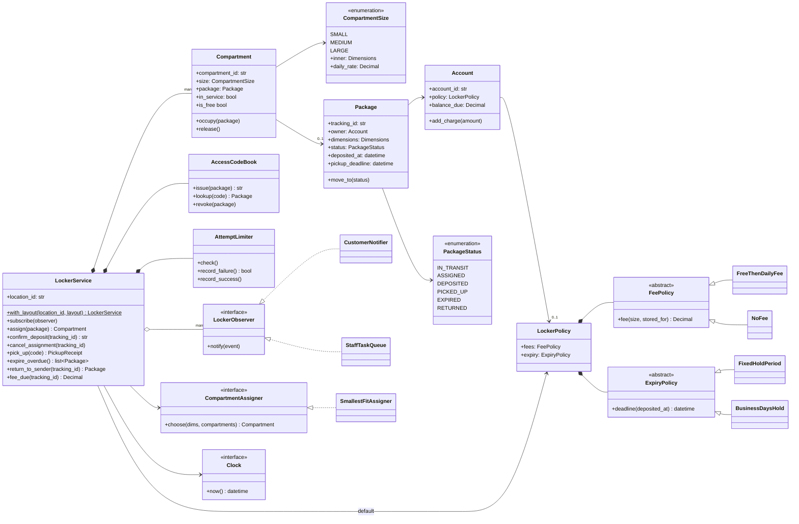
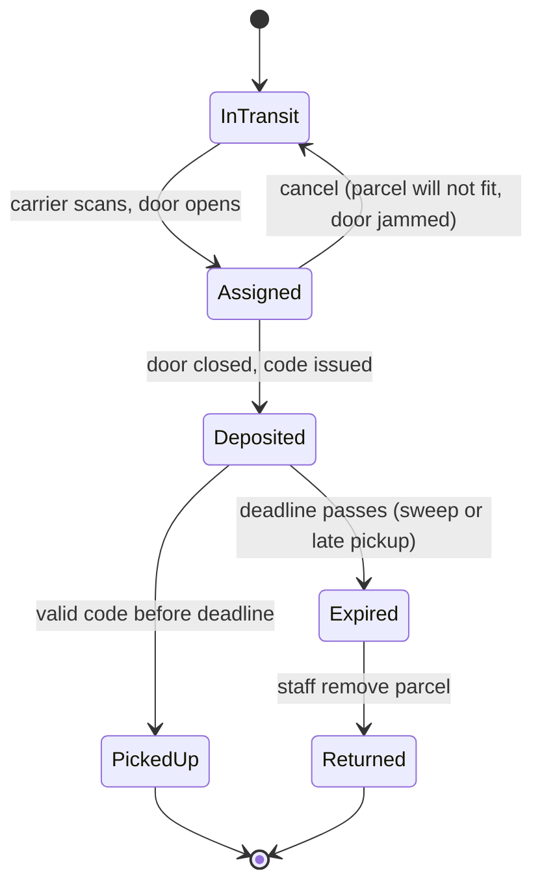

# Design a Shipping Locker System: compartments, codes and a package lifecycle that runs on a clock

A shipping locker is the wall of metal doors in a supermarket or train station where your online order waits for you. It looks simple: a box goes in, you type a code, the door pops open. Underneath, it is a compact object-oriented design problem with a real state machine, a security problem, money, time-based rules and two very different kinds of users.

By the end of this post you will be able to design one from scratch in an interview, explain why each class exists, compare the main alternatives for every important decision (with working Python code for each), and discuss what production systems like Amazon Hub Locker or UPS Access Point lockers add on top.

All the code is in this folder and runs on plain Python 3.13:

- [`shipping_locker.py`](shipping_locker.py) - the recommended design, with a demo (`python3 shipping_locker.py`)
- [`alternatives.py`](alternatives.py) - the competing designs we compare (`python3 alternatives.py`)
- [`test_shipping_locker.py`](test_shipping_locker.py) - 45 `unittest` tests (`python3 -m unittest discover -s .`)

If terms like *class*, *composition* or *interface* are new, skim [OOP fundamentals](../../01-foundations/01-oop-fundamentals.md) first. The patterns we use (Strategy, Observer, State, Factory, Facade) are introduced in [Design patterns](../../01-foundations/02-design-patterns.md), but each one is explained here when it appears.

---

## 1. The real-world system

Self-service parcel lockers exist because the "last mile" of delivery is the most expensive part. A driver who drops 40 parcels into one locker bank makes one stop instead of 40, and nobody's package is left on a porch to be stolen. Amazon Hub Locker, UPS Access Point lockers, InPost's Paczkomat network in Poland, and lockers run by national postal services all follow the same basic shape.

**The physical thing.** A *locker bank* (sometimes called a *site* or *location*) is a set of *compartments*: individual doors, each with an electronic latch and usually a sensor that knows whether the door is closed. Compartments come in a handful of fixed sizes, because the bank is manufactured as modules. There is a control unit with a touchscreen or keypad, sometimes a barcode scanner, and a network connection back to the operator's cloud.

**The actors.**

| Actor | What they do at the locker |
| --- | --- |
| **Carrier / driver** | Scans a parcel, gets a door opened for it, puts the parcel in, closes the door. |
| **Customer** | Receives a message with a pickup code, types it at the keypad (or scans a QR code in an app), takes the parcel. |
| **Site associate / staff** | Removes parcels that were never collected, clears jammed doors, marks broken doors out of service. |
| **The cloud backend** | Decides which locker a parcel goes to, sends notifications, bills fees, triggers return shipments. |

**The two flows.** Notice that the carrier and the customer never interact. The carrier flow ends when a door closes on a parcel; the customer flow starts when a code arrives on a phone. Everything in between (picking a door, creating a code, sending the message, starting a countdown) is the system's job.

**Why it is a good OOD problem.** It is small enough to finish in 45 minutes, but it has:

- a *resource allocation* question (which door?), like a parking lot,
- a *lifecycle* with legal and illegal moves (a parcel cannot be picked up twice, or picked up after being sent back),
- *time-based rules* (free period, daily fees, expiry), which forces you to think about testability,
- a *security* question (a six-digit code is a password that opens a door with someone else's property behind it),
- *side effects* (notifications, staff tasks, returns) that should not tangle up the core logic.

---

## 2. Clarifying requirements

Interviewers usually start with one sentence: "Design a locker system like Amazon Locker." Your first job is to turn that into a list you can build against. Ask questions, but have a default answer ready for each one so the conversation keeps moving.

**Questions worth asking, with sensible answers:**

1. *Are we designing one locker location or the whole network?* One location's software, with an eye on how it would plug into a network. (Choosing which location a customer ships to happens at checkout, outside our scope.)
2. *Do compartments come in different sizes?* Yes, a small fixed set (small, medium, large). A parcel should go in the smallest size that fits so big doors stay available for big parcels.
3. *How does the customer open the door?* A unique code sent to them after the parcel is deposited. One code per parcel, single use.
4. *How long can a parcel stay?* There is a free period, then a daily fee depending on compartment size, and a maximum hold time after which staff remove the parcel and it goes back to the sender.
5. *Can these rules differ per customer?* Yes. Some customers (think of a membership programme) might get no fees or a longer hold.
6. *Do we take payments?* No, an external billing service collects money. We only work out what is owed.
7. *How are customers told?* Through a notification service (SMS, email, push). We call it, we do not build it.
8. *What happens if a carrier cannot get a parcel into the door it was given?* The assignment should be cancellable.
9. *Anything about security?* Codes must be hard to guess and the keypad must resist someone trying codes one after another.

**Functional requirements**

- Track all compartments of a locker location and their sizes.
- Assign an arriving parcel to a free compartment of the smallest size that fits it.
- Let the carrier confirm the deposit (or cancel it if the parcel will not go in).
- Generate a unique, hard-to-guess pickup code when a parcel is deposited and notify the customer.
- Open the right compartment when a valid code is entered; codes are single-use.
- Charge storage fees after a free period, at a daily rate based on compartment size, using the customer's policy.
- Expire parcels that pass the maximum hold time; their codes stop working; staff remove them and they are returned to the sender.
- Lock the keypad temporarily after repeated wrong codes.

**Non-functional requirements**

- *Correctness under concurrency:* two carriers or a carrier and a customer acting at once must never be given the same compartment.
- *Availability:* a locker must keep working if its internet connection drops (we discuss this in "Going deeper").
- *Security:* codes come from a cryptographically secure source, are never reused while active, and brute force is rate-limited.
- *Testability:* every time-based rule must be testable without waiting real days.
- *Extensibility:* new fee rules, hold rules, notification channels and compartment types should not require rewriting the core.

**Out of scope:** payment processing, the customer-facing website, choosing a locker location at checkout, hardware drivers, routing carriers.

---

## 3. Finding the core objects

A quick and reliable technique is *noun/verb analysis*: underline the nouns in the requirements (candidate classes or attributes) and the verbs (candidate methods).

**Nouns:** locker location, compartment, size, parcel/package, customer, account, code, fee, free period, hold time, policy, notification, keypad, carrier, staff, sender.

**Verbs:** assign, deposit, cancel, notify, pick up, charge, expire, remove, return, lock (keypad).

Now decide what each noun becomes:

| Noun | Becomes | Why |
| --- | --- | --- |
| Compartment | `Compartment` class | Has identity (door S01), state (empty / holding a package / out of service) and behaviour (occupy, release). |
| Size | `CompartmentSize` enum | A small, fixed set known when the bank is built. Each value carries its inner dimensions and daily rate. |
| Package | `Package` class | Has identity (tracking id), an owner, dimensions, and a lifecycle. |
| Dimensions | `Dimensions` value object | Several fields that only make sense together and need a "fits inside" rule. A *value object* is an immutable object compared by value, not identity. |
| Customer / account | `Account` class | Owns packages, has a policy and a running balance. |
| Policy, fee, hold time | `FeePolicy`, `ExpiryPolicy`, `LockerPolicy` | These are *rules that vary*, which is the signal for the Strategy pattern. |
| Code | `AccessCodeBook` | A single code is just a string; the interesting behaviour (unique issuing, lookup, revoking) belongs to the collection. |
| Keypad | `AttemptLimiter` | We don't model the hardware, only its security behaviour. |
| Notification | `LockerEvent` + observers | An outside system; we expose events and let listeners subscribe. |
| Locker location | `LockerService` | The *facade*: one object that the kiosk screen, the carrier app and the scheduler talk to. |
| Carrier, staff | *not classes* | They are callers of methods, not things the system stores. In a real system they would be authenticated users, but nothing in our requirements needs their state. |
| Sender | *not a class* | "Return to sender" is a status change and an event; the shipping system that handles returns lives elsewhere. |
| Fee | *not a class* | A `Decimal` amount is enough. |

Two lessons hide in this table. First, not every noun deserves a class: carriers and senders matter in the story but the system stores nothing about them. Second, some classes are not nouns in the requirements at all: `Dimensions`, `AttemptLimiter` and the clock come from thinking about behaviour and testing.

**Time is an object too.** Expiry and fees depend on "now". If the code calls `datetime.now()` directly, the only way to test a seven-day expiry is to wait seven days. So we make the clock a dependency: a `Clock` with a single `now()` method. Production uses the system clock; tests use a `ManualClock` they can move forward. This is called *dependency injection*: an object receives its collaborators instead of creating or reaching for them.

---

## 4. Class design



A quick reminder of the arrows. *Composition* (filled diamond) means the part's life is tied to the whole: compartments do not exist without their locker bank. *Aggregation* (hollow diamond) is a looser "has a collection of": observers are created elsewhere and could subscribe to several lockers. A plain arrow is an *association*: one object holds a reference to another. The triangle arrow is *inheritance* (solid line) or *implementing an interface* (dashed line).

**`LockerService` (Facade).** The single entry point for everything that happens at one location. A *facade* gives callers a simple interface over a group of objects; the kiosk does not need to know that picking up involves a code book, a limiter, a fee policy and an event list. It owns the compartments, the code book and the limiter; it is *given* the clock, the assigner, the default policy and the observers. It also owns the lock that makes each operation atomic.

**`Compartment`.** One door. It knows its size, whether it holds a package, and whether it is in service. It enforces one invariant (a rule that must always be true): you cannot occupy a door that is not free. It deliberately does *not* know about fees, codes or expiry; those depend on the package and the customer, not the door.

**`CompartmentSize` (enum).** An *enum* is a type with a fixed list of named values. Sizes are fixed by the hardware, so an enum gives us type safety and lets each value carry data (inner dimensions, daily rate). The definition order doubles as "smallest to largest".

**`Dimensions` (value object).** Holds three edges and answers one question well: does this box fit inside that space, allowing rotation?

**`Package`.** Tracks a parcel's journey through the locker. Its `status` is guarded by `move_to`, which consults a transition table, so illegal jumps (picked up -> deposited) are impossible no matter which method tries them.

**`Account` and `LockerPolicy`.** The account owns an optional policy and a running balance. The policy bundles two strategies: how fees are computed and when packages expire. Keeping policy separate from account means "members get 10 days free storage" is a new policy object, not a new kind of account.

**`FeePolicy`, `ExpiryPolicy` (Strategy).** The *Strategy* pattern puts each variant of an algorithm behind a common interface so you can swap them without touching the caller. More on why in the comparisons.

**`CompartmentAssigner` (Strategy).** Which door a box gets is also a swappable rule.

**`AccessCodeBook` and `AttemptLimiter`.** Code issuing and brute-force protection, each in its own small class so they can be tested and replaced independently.

**`LockerObserver` (Observer).** The *Observer* pattern lets objects subscribe to events from another object without it knowing who they are. Customer messages and staff tasks are two observers.

---

## 5. Code: the recommended solution

We'll go through [`shipping_locker.py`](shipping_locker.py) from the bottom up: the small pieces first, then the facade that ties them together.

### 5.1 The clock

```python
class Clock(Protocol):
    def now(self) -> datetime: ...


class SystemClock:
    """Real wall-clock time, in UTC."""

    def now(self) -> datetime:
        return datetime.now(timezone.utc)


class ManualClock:
    """A clock that only moves when told to. Used by tests and the demo."""

    def __init__(self, start: datetime | None = None) -> None:
        self._now = start or datetime(2026, 1, 5, 9, 0, tzinfo=timezone.utc)  # a Monday

    def now(self) -> datetime:
        return self._now

    def advance(self, delta: timedelta) -> None:
        self._now += delta
```

`Protocol` (from `typing`) describes an interface by shape: anything with a `now()` method counts as a `Clock`, with no inheritance needed. That is Python's version of *structural typing*. Using timezone-aware UTC avoids a classic bug where a daylight-saving change makes a package expire an hour early or late.

### 5.2 Fitting boxes into doors

```python
@dataclass(frozen=True)
class Dimensions:
    """Outer size of a box, or inner size of a compartment, in centimetres."""

    length: int
    width: int
    height: int

    def __post_init__(self) -> None:
        if min(self.length, self.width, self.height) <= 0:
            raise ValueError("dimensions must be positive")

    def __iter__(self) -> Iterator[int]:
        return iter((self.length, self.width, self.height))

    @property
    def volume(self) -> int:
        return self.length * self.width * self.height

    def fits_inside(self, space: Dimensions) -> bool:
        # A box can be turned on its side, so compare shortest edge with
        # shortest edge, middle with middle, longest with longest.
        return all(mine <= theirs for mine, theirs in zip(sorted(self), sorted(space)))
```

The `fits_inside` rule is a detail many candidates get wrong. Comparing `length <= length`, `width <= width` and so on rejects a 10x30x20 box for a 30x20x10 door, even though turning the box makes it fit. Sorting both sets of edges and comparing pairwise handles every rotation that keeps the box square to the walls. (It does not consider tilting a long thin box diagonally; real carriers do not do that either.)

```python
class CompartmentSize(Enum):
    """The fixed set of door sizes a locker bank is built with."""

    SMALL = (Dimensions(30, 20, 10), Decimal("1.00"))
    MEDIUM = (Dimensions(45, 35, 20), Decimal("2.00"))
    LARGE = (Dimensions(60, 45, 40), Decimal("3.00"))

    def __init__(self, inner: Dimensions, daily_rate: Decimal) -> None:
        self.inner = inner
        self.daily_rate = daily_rate
```

A Python enum whose values are tuples can unpack them in `__init__`, so each member gets named attributes. Money is a `Decimal`, never a `float`: `0.1 + 0.2` is not `0.3` in binary floating point, and billing errors of a fraction of a cent add up across millions of parcels.

### 5.3 The package lifecycle

The *lifecycle* of a package is a *state machine*: a fixed set of states plus rules for which transitions are allowed.



Why separate `Assigned` from `Deposited`? Because between "the system picked door M01" and "the parcel is inside and the door is closed" lots can go wrong: the box is bigger than its label claims, the door is stuck, the driver walks away. Until the door sensor reports closed, we must not send the customer a code or start the fee clock.

Why does `Expired` not free the compartment? Because it is still physically full. Software can revoke a code instantly; only a person can take a box out. `Returned` is the moment the door is truly empty again.

The recommended implementation is an enum plus a transition table:

```python
# The whole lifecycle in one table: from-status -> statuses it may move to.
ALLOWED_TRANSITIONS: dict[PackageStatus, frozenset[PackageStatus]] = {
    PackageStatus.IN_TRANSIT: frozenset({PackageStatus.ASSIGNED}),
    PackageStatus.ASSIGNED: frozenset({PackageStatus.DEPOSITED, PackageStatus.IN_TRANSIT}),
    PackageStatus.DEPOSITED: frozenset({PackageStatus.PICKED_UP, PackageStatus.EXPIRED}),
    PackageStatus.EXPIRED: frozenset({PackageStatus.RETURNED}),
    PackageStatus.PICKED_UP: frozenset(),
    PackageStatus.RETURNED: frozenset(),
}
```

```python
    def move_to(self, new_status: PackageStatus) -> None:
        if new_status not in ALLOWED_TRANSITIONS[self.status]:
            raise InvalidTransitionError(
                f"{self.tracking_id}: cannot go from {self.status.value} to {new_status.value}"
            )
        self.status = new_status
```

The table is the diagram in code. Anyone can read it top to bottom and check it against the picture. We compare this with the State pattern in section 6.3.

### 5.4 Policies as strategies

```python
class FreeThenDailyFee(FeePolicy):
    """A free period, then the compartment's daily rate for each started day."""

    def __init__(self, free_days: int) -> None:
        if free_days < 0:
            raise ValueError("free_days cannot be negative")
        self.free_days = free_days

    def fee(self, size: CompartmentSize, stored_for: timedelta) -> Decimal:
        days_started = -(-stored_for // ONE_DAY)  # ceiling division: a partial day counts
        chargeable = max(0, days_started - self.free_days)
        return size.daily_rate * chargeable
```

Dividing one `timedelta` by another with `//` gives a whole number of days rounded down; negating twice turns it into rounding up. So 3 days and 1 minute counts as 4 started days. Whether a partial day is billed is a business decision, and having it in one small class means changing it touches one place.

```python
class BusinessDaysHold(ExpiryPolicy):
    """Hold for N business days, so a weekend does not eat into the window."""

    def __init__(self, days: int) -> None:
        if days <= 0:
            raise ValueError("hold period must be positive")
        self.days = days

    def deadline(self, deposited_at: datetime) -> datetime:
        moment, remaining = deposited_at, self.days
        while remaining:
            moment += ONE_DAY
            if moment.weekday() < 5:  # Monday=0 .. Friday=4
                remaining -= 1
        return moment
```

```python
@dataclass(frozen=True)
class LockerPolicy:
    """The pair of rules that apply to one customer's packages."""

    fees: FeePolicy
    expiry: ExpiryPolicy


STANDARD_POLICY = LockerPolicy(fees=FreeThenDailyFee(free_days=3), expiry=FixedHoldPeriod(days=7))
```

The deadline is computed once, at deposit time, and stored on the package. That way a later policy change does not silently shorten the window for a parcel that is already waiting, which is also what customers would expect.

### 5.5 Choosing a compartment

```python
class SmallestFitAssigner:
    """Pick a free compartment of the smallest size class the box fits in."""

    def choose(self, dims: Dimensions, compartments: Iterable[Compartment]) -> Compartment | None:
        candidates = [c for c in compartments if c.is_free and dims.fits_inside(c.size.inner)]
        return min(candidates, key=lambda c: (c.size.rank, c.compartment_id), default=None)
```

This handles "overflow" for free: if every small door is taken, a small box goes into the smallest *available* size that fits, usually medium. The tie-breaker on `compartment_id` makes the choice deterministic, which matters for tests and for support staff trying to reproduce an issue.

### 5.6 Codes and the keypad

```python
def random_six_digit_code() -> str:
    # secrets, not random: random's generator can be predicted from its output.
    return f"{secrets.randbelow(1_000_000):06d}"


class AccessCodeBook:
    """Issues pickup codes unique within this locker and maps them to packages."""

    def __init__(self, generate: Callable[[], str] = random_six_digit_code, max_tries: int = 20) -> None:
        self._generate = generate
        self._max_tries = max_tries
        self._by_code: dict[str, Package] = {}
        self._by_tracking_id: dict[str, str] = {}

    def issue(self, package: Package) -> str:
        for _ in range(self._max_tries):
            code = self._generate()
            if code not in self._by_code:  # collision check: codes must be unambiguous
                self._by_code[code] = package
                self._by_tracking_id[package.tracking_id] = code
                return code
        raise LockerError("could not generate a unique access code")
```

Three decisions here:

1. **`secrets`, not `random`.** Python's `random` module uses the Mersenne Twister, which is fast and statistically good but *not* unpredictable: someone who sees enough outputs can reconstruct its internal state. `secrets` uses the operating system's cryptographic random source.
2. **Codes are unique per locker.** A code only needs to be unique among the *currently active* codes at this location, because the keypad is physical. If two active parcels shared a code, typing it would be ambiguous. With a few hundred active codes out of a million, a collision is rare but real (the birthday problem says it becomes likely surprisingly fast across many issues), so we check and retry.
3. **The generator is injectable**, so a test can force a collision and prove the retry works.

The keypad's brute-force guard:

```python
    def record_failure(self) -> bool:
        """Remember a wrong code. Returns True if this failure triggered a lockout."""
        now = self._clock.now()
        self._failures.append(now)
        while self._failures and now - self._failures[0] > self._window:
            self._failures.popleft()
        if len(self._failures) >= self._max_failures:
            self._locked_until = now + self._lockout
            self._failures.clear()
            return True
        return False
```

This is a *sliding-window* limiter: it keeps the timestamps of recent failures and drops ones older than the window. Five wrong codes within ten minutes locks the keypad for fifteen. It is keyed by the *keypad*, not by a user, because at a physical keypad there is no user identity until a code succeeds.

### 5.7 Events and observers

```python
@dataclass(frozen=True)
class LockerEvent:
    type: EventType
    location_id: str
    at: datetime
    package: Package | None = None
    access_code: str | None = None
    fee: Decimal | None = None


class LockerObserver(Protocol):
    def notify(self, event: LockerEvent) -> None: ...
```

`CustomerNotifier` turns `DEPOSITED`, `PICKED_UP` and `EXPIRED` into messages through a `MessageSender` (the stand-in for an SMS or email gateway). `StaffTaskQueue` turns `EXPIRED` and `KEYPAD_LOCKED` into to-do items for a site associate. Neither the locker nor the other observer knows about them.

### 5.8 The facade: atomic operations, events after the lock

Every state-changing method follows the same pattern, captured in one helper:

```python
    def _transaction(self, operation: Callable[[list[LockerEvent]], object]):
        """Run `operation` under the lock; publish its events after releasing it."""
        events: list[LockerEvent] = []
        try:
            with self._lock:
                return operation(events)
        finally:
            for event in events:
                self._publish(event)
```

Two ideas are packed in here. The *lock* makes each operation *atomic*: no other thread can see or change the locker halfway through. And events are *collected* during the operation but *published* only after the lock is released. Sending an SMS can take a second; holding the lock that long would stall every other keypad press. The `finally` makes sure events produced before an exception still go out (we need this for "pickup attempted after expiry", which both expires the parcel and raises an error).

```python
    def _publish(self, event: LockerEvent) -> None:
        for observer in list(self._observers):
            try:
                observer.notify(event)
            except Exception:  # one broken observer must not undo a pickup
                log.exception("observer %r failed on %s", observer, event.type)
```

If the SMS gateway is down, the customer still gets their parcel. The failure is logged, not swallowed silently. (A production system would put events on a durable queue and retry; see section 7.)

The carrier flow:

```python
    def assign(self, package: Package) -> Compartment:
        """Carrier scans a parcel: reserve a compartment and open its door."""

        def op(events: list[LockerEvent]) -> Compartment:
            if CompartmentSize.smallest_fitting(package.dimensions) is None:
                raise PackageTooLargeError(f"{package.tracking_id} is larger than any compartment")
            compartment = self._assigner.choose(package.dimensions, self._compartments.values())
            if compartment is None:
                raise NoCompartmentAvailableError(f"no free compartment fits {package.tracking_id}")
            package.move_to(PackageStatus.ASSIGNED)
            compartment.occupy(package)
            package.compartment = compartment
            self._packages[package.tracking_id] = package
            events.append(self._event(EventType.ASSIGNED, package))
            return compartment

        return self._transaction(op)

    def confirm_deposit(self, tracking_id: str) -> str:
        """Door sensor reports closed with the parcel inside: start the clock."""

        def op(events: list[LockerEvent]) -> str:
            pkg = self.package(tracking_id)
            pkg.move_to(PackageStatus.DEPOSITED)
            pkg.deposited_at = self._clock.now()
            pkg.pickup_deadline = self.policy_for(pkg).expiry.deadline(pkg.deposited_at)
            code = self._codes.issue(pkg)
            events.append(self._event(EventType.DEPOSITED, pkg, access_code=code))
            return code

        return self._transaction(op)
```

Notice the two different errors in `assign`. "Too large for any door" means the parcel should never have been routed here, which is a routing bug upstream. "No free door" is a capacity problem that the network can solve by rerouting to a nearby locker. Different errors let callers react differently.

The customer flow puts the pieces together:

```python
    def pick_up(self, code: str) -> PickupReceipt:
        """Customer types a code at the keypad."""

        def op(events: list[LockerEvent]) -> PickupReceipt:
            self._limiter.check()
            pkg = self._codes.lookup(code)
            if pkg is None:
                if self._limiter.record_failure():
                    events.append(self._event(EventType.KEYPAD_LOCKED))
                raise InvalidAccessCodeError("unknown or already-used code")
            self._limiter.record_success()
            now = self._clock.now()
            if now >= pkg.pickup_deadline:
                self._expire(pkg, events)
                raise PackageExpiredError(f"{pkg.tracking_id} expired at {pkg.pickup_deadline}")
            fee = self.policy_for(pkg).fees.fee(pkg.compartment.size, now - pkg.deposited_at)
            if fee:
                pkg.owner.add_charge(fee)
            compartment = pkg.compartment
            pkg.move_to(PackageStatus.PICKED_UP)
            self._codes.revoke(pkg)
            compartment.release()
            events.append(self._event(EventType.PICKED_UP, pkg, fee=fee))
            return PickupReceipt(pkg, compartment.compartment_id, fee)

        return self._transaction(op)
```

The check against the deadline happens at the keypad, not only in a periodic sweep. That closes a gap: if the sweep runs every 15 minutes, a customer arriving 5 minutes after the deadline would otherwise still get the parcel. Depending on the business you might *want* that grace period, but it should be a deliberate policy, not a side effect of a cron interval.

Staff flow:

```python
    def expire_overdue(self) -> list[Package]:
        """Run periodically (e.g. every few minutes) to close lapsed pickup windows."""

        def op(events: list[LockerEvent]) -> list[Package]:
            now = self._clock.now()
            overdue = [p for p in self._packages.values()
                       if p.status is PackageStatus.DEPOSITED and now >= p.pickup_deadline]
            for pkg in overdue:
                self._expire(pkg, events)
            return overdue

        return self._transaction(op)
```

Finally, `with_layout` is a small *factory method*: a method whose job is to build objects so that callers don't repeat construction logic.

```python
    @classmethod
    def with_layout(cls, location_id: str, layout: dict[CompartmentSize, int], **kwargs) -> LockerService:
        """Factory: build a locker bank from a count of doors per size."""
        compartments = [
            Compartment(f"{size.name[0]}{n:02d}", size)
            for size, how_many in layout.items()
            for n in range(1, how_many + 1)
        ]
        return cls(location_id, compartments, **kwargs)
```

Running `python3 shipping_locker.py` plays a day in the life of a locker: three drop-offs, a free pickup, a brute-force attempt that locks the keypad, a paid pickup on day five, and an expiry that becomes a staff task and a return.

---

## 6. Comparing approaches

This is where an interview is won. Anyone can draw boxes; strong candidates explain what they chose *instead of* and why. Each alternative below is runnable in [`alternatives.py`](alternatives.py).

### 6.1 Compartment assignment

**Option A: first free door that fits.**

```python
class FirstFreeAssigner:
    """Take the first free compartment the box fits in, in door order."""

    def choose(self, dims: Dimensions, compartments: Iterable[Compartment]) -> Compartment | None:
        return next((c for c in compartments if c.is_free and dims.fits_inside(c.size.inner)), None)
```

**Option B: smallest fitting size class first** (our choice, `SmallestFitAssigner` above).

**Option C: best fit by real 3D dimensions.** Some lockers, or warehouse storage systems, have doors of many irregular sizes rather than three classes. Then you compare actual interiors and pick the one with the least wasted volume:

```python
class BestFitVolumeAssigner:
    """Pick the free compartment that leaves the least empty space around the box."""

    def choose(self, dims: Dimensions, compartments: Iterable[FreeformCompartment]) -> FreeformCompartment | None:
        candidates = [c for c in compartments if not c.occupied and dims.fits_inside(c.inner)]
        return min(candidates, key=lambda c: (c.inner.volume - dims.volume, c.compartment_id), default=None)
```

The demo shows why order matters. With one door of each size and doors listed large-first (as on banks where the big doors sit at the bottom), a small, a medium and a large box arrive:

```
first free  : ['L1', 'M1', 'REJECTED']
smallest fit: ['S1', 'M1', 'L1']
```

First-free put the small box in the large door, and the large box had nowhere to go.

| | First free | Smallest size class first | Best fit by 3D volume |
| --- | --- | --- | --- |
| Pros | Trivial; fastest | Keeps big doors for big parcels; simple to explain; matches how fixed-size banks are built | Best space use with many irregular sizes; handles odd shapes (poster tubes) |
| Cons | Wastes big doors; rejects parcels that could have fit | Ignores fine differences inside one class | Needs reliable measured dimensions for every parcel; more computation; wasted *volume* is not always the right measure (shape matters) |
| Choose when | Every door is the same size | A few standard sizes (most real lockers) | Many custom compartment sizes, accurate dimensioning at intake |

**Recommendation:** smallest-fitting size class, behind a `CompartmentAssigner` interface. The interface costs one line and lets you move to best-fit, or to a smarter policy such as "keep two large doors free until 5 pm for expected large deliveries", without touching `LockerService`. Dimensions on shipping labels are often estimates, so a real system also needs the *cancel* path when a parcel does not fit its assigned door.

### 6.2 Access codes

There are three sub-decisions: how to generate a code, how to find the parcel from a code, and how to stop guessing.

**Generation, option A: `random` with no collision check.**

```python
class NaiveRandomCodes:
    """random.randint and no collision check. Two problems in four lines."""

    def __init__(self, seed: int | None = None) -> None:
        self._rng = random.Random(seed)  # Mersenne Twister: predictable from output
        self.by_code: dict[str, str] = {}

    def issue(self, tracking_id: str) -> str:
        code = f"{self._rng.randint(0, 999_999):06d}"
        self.by_code[code] = tracking_id  # silently overwrites an existing package!
        return code
```

Issuing 3,000 codes in the demo loses 5 parcels to collisions: their codes now open someone else's door.

**Generation, option B: `secrets` six-digit codes with a collision check** (our `AccessCodeBook`).

**Generation, option C: long random tokens**, typically shown as a QR code in an app.

```python
class TokenCodes:
    """Long URL-safe tokens, meant to be shown as a QR code in an app."""

    def __init__(self) -> None:
        self.by_token: dict[str, str] = {}

    def issue(self, tracking_id: str) -> str:
        token = secrets.token_urlsafe(16)  # 128 bits: collisions are not a practical concern
        self.by_token[token] = tracking_id
        return token
```

**Lookup:** a map from code to package (our choice, O(1)) versus scanning every compartment and comparing (O(n), see `scan_for_code`). With a few hundred doors the scan is fast enough, but the map also makes uniqueness checks trivial, so it wins on both counts.

**Storage:** a further hardening is to store only a *keyed hash* (HMAC) of each code, so someone who copies the locker's database learns no working codes:

```python
    def _digest(self, code: str) -> str:
        return hmac.new(self._key, code.encode(), hashlib.sha256).hexdigest()
```

Be honest about its limits: with only a million possible six-digit codes, an attacker who also steals the key can try them all. Hashing protects against a leaked database, not a fully compromised locker.

**Rate limiting.** A six-digit code has a million possibilities, which sounds like a lot until you count how many are active. `brute_force_odds` in `alternatives.py` computes it:

```
odds 300 active codes are hit by 1,000 guesses (no rate limit): 26%
odds with a 5-try lockout (5 guesses):                 0.15%
```

An attacker is not trying to open *one* specific door; any active code will do. That is why the limiter is essential, and why it should also raise an alert (our `KEYPAD_LOCKED` event becomes a staff task).

| | `random` 6-digit, no check | `secrets` 6-digit + collision check + map | Long token / QR | Hashed code store |
| --- | --- | --- | --- | --- |
| Pros | Simplest | Typeable on a keypad; unique; unpredictable; O(1) lookup | Unguessable; no rate limit needed for guessing | Database leak reveals nothing on its own |
| Cons | Predictable; collisions give away other people's parcels | Small code space needs rate limiting | Needs a phone and scanner; no keypad fallback | Small code space limits protection; more moving parts |
| Choose when | Never in production | Default for keypad lockers | App-first lockers with scanners | Add-on when codes are stored centrally |

**Recommendation:** `secrets`-based six-digit codes, unique per location, a code-to-package map, single use, revoked on pickup or expiry, plus a sliding-window lockout. Offer a QR token as well if your locker has a scanner; many real lockers support both.

### 6.3 Package lifecycle: enum + table vs the State pattern

The *State pattern* turns each state into a class. The package (the "context") forwards each event to its current state object, and the state decides what happens.

```python
class DepositedState(PackageState):
    name = "deposited"

    def pick_up(self, pkg: StatefulPackage) -> None:
        pkg.state = PickedUpState()

    def expire(self, pkg: StatefulPackage) -> None:
        pkg.state = ExpiredState()
```

```python
class StatefulPackage:
    """The context object: it forwards every event to its current state."""

    def __init__(self, tracking_id: str) -> None:
        self.tracking_id = tracking_id
        self.state: PackageState = AssignedState()

    def deposit(self) -> None:
        self.state.deposit(self)

    def pick_up(self) -> None:
        self.state.pick_up(self)
```

The base class rejects every event by default, so each state only overrides what it allows.

| | Enum + transition table (ours) | State pattern | Bare enum, no guard |
| --- | --- | --- | --- |
| Pros | Whole lifecycle visible in one place; easy to persist (a string column); easy to generate the diagram from | Behaviour that differs by state lives with that state; no `if status == ...` chains | Least code |
| Cons | State-specific *behaviour* still lives in the service | One class per state; harder to see the whole machine; state objects must be rebuilt when loading from a database | Any code can set any status; bugs like "picked up twice" go unnoticed |
| Choose when | States differ mainly in *which moves are legal* | States differ in *what they do* (e.g. a vending machine where every button behaves differently per state) | Prototypes only |

**Recommendation:** enum plus table. In a locker, the states mostly differ in which transitions are legal; the actual work (fees, codes, freeing doors) involves many collaborators that belong in the service. If an interviewer pushes for the State pattern, show you can do it and say when you would switch: once per-state behaviour grows (for example, a "held for ID check" state for age-restricted parcels that changes how pickup works).

### 6.4 Fees and expiry: hard-coded rules vs Strategy

The tempting version is one function with branches:

```python
def hardcoded_fee(size: CompartmentSize, stored_for: timedelta, is_member: bool) -> Decimal:
    """Every new pricing idea becomes another branch in this one function."""
    days = -(-stored_for // timedelta(days=1))
    if is_member:
        return Decimal("0.00")
    elif days <= 3:
        return Decimal("0.00")
    elif size is CompartmentSize.LARGE:
        return Decimal("3.00") * (days - 3)
    elif size is CompartmentSize.MEDIUM:
        return Decimal("2.00") * (days - 3)
    else:
        return Decimal("1.00") * (days - 3)
```

It gives the same answers today (a test checks they agree). The trouble starts when product asks for a weekend-free policy, a business-customer rate, a holiday promotion and a different rule in another country. Each one edits this function, each edit risks breaking the others, and `is_member` becomes `is_member, is_business, region, promo_code`.

With Strategy, each rule is its own class, and the account holds whichever policy applies. This follows the *Open/Closed Principle*: open for extension (add a class), closed for modification (existing classes don't change).

| | Hard-coded branches | Strategy objects (ours) | Data-driven rules (config table) |
| --- | --- | --- | --- |
| Pros | All logic in one place; fine for 1-2 rules | Each rule tested alone; new rules don't touch old ones; per-account policies | Business can change numbers without a deploy |
| Cons | Grows into a tangle; every change risks every rule | More classes; need a place to decide which policy applies | Only covers rule *shapes* you anticipated |
| Choose when | One fixed rule, no plans to change | Rules vary by customer, market or time (the real case) | Many markets with the same shape, different numbers |

**Recommendation:** Strategy, with numeric parameters (free days, rates) taken from configuration. That combines both: new *shapes* of rule are new classes, new *numbers* are config.

### 6.5 Notification: direct call vs Observer

```python
class DirectCallLocker:
    """The locker calls the SMS gateway itself. Simple, but every new listener edits this class."""

    def __init__(self, sms: SmsGateway) -> None:
        self._sms = sms
        self.deposited: dict[str, Account] = {}

    def confirm_deposit(self, tracking_id: str, owner: Account, code: str) -> None:
        self.deposited[tracking_id] = owner
        self._sms.send(owner, f"{tracking_id} is ready, code {code}")
        # Want an email too? An audit log? A fraud monitor? Add more lines here,
        # and if the SMS call raises, the deposit above is half-done.
```

| | Direct call | Observer (ours) | Message queue / event bus |
| --- | --- | --- | --- |
| Pros | Obvious control flow; easy to debug | Locker knows nothing about listeners; add email, audit, analytics, staff tasks without editing it; failures isolated | Durable; retries; listeners in other services; survives crashes |
| Cons | Locker grows a dependency per listener; a failing listener can break the core operation | Control flow less obvious; in-process only; events lost if process dies | Infrastructure to run; eventual consistency; duplicate delivery to handle |
| Choose when | Exactly one listener that will never change | In-process design (the interview) | Production across services |

**Recommendation:** Observer in the object model, and say out loud that in production the "publish" step writes to a durable queue (the *transactional outbox* pattern: write the event in the same database transaction as the state change, and a separate process delivers it). The interface stays the same; only the publisher changes.

---

## 7. Going deeper

### 7.1 Concurrency

*What breaks without a lock?* A *race condition* is a bug where the result depends on the timing of two threads. Two carriers press "deposit" at the same moment. Both threads run `choose()`, both see S01 free, both call `occupy()`. Without a lock the second either raises (if lucky) or overwrites the first package's reference (if `occupy` didn't check). Similarly, a customer's pickup and the expiry sweep can race: the sweep marks a parcel expired while the door is opening.

Our fix is a single `RLock` per locker, held for the whole of each operation. A locker bank has at most a few hundred doors and a handful of simultaneous users, so one lock is not a bottleneck, and it makes reasoning easy: every operation sees a consistent snapshot. The test `test_parallel_assignments_never_double_book` starts 20 threads behind a `threading.Barrier` (so they really start together) against 4 doors and checks that exactly 4 succeed with 4 distinct doors.

We use `RLock` (re-entrant) rather than `Lock` because public helpers such as `free_count()` take the lock themselves; if an operation already holding the lock calls one of them, a re-entrant lock lets the same thread re-acquire it instead of deadlocking against itself.

When the state moves to a database shared by many service instances, the in-memory lock no longer covers you. Options:

- **Row lock:** `SELECT ... FROM compartment WHERE location=? AND status='FREE' ORDER BY size_rank LIMIT 1 FOR UPDATE SKIP LOCKED`. `SKIP LOCKED` lets two concurrent requests grab *different* free doors instead of waiting on each other.
- **Optimistic concurrency:** add a `version` column; `UPDATE compartment SET package_id=?, version=version+1 WHERE id=? AND version=?`; if zero rows changed, someone else won, retry with the next door.
- **Unique constraint as the last line of defence:** a unique index on `(location_id, active_code)` guarantees code uniqueness even if application logic has a bug.

### 7.2 "The interviewer now asks..."

**"Customers want to return items through the locker."** Reverse flow: the customer gets a drop-off code, deposits, the carrier collects. Add `RETURN_DROPOFF` statuses and a different event, plus `NoFee`. The assigner, code book, limiter and observers are reused unchanged. The lifecycle table grows a second branch, which is exactly where a table is easy to extend.

**"Some compartments are refrigerated."** Grocery lockers exist. Add a `temperature` attribute to `Compartment` and a `requires_cold` flag on `Package`; the assigner filters on it. Because assignment is a Strategy, this is one new class (`ColdChainAwareAssigner`) and nothing else. Expiry for chilled food would be hours, not days: a new `ExpiryPolicy` chosen by package type rather than account.

**"Let customers extend their pickup window once."** Add `extend(tracking_id)` to the service: check the package is `DEPOSITED`, has not been extended, then push `pickup_deadline` forward. The deadline being stored on the package (not recomputed) makes this a one-field update.

**"Several parcels for the same customer should open with one code."** Change the code book to map a code to a *list* of packages, and have `pick_up` release all of them. The rate limiter is untouched.

**"A door breaks while holding a parcel."** Mark it `in_service = False`; it remains occupied, so the parcel stays safe; staff open it manually and record pickup through a staff override that still moves the package through the same lifecycle.

**"Add new kinds of compartments easily."** The `with_layout` factory is the single place compartments are created. A richer factory could read a hardware manifest (module type, door positions) and build the right `Compartment` subclasses.

### 7.3 Offline lockers and the cloud

Real locker banks sit in basements and petrol stations with unreliable connectivity, yet customers expect the door to open. The common approach is to make the *locker controller* able to work alone:

- The cloud pushes the expected codes (or code hashes) for that location to the controller in advance, so a pickup can be validated locally.
- The controller records every event (door opened, door closed, code used) in a local append-only log with its own timestamps and a sequence number, and uploads them when the connection returns.
- The cloud treats those uploads as *idempotent* (safe to apply twice), keyed by sequence number, because retries will send duplicates.
- Conflicts are resolved with clear rules: for example, if the cloud expired a parcel while the locker was offline but the locker log shows a valid pickup before the deadline, the pickup wins.

In our design, the `LockerService` is close to what runs on the controller, and observers are where "append to the outbound log" would plug in. Injecting the `Clock` matters here too: a controller's clock can drift, so production systems sync it and record both local and server timestamps.

### 7.4 From an in-memory model to a real service

| In this post | In production |
| --- | --- |
| `dict` of compartments and packages | Tables: `location`, `compartment`, `package`, `access_code`, `event` |
| `RLock` | DB transactions, row locks or optimistic versions |
| Observers in-process | Transactional outbox + message queue; notification service consumes it |
| `balance_due` on `Account` | Billing service; we emit a "fee owed" event |
| `expire_overdue()` called by demo | Scheduled job, or a delay queue that fires at each deadline |
| `ManualClock` | NTP-synced time, but still an injected clock for tests |

### 7.5 Testing strategy

The test file is organised by behaviour: dimensions, assignment, pickup, expiry, fee policy, codes, rate limiting, observers, concurrency and alternatives. A few techniques worth copying:

- **Injected clock:** expiry tests move time with `clock.advance(timedelta(days=7))`, and boundary tests check one second before the deadline.
- **Injected code generator:** `AccessCodeBook(generate=lambda: next(codes))` forces a collision deterministically.
- **Recording observer:** a tiny observer that stores events lets tests assert on the event sequence without mocking libraries.
- **Failure injection:** an observer that always raises proves a broken SMS gateway cannot break a pickup, and `assertLogs` proves the failure was logged.
- **Equivalence test:** the hard-coded fee function and the strategy are compared over a range of days, a cheap way to refactor safely.

### 7.6 Failure modes to mention

- The carrier walks away with the door open: the door sensor never reports closed; a timeout should cancel the assignment and alert.
- The parcel is in the wrong door: the customer opens an empty door. Production lockers often have staff overrides and photos/sensors for audit.
- Notification never arrives: customers can usually look up the code in the app; the code still exists server-side.
- Clock skew between controller and cloud: deadlines should be computed and stored in one place.

---

## 8. How real systems do it

Production locker networks share the same core but add a lot around it. A few things they commonly do (kept general, because exact details vary by operator and change over time):

- **Location choice at checkout.** Customers pick a locker when they order; the system checks the parcel's estimated size against the locker's compartment mix and expected capacity on the delivery day. Our `NoCompartmentAvailableError` is what this upstream planning tries to avoid.
- **Carrier apps.** Drivers authenticate on a handheld device; scanning a parcel's barcode tells the locker which door to open. The carrier flow is a separate, authenticated API rather than the public keypad.
- **Barcodes and QR codes alongside typed codes.** Many lockers accept a scanned code from the customer's phone as well as typing.
- **Holding period and returns.** Lockers hold parcels for a limited number of days; uncollected parcels are removed and returned to the sender, typically with a refund process on the retailer's side. That is our `EXPIRED -> RETURNED` path.
- **Returns drop-off.** Customers can drop off returns into a locker, and carriers collect them; the same hardware runs both directions.
- **Access points without lockers.** UPS Access Point and similar programmes also use staffed shops as pickup points. The software concepts (hold period, notification, ID or code at pickup, return to sender) stay the same; a store clerk replaces the door latch.
- **Network-scale operations.** Operators like InPost run very large numbers of lockers and treat them as a fleet: remote monitoring, door health, firmware updates, and capacity forecasting.
- **Fraud and audit.** Every door event is logged; cameras are common; anomalies (many wrong codes, doors opening without a code) raise alerts.

---

## 9. Interview playbook

**A 45-minute plan:**

| Minutes | What to do |
| --- | --- |
| 0-7 | Requirements. Ask the questions in section 2. Write functional and non-functional lists. Say what's out of scope. |
| 7-12 | Core objects. Noun/verb pass. Mention the clock and that carriers are callers, not classes. |
| 12-20 | Class diagram. Facade, compartment, size enum, package + status, account + policy, strategies, code book, observers. |
| 20-23 | Lifecycle diagram. Explain why `ASSIGNED` and `DEPOSITED` differ and why `EXPIRED` doesn't free the door. |
| 23-38 | Code `assign`, `confirm_deposit`, `pick_up`, and one fee policy. Show the transition table. |
| 38-45 | Trade-offs and deep dives: assignment strategy, code security and rate limiting, concurrency, offline mode. |

**Things that impress:**

- Calling out that the clock must be injected, unprompted.
- Using `secrets` and explaining why `random` is wrong for codes.
- Doing the brute-force arithmetic: "any active code is a win for the attacker".
- Distinguishing "too large for any door" from "no free door".
- Mentioning that the deadline is stored at deposit time.

**Common mistakes:**

- Putting fee logic in `Compartment` (the fee depends on the customer's policy, not the door).
- Comparing dimensions without allowing rotation.
- Using `float` for money.
- A code map that never revokes codes, so old codes still open doors.
- Calling `datetime.now()` deep inside business logic.
- Sending notifications while holding the lock.
- Letting any method set `status` directly.

**Follow-ups to prepare for:** multiple locker locations and routing, offline operation, return drop-off, a "door won't open" support flow, scaling to thousands of locations, how you'd test expiry.

---

## 10. Test yourself

<details>
<summary>1. Why do we have both an ASSIGNED and a DEPOSITED status instead of going straight to "in locker"?</summary>

Between reserving a door and the parcel being safely inside, several things can fail: the parcel doesn't fit, the door jams, the carrier is interrupted. Until the door sensor confirms closure we must not send the customer a code or start fees. ASSIGNED also lets us cancel and return the package to IN_TRANSIT cleanly.
</details>

<details>
<summary>2. A 10x30x20 cm box and a 30x20x10 cm door. Does it fit, and how should the code decide?</summary>

Yes. Sort both edge lists (10, 20, 30 and 10, 20, 30) and compare pairwise. Comparing fields in their given order (length to length) would wrongly reject it.
</details>

<details>
<summary>3. Why is "first free compartment" a bad assignment policy for a bank with mixed sizes?</summary>

It can put a small parcel in a large door, leaving no space for a large parcel that arrives later. Smallest-fitting-size-first preserves big doors for big parcels and only overflows upward when smaller sizes are full.
</details>

<details>
<summary>4. There are 400 active six-digit codes at a busy locker. Why is a rate limit necessary, and what should it be keyed on?</summary>

An attacker succeeds if they hit *any* active code, so each guess has roughly a 400-in-a-million chance; a few thousand unthrottled guesses give a substantial probability of opening someone's door. The limit is keyed on the keypad (the physical location), because an anonymous person at a keypad has no identity until a code succeeds. Locking for a while after a handful of failures and alerting staff cuts the odds dramatically.
</details>

<details>
<summary>5. The product team wants "10 free days for members, 3 for everyone else, and no fees on public holidays". What changes in the design?</summary>

Nothing in `LockerService`. Members get an `Account.policy` with `FreeThenDailyFee(10)`. The holiday rule is a new `FeePolicy` (say `HolidayAwareFee`) that wraps another policy and skips holiday dates when counting chargeable days. This is the Strategy pattern plus a small decorator.
</details>

<details>
<summary>6. Why do we publish events after releasing the lock, and why in a <code>finally</code>?</summary>

Observers may be slow (network calls to SMS gateways); holding the lock while they run would block every other keypad and carrier. The `finally` ensures that events generated before an exception, such as the EXPIRED event produced when a customer arrives too late, are still published even though `pick_up` raises.
</details>

<details>
<summary>7. When would you switch from the enum + transition table to the State pattern?</summary>

When states start to differ in *behaviour*, not just in which transitions are legal: for example, an age-restricted parcel that requires an ID check at pickup, or a "held for customs" state where pickup shows a different screen and computes fees differently. Then putting that behaviour in state classes removes growing `if status == ...` chains.
</details>

<details>
<summary>8. The locker loses internet for six hours. How can customers still pick up, and what must happen when it reconnects?</summary>

The controller keeps a local copy of active codes (or code hashes) and validates locally, logging each door event with a sequence number. On reconnect it uploads the log; the cloud applies events idempotently by sequence number and resolves conflicts with defined rules (a valid pickup before the deadline beats a server-side expiry).
</details>

<details>
<summary>9. Two instances of the locker service share one database. How do you prevent two carriers getting the same compartment?</summary>

Use the database, not an in-memory lock: select a free compartment with `FOR UPDATE SKIP LOCKED` inside a transaction, or use optimistic concurrency with a version column and retry on conflict. Back it up with constraints, for example a unique index on active code per location.
</details>

<details>
<summary>10. Why should a package's pickup deadline be stored at deposit time rather than recomputed from the policy each time?</summary>

Policies change. If a customer's hold period is shortened tomorrow, recomputing would suddenly expire parcels that were promised a longer window. Storing it also makes extensions a simple field update and makes the expiry sweep a cheap comparison.
</details>

---

## 11. Key takeaways

- Model the locker as a **facade** (`LockerService`) over small, focused objects: compartments, packages, a code book, a limiter, policies and observers.
- The **package lifecycle is a state machine**; write it down as a diagram and as a transition table, and guard every status change.
- **Assign the smallest size that fits**, comparing dimensions with rotation, and keep the rule behind an interface.
- Treat pickup codes as **secrets**: generate with `secrets`, keep them unique per location, revoke on use or expiry, and **rate-limit the keypad**.
- **Fees and expiry are strategies** chosen per account; money is `Decimal`; deadlines are stored at deposit time.
- **Inject the clock** so time-based rules are testable in milliseconds.
- **Observers** decouple notifications and staff tasks; publish after releasing the lock, and isolate observer failures.
- Production adds offline operation, durable event delivery, database-level concurrency control and routing across many locations.

---

## 12. Further reading

- Gamma, Helm, Johnson, Vlissides, *Design Patterns: Elements of Reusable Object-Oriented Software* (Addison-Wesley, 1994): Strategy, Observer, State, Facade, Factory Method.
- Refactoring Guru: [Strategy](https://refactoring.guru/design-patterns/strategy), [Observer](https://refactoring.guru/design-patterns/observer), [State](https://refactoring.guru/design-patterns/state), [Facade](https://refactoring.guru/design-patterns/facade), [Factory Method](https://refactoring.guru/design-patterns/factory-method).
- Python docs: [`secrets`](https://docs.python.org/3/library/secrets.html), [`decimal`](https://docs.python.org/3/library/decimal.html), [`enum`](https://docs.python.org/3/library/enum.html), [`typing.Protocol`](https://docs.python.org/3/library/typing.html#typing.Protocol), [`threading`](https://docs.python.org/3/library/threading.html).
- Chris Richardson, [Transactional outbox pattern](https://microservices.io/patterns/data/transactional-outbox.html) on microservices.io.
- OWASP, [Authentication Cheat Sheet](https://cheatsheetseries.owasp.org/cheatsheets/Authentication_Cheat_Sheet.html) (guidance on throttling and lockout).
- Related posts in this series: [Parking lot](../01-parking-lot/README.md) (another resource-allocation problem), [Vending machine](../04-vending-machine/README.md) (where the State pattern shines), [ATM](../10-atm/README.md) (secrets and PINs at a physical terminal).
