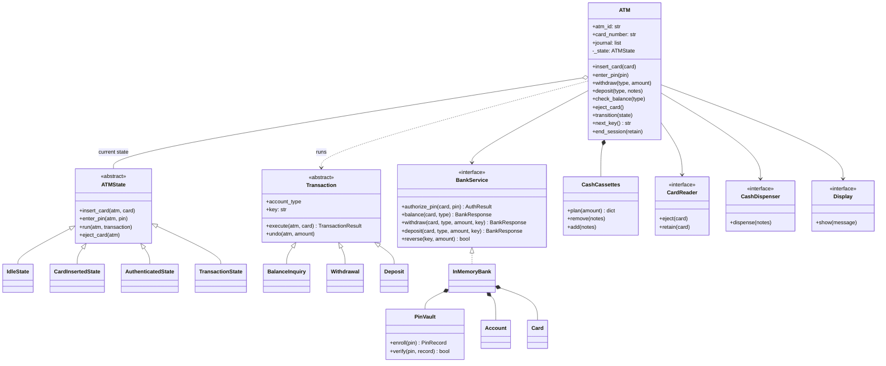
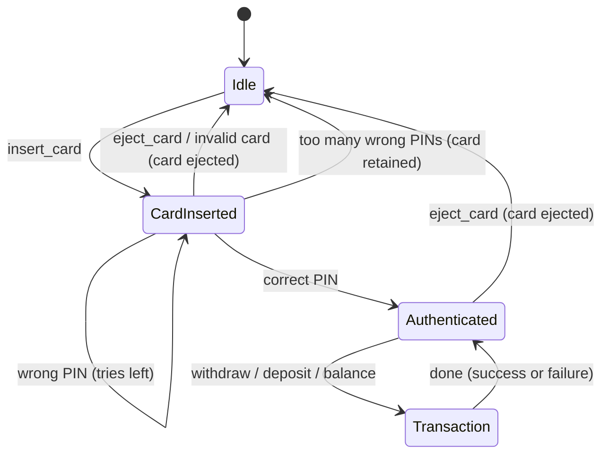
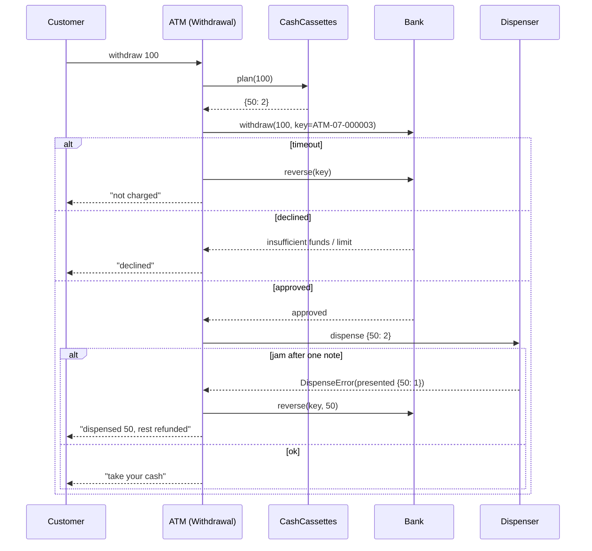

# Design an ATM System: state machines, cash math and never losing a dollar

An ATM looks like a simple box: insert card, type PIN, take cash. Underneath it is one of the best object-oriented design problems around, because it mixes a strict step-by-step user flow, unreliable hardware, a remote bank that may not answer, and money that must never be created or destroyed by accident.

By the end of this post you will be able to design an ATM from scratch in an interview, explain why the State and Command patterns fit it, write a cash-dispensing algorithm that does not get stuck when a cassette runs low, and discuss how real ATM networks (ISO 8583 messages, HSMs, PIN blocks, XFS device drivers) keep cash and account balances in agreement. All code is plain Python 3.13 with no third-party libraries, and every piece runs.

Files in this folder:

- [`atm.py`](atm.py): the recommended design, with a demo (`python3 atm.py`).
- [`alternatives.py`](alternatives.py): the competing designs this post compares, runnable side by side.
- [`test_atm.py`](test_atm.py): 43 `unittest` tests (`python3 -m unittest discover -s .`).

If terms like *class*, *interface* or *composition* are new to you, skim [OOP fundamentals](../../01-foundations/01-oop-fundamentals.md) first. The patterns used here (State, Command, Chain of Responsibility, Facade) are introduced in [Design patterns](../../01-foundations/02-design-patterns.md), but this post explains each one as it comes up.

---

## 1. The real-world system

When you use an ATM, at least four parties are involved:

- **The cardholder**: you, with a debit card and a PIN (personal identification number).
- **The ATM and its owner, the *acquirer***: the bank or independent operator that owns the machine. The machine talks to the acquirer's *ATM switch*, a server that drives many ATMs.
- **The card network**: Visa (Plus), Mastercard (Cirrus) or a domestic network such as STAR, NYCE, Interac or LINK. It routes requests from the acquirer to the right bank.
- **The *issuer***: your bank, which issued the card, holds your account, checks your PIN and decides yes or no.

When you withdraw $60 from your own bank's machine, acquirer and issuer are the same bank. When you use another bank's machine abroad, the request may cross three or four systems before your bank answers, and it comes back in a second or two.

Inside the box there is a small PC running the ATM application, plus devices: a card reader (magnetic stripe and EMV chip), an *encrypting PIN pad* (EPP) that encrypts your PIN the moment you type it, a screen, a receipt printer, a *cash dispenser* with several *cassettes* (one per note type) and a reject bin, and often a deposit module that counts and checks notes.

Why is this a great OOD problem?

1. **A strict flow.** You cannot withdraw before entering a PIN; you cannot enter a PIN with no card. That is a *state machine*: a system that is always in exactly one of a fixed set of states, and where each event either moves it to another state or is refused.
2. **Unreliable collaborators.** The bank may time out. The dispenser may jam halfway through counting notes. Good design isolates these behind interfaces so we can fake them in tests.
3. **Money must balance.** If the ATM debits your account and then fails to give you cash, you are robbed. If it gives cash and then fails to debit, the bank is robbed. Getting this right is the deepest part of the problem.
4. **Security.** PINs must never be stored or sent in the clear, and a stolen card should not give a thief unlimited guesses.

---

## 2. Clarifying requirements

An interviewer will usually open with something vague like "design an ATM". Spend the first five minutes turning that into a list. Good questions:

| Question | Why it matters | Typical answer |
|---|---|---|
| Which transactions? Balance, withdraw, deposit, transfer? | Decides how many transaction types we model | Balance, withdraw, deposit. Transfer is a follow-up. |
| Can one card reach several accounts? | Adds account selection | Yes: checking and savings. |
| How is the user authenticated? | Drives the state machine and security design | Card + PIN. Three wrong PINs and the card is kept. |
| Are we designing the machine, the bank, or both? | Scope | The machine. The bank is a service behind an interface; we may fake it. |
| Which hardware do we model? | Decides interfaces | Card reader, keypad, screen, cash dispenser, deposit slot, optional printer. |
| Any limits? | Business rules | A daily withdrawal limit per card. |
| What if the bank is down or the dispenser jams? | Failure handling, the interesting part | The customer must never lose money; neither should the bank. |
| One user at a time per machine? | Concurrency scope | Yes, but many machines share the same bank and accounts. |

### Functional requirements

1. A customer inserts a card and enters a PIN. The PIN is checked by the bank.
2. After three wrong PINs the card is blocked and the machine retains (keeps) the card.
3. An authenticated customer can choose an account (checking or savings) and run any number of transactions: balance inquiry, cash withdrawal, cash deposit.
4. A withdrawal must check funds and a daily withdrawal limit, and must only be offered in amounts the machine can physically pay with the notes it has.
5. The customer can cancel at any time outside a running transaction; the card is ejected and the session ends.
6. Clear error messages for invalid input, insufficient funds, limits, hardware faults and bank outages.

### Non-functional requirements

- **Correctness of money**: every completed withdrawal debits exactly the cash dispensed; failures are compensated automatically.
- **Security**: raw PINs are never stored; PIN guesses are limited across all machines.
- **Reliability**: the machine always returns to a safe state (card ejected or retained, session ended) after any failure.
- **Testability and extensibility**: hardware and bank sit behind interfaces so they can be faked and replaced, and new transaction types can be added without editing the state machine.

### Out of scope

Transfers, receipts, multi-currency, cardless (phone tap) withdrawals, the operator's maintenance menu, and building the bank's core ledger. We will discuss several of these as follow-ups.

---

## 3. Finding the core objects

A classic technique is **noun/verb analysis**: underline the nouns in the requirements (candidate classes and attributes) and the verbs (candidate methods).

> A **customer** inserts a **card** into the **ATM** and enters a **PIN**. The **bank** checks the PIN. After three wrong **attempts** the card is **retained**. The customer picks an **account** (checking or savings) and runs **transactions**: **balance inquiry**, **withdrawal**, **deposit**. The **cash dispenser** pays **notes** from **cassettes**. The **screen** shows **messages**. A **daily limit** applies.

Turning candidates into decisions:

| Noun | Becomes | Why |
|---|---|---|
| ATM | `ATM` class | The coordinator of one physical machine. |
| Bank | `BankService` interface + `InMemoryBank` fake | The ATM must not know whether the bank is local or across a network. |
| Account | `Account` (inside the bank) | Owns a balance. The ATM never touches it directly. |
| Card | `Card` record (inside the bank) and just a card number on the ATM side | The ATM only reads a number; the bank owns the PIN record and try counter. |
| PIN | `PinRecord` + `PinVault` | We never store a PIN, only a keyed digest; the vault plays the role of an HSM. |
| Transaction, withdrawal, deposit, balance inquiry | `Transaction` base class with three subclasses | Each is a *command* object that can run and undo itself. |
| Cash dispenser, card reader, screen | Interfaces (`CashDispenser`, `CardReader`, `Display`) + fakes | Hardware varies by vendor; tests need fakes. |
| Cassettes, notes | `CashCassettes` | Owns the note inventory and the "how do I pay this amount?" algorithm. |
| "after three attempts", "inserted", "authenticated" | `ATMState` subclasses | These are *phases* of a session, which is the State pattern's job. |
| Customer | Nothing | The customer is an actor outside the system. Their identity is the card. |
| Daily limit | A field of the bank | A rule, not a thing with behaviour. |
| Message | A plain string | No behaviour of its own. |
| Account type | `AccountType` enum | A fixed set of values. |

Verbs become methods: *insert* → `insert_card`, *enter PIN* → `enter_pin`, *check PIN* → `authorize_pin`, *withdraw* → `withdraw`, *dispense* → `dispense`, *retain* → `retain`, *eject* → `eject`.

Two important "non-classes": we do not make a `Customer` class, and we do not put `balance` on the ATM. A common beginner mistake is to give the ATM a list of `Account` objects and subtract from them directly. In reality the ATM never sees your balance as data it owns; it asks the bank, and the bank answers. Keeping that boundary in the design is the single most valuable thing you can show an interviewer.

---

## 4. Class design



A quick key to the arrows: `<|--` is inheritance ("is a"), `<|..` is implementing an interface, `*--` is *composition* (the part lives and dies with the whole), `o--` is *aggregation* (a looser "has a"), `-->` is an *association* (holds a reference to a collaborator it does not own) and `..>` is a *dependency* (uses it briefly).

**`ATM`**: the *context* of the state machine and a *Facade* (one simple front door to a complicated subsystem). Its public methods are the events a customer can trigger. It does almost nothing itself: every event is forwarded to the current state object. It owns its `CashCassettes` (composition: the notes physically live in this machine) and holds references to the bank and devices it was given (association, injected through the constructor so tests can pass fakes). It also hands out idempotency keys and keeps an electronic journal.

**`ATMState` and its four subclasses**: each class is one phase of a session. A state answers every event: either it does the work and switches the ATM to the next state, or it shows a "not now" message. The base class supplies the "not now" defaults, so each subclass only overrides the events that make sense in that phase.

**`Transaction` and subclasses**: each customer request is a *Command* object: an object that wraps one request with everything needed to run it later, log it, or undo it. Each has `execute()` and `undo()`. The `key` is the transaction's identity on the wire.

**`BankService`**: an *interface* (in Python, a `typing.Protocol`, meaning any class with the right methods qualifies, no inheritance needed). The ATM depends only on this, which is the *Dependency Inversion Principle*: high-level policy depends on an abstraction, not on a concrete database or network client. `InMemoryBank` is a deterministic fake we use in the demo and tests. It composes `Account`, `Card` and `PinVault`.

**`PinVault`**: a stand-in for a *hardware security module* (HSM), a tamper-resistant box that holds the bank's secret keys and does all PIN cryptography so the keys never appear in ordinary server memory.

**`CashCassettes`**: the note inventory, plus the algorithm that decides which notes to pay. Keeping this separate from the dispenser device matters: the device moves paper; the planner does arithmetic. Different responsibilities, different reasons to change (the *Single Responsibility Principle*).

**Device interfaces** (`CardReader`, `CashDispenser`, `Display`): thin protocols over real hardware. In production they would wrap the vendor's XFS service providers (more on that later).

---

## 5. Code: the recommended solution

The full code is in [`atm.py`](atm.py). Let's walk through it in the order a session happens.

### 5.1 PINs: store a keyed digest, never the PIN

A *hash* is a one-way function: easy to compute from the input, infeasible to reverse. Storing a hash of a password instead of the password is standard. But PINs are special: a 4-digit PIN has only 10,000 possible values. Anyone who steals a table of plain SHA-256 PIN hashes can try all 10,000 in a fraction of a second, salt or no salt (a *salt* is random bytes mixed into each hash so that equal PINs produce different hashes).

The fix is to mix in a **secret key** that the attacker does not have. That is exactly what an HMAC (hash-based message authentication code) does. Without the key, a stolen table is useless, and in a real bank the key never leaves the HSM.

```python
class PinVault:
    """Toy stand-in for a hardware security module (HSM).

    The secret key lives only inside this object. Because the digest is an
    HMAC keyed with that secret, a stolen table of PinRecords cannot be
    brute-forced offline, even though a 4-digit PIN has only 10,000 values.
    """

    def __init__(self, secret_key: bytes | None = None) -> None:
        self._key = secret_key or secrets.token_bytes(32)

    def enroll(self, pin: str) -> PinRecord:
        if not (pin.isdigit() and 4 <= len(pin) <= 12):
            raise ValueError("PIN must be 4-12 digits")
        salt = secrets.token_bytes(16)
        return PinRecord(salt, self._digest(pin, salt))

    def verify(self, pin: str, record: PinRecord) -> bool:
        # compare_digest takes the same time whether the first or last byte
        # differs, so response timing leaks nothing about the stored digest.
        return hmac.compare_digest(self._digest(pin, record.salt), record.digest)

    def _digest(self, pin: str, salt: bytes) -> bytes:
        return hmac.new(self._key, salt + pin.encode(), hashlib.sha256).digest()
```

`hmac.compare_digest` is a *constant-time* comparison. A normal `==` on bytes stops at the first differing byte, so an attacker timing many responses could learn how many leading bytes they got right. Constant-time comparison removes that signal.

This is a toy model of the real thing. Real ATMs never send your PIN, even hashed, as plain data. Section 9 explains PIN blocks and HSMs.

### 5.2 The bank behind an interface

The ATM sees the bank only through this protocol:

```python
class BankService(Protocol):
    """Everything the ATM needs from the bank. A network client would implement this too."""

    def authorize_pin(self, card_number: str, pin: str) -> AuthResult: ...

    def balance(self, card_number: str, account_type: AccountType) -> BankResponse: ...

    def withdraw(
        self, card_number: str, account_type: AccountType, amount: Decimal, key: str
    ) -> BankResponse: ...

    def deposit(
        self, card_number: str, account_type: AccountType, amount: Decimal, key: str
    ) -> BankResponse: ...

    def reverse(self, key: str, amount: Decimal | None = None) -> bool: ...
```

Three design decisions are hiding in those five lines:

1. **Money is `Decimal`, never `float`.** `0.1 + 0.2 != 0.3` in binary floating point; in `Decimal` it is exact.
2. **Every money-moving call carries a `key`.** This is an *idempotency key*: a unique ID for one logical request. *Idempotent* means "doing it twice has the same effect as doing it once". If the ATM sends `withdraw(..., key="ATM-07-000042")` twice because the first answer got lost, the bank recognises the key and replies with the original answer instead of debiting again.
3. **`reverse(key)` exists.** A *reversal* (also called a *compensating transaction*) undoes an earlier request identified by its key. We do not delete history; we add an opposite movement. It can be partial, which matters when a dispenser jams halfway.

The PIN try counter lives in the bank, not in the ATM:

```python
    def authorize_pin(self, card_number: str, pin: str) -> AuthResult:
        with self._lock:
            card = self._cards.get(card_number)
            if card is None:
                return AuthResult.INVALID_CARD
            if card.blocked:
                return AuthResult.RETAIN_CARD
            if self._vault.verify(pin, card.pin):
                card.failed_pin_attempts = 0
                return AuthResult.APPROVED
            # The try counter lives at the bank, not the ATM, so a thief
            # cannot reset it by walking to another machine.
            card.failed_pin_attempts += 1
            if card.failed_pin_attempts >= self._max_pin_attempts:
                card.blocked = True
                return AuthResult.RETAIN_CARD
            return AuthResult.WRONG_PIN
```

If the counter lived in the ATM, a thief could make two guesses at each of a hundred machines. The test `test_try_counter_survives_moving_to_another_atm` proves that does not work here.

Withdrawals and deposits share one private method, which first checks the idempotency cache and only then decides:

```python
    def _apply(
        self, card_number: str, account_type: AccountType, delta: Decimal, key: str
    ) -> BankResponse:
        if delta == 0:
            raise ValueError("amount must be positive")
        with self._lock:
            if key in self._responses:  # a retry: answer exactly as before
                return self._responses[key]
            response = self._decide(card_number, account_type, delta, key)
            self._responses[key] = response
            return response
```

Note that declines are cached too. If the first attempt was declined for insufficient funds and the customer's salary lands a second later, a retry of *the same request* must still say "declined"; a new attempt gets a new key.

`_decide` enforces the business rules (daily limit, then funds) and writes a `LedgerEntry` that remembers the key, so a later `reverse` knows what to undo. The daily limit uses an injected clock (`today: Callable[[], date]`) so tests can move to "tomorrow" without waiting.

### 5.3 The state machine

Here is the session lifecycle. A *state diagram* shows states as boxes and events as labelled arrows.



Each box is a class. The base class refuses everything politely:

```python
class ATMState(ABC):
    """One stage of a customer session. Each event is rejected unless a state overrides it."""

    name = "abstract"

    def insert_card(self, atm: ATM, card_number: str) -> None:
        atm.display.show("Please finish the current session first.")

    def enter_pin(self, atm: ATM, pin: str) -> None:
        atm.display.show("Please insert your card.")

    def run(self, atm: ATM, transaction: Transaction) -> TransactionResult | None:
        atm.display.show("Please enter your PIN first.")
        return None

    def eject_card(self, atm: ATM) -> None:
        atm.display.show("There is no card to eject.")
```

Then each state overrides only what it allows. `CardInsertedState` maps the bank's answer to the next state:

```python
class CardInsertedState(ATMState):
    name = "card inserted"

    def enter_pin(self, atm: ATM, pin: str) -> None:
        result = atm.bank.authorize_pin(atm.require_card(), pin)
        if result is AuthResult.APPROVED:
            atm.display.show("PIN accepted. Choose a transaction.")
            atm.transition(AuthenticatedState())
        elif result is AuthResult.WRONG_PIN:
            atm.display.show("Incorrect PIN. Please try again.")
        elif result is AuthResult.RETAIN_CARD:
            atm.display.show("Too many incorrect PINs. Your card has been retained.")
            atm.end_session(retain=True)
        else:
            atm.display.show("This card cannot be used.")
            atm.end_session()

    def eject_card(self, atm: ATM) -> None:
        atm.end_session()
```

`AuthenticatedState.run` is where commands execute. It switches to `TransactionState` for the duration, gives the command a fresh key, records the outcome in the journal, and always comes back, even if something raises:

```python
class AuthenticatedState(ATMState):
    name = "authenticated"

    def run(self, atm: ATM, transaction: Transaction) -> TransactionResult:
        atm.transition(TransactionState())
        try:
            transaction.key = atm.next_key()
            result = transaction.execute(atm, atm.require_card())
            atm.journal.append((transaction.key, type(transaction).__name__, result))
            atm.display.show(result.message)
            return result
        finally:
            atm.transition(AuthenticatedState())

    def eject_card(self, atm: ATM) -> None:
        atm.end_session()
```

Why have a `TransactionState` at all, when the transaction runs synchronously? Because hardware is event-driven. While notes are being counted, the customer may press Cancel and the card reader driver may fire an event. In `TransactionState` every event is refused with "Please wait". The test `test_events_during_transaction_are_rejected` simulates exactly this: a dispenser that presses eject mid-dispense. Without that state, the card would be ejected and the session closed while money was still moving.

The `ATM` class is small because the states do the work:

```python
    def insert_card(self, card_number: str) -> None:
        with self._lock:
            self._state.insert_card(self, card_number)

    def enter_pin(self, pin: str) -> None:
        with self._lock:
            self._state.enter_pin(self, pin)

    def check_balance(self, account_type: AccountType) -> TransactionResult | None:
        return self._run(BalanceInquiry(account_type))

    def withdraw(self, account_type: AccountType, amount: int) -> TransactionResult | None:
        return self._run(Withdrawal(account_type, amount))
```

The lock is an `RLock` (reentrant lock: the same thread can acquire it again without deadlocking). A device callback that fires on the same thread during a transaction must reach `TransactionState` and be refused, not freeze the machine.

### 5.4 Paying an amount: the cash planner

Before asking the bank for money, the ATM asks itself: *can I physically pay this amount with the notes I have?* If you ask for $35 and the machine holds only 20s and 50s, there is no point debiting your account.

The planner uses *dynamic programming* (DP): solve a big problem by building up answers to smaller sub-problems and reusing them. Here the sub-problems are "what is the cheapest way to make total *t* using the denominations considered so far?"

```python
    def plan(self, amount: int) -> dict[int, int] | None:
        """Fewest notes that make exactly ``amount`` using only notes we have.

        Dynamic programming over reachable totals: after processing each
        denomination, ``best`` maps every reachable total to the cheapest note
        mix that produces it. Unlike greedy, this never paints itself into a
        corner when a cassette runs low.
        """
        if amount <= 0:
            return None
        best: dict[int, dict[int, int]] = {0: {}}
        for denom in sorted(self._counts, reverse=True):
            usable = min(self._counts[denom], amount // denom)
            nxt: dict[int, dict[int, int]] = {}
            for total, mix in best.items():
                for k in range(usable + 1):
                    value = total + k * denom
                    if value > amount:
                        break
                    candidate = {**mix, denom: k} if k else mix
                    current = nxt.get(value)
                    if current is None or sum(candidate.values()) < sum(current.values()):
                        nxt[value] = candidate
            best = nxt
        return best.get(amount)
```

The table `best` never has more than `amount + 1` entries, and each denomination is tried at most `amount // denom` times, so the work is tiny for ATM-sized amounts. Section 7.2 shows why the simpler greedy approach is not enough.

### 5.5 Transactions as commands, and the money-safety sequence

The withdrawal command is the heart of the design. Read the three numbered steps:

```python
class Withdrawal(Transaction):
    def __init__(self, account_type: AccountType, amount: int) -> None:
        super().__init__(account_type)
        self.amount = amount

    def execute(self, atm: ATM, card_number: str) -> TransactionResult:
        # 1. Can this machine physically pay this amount? Ask before touching money.
        notes = atm.cassettes.plan(self.amount)
        if notes is None:
            return TransactionResult(False, f"This ATM cannot dispense {self.amount}.")

        # 2. Debit the account first. The idempotency key makes retries safe.
        amount = Decimal(self.amount)
        try:
            response = atm.bank.withdraw(card_number, self.account_type, amount, self.key)
        except BankUnavailable:
            # We do not know whether the debit happened, so we cancel it
            # (a "timeout reversal"). If it never happened, reverse is a no-op.
            self.undo(atm)
            return TransactionResult(False, "Bank unavailable. You have not been charged.")
        if not response.approved:
            return TransactionResult(False, f"Declined: {response.status.value}.", response.balance)

        # 3. Dispense. If hardware fails, refund whatever did not come out.
        try:
            atm.dispenser.dispense(notes)
        except DispenseError as error:
            atm.cassettes.remove(error.notes_presented)
            paid = sum(d * c for d, c in error.notes_presented.items())
            self.undo(atm, amount - paid)
            return TransactionResult(
                False, f"Dispenser fault. Dispensed {paid}; the rest was returned to your account."
            )
        atm.cassettes.remove(notes)
        return TransactionResult(True, f"Please take your cash: {self.amount}.", response.balance)
```

And `undo` is defined once, on the base class:

```python
    def undo(self, atm: ATM, amount: Decimal | None = None) -> bool:
        """Compensate a completed request by asking the bank to reverse it."""
        return atm.bank.reverse(self.key, amount)
```

As a sequence diagram (time flows downward), including the failure branches:



Run `python3 atm.py` and the demo shows all of this, including a jam after one note where the account ends up charged only for the $50 that actually came out.

---

## 6. Running it

```text
$ python3 atm.py
== A normal session ==
  [screen] Please enter your PIN.
  [screen] Incorrect PIN. Please try again.
  [screen] PIN accepted. Choose a transaction.
  [screen] Available balance: 1000
  [screen] Please take your cash: 60.
  [screen] This ATM cannot dispense 35.
  [screen] Declined: daily withdrawal limit exceeded.
  [screen] Deposited 40.
  [screen] Please take your card.
  checking balance now 940, cassettes {50: 2, 20: 19}

== The dispenser jams after one note ==
  ...
  [screen] Dispenser fault. Dispensed 50; the rest was returned to your account.
  [screen] Please take your card.
  checking balance now 950 (only the dispensed 50 was charged)

== Three wrong PINs ==
  ...
  [screen] Too many incorrect PINs. Your card has been retained.
  state='idle', retained cards=['4000-0001']
```

Notice the cassette counts after the first session: three 20s went out and two 20s came in from the deposit. Deposited notes going back into the dispensing cassettes is how a *cash recycler* works, which many modern ATMs are.

---

## 7. Comparing approaches

This is the heart of the post. For each decision, here are the realistic options, code for each, and a recommendation. All of the alternatives live in [`alternatives.py`](alternatives.py); run `python3 alternatives.py` to see them side by side.

### 7.1 Session states: if/elif on an enum vs the State pattern

**Option A: an enum plus `if/elif` in every method.**

```python
    def enter_pin(self, pin: str) -> None:
        if self.phase is Phase.CARD_INSERTED:
            if pin == self._correct_pin:  # toy only: real code never compares raw PINs
                self.phase = Phase.AUTHENTICATED
                self.messages.append("Choose transaction")
            else:
                self.messages.append("Wrong PIN")
        elif self.phase is Phase.IDLE:
            self.messages.append("Insert card first")
        else:
            self.messages.append("Already authenticated")
```

Every event method contains the full "which phase am I in?" switch. With 3 phases and 4 events that is 12 branches spread over 4 methods. Add an *Out of service* phase and you edit all 4 methods.

**Option B: the State pattern** (what `atm.py` does). Each phase is a class; the context forwards events to the current state object; states decide transitions. Adding *Out of service* means writing one new class and having the ATM switch to it; existing states are untouched (the *Open/Closed Principle*: open for extension, closed for modification).

**Option C: a transition table**, e.g. a `dict[(state, event)] -> (next_state, action)`. Very compact and easy to draw, but actions with rich logic (calling the bank, branching on its answer) end up as functions anyway, so you get the table plus the code.

| | if/elif + enum | State pattern | Transition table |
|---|---|---|---|
| Lines of code for 4 states | Fewest | More (one class each) | Few |
| Where is "what can happen in state X"? | Scattered across every method | One class | One table region |
| Adding a state | Edit every method | Add one class | Add rows |
| Risk of forgetting a case | High | Low: base class refuses by default | Low if missing keys are refused |
| Logic-heavy transitions | Fine | Natural | Awkward |
| Choose when | 2–3 states, throwaway code | Many states with real behaviour (ATMs, vending machines, elevators) | Protocol parsers, simple UI flows |

**Recommendation:** the State pattern. ATMs in practice have more states than our four (out of service, supervisor mode, waiting for card removal, waiting for cash removal), and each has distinctive behaviour. The [vending machine post](../04-vending-machine/README.md) uses the same pattern for the same reasons.

### 7.2 Cash dispensing: greedy vs Chain of Responsibility vs dynamic programming

**Option A: greedy.** Take as many of the biggest note as you can, then move to the next.

```python
def greedy_plan(amount: int, counts: Mapping[int, int]) -> dict[int, int] | None:
    """Take as many of the largest note as possible, then move down."""
    plan: dict[int, int] = {}
    remaining = amount
    for denom in sorted(counts, reverse=True):
        take = min(counts[denom], remaining // denom)
        if take:
            plan[denom] = take
            remaining -= take * denom
    return plan if remaining == 0 else None
```

**Option B: Chain of Responsibility (CoR).** CoR is a pattern where a request is passed along a chain of handler objects; each handles what it can and passes the rest to its successor. It is the textbook "ATM dispenser" example in many pattern tutorials.

```python
class NoteHandler:
    """One link in a Chain of Responsibility: pays what it can, passes the rest on."""

    def __init__(self, denomination: int, count: int, successor: NoteHandler | None = None) -> None:
        self.denomination = denomination
        self.count = count
        self.successor = successor

    def handle(self, remaining: int, plan: dict[int, int]) -> int:
        take = min(self.count, remaining // self.denomination)
        if take:
            plan[self.denomination] = take
            remaining -= take * self.denomination
        if remaining and self.successor:
            return self.successor.handle(remaining, plan)
        return remaining
```

**Option C: dynamic programming** (`CashCassettes.plan`, shown in section 5.4).

Now the output of `python3 alternatives.py`:

```text
== 2. Dispensing plans (None means 'cannot pay') ==
    80 from {50: 5, 20: 5, 10: 5}: greedy={50: 1, 20: 1, 10: 1}, chain={50: 1, 20: 1, 10: 1}, dp={50: 1, 20: 1, 10: 1}
    60 from {50: 1, 20: 3}: greedy=None, chain=None, dp={20: 3}
   110 from {50: 1, 20: 5}: greedy={50: 1, 20: 3}, chain={50: 1, 20: 3}, dp={50: 1, 20: 3}
    30 from {25: 2, 10: 3}: greedy=None, chain=None, dp={10: 3}
```

The second row is the killer case. The machine holds one 50 and three 20s; the customer asks for 60. Greedy grabs the 50, is left with 10, has no 10s, and gives up, even though three 20s would work. This happens in real life: cassettes run unevenly low through the day. The fourth row shows the same failure with a non-"canonical" set of denominations (some currencies have 25-unit notes).

Notice that CoR fails in exactly the same cases. That is not a coincidence: a chain where each link takes "as much as it can" *is* greedy, just spread over objects. CoR is a structural pattern; it does not change the algorithm. A CoR chain could backtrack (a link tries fewer notes if the rest of the chain fails), but then you have written a search with extra indirection.

| | Greedy | Chain of Responsibility | Dynamic programming |
|---|---|---|---|
| Correct with unlimited notes of 10/20/50/100 | Yes | Yes | Yes |
| Correct when a cassette runs low | **No** | **No** | Yes |
| Correct for any denomination set | No | No | Yes |
| Fewest notes | Usually | Usually | Always (by construction) |
| Cost | O(denominations) | O(denominations) | O(amount × notes considered), tiny for ATM amounts |
| Extensibility | Edit function | Add/reorder handlers | Add a tie-breaker (e.g. "use the fullest cassette") in one place |
| Choose when | Stock is guaranteed plentiful | You need per-cassette hooks (logging, health checks) and stock is plentiful | Real machines with finite cassettes |

**Recommendation:** dynamic programming, hidden behind `CashCassettes.plan`. Because the planner is behind one method, you can swap the policy later (for example "prefer notes from the fullest cassette to balance wear", or "give at least one small note so the customer can buy a coffee") without touching the rest of the system. That swap point is effectively the *Strategy* pattern.

### 7.3 Transactions: methods on the ATM vs Command objects with undo

**Option A: methods on the ATM.**

```python
class MethodsATM:
    """All business rules live in ATM methods. Simple, but the class grows with every feature."""

    def __init__(self, bank: TinyBank) -> None:
        self.bank = bank
        self._seq = 0

    def _key(self) -> str:
        self._seq += 1
        return f"m-{self._seq}"

    def withdraw(self, amount: Decimal) -> bool:
        return self.bank.debit(self._key(), amount)

    def deposit(self, amount: Decimal) -> None:
        self.bank.credit(self._key(), amount)

    # Undo has nowhere natural to live: the caller must remember keys itself.
```

**Option B: Command objects** with `execute` and `undo`:

```python
class Command(ABC):
    def __init__(self, key: str) -> None:
        self.key = key

    @abstractmethod
    def execute(self, bank: TinyBank) -> bool: ...

    def undo(self, bank: TinyBank) -> None:
        bank.reverse(self.key)
```

and a journal that can reverse any past command by key:

```python
class CommandJournal:
    """Runs commands and remembers them, so any of them can be reversed later."""

    def __init__(self, bank: TinyBank) -> None:
        self.bank = bank
        self.history: list[Command] = []

    def run(self, command: Command) -> bool:
        ok = command.execute(self.bank)
        if ok:
            self.history.append(command)
        return ok

    def reverse(self, key: str) -> bool:
        for command in self.history:
            if command.key == key:
                command.undo(self.bank)
                self.history.remove(command)
                return True
        return False
```

Why does an ATM care about "undo"? Not for a Ctrl+Z button. It cares because a withdrawal can fail *after* the bank said yes, and the fix is a reversal of that exact request. A command object carries its own key and amount, so "undo yourself" is one call. With plain methods, the reversal logic has to be duplicated in each method, or the caller has to keep keys around itself.

Commands bring other benefits real ATMs rely on: each one can be written to the electronic journal, queued and replayed after a power cut, and passed through the state machine as a single object (`state.run(atm, transaction)`) so the state machine does not need to know transaction types.

| | Methods on ATM | Command objects |
|---|---|---|
| Simplicity for 2 operations | Simplest | Slightly more code |
| Adding a transfer or bill payment | Edit `ATM` (and probably the states) | Add one class |
| Undo / reversal | Ad hoc, per method | `undo()` on every command |
| Journal / audit / replay | Manual | Natural: log the object |
| State machine coupling | States must know each operation | States run any `Transaction` |
| Choose when | Prototype or tiny kiosk | Anything moving money |

**Recommendation:** Command objects. In `atm.py`, the three commands share `undo()` via the base class, and `BalanceInquiry` overrides it to do nothing, because reading changes nothing.

### 7.4 Consistency: dispensing cash vs debiting the account

The ATM touches two systems that cannot share a database transaction: the bank's ledger (far away) and a physical cash dispenser (right here). There is no way to make "debit" and "dispense" happen atomically, meaning all-or-nothing in one indivisible step. So we pick an order and plan for the failure in between. Four options, all in `alternatives.py`:

**Option A: dispense, then debit.**

```python
def dispense_then_debit(bank: TinyBank, dispenser: JammingDispenser, key: str, amount: Decimal) -> str:
    """WRONG: the cash is gone before we know the bank will pay for it."""
    try:
        dispenser.dispense(amount)
    except DispenseError:
        return "dispense failed"
    try:
        return "ok" if bank.debit(key, amount) else "cash out, but declined: bank loses money"
    except Unreachable:
        return "cash out, bank unreachable: bank may lose money"
```

**Option B: debit, then dispense, no compensation.**

```python
def debit_then_dispense_naive(
    bank: TinyBank, dispenser: JammingDispenser, key: str, amount: Decimal
) -> str:
    """WRONG: no compensation, so a jam leaves the customer charged with no cash."""
    if not bank.debit(key, amount):
        return "declined"
    try:
        dispenser.dispense(amount)
    except DispenseError:
        return "charged but no cash: customer loses money"
    return "ok"
```

**Option C: debit, then dispense, reverse on any failure** (the recommendation, and what `Withdrawal.execute` does).

```python
def debit_then_dispense_with_reversal(
    bank: TinyBank, dispenser: JammingDispenser, key: str, amount: Decimal
) -> str:
    """Recommended (and what atm.py does): compensate every failure after the debit."""
    try:
        if not bank.debit(key, amount):
            return "declined"
    except Unreachable:
        bank.reverse(key)  # unknown outcome: cancel it; harmless if never applied
        return "bank unreachable, nothing charged"
    try:
        dispenser.dispense(amount)
    except DispenseError:
        bank.reverse(key)
        return "jam, reversed"
    return "ok"
```

**Option D: hold, then capture.** A *two-phase* approach: first ask the bank to reserve (hold) the money, dispense, then *capture* (turn the hold into a real debit) or *release* it.

```python
def hold_then_capture(bank: TinyBank, dispenser: JammingDispenser, key: str, amount: Decimal) -> str:
    """Two-phase: reserve funds, dispense, then capture (or release on failure)."""
    if not bank.hold(key, amount):
        return "declined"
    try:
        dispenser.dispense(amount)
    except DispenseError:
        bank.release(key)
        return "jam, hold released"
    bank.capture(key)
    return "ok"
```

Results from the demo:

```text
== 4. Dispense vs debit ordering when the dispenser jams ==
  dispense_then_debit                -> dispense failed                               balance=100
  debit_then_dispense_naive          -> charged but no cash: customer loses money     balance=60
  debit_then_dispense_with_reversal  -> jam, reversed                                 balance=100
  hold_then_capture                  -> jam, hold released                            balance=100

== 4b. Same, but the bank times out and the dispenser works ==
  dispense_then_debit                -> cash out, bank unreachable: bank may lose money balance=100 cash out=40
  debit_then_dispense_with_reversal  -> bank unreachable, nothing charged             balance=100 cash out=0
```

| | Dispense → debit | Debit → dispense (naive) | Debit → dispense + reversal | Hold → capture |
|---|---|---|---|---|
| Bank outage | Cash already gone: bank loses | Safe | Safe (timeout reversal) | Safe |
| Dispenser jam | Safe | **Customer loses** | Safe (full or partial reversal) | Safe |
| Messages per success | 1 | 1 | 1 | 2 (hold + capture) |
| Failure of the *second* message | Bank loses | n/a | Reversal must be retried until acknowledged | Capture must be retried; hold may expire |
| Needs idempotency keys | Yes | Yes | Yes, for both request and reversal | Yes |
| Choose when | Never for cash | Never | ATM cash withdrawals (industry norm) | Card-present purchases with later completion (hotels, fuel pumps) |

**Recommendation:** debit, then dispense, with automatic reversal, and idempotency keys on every message. This is how real ATMs work: a single financial request, followed by a reversal if anything goes wrong. A two-phase hold is a fine design too, but it doubles the happy-path traffic for the most common operation.

Three subtle cases our design handles, each with a test:

1. **The bank applied the debit but the answer was lost** (`test_timeout_after_apply_is_reversed`). The ATM does not know whether it was charged, so it sends a reversal with the same key. If the debit happened, it is undone; if not, the reversal is a no-op.
2. **The reversal overtakes the original** (`test_timeout_before_apply_blocks_late_original`). Networks can reorder messages. Our bank remembers "reversed before seen" keys and declines the late original with `ALREADY_REVERSED`. Without this, the original would apply after its own reversal and the customer would be charged for cash they never got.
3. **Partial dispense** (`test_partial_jam_charges_only_what_came_out`). The dispenser reports which notes reached the customer; we reverse only the rest. Real dispensers track presented, rejected and retracted notes for exactly this reason.

---

## 8. Going deeper

### 8.1 Concurrency

One ATM serves one person at a time, but **many ATMs share one bank**. A couple with joint cards can stand at two machines and both withdraw at once. Without coordination you get a *race condition*: a bug where the outcome depends on the timing of concurrent operations. Two threads both read balance 100, both see 100 ≥ 60, both subtract: balance −20.

In `InMemoryBank`, the whole check-and-update runs under one `threading.Lock`, so the check and the write form a *critical section* no other thread can interleave with. The test fires 100 concurrent $30 withdrawals against $1,000; exactly 33 succeed and the balance ends at exactly 10:

```python
    def test_concurrent_withdrawals_never_overdraw(self) -> None:
        bank = make_bank(daily_limit="100000")
        approved: list[bool] = []
        lock = threading.Lock()

        def worker(n: int) -> None:
            response = bank.withdraw(CARD, CHK, Decimal("30"), f"t-{n}")
            with lock:
                approved.append(response.approved)

        threads = [threading.Thread(target=worker, args=(n,)) for n in range(100)]
        for t in threads:
            t.start()
        for t in threads:
            t.join()
        self.assertEqual(approved.count(True), 33)  # 33 * 30 = 990 <= 1000
        self.assertEqual(bank.account_balance("CHK-1"), Decimal("10"))
```

One global lock is fine for an in-memory toy. A real bank uses a database: `SELECT ... FOR UPDATE` row locks on the account, or a conditional update such as `UPDATE accounts SET balance = balance - :amt WHERE id = :id AND balance >= :amt` and checking the affected row count. The idempotency table needs a unique constraint on the key so two copies of the same request cannot both insert.

Inside the ATM, the `RLock` serialises events from different device threads (keypad, card reader, dispenser callbacks), and `TransactionState` refuses events while money moves.

### 8.2 Extensibility: "the interviewer now asks..."

**"Add funds transfer between checking and savings."** Add a `Transfer(Transaction)` command and one `transfer` method on the bank (it must debit and credit atomically inside the bank, under one key). No state class changes, because `AuthenticatedState.run` accepts any `Transaction`. This is where Command pays off most.

**"Add an Out of Service mode when cash runs out or the dispenser faults."** Add `OutOfServiceState` that refuses `insert_card` with "Temporarily out of service". After a dispenser fault, `end_session` transitions there instead of to `IdleState`. An operator event (`supervisor_reset`) moves it back. One new class; the other states are untouched.

**"Add receipts."** Add a `ReceiptPrinter` protocol. Print from `AuthenticatedState.run` after the journal entry, so every command gets receipts for free. If the printer is out of paper, warn before the transaction, never fail after money moved.

**"Add a session timeout: if the customer walks away, end the session."** Add a `timeout()` event. In `CardInsertedState` and `AuthenticatedState` it ejects the card; in `TransactionState` it is ignored. Many real machines also *retain* the card if it is ejected and not taken within some seconds, which would be a new "waiting for card removal" state.

**"Support cardless withdrawals with a phone code."** The session starts from a different event (`enter_code`) but ends up in the same `AuthenticatedState`. A new entry state plus a new bank method; commands are reused.

**"Different limits for different card tiers."** The bank owns limits, so the ATM does not change at all. This is a good moment to say "that is the bank's responsibility, which is why it is behind an interface".

### 8.3 From in-memory OOD to a real service

- **Bank client**: replace `InMemoryBank` with an `IsoBankClient` that builds ISO 8583 messages, sends them over TCP to the switch, and maps response codes to `Status`. Timeouts raise `BankUnavailable`. The ATM code does not change.
- **Durable journal**: the journal must be written to local disk *before* the request goes out and updated after, so that after a power cut the ATM knows which requests are in doubt and can send reversals for them on restart. This is a small *write-ahead log* (record intent first, then act).
- **Store-and-forward reversals**: if the bank is down when we need to reverse, the reversal is queued and retried until acknowledged. Because reversals are idempotent, retrying is safe.
- **Key generation**: our key is `atm_id + sequence`. A real ATM must persist the counter so a reboot does not reuse numbers.

### 8.4 Testing strategy

The interfaces make this easy. Everything external is a fake: `InMemoryBank` with an injectable clock, `FakeDispenser` with a configurable jam point, `RecordingCardReader` and `RecordingDisplay` that remember what happened. The 43 tests in `test_atm.py` cover:

- PIN vault: no raw PIN in records, salting, a different key cannot verify.
- State machine: happy path, every out-of-order event, card retention, try counter across machines, events during a transaction.
- Transactions: balance, withdraw, deposit, insufficient funds, unpayable amounts, daily limit across a date change, journal keys.
- Consistency: full and partial jams, limit restored after reversal, lost responses, reversal before original, idempotent retries and reversals, concurrent withdrawals.
- Alternatives: the greedy/chain failure cases and the ordering strategies.

A good habit is *fault injection*: each fake can be told to fail at a specific point. Most of the interesting bugs in money systems live in the failure paths, and these are almost impossible to hit by hand on real hardware.

### 8.5 Failure modes checklist

| Failure | What our design does |
|---|---|
| Wrong PIN | Message, stay in `CardInserted`; bank counts the try |
| Third wrong PIN | Bank blocks card; ATM retains it |
| Unknown or blocked card | Eject (or retain if the bank says so) |
| Amount not payable with loaded notes | Refuse before contacting the bank |
| Insufficient funds / limit | Bank declines; nothing changes |
| Bank timeout | Timeout reversal with the same key |
| Dispenser jam (full or partial) | Reverse the undispensed amount |
| Duplicate request | Bank returns the stored response |
| Reversal arrives before the original | Late original declined |
| Customer presses Cancel mid-dispense | Refused by `TransactionState` |

---

## 9. How real systems do it

**ISO 8583 messages.** Almost every card network speaks ISO 8583, a message format where each message has a 4-digit *message type indicator* and a bitmap saying which numbered *data elements* follow. An ATM withdrawal is typically a 0200 financial request answered by a 0210 response; a reversal is a 0400 request or 0420 advice. Field 11, the *system trace audit number* (STAN), together with the terminal ID and other fields, identifies the transaction, which is the real-world version of our idempotency key. Field 39 carries the response code: "00" approved, "51" insufficient funds, "55" incorrect PIN, "61" exceeds withdrawal limit, "75" PIN tries exceeded. Our `Status` enum is a simplified version of field 39. Many ATMs speak a vendor protocol to the bank's own switch (NCR NDC and Diebold 91x are the classic ones), and the switch converts to ISO 8583 for the networks.

**PIN blocks, the EPP and HSMs.** Your PIN never exists in the clear outside the keypad. The *encrypting PIN pad* builds a *PIN block* (defined in ISO 9564; the common "format 0" combines the PIN with digits of the card number so the same PIN looks different on different cards) and encrypts it with a key loaded into the pad. As the message travels from ATM to switch to network to issuer, each hop uses its HSM to *translate* the PIN block from one key to the next, inside the tamper-resistant hardware, so the clear PIN is never in any server's memory. The issuer's HSM finally verifies it, using a method such as the IBM 3624 PIN offset or the Visa PIN Verification Value, both of which depend on a secret key, the same idea as our HMAC. Real verification never stores a PIN or a plain hash of it.

**EMV chip.** With a chip card, the card itself produces a cryptogram (ARQC) over the transaction details, which the issuer verifies and answers with its own (ARPC). This defeats card cloning, which magnetic stripe alone cannot.

**XFS device layer.** ATM application software does not talk to motors directly. The industry standard is CEN/XFS (eXtensions for Financial Services), an API originally for Windows where each device class (card reader, PIN pad, cash dispenser, cash-in module, printer) has a standard interface and each hardware vendor ships a *service provider* that implements it. That is exactly the role of our `CardReader`/`CashDispenser` protocols: the application codes against the standard, and swapping a vendor's dispenser does not change the application. Its successor, XFS4IoT, moves the same idea to a platform-neutral, web-socket based design.

**Cash handling.** Dispensers pick notes one by one, measure thickness to detect double picks, and divert suspicious notes to a reject bin. They report exactly which notes were presented, which is what lets the ATM reverse only the undispensed part. If the customer does not take the cash in time, many machines retract it, and that too triggers a reversal or an exception for manual review. At replenishment the operator counts cassettes and the reject bin, and the totals are reconciled against the electronic journal and the host's records.

**Limits and fraud controls.** Daily withdrawal limits, per-transaction maximums, and velocity checks (too many withdrawals in a short time) are enforced by the issuer, not the ATM, for the same reason as the PIN counter: the machine cannot see what happened elsewhere. Card retention after repeated wrong PINs, or when the issuer flags a card as lost or stolen, puts the card in a secure bin inside the machine.

**Deposits.** Deposit modules validate and count notes (and sometimes read cheques). Banks often make part of a deposit available immediately and hold the rest until it is verified. Our toy credits deposits immediately; a production design would have the bank return an "available now" and a "pending" amount.

**Who builds this.** ATM hardware and application software comes from vendors such as NCR (now NCR Atleos), Diebold Nixdorf and Hyosung; switch software such as ACI's BASE24 has long been common at banks and processors. The architecture we drew (a state-driven terminal app over a standard device layer, talking to a host through a narrow message interface) maps directly onto that world.

---

## 10. Interview playbook

**A 45-minute plan:**

| Minutes | What to do |
|---|---|
| 0–5 | Requirements. Ask the questions in section 2. Write the functional list and explicitly scope out transfers and the bank's internals. |
| 5–10 | Core objects via noun/verb analysis. Say out loud: "the ATM does not own balances; the bank does, behind an interface". |
| 10–20 | Class diagram and the state diagram. Name the State pattern and the Command pattern and say why. |
| 20–35 | Code: the state classes, the bank interface, and `Withdrawal.execute` with the debit-then-dispense-then-reverse sequence. |
| 35–42 | Deep dive the interviewer picks: dispensing algorithm, concurrency, idempotency, security. |
| 42–45 | Recap trade-offs and what you would do with more time. |

**What strong candidates say:**

- "PIN attempts are counted at the bank, so a thief cannot reset them by changing machines."
- "We cannot debit and dispense atomically, so we debit first and compensate with a reversal; every message carries an idempotency key."
- "Greedy fails when a cassette runs low; I'll use a small DP behind a `plan()` method."
- "Money is `Decimal`."
- "Hardware and bank are interfaces, which makes the failure paths testable."

**Common mistakes:**

- Putting `Account` objects inside the ATM and subtracting from them.
- Storing PINs, or hashing a 4-digit PIN with plain SHA-256 and calling it secure.
- Using `float` for money.
- Dispensing before debiting, or debiting without any reversal path.
- Counting PIN attempts in the ATM.
- A giant `ATM` class with `if state == ...` in every method and no way to add a state cleanly.
- Using Chain of Responsibility for dispensing and claiming it handles low cassettes.

**Follow-ups interviewers ask** (all covered above): add a transfer; out-of-service mode; what if the network drops the bank's reply; two people withdraw from a joint account at once; how is the PIN protected in transit; how would you test a jammed dispenser; what changes for a cash recycler.

---

## 11. Test yourself

<details>
<summary>1. Why does the PIN try counter belong in the bank and not in the ATM?</summary>

Because the ATM only sees its own sessions. If each machine counted separately, a thief could make two guesses at each of many machines and never trigger the lock. The issuer sees every attempt on the card across the whole network, so it is the only place a global limit can be enforced. The ATM's job is just to obey the "retain card" answer.
</details>

<details>
<summary>2. Salted SHA-256 is good enough for storing passwords in many systems (with a slow hash). Why is it not enough for 4-digit PINs, and what does our toy do instead?</summary>

There are only 10,000 four-digit PINs. With the salt known (it is stored next to the hash), an attacker who steals the table can try all 10,000 for each card almost instantly; even a deliberately slow hash cannot make 10,000 guesses expensive enough. Our toy uses an HMAC keyed with a secret that lives only in the `PinVault` (standing in for an HSM), so the stolen table is useless without the key. Real systems go further: the PIN is encrypted in the PIN pad and only ever handled in clear inside HSMs.
</details>

<details>
<summary>3. The machine holds one $50 and three $20 notes. A customer asks for $60. What do greedy, Chain of Responsibility and DP do?</summary>

Greedy takes the $50, is left with $10, has no $10 notes, and fails. Chain of Responsibility, where each handler takes as many notes as it can, behaves identically because it is greedy split across objects. DP considers all combinations of available notes and finds three $20s.
</details>

<details>
<summary>4. The bank applied a withdrawal, but its response was lost and the ATM timed out. Walk through what happens.</summary>

The ATM does not know whether the account was debited, so it must not dispense. It sends a reversal carrying the same key as the original request. The bank finds the ledger entry for that key and credits the money back. The customer sees "you have not been charged", which is true. If instead the original never arrived, the reversal finds nothing; our bank remembers the key so that if the original turns up late, it is declined rather than applied.
</details>

<details>
<summary>5. Why is it important that the bank caches declined responses for an idempotency key, not only approvals?</summary>

A retry must return the same outcome as the original attempt. If the first attempt was declined and the retry were re-evaluated, a change in between (a salary credit, the date rolling over for the daily limit) could turn the retry into an approval that the ATM, which already showed "declined" and moved on, never acts on. That would debit money without dispensing it. One key, one decision, forever.
</details>

<details>
<summary>6. The interviewer asks you to add funds transfer. What changes in our design, and what does not?</summary>

Add a `Transfer(Transaction)` command and a `transfer(card, from_type, to_type, amount, key)` method on `BankService` that moves money atomically inside the bank. `ATM` gets a convenience `transfer()` method that creates the command. Nothing in the state classes changes, because `AuthenticatedState.run` runs any `Transaction`. `undo` is inherited and reverses by key.
</details>

<details>
<summary>7. Why does the design need a TransactionState if each transaction is a single synchronous method call?</summary>

Because hardware events arrive independently of our call stack: a cancel button, a card reader event, a dispenser callback. During a transaction, those events must be refused so the session cannot be ended (card ejected, state reset) while money is moving. `TransactionState` makes that rule explicit, and the reentrant lock makes sure such a callback on the same thread reaches the state and is refused rather than deadlocking.
</details>

<details>
<summary>8. Compare debit-then-dispense-with-reversal to hold-then-capture. When would you choose each?</summary>

Both are safe if every message is idempotent and retried. Debit-then-reverse needs one message on the happy path and a reversal only on failure, which suits ATM cash, where failures are rare and the amount is known up front. Hold-then-capture needs two messages every time, but the final amount can differ from the hold, which suits fuel pumps, hotels and car rentals. Its risk is a capture that fails or a hold that expires before capture.
</details>

<details>
<summary>9. Where would you change the code to make the ATM prefer notes from the fullest cassette?</summary>

Only inside `CashCassettes.plan`: change the tie-breaker when two mixes reach the same total (for example, prefer the mix that leaves the most even cassette levels). Nothing else depends on how the plan is chosen, which is why it is behind one method.
</details>

<details>
<summary>10. Two joint account holders withdraw at the same time from two ATMs. What could go wrong, and what prevents it in our code and in production?</summary>

A race: both read the same balance, both pass the funds check, both subtract, and the account goes negative. In our code the bank's check-and-update runs under one lock, so they are serialised. In production, the database does it, with a row lock (`SELECT ... FOR UPDATE`) or a conditional update (`... WHERE balance >= :amount`) plus a unique constraint on the idempotency key.
</details>

---

## 12. Key takeaways

- The ATM is a **state machine**; model each phase as a class (State pattern) so adding phases does not mean editing every method.
- Each customer request is a **Command** with `execute` and `undo`; undo means a **reversal** sent to the bank by key.
- The ATM does not own money. **Balances, limits and PIN tries live at the bank**, behind an interface.
- You cannot debit and dispense atomically. **Debit first, dispense second, reverse on any failure**, and give every message an **idempotency key**.
- Greedy dispensing (and the classic Chain of Responsibility version of it) fails when cassettes run low; a small **DP planner** does not.
- **Never store or send raw PINs.** In the toy, a keyed HMAC with constant-time comparison; in reality, encrypted PIN blocks and HSMs.
- Hardware and bank behind interfaces make the **failure paths testable** with fakes, and that is where the bugs hide.

---

## 13. Further reading

- *Design Patterns: Elements of Reusable Object-Oriented Software*, Gamma, Helm, Johnson, Vlissides (the State, Command, Chain of Responsibility and Facade chapters).
- Refactoring Guru: [State](https://refactoring.guru/design-patterns/state), [Command](https://refactoring.guru/design-patterns/command), [Chain of Responsibility](https://refactoring.guru/design-patterns/chain-of-responsibility).
- Python docs: [`hmac`](https://docs.python.org/3/library/hmac.html), [`hashlib`](https://docs.python.org/3/library/hashlib.html), [`secrets`](https://docs.python.org/3/library/secrets.html), [`decimal`](https://docs.python.org/3/library/decimal.html), [`typing.Protocol`](https://docs.python.org/3/library/typing.html#typing.Protocol).
- Stripe engineering blog: [Designing robust and predictable APIs with idempotency](https://stripe.com/blog/idempotency).
- Wikipedia: [ISO 8583](https://en.wikipedia.org/wiki/ISO_8583), [Hardware security module](https://en.wikipedia.org/wiki/Hardware_security_module), [CEN/XFS](https://en.wikipedia.org/wiki/CEN/XFS).
- Related posts in this series: [Parking lot](../01-parking-lot/README.md), [Vending machine](../04-vending-machine/README.md) (State pattern), [Design patterns](../../01-foundations/02-design-patterns.md).
