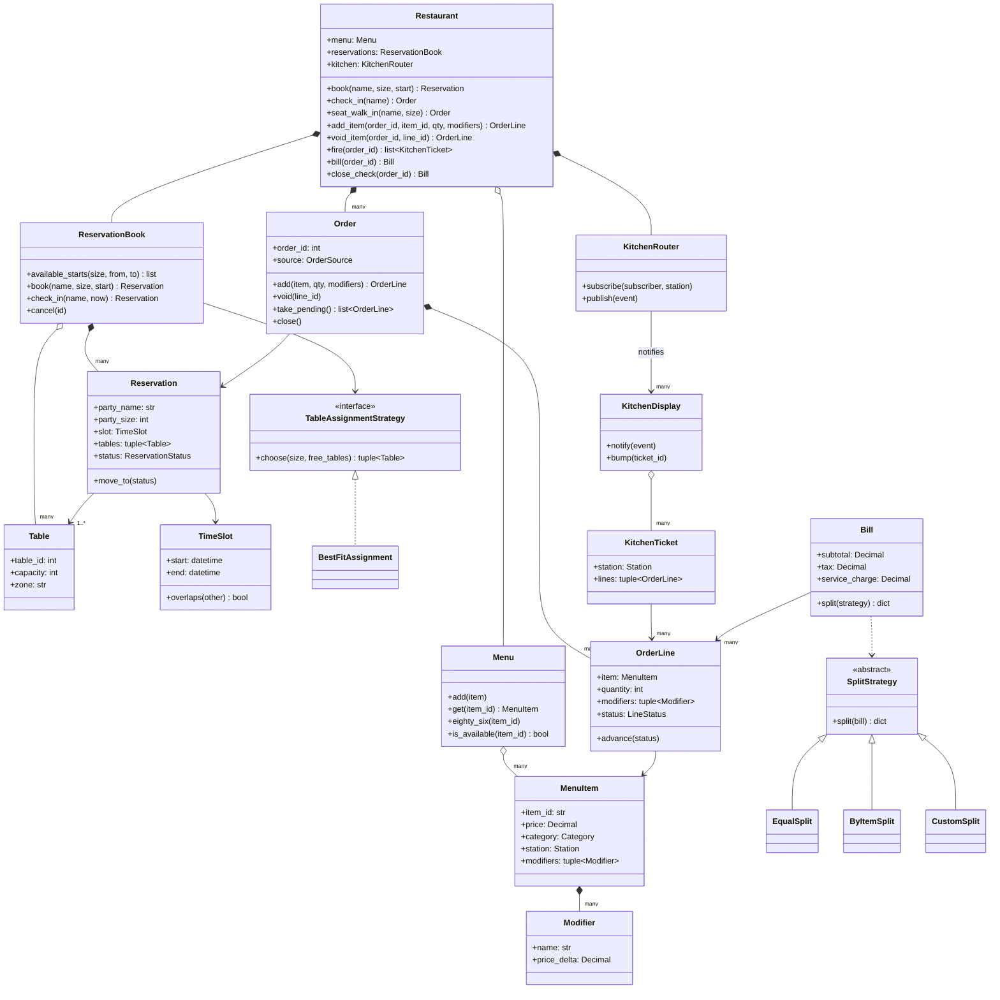
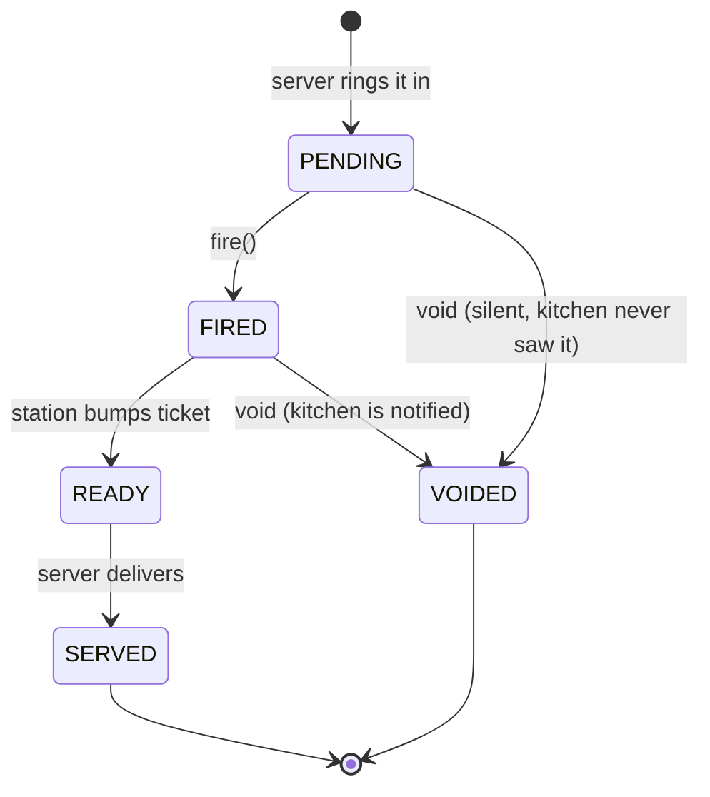
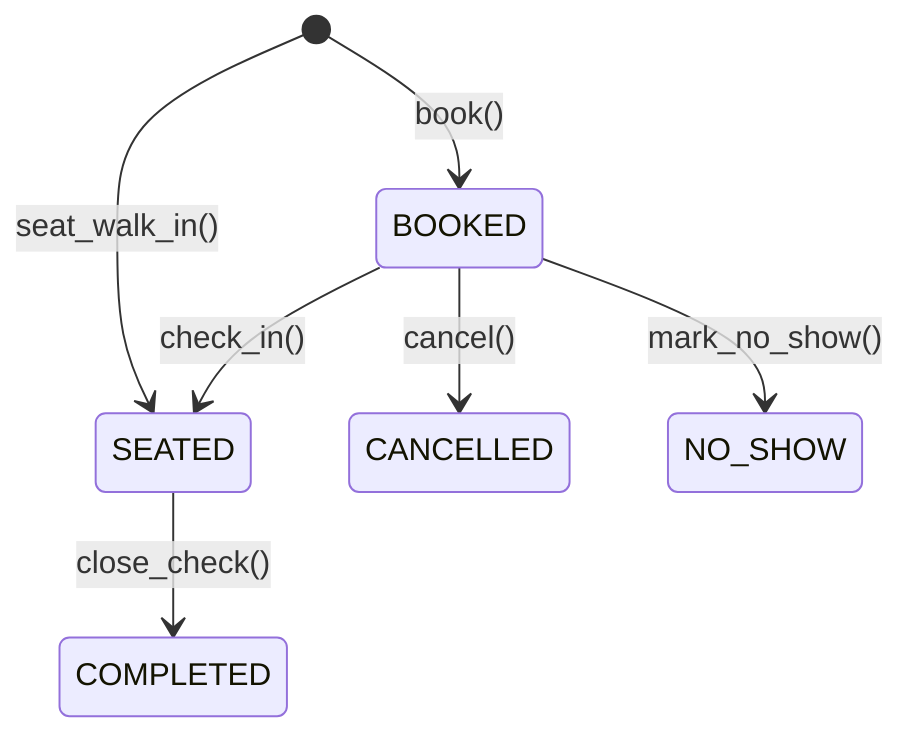
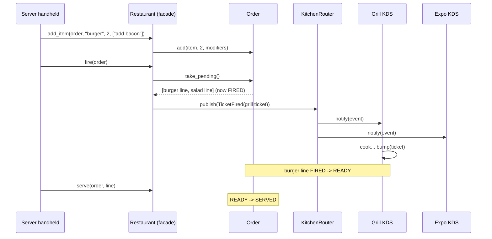

# Design a Restaurant Management System: Reservations, Tickets and Split Checks

A restaurant on a Friday night is a small distributed system made of people: a host juggling a waitlist, servers punching orders into handhelds, cooks reading tickets off screens, and a table of six who all want to pay separately. In this post we design the software behind it from scratch, in Python, the way you would in an object-oriented design (OOD) interview.

By the end you will be able to gather requirements for a restaurant system, turn them into a clean set of classes, write a working implementation, and defend your choices: how tables get assigned, how orders reach the kitchen, how an order item moves through its life, how a bill gets split, and how menu add-ons are modeled. You will also see how real point-of-sale (POS) systems such as Toast and Square, and reservation platforms such as OpenTable and Resy, handle the same problems. This is the last case study in the series, so we finish by tying together the patterns that have shown up across all eleven problems.

All the code is in this folder:

- [`restaurant.py`](restaurant.py): the recommended design, with a runnable demo.
- [`alternatives.py`](alternatives.py): the competing designs we compare, also runnable.
- [`test_restaurant.py`](test_restaurant.py): 48 `unittest` tests for both.

If terms like *class*, *composition* or *interface* are new to you, skim [OOP fundamentals](../../01-foundations/01-oop-fundamentals.md) first. The patterns we use (Strategy, Observer, Command, State, Decorator, Facade, Adapter) are introduced in [Design patterns](../../01-foundations/02-design-patterns.md).

---

## 1. The real-world system

Walk through one evening from the restaurant's point of view.

**Before service.** Guests book tables through a phone call or an app such as OpenTable or Resy. The reservation system needs to know which tables exist, how many people each seats, and how long a party typically stays. That last number is called the **turn time**: the expected time from seating a party to the table being free again. Reservation platforms let restaurants set turn times by party size, because a couple finishes faster than a group of eight.

**At the host stand.** A party arrives and gives a name. The host finds their booking and seats them at the assigned table. A **walk-in** (a party without a reservation) gets whatever fits right now, as long as it does not collide with a booking that is about to arrive.

**At the table.** A server takes the order on a handheld POS terminal. Each dish might come with **modifiers** ("no onion", "add bacon"), a seat number, and a note ("allergy: nuts"). Entering an item is not the same as cooking it: the server **fires** the order, which sends it to the kitchen. Servers often hold desserts and fire them later.

**In the kitchen.** Modern kitchens replace paper tickets with a **kitchen display system (KDS)**: screens at each station. The grill screen shows only grill items, the bar screen shows only drinks. When a cook finishes a ticket, they **bump** it (tap it off the screen). An **expo** screen (short for expediter, the person who checks plates before they leave the kitchen) sees every station, so it can tell when a whole table's food is ready together.

**Changes.** Guests change their minds. If an item has not been fired, the server just removes it. If it has been fired, it must be **voided**, and the kitchen must hear about it, because the cook may have already started. When the kitchen runs out of something, the item is **86'd** (kitchen slang for "no longer available"), and the POS should stop servers from ordering it.

**Paying.** The server prints the check. The table wants to split it: evenly, by who ate what, or with one person putting down a fixed amount. Large parties often get an automatic service charge.

**Off-premise.** Takeout and third-party delivery (DoorDash, Uber Eats, Grubhub) orders flow into the same kitchen, without a table.

This is a great OOD problem because it has several independent subsystems (reservations, ordering, kitchen routing, billing), each with its own interesting decision, and the interviewer can push on any one of them. It also has real **lifecycles** (a reservation and an order item both move through states), real **money** (so rounding matters), and real **concurrency** (two hosts booking the same table).

---

## 2. Clarifying requirements

An interview prompt is usually vague on purpose: "Design a restaurant management system." Your first job is to shrink it to something you can design in 45 minutes. Ask questions that change the design, not questions about colors of buttons.

### Questions worth asking

| Question | Why it matters | Answer we assume |
|---|---|---|
| Which parts: reservations, ordering, kitchen, billing, inventory, staff scheduling, payroll? | Scope. Each one is a full system. | Reservations, seating, orders, kitchen routing, billing. Not inventory, payroll, staff. |
| How long does a reservation hold a table? | Drives the availability check. | A turn time that depends on party size (configurable). |
| Can a party be split across tables, or tables pushed together? | Changes `Reservation` from one table to many. | Design for it; ship best-fit single table first. |
| How are walk-ins handled? | Do walk-ins and bookings share the same data? | Seat immediately if a table is free for their whole turn time. |
| How do guests check in? | Lookup key for reservations. | By name; pick today's booking closest to now. |
| Can orders change after they are placed? | Needs a lifecycle and rules per state. | Yes: change quantity before firing; void after. |
| Does the kitchen get the whole order, or per station? | Routing design. | Per station, like a KDS. |
| How is the bill split? | Billing extensibility. | Equal, by item, custom amounts. |
| Do we process payments? | Card handling is a huge separate topic. | No. We produce amounts per payer; tendering is out of scope. |
| Concurrency? | Locks and atomicity. | Several hosts and servers at once; no double bookings. |

### Functional requirements

1. **Reservations.** Search available start times for a party in a time window. Book a table for a party at a start time. Cancel a booking. Mark a no-show.
2. **Seating.** Check in a booked party by name. Seat walk-ins based on current availability and party size.
3. **Table assignment.** Choose a table that fits the party without wasting bigger tables; the rule should be swappable (for example, to allow combining tables).
4. **Ordering.** Open an order for a seated party, or for takeout/delivery. Add items with modifiers, seat numbers and notes. Change quantities of unsent items. Void items. Refuse items that are 86'd.
5. **Kitchen.** Fire unsent items; each kitchen station receives a ticket with only its items. Stations bump tickets when cooked. Voids of fired items reach the station.
6. **Lifecycle.** Track each order line through pending, fired, ready, served or voided, rejecting illegal moves.
7. **Billing.** Compute subtotal, tax and an automatic service charge for large parties. Split the total equally, by item, or by custom amounts; shares must add up to the total to the cent.

### Non-functional requirements

- **Correctness under concurrency.** Two hosts must never book the same table for overlapping times.
- **Money is exact.** Use decimal arithmetic, never floats.
- **Extensibility.** New split rules, table rules and kitchen screens should not require editing existing classes.
- **Testability.** Time must be injectable so tests are deterministic.

### Out of scope

Payment processing and tips at the card terminal, inventory and recipe costing, staff scheduling, loyalty programs, a waitlist queue, and the network layer between devices. We will mention where each would plug in.

---

## 3. Finding the core objects

A simple, reliable technique is **noun/verb analysis**: underline the nouns in the requirements (candidate classes) and the verbs (candidate methods), then decide which nouns deserve to be classes.

**Nouns:** restaurant, menu, menu item, modifier, category, table, zone, party, reservation, time, turn time, walk-in, host, server, order, order item, seat, note, kitchen, station, ticket, screen, bill, tax, service charge, payer, split.

**Verbs:** search times, book, cancel, check in, seat, assign table, add item, change quantity, void, fire, bump, serve, close, split.

Now filter:

- **Become classes:** `Menu`, `MenuItem`, `Modifier`, `Table`, `TimeSlot`, `Reservation`, `ReservationBook`, `Order`, `OrderLine`, `KitchenTicket`, `KitchenRouter`, `KitchenDisplay`, `Bill`, and the facade `Restaurant`. Each holds data and behavior that belong together.
- **Become enums:** `Category`, `Station`, `ReservationStatus`, `LineStatus`, `OrderSource`. They are fixed sets of named values.
- **Become strategies (swappable rules):** "assign table" becomes `TableAssignmentStrategy`; "split" becomes `SplitStrategy`. Whenever a verb has several reasonable rules, that is a hint for the Strategy pattern.
- **Do not become classes:**
  - *Party* is just a name and a size on a reservation. A class adds nothing.
  - *Walk-in* is a reservation that starts now and starts seated. Making it a separate class would duplicate the availability logic.
  - *Host* and *server* are people using the system, not objects inside it. Unless the interviewer asks for staff permissions, they stay out.
  - *Kitchen* as one object is too coarse. Real kitchens are a set of stations, so we model a router plus one display per station.
  - *Tax* and *service charge* are numbers on a bill, not objects.
  - *Seat* and *note* are attributes of an order line.

Two names deserve a comment. We call the order item `OrderLine` because that is what it is on a check: a line with an item, a quantity and modifiers. And we call the reservation manager `ReservationBook` because restaurants literally used to keep a book; the name tells you it owns the bookings.

---

## 4. Class design



A quick reminder of the arrow types. **Composition** (filled diamond) means the whole owns the part's lifetime: when the `Restaurant` goes, its `ReservationBook` goes too. **Aggregation** (hollow diamond) means the whole uses parts that can exist independently: the same `Menu` object could be shared by two locations. **Association** (plain arrow) means one object knows about another. **Inheritance/realization** (hollow triangle) means "is a kind of".

### The classes, one by one

**`MenuItem` and `Modifier`** are *immutable value objects* (frozen dataclasses): once created they never change. This matters because order lines point at them. If a manager raises the burger price at 8 pm, the burger rung up at 7 pm must not silently change on the open check. In a real system, price changes create a new menu version; here immutability gives us the same guarantee. Each item also names its kitchen `Station`, which is what makes routing possible. The modifiers an item allows are part of the item (composition).

**`Menu`** is a catalog keyed by id, plus a set of 86'd ids. Availability is a property of the menu (today's state), not of the item (what the dish is), so the item stays immutable.

**`Table`** is a value object too: id, capacity and zone. It holds no bookings. This is a deliberate difference from many textbook designs where a table keeps a map of its reservations. Keeping bookings in one place (`ReservationBook`) means there is exactly one place to lock and one source of truth.

**`TimeSlot`** is a half-open interval `[start, end)`. It exists because "do these two bookings clash?" is the most important question in the reservation subsystem, and it deserves one tested method rather than date arithmetic scattered everywhere.

**`Reservation`** is a party's claim on one or more tables for a slot, with a status. Walk-ins are reservations too, created already `SEATED`. That one decision means walk-ins and bookings can never collide, because the same overlap check sees both.

**`ReservationBook`** owns all reservations. It answers "which tables are free for this slot?", delegates "which of those should this party get?" to a `TableAssignmentStrategy`, and performs the check-then-book step under a lock.

**`Order` and `OrderLine`.** An `Order` is a check: a list of lines plus a link to the reservation (for dine-in) or a source (takeout, delivery). An `OrderLine` is one item with quantity, chosen modifiers, seat, note and a `LineStatus`. The lifecycle rules live in a transition table next to `LineStatus`.

**`KitchenRouter`, `KitchenDisplay`, `KitchenTicket`.** When an order is fired, the facade groups its pending lines by station into tickets and *publishes* them on the router. Displays *subscribe* to a station (or to all stations, for expo). That is the Observer pattern: the order does not know which screens exist.

**`Bill` and `SplitStrategy`.** A `Bill` is a frozen snapshot of what an order owes. Splitting delegates to a strategy object, and every strategy is checked to preserve the total.

**`Restaurant`** is a **Facade**: one simple entry point that the host stand, handhelds and tests call. It holds almost no logic itself; it wires the subsystems together and translates ids into objects.

---

## 5. Code: the recommended solution

The full file is [`restaurant.py`](restaurant.py). Here are the parts that carry the design.

### Time slots and the overlap test

```python
@dataclass(frozen=True)
class TimeSlot:
    """A half-open interval [start, end): a 19:00-20:30 slot does not clash with 20:30-22:00."""

    start: datetime
    end: datetime

    def __post_init__(self) -> None:
        if self.end <= self.start:
            raise ValueError("a time slot must end after it starts")

    def overlaps(self, other: TimeSlot) -> bool:
        return self.start < other.end and other.start < self.end
```

Two intervals overlap exactly when each one starts before the other ends. Using strict `<` makes intervals half-open, so back-to-back bookings (one ends at 20:30, the next starts at 20:30) are allowed. The `__post_init__` check enforces an **invariant**, a rule that must always be true for the object to make sense: a slot always has positive length.

How long is the slot? That is the turn time, a plain function you can replace:

```python
def default_turn_time(party_size: int) -> timedelta:
    """How long a party is expected to occupy a table. Bigger groups linger longer."""
    if party_size <= 2:
        return timedelta(minutes=75)
    if party_size <= 4:
        return timedelta(minutes=90)
    return timedelta(minutes=120)
```

The exact minutes are placeholders. A real restaurant would tune them from its own history, and reservation platforms let operators do exactly that.

### Choosing a table

The rule for picking tables is a Strategy: an object with one method, swappable at construction time. We describe it with a `typing.Protocol`, which is Python's way of saying "any object with this method shape will do", without forcing inheritance.

```python
class TableAssignmentStrategy(Protocol):
    """Picks tables for a party from the tables that are free for the whole slot."""

    def choose(
        self, party_size: int, free_tables: Sequence[Table]
    ) -> tuple[Table, ...] | None: ...


class BestFitAssignment:
    """Smallest single table that fits, so a couple never ties up an eight-top."""

    def choose(
        self, party_size: int, free_tables: Sequence[Table]
    ) -> tuple[Table, ...] | None:
        candidates = [t for t in free_tables if t.capacity >= party_size]
        if not candidates:
            return None
        return (min(candidates, key=lambda t: (t.capacity, t.table_id)),)
```

Notice the split of responsibilities. The `ReservationBook` decides which tables are *free*; the strategy only decides which free table is *best*. The strategy returns a tuple so that a combining strategy (section 6) can return two or three tables without changing anyone's signature.

### Booking atomically

```python
    def book(
        self, party_name: str, party_size: int, start: datetime, *, walk_in: bool = False
    ) -> Reservation:
        _check_party_size(party_size)
        slot = self.slot_for(party_size, start)
        with self._lock:
            tables = self._strategy.choose(party_size, self.free_tables(slot))
            if tables is None:
                raise NoTableAvailable(
                    f"no table for {party_size} at {start:%Y-%m-%d %H:%M}"
                )
            reservation = Reservation(
                reservation_id=next(self._ids),
                party_name=party_name,
                party_size=party_size,
                slot=slot,
                tables=tables,
                walk_in=walk_in,
                status=ReservationStatus.SEATED if walk_in else ReservationStatus.BOOKED,
            )
            for table in tables:
                self._by_table[table.table_id].append(reservation)
            self._by_id[reservation.reservation_id] = reservation
            return reservation
```

The important part is that "find free tables", "choose one" and "record the booking" happen inside one `with self._lock:` block. Without it you get a **race condition**: a bug where the result depends on the timing of threads. Two hosts could both see table 4 as free, both choose it, and both record a booking. We use an `RLock` (re-entrant lock: the same thread may acquire it again) because `book` calls `free_tables`, which also takes the lock.

The free check itself only counts reservations that still hold tables:

```python
    def _is_free(self, table: Table, slot: TimeSlot) -> bool:
        return not any(
            r.holds_tables and r.slot.overlaps(slot) for r in self._by_table[table.table_id]
        )
```

So cancelling a booking, marking a no-show or completing a meal frees the table automatically; there is no second data structure to keep in sync.

Check-in finds today's booked reservation for a name, choosing the one closest to now if a regular has two bookings:

```python
    def check_in(self, party_name: str, now: datetime) -> Reservation:
        """Seat the booking under this name whose start time is closest to now."""
        with self._lock:
            matches = self.find_booked(party_name, now.date())
            if not matches:
                raise ReservationNotFound(f"no booking today for {party_name!r}")
            reservation = min(matches, key=lambda r: abs(r.slot.start - now))
            reservation.move_to(ReservationStatus.SEATED)
            return reservation
```

### The order-line lifecycle

An order line is a **state machine**: an object that is always in exactly one of a fixed set of states, and moves between them only along allowed transitions.



We encode it as an enum plus a transition table:

```python
LINE_TRANSITIONS: dict[LineStatus, frozenset[LineStatus]] = {
    LineStatus.PENDING: frozenset({LineStatus.FIRED, LineStatus.VOIDED}),
    LineStatus.FIRED: frozenset({LineStatus.READY, LineStatus.VOIDED}),
    LineStatus.READY: frozenset({LineStatus.SERVED}),
    LineStatus.SERVED: frozenset(),
    LineStatus.VOIDED: frozenset(),
}
```

```python
    def advance(self, target: LineStatus) -> None:
        if target not in LINE_TRANSITIONS[self.status]:
            raise InvalidTransition(
                f"line {self.line_id} ({self.item.name}): "
                f"{self.status.value} -> {target.value}"
            )
        self.status = target
```

The whole lifecycle fits on one screen, it reads like the diagram, and every status change goes through one guarded method. Rules that depend on state but are not transitions live in `Order`. For example, quantity can only change before firing, because the kitchen is already cooking the old quantity:

```python
    def change_quantity(self, line_id: int, quantity: int) -> OrderLine:
        if quantity < 1:
            raise ValueError("quantity must be at least 1; void the line instead")
        with self._lock:
            self._ensure_open()
            line = self.line(line_id)
            if line.status is not LineStatus.PENDING:
                raise InvalidTransition("only unsent lines can change quantity; void and re-ring")
            line.quantity = quantity
            return line
```

This mirrors real POS behavior: once something is sent, you void it and ring in a new line, which leaves an audit trail.

Reservations get the same treatment with their own table (`BOOKED` to `SEATED`, `CANCELLED` or `NO_SHOW`; `SEATED` to `COMPLETED`).



### Firing to the kitchen

```python
    def fire(self, order_id: int) -> list[KitchenTicket]:
        """Send every unsent line to the kitchen, one ticket per station."""
        order = self.order(order_id)
        by_station: dict[Station, list[OrderLine]] = defaultdict(list)
        for line in order.take_pending():
            by_station[line.item.station].append(line)
        tickets = []
        for station, lines in by_station.items():
            with self._lock:
                ticket_id = next(self._ticket_ids)
            ticket = KitchenTicket(
                ticket_id, order_id, order.label, station, tuple(lines), self._clock()
            )
            self.kitchen.publish(TicketFired(ticket))
            tickets.append(ticket)
        return tickets
```

`take_pending` atomically flips every `PENDING` line to `FIRED` and returns them, so firing twice never sends the same burger twice. The facade groups lines by station and publishes one event per ticket. It does not know or care who listens.

```python
    def publish(self, event: KitchenEvent) -> None:
        station = event.ticket.station if isinstance(event, TicketFired) else event.station
        for subscriber in [*self._subscribers[station], *self._subscribers[None]]:
            subscriber.notify(event)
```

Subscribers registered under `None` receive everything, which is how the expo screen works. A display handles events with Python's `match` statement and turns a bump into state changes on the lines:

```python
    def bump(self, ticket_id: int) -> KitchenTicket:
        try:
            ticket = self._open.pop(ticket_id)
        except KeyError:
            raise RestaurantError(f"{self.name} has no open ticket {ticket_id}") from None
        for line in ticket.lines:
            if line.status is LineStatus.FIRED:
                line.advance(LineStatus.READY)
        return ticket
```

Voids tell the kitchen only when the kitchen already knows about the item:

```python
    def void_item(self, order_id: int, line_id: int) -> OrderLine:
        line, previous = self.order(order_id).void(line_id)
        if previous is LineStatus.FIRED:
            self.kitchen.publish(ItemVoided(order_id, line, line.item.station))
        return line
```

Here is the whole flow as a sequence diagram:



### Billing and fair splitting

Money is `decimal.Decimal`, never `float`, because binary floating point cannot represent most decimal fractions exactly (`0.1 + 0.2 != 0.3`). The bill is a frozen snapshot:

```python
    @classmethod
    def for_order(
        cls, order: Order, tax_rate: Decimal, service_rate: Decimal = Decimal("0")
    ) -> Bill:
        billable = tuple(l for l in order.lines if l.status is not LineStatus.VOIDED)
        subtotal = to_money(sum((l.total for l in billable), Decimal("0")))
        return cls(
            order_id=order.order_id,
            lines=billable,
            subtotal=subtotal,
            tax=to_money(subtotal * tax_rate),
            service_charge=to_money(subtotal * service_rate),
        )
```

Splitting has a subtle trap. $100.00 split three ways is $33.333..., and if you round each share you get three times $33.33, which is $99.99. Someone has to pay the extra cent. Every split strategy in our design goes through one helper that fixes this with the **largest-remainder method**: give everyone the rounded-down cents, then hand the leftover cents to whoever lost the most in rounding.

```python
def allocate(total: Decimal, weights: Mapping[str, Decimal]) -> dict[str, Decimal]:
    """Split `total` into whole cents in proportion to `weights`.

    Uses the largest-remainder method so the shares always add up to the
    total exactly; naive rounding of each share can gain or lose a cent.
    """
    if not weights:
        raise BillingError("nobody to split the bill between")
    weight_sum = sum(weights.values(), Decimal("0"))
    if weight_sum <= 0 or any(w < 0 for w in weights.values()):
        raise BillingError("split weights must be non-negative and not all zero")
    cents = int(to_money(total) / CENT)
    exact = {name: cents * w / weight_sum for name, w in weights.items()}
    shares = {name: int(value) for name, value in exact.items()}
    leftover = cents - sum(shares.values())
    by_remainder = sorted(weights, key=lambda n: exact[n] - shares[n], reverse=True)
    for name in by_remainder[:leftover]:
        shares[name] += 1
    return {name: Decimal(c) * CENT for name, c in shares.items()}
```

With that helper, each strategy is short. Equal split gives everyone weight 1. Splitting by item gives each payer a weight equal to what they ate, dividing shared dishes among the sharers, and then allocates the *whole total* by those weights, so tax and service charge are shared in proportion:

```python
class ByItemSplit(SplitStrategy):
    """Each payer pays for what they ate; shared lines are divided among the sharers.

    Tax and service charge are spread in proportion to each payer's food total.
    """

    def __init__(self, assignments: Mapping[int, Sequence[str]]) -> None:
        self.assignments = {line_id: list(p) for line_id, p in assignments.items()}

    def split(self, bill: Bill) -> dict[str, Decimal]:
        weights: dict[str, Decimal] = {}
        for line in bill.lines:
            payers = self.assignments.get(line.line_id)
            if not payers:
                raise BillingError(f"line {line.line_id} ({line.item.name}) is not assigned")
            for payer in payers:
                weights[payer] = weights.get(payer, Decimal("0")) + line.total / len(payers)
        unknown = set(self.assignments) - {l.line_id for l in bill.lines}
        if unknown:
            raise BillingError(f"assigned lines not on the bill: {sorted(unknown)}")
        return allocate(bill.total, weights)
```

`Bill.split` then double-checks the one invariant every strategy must keep:

```python
    def split(self, strategy: SplitStrategy) -> dict[str, Decimal]:
        shares = strategy.split(self)
        if sum(shares.values()) != self.total:
            raise BillingError("split strategy changed the bill total")
        return shares
```

### The facade and an injectable clock

`Restaurant.__init__` takes a `clock` argument (any zero-argument function returning a `datetime`), defaulting to `datetime.now`. Tests and the demo pass a `ManualClock` they can move forward by hand. This is **dependency injection**: instead of reaching out for the current time, the object is handed a source of time. It is the only reason tests like "a walk-in at 18:30 is blocked by a 19:00 booking" are reliable.

Running the demo:

```text
$ python3 restaurant.py
== Bistro 11: Friday dinner ==
Start times for 4 between 19:00 and 20:00: ['19:00', '19:15', '19:30', '19:45', '20:00']
Booked Garcia x4 -> table 3, 19:00-20:30
Garcia checked in -> order #1 at Table 3
Fired tickets to: grill, cold, bar
Grill screen: ['NEW #1 Table 3: 2x Smash Burger (add bacon); 1x Grilled Salmon']
Grill screen after void: VOID 1x Grilled Salmon
Burger line is now: served
Expo saw 4 kitchen events
Bill:
  2x Smash Burger (add bacon)                38.00
  1x Caesar Salad                            11.00
  3x Lemonade                                12.00
  Subtotal                                   61.00
  Tax                                         4.88
  TOTAL                                      65.88
Split three ways: {'Ana': '21.96', 'Ben': '21.96', 'Cy': '21.96'}
Walk-in Lee x2 seated at Table 1
```

---

## 6. Comparing approaches

This is where an interview is won. For each decision, there are several defensible designs; what matters is that you can name them, show them, and pick one for a reason. Runnable versions of every alternative are in [`alternatives.py`](alternatives.py).

### Decision 1: assigning tables to parties

**Option A: first fit.** Walk the tables in id order and take the first one that is big enough.

```python
class FirstFitAssignment:
    """First free table (by id) that is big enough. Simple, but wastes big tables."""

    def choose(
        self, party_size: int, free_tables: Sequence[Table]
    ) -> tuple[Table, ...] | None:
        for table in sorted(free_tables, key=lambda t: t.table_id):
            if table.capacity >= party_size:
                return (table,)
        return None
```

If the eight-top happens to be table 1, the first couple of the night sits there, and the birthday party of eight at 8 pm has nowhere to go.

**Option B: best fit.** The smallest table that fits (our `BestFitAssignment`). The demo in `alternatives.py` shows the difference on a patio with an 8-top, a 4-top and a 2-top: first-fit seats a couple at table 1 (the 8-top); best-fit seats them at table 3 (the 2-top).

**Option C: combine tables.** Try best fit first; if no single table fits, push together two or three tables from the same zone, preferring fewer tables and fewer empty seats.

```python
        zones: dict[str, list[Table]] = {}
        for table in free_tables:
            zones.setdefault(table.zone, []).append(table)
        best: tuple[Table, ...] | None = None
        for size in range(2, self.max_tables + 1):
            for tables in zones.values():
                for combo in combinations(sorted(tables, key=lambda t: t.table_id), size):
                    seats = sum(t.capacity for t in combo)
                    if seats >= party_size and (
                        best is None or seats < sum(t.capacity for t in best)
                    ):
                        best = combo
            if best is not None:
                return best
        return None
```

Brute force over combinations sounds slow, but a zone has a handful of tables, so it is a few hundred checks at most. In production you would replace "same zone" with an explicit adjacency list ("table 3 can join table 4"), because tables in the same room are not always movable.

| Approach | Pros | Cons | Choose when |
|---|---|---|---|
| First fit | Trivial, predictable | Wastes big tables, lowers covers per night | Never for real seating; fine as a first sketch |
| Best fit | Simple, keeps big tables for big parties | Can fragment: lots of small tables free, no big one | Default |
| Combine tables | Seats large parties that would otherwise be refused | More complex; needs a notion of adjacency; ties up several tables | Restaurants that take large groups |
| (Beyond) Optimizer | Maximizes covers over the whole night | Hard to explain, needs forecasting | Production reservation platforms |

**Recommendation:** best fit as the default strategy, with combining as a drop-in second strategy. Because the strategy returns a tuple of tables, `ReservationBook` and `Reservation` do not change at all when you switch; a test in `test_restaurant.py` books a party of 12 through `ReservationBook(sample_tables(), CombineTablesAssignment())` to prove it.

### Decision 1b: checking time-slot availability

**Option A: key by exact start time.** Store, per table, the set of start times that are booked, and treat each booking as a fixed one-hour slot.

```python
    def is_free(self, table: Table, start: datetime) -> bool:
        return start not in self._taken.get(table.table_id, set())
```

This is fast and looks right, until a booking starts at 19:30 on a table that is already booked at 19:00. The keys differ, so the table looks free, and you have double-booked. It only works if every booking is forced onto a fixed grid (on the hour) *and* every booking lasts exactly one grid step. The moment turn times vary by party size, it breaks.

**Option B: interval overlap.** Store slots and test `start < other.end and other.start < end` (our `TimeSlot.overlaps`). Correct for any start times and any durations.

**Option C: time buckets.** Divide the night into 15-minute buckets and mark every bucket a booking covers. Overlap becomes "is any of my buckets taken?". This is effectively a bitmap per table per day, which is very fast and easy to store, at the cost of rounding times to the bucket size.

| Approach | Pros | Cons | Choose when |
|---|---|---|---|
| Exact start key | O(1) lookup, tiny code | Wrong as soon as slots can overlap partially | Only with a fixed grid and fixed duration |
| Interval overlap | Always correct, any duration | Linear scan of a table's bookings (a few dozen per night, so fine) | Default for an interview and most systems |
| Time buckets | Very fast, easy to persist and to query "what is free at 19:15?" | Granularity loss; more memory | High-volume search across many restaurants |

**Recommendation:** interval overlap. Correctness first; a table has so few bookings per night that the scan is irrelevant. Mention buckets as the scaling option.

### Decision 2: getting orders to the kitchen

**Option A: direct method calls.** The order holds a reference to the kitchen and calls it.

```python
class DirectCallOrder:
    """Couples the order to one concrete kitchen. Adding a bar printer means editing this class."""

    def __init__(self, table: str, kitchen: DirectKitchen) -> None:
        self.table = table
        self.kitchen = kitchen

    def fire(self, item: MenuItem) -> None:
        self.kitchen.cook(self.table, item)
```

Simple, but the order now depends on a concrete kitchen class. Add a bar screen, an expo screen, a ticket printer for the pastry station and an analytics feed, and the order has to know all of them.

**Option B: Command objects in a queue.** Each request becomes an object with `execute` (and optionally `undo`). An invoker queues commands and runs them later.

```python
@dataclass(frozen=True)
class FireItem(KitchenCommand):
    table: str
    item: MenuItem

    def execute(self, board: dict[str, list[str]]) -> None:
        board.setdefault(self.item.station.value, []).append(f"{self.table}: {self.item.name}")

    def undo(self, board: dict[str, list[str]]) -> None:
        board[self.item.station.value].remove(f"{self.table}: {self.item.name}")
```

```python
    def drain(self) -> int:
        count = 0
        while self._pending:
            command = self._pending.popleft()
            command.execute(self.board)
            self.history.append(command)
            count += 1
        return count
```

The Command pattern shines at things that are about *the request itself*: queueing while the network is down and replaying later, logging every action for audit, undo, and new kinds of request (`RushTable` moves a table's tickets to the front) without new methods on the kitchen. Its weakness here is fan-out: a command is executed against one receiver. If three screens need to react, someone still has to know about all three.

**Option C: Observer / event bus (recommended).** The order side publishes "a ticket was fired for station X"; any number of screens subscribe. This is our `KitchenRouter`.

| Approach | Pros | Cons | Choose when |
|---|---|---|---|
| Direct calls | Easiest to read and debug | Tight coupling; every new consumer edits the sender | One consumer that will never change |
| Command queue | Queueing, retry, audit log, undo, new request types | Each command has one receiver; more classes | Offline-tolerant terminals, audit requirements |
| Observer / event bus | Any number of consumers; routing by station; add expo, printers, analytics without touching orders | Flow is less obvious; subscribers must not throw; ordering across subscribers needs care | Default for KDS-style routing |

**Recommendation:** Observer for routing, because the defining feature of a kitchen is *one event, many interested screens*. The two patterns combine well: the events themselves (`TicketFired`, `ItemVoided`) are small immutable objects, very much like commands, and in a distributed version you would put them on a durable queue (a Command-like log) and fan them out to subscribers (Observer). Saying that in an interview shows you understand both.

### Decision 3: the order-line lifecycle

**Option A: status enum plus transition table (recommended).** Shown in section 5.

**Option B: the State pattern.** Each state is a class; the line forwards events to its current state object, and each state decides what to do.

```python
class FiredState(LineState):
    name = "fired"

    def bump(self, line: StatefulLine) -> None:
        line.state = ReadyState()

    def void(self, line: StatefulLine) -> None:
        line.waste_logged = True  # food may already be on the grill
        line.state = VoidedState()
```

The base `LineState` rejects every event by default, so each state only overrides what it allows. The State pattern earns its keep when *behavior* differs by state, not just *permission*. Here `FiredState.void` does extra work (logging waste), which an enum would handle with an `if` in the facade.

**Option C: plain string or boolean flags** (`is_sent`, `is_ready`, `is_voided`). Easy to start with, but nothing stops `is_voided and is_ready` from both being true, and every rule ends up as a scattered `if`.

| Approach | Pros | Cons | Choose when |
|---|---|---|---|
| Boolean flags | Zero ceremony | Impossible combinations; rules everywhere | Never past a prototype |
| Enum + transition table | Whole machine visible in one dict; easy to persist (the status is just a string); easy to test | Per-state behavior becomes `if` statements elsewhere | States differ mainly in which moves are allowed |
| State pattern | Per-state behavior lives with the state; adding a state is adding a class | Many small classes; persisting means mapping classes back to names; harder to see the whole machine | States have rich, different behavior (e.g. a vending machine) |

**Recommendation:** enum plus transition table. Order lines mostly differ in what moves are legal, and the status has to be stored in a database and shown on screens anyway. Switch to State if the interviewer adds rich per-state behavior (for example, "fired items have a cook timer and alert when late").

### Decision 4: splitting the bill

**Option A: one function with branches.**

```python
def split_with_if_else(
    mode: str, total: Decimal, payers: Sequence[str], amounts: dict[str, Decimal] | None = None
) -> dict[str, Decimal]:
    """Every new split rule adds a branch here, and every branch must be retested."""
    if mode == "equal":
        return allocate(total, {p: Decimal(1) for p in payers})
    elif mode == "custom":
        if amounts is None or sum(amounts.values()) != total:
            raise BillingError("custom amounts must add up to the total")
        return dict(amounts)
    else:
        raise BillingError(f"unknown split mode {mode!r}")
```

The signature is already awkward: `amounts` only matters for one mode, and by-item would need yet another parameter (the assignments). Each new rule, such as "by seat" or "one person pays for drinks", edits this function, which violates the **Open/Closed Principle** (open for extension, closed for modification).

**Option B: Strategy (recommended).** `EqualSplit`, `ByItemSplit` and `CustomSplit` each take exactly the data they need in their constructor and share one `split(bill)` method. New rules are new classes.

**Option C: a fixed set of methods on `Bill`** (`split_equally`, `split_by_item`, ...). Better than a mode string, but `Bill` keeps growing and you cannot pass "the chosen split rule" around as a value (for example, store it on the check while guests argue).

Whichever you choose, **rounding must be handled once**. The naive version loses a cent:

```python
def naive_equal_split(total: Decimal, payers: int) -> list[Decimal]:
    """Rounds each share independently, so the shares may not add up to the total."""
    return [to_money(total / payers)] * payers
```

| Approach | Pros | Cons | Choose when |
|---|---|---|---|
| if/else on a mode | Quick | Grows forever; awkward parameters; violates Open/Closed | One or two fixed rules |
| Methods on `Bill` | Discoverable | `Bill` bloats; rule is not a passable value | Small fixed set |
| Strategy | Each rule is small, tested alone, carries its own inputs; new rules don't touch `Bill` | One more class per rule | Default |

**Recommendation:** Strategy plus a shared `allocate` helper. The helper guarantees that every strategy, present and future, adds up to the cent.

### Decision 5: modeling modifiers and add-ons

**Option A: composition (recommended).** A `MenuItem` lists which `Modifier`s it allows; an `OrderLine` holds a tuple of chosen modifiers; price is base plus the sum of deltas.

```python
    @property
    def unit_price(self) -> Decimal:
        return self.item.price + sum((m.price_delta for m in self.modifiers), Decimal("0"))
```

**Option B: Decorator.** Each modifier is a wrapper class that holds another dish and adjusts its price and description.

```python
class AddBacon(DishDecorator):
    def price(self) -> Decimal:
        return self.inner.price() + Decimal("2.50")

    def description(self) -> str:
        return self.inner.description() + ", add bacon"
```

`NoOnion(AddBacon(BaseDish(burger)))` costs $19.00 and reads "Smash Burger, add bacon, no onion". This is the textbook coffee-shop example of Decorator, and interviewers sometimes expect you to mention it.

**Option C: one menu item per combination** ("Burger with bacon", "Burger with bacon no onion"...). Explodes combinatorially. Some POS setups do this for a few popular variants, but never as the general mechanism.

| Approach | Pros | Cons | Choose when |
|---|---|---|---|
| Composition (data) | Modifiers are data a manager can edit without a deploy; easy to store, print on tickets, validate against the item; order-independent | Complex rules (e.g. "pick 2 of 5 sides") need a small rules layer | Default, and what real POS menus do |
| Decorator | Each modifier can carry arbitrary behavior; open for extension | A class per modifier means a code deploy to add "oat milk"; hard to persist, inspect or remove one modifier from the middle of the chain; wrapping order can matter | Behavior truly differs per add-on, and the set is small and stable |
| Item per combination | No modifier concept needed | Combinatorial explosion | A handful of fixed variants |

**Recommendation:** composition. Real menus change weekly, and modifiers have to be editable data with prices, availability and kitchen routing. Use Decorator when each wrapper changes *behavior* rather than just *data*, which in a restaurant is rare. Real POS systems also support **modifier groups** with min/max selection rules ("choose a side", "up to 3 toppings"); that is a natural extension of the composition model (a `ModifierGroup` with `min_choices` and `max_choices`), and very awkward with decorators.

---

## 7. Going deeper

### Concurrency: what breaks and how we fixed it

Several actors touch shared state at the same time: hosts booking tables, servers on handhelds adding to the same check (a server and a manager, say), and kitchen screens bumping tickets.

**Double booking.** The classic race is check-then-act: two hosts call `book` for the last 4-top at 19:00. Both see it free, both write a booking. Our fix is a lock around the whole check-choose-record sequence. The test proves it with eight threads released at once by a `threading.Barrier`:

```python
    def test_concurrent_hosts_cannot_double_book(self) -> None:
        book = ReservationBook([Table(1, 4)])
        results: list[str] = []
        barrier = threading.Barrier(8)

        def host(n: int) -> None:
            barrier.wait()
            try:
                book.book(f"party{n}", 4, SEVEN)
                results.append("ok")
            except NoTableAvailable:
                results.append("full")
```

Exactly one thread wins; seven get `NoTableAvailable`.

**Double firing.** If two devices press "fire" on the same check, each could read the same pending lines. `Order.take_pending` reads and flips them under the order's lock, so the second call gets an empty list.

**Lock granularity.** One lock for the whole reservation book is simple and correct, and for one restaurant with a few dozen tables it is more than fast enough. If contention ever mattered, you could lock per table, but then a combined-table booking must take several locks, always in the same order (for example ascending table id) to avoid a **deadlock**, where two threads each hold one lock and wait forever for the other.

**In a real service** the lock moves into the database. Two common approaches: a uniqueness or exclusion constraint so that the database itself rejects overlapping bookings for the same table (PostgreSQL supports exclusion constraints on time ranges), or **optimistic locking**, where each table-night row has a version number and an update succeeds only if the version has not changed since you read it.

### Extensibility: "the interviewer now asks..."

**"Support a waitlist for walk-ins."** Add a `Waitlist` holding parties in arrival order with a quoted wait. When a reservation completes or is cancelled, the facade asks the waitlist for the first party that fits a newly free table. Because freed tables are just "no live reservation overlaps", nothing in `ReservationBook` changes. Real waitlist apps text the guest when their table is ready; that is another subscriber to a "table freed" event.

**"Large parties can combine tables."** Pass `CombineTablesAssignment()` to the constructor. No other change, because `Reservation.tables` is already a tuple.

**"Add a dessert course that is held until the server fires it."** Add a `course` number to `OrderLine` and let `fire(order_id, course=...)` take pending lines of that course only. The lifecycle is unchanged; holding is just "pending for longer".

**"Split by seat."** A new `SplitStrategy` that groups lines by `line.seat` and maps seats to payers. Nothing else changes. This is the payoff of Strategy.

**"Add happy-hour pricing."** Introduce a `PricingRule` strategy consulted when a line is added, and store the resolved unit price on the line so the bill does not change if the clock passes 18:00 while the guests are still eating. This is the same "snapshot the price at sale time" principle that made `MenuItem` immutable.

**"Third-party delivery orders."** Delivery platforms send orders in their own format. An **Adapter** converts each platform's payload into our own `add_item` calls, using a mapping from their item ids to ours:

```python
    def to_lines(self, payload: dict) -> list[tuple[str, int, list[str]]]:
        rows = []
        for entry in payload["items"]:
            try:
                item_id = self.item_map[entry["external_id"]]
            except KeyError:
                raise MenuError(
                    f"{self.platform} item {entry['external_id']!r} is not mapped"
                ) from None
            rows.append((item_id, int(entry.get("qty", 1)), list(entry.get("options", []))))
        return rows
```

The order itself is created with `open_off_premise(customer, OrderSource.DELIVERY)`, and from then on it fires to the same kitchen screens as dine-in orders. In practice, restaurants often use a middleware service that aggregates several delivery marketplaces into the POS, precisely so the kitchen sees one stream of tickets instead of a row of tablets.

**"Item 86'd mid-service."** Already supported: `menu.eighty_six("salmon")` makes `add_item` refuse it. A good follow-up is publishing an event so handhelds grey the item out immediately.

### From in-memory objects to a real service

- **Persistence.** Each class maps cleanly to tables: `menu_items`, `modifiers`, `tables`, `reservations` (with start, end, status), `reservation_tables` (many-to-many for combined tables), `orders`, `order_lines` (status as a string, price snapshot), `kitchen_tickets`. Storing statuses as strings is one more reason we preferred an enum over State classes.
- **Distribution.** In a real restaurant the handhelds, KDS screens and printers are separate devices. The `KitchenRouter` becomes a message broker (or the POS vendor's cloud service) and each screen is a consumer. Events need ids so a screen that reconnects can ask "what did I miss?" and ignore duplicates; this is called **idempotent** handling (processing the same message twice has the same effect as once).
- **Offline mode.** Restaurant internet fails. POS vendors design terminals to keep taking orders locally and sync later. That is where the Command-queue idea returns: queue actions locally, replay them when the connection is back.
- **Multi-location.** A chain shares a menu across locations with local price overrides, which is aggregation (`Restaurant o-- Menu`) paying off.

### Testing strategy

The test file has 48 tests in five groups: time slots; reservations (best fit, overlaps, back-to-back, cancellation, past bookings, check-in, walk-ins blocked by upcoming bookings, the concurrency test); orders (modifiers, 86'd items, station routing, fire-twice, the full lifecycle, illegal moves, voids that do or do not reach the kitchen, closing rules, takeout); billing (totals, voids, service charge, every split, the largest-remainder rule); and the alternatives (first fit wasting a big table, combining in one zone, the exact-start double-booking bug, command undo, the State pattern, the cent lost by naive rounding, decorators, the adapter).

Two design choices make this easy: the injected clock (time never comes from the real world) and the Observer router (tests subscribe a `KitchenDisplay` and inspect what it received, with no mocking library).

```text
$ python3 -m unittest discover -s object-oriented-design/02-case-studies/11-restaurant-management
................................................
----------------------------------------------------------------------
Ran 48 tests in 0.003s

OK
```

### Failure modes worth naming

- **No-shows** hold a table that nobody uses. Reservation platforms deal with this using confirmations, deposits or card holds for some bookings, and the host marks the booking `NO_SHOW` after a grace period, which frees the table in our model.
- **Overstays.** A party that stays past its turn time collides with the next booking. Our model would refuse to seat a walk-in into that overlap, which is right, but the next booked party still arrives to an occupied table. Real hosts handle this by moving parties; software helps by showing which seated tables are past their expected end.
- **A subscriber that throws** inside `publish` would stop later subscribers from receiving the event. A production router catches and logs per-subscriber errors, or delivers asynchronously.
- **Price changes on open checks** are handled by immutability here; a database version needs an explicit price snapshot on each line.

---

## 8. How real systems do it

**POS systems (Toast, Square for Restaurants, Lightspeed and others).** The order screen is the center of everything. Menus are data with modifier groups, per-item routing to kitchen stations or printers, and availability toggles for 86'd items. Orders carry seat numbers and courses, and splitting by seat or by item is a standard feature. Voids and comps (giving an item for free) usually need a reason and sometimes a manager approval, and they are reported, because they are a classic place for loss and fraud. Terminals are built to keep working when the internet drops.

**Kitchen display systems.** Screens replace paper tickets. Each station sees only its items; expo sees everything. Tickets show elapsed time and change color when they are late. Smarter KDS setups add **course pacing** (fire appetizers now, mains when apps are bumped) and **fire timing** (start the 20-minute steak before the 8-minute salad so a table's plates land together). All of that sits on the same idea as our router: one stream of order events, routed by station.

**Reservation platforms (OpenTable, Resy, SevenRooms, Tock).** Restaurants configure tables, shifts and turn times by party size, and the platform searches for slots that fit. Beyond our interview version they add table combinations defined by the floor plan, pacing limits (no more than N covers starting in any 15-minute window, so the kitchen is not slammed), waitlists, guest profiles and notes, deposits or prepaid tickets, and no-show policies. They also integrate with the POS so the floor plan knows when a check closes and a table frees up.

**Third-party delivery.** Marketplaces like DoorDash, Uber Eats and Grubhub send orders into the restaurant, ideally straight into the POS through an integration, so the kitchen sees delivery tickets on the same screens. Menus must be mapped between systems (our adapter's `item_map`), and availability must sync so a 86'd item is not sold online.

What production adds beyond our design, in short: persistence and audit trails, devices on a network with offline sync, permissions (who may void, discount, reopen a check), payments and tips, reporting, inventory depletion from recipes, and integrations.

---

## 9. Interview playbook

### A 45-minute plan

| Minutes | What to do |
|---|---|
| 0–7 | Clarify scope. Propose: reservations, seating, ordering, kitchen routing, billing. Confirm turn time rule, walk-ins, modify/cancel rules, split rules, no payments. |
| 7–12 | Noun/verb analysis. Name the core classes and say which nouns you are *not* making classes (party, walk-in, host). |
| 12–20 | Draw the class diagram. Point out the facade, the strategy seams, and that walk-ins are reservations. |
| 20–35 | Code the core: `TimeSlot.overlaps`, `ReservationBook.book` with a lock, `OrderLine` lifecycle, `fire` with station routing, `Bill` and one split strategy. |
| 35–42 | Discuss alternatives for two or three decisions (table assignment, kitchen flow, split). Mention concurrency. |
| 42–45 | Extensions: waitlist, combined tables, delivery, persistence. |

### What to say out loud

- "Walk-ins are just reservations that start now and start seated, so one overlap check protects both."
- "The table-assignment rule is a strategy that returns a tuple, so combining tables is a new class, not a refactor."
- "Entering an item and cooking it are different events; that is why lines have pending and fired states."
- "The kitchen is one event and many screens, so I use Observer; I'd keep Command in mind for an offline queue."
- "Money is `Decimal`, and the split helper guarantees the shares add up to the cent."

### Common mistakes

- Keying availability by exact start time, which double-books at 19:00 and 19:30.
- Storing bookings both in `Table` and in a manager, then forgetting to update one of them on cancel.
- A `Restaurant` god class that does everything itself instead of delegating.
- Letting quantity change after the kitchen has started cooking.
- Using `float` for money, or splitting a bill so the shares do not add up.
- Ignoring concurrency entirely when the prompt mentions a busy Friday night.

### Follow-ups interviewers like

- How would you prevent double booking across several servers? (Database constraint or optimistic locking.)
- A table of 10 arrives; you only have 4-tops. (Combine tables strategy, adjacency.)
- How does the kitchen know about a cancelled item? (Void event to the station, only if fired.)
- How would you make sure all plates for a table arrive together? (Expo screen, course pacing, fire timing.)
- How would you add delivery orders? (Order without a table, adapter for each platform.)

---

## 10. Closing the series: the patterns behind all eleven designs

This was the last case study, so it is worth stepping back. If you worked through the series, you have now seen the same handful of ideas solve very different problems. That is the real skill an OOD interview tests: not memorizing a parking lot, but recognizing which shape a problem has.

**Strategy: "there are several reasonable rules, and the rule may change."** Here it chose tables and split bills. The same shape shows up when a [parking lot](../01-parking-lot/README.md) prices a stay or picks a spot, when a [tic-tac-toe](../07-tic-tac-toe/README.md) player chooses its next move, when an [elevator system](../05-elevator-system/README.md) decides which car answers a call, and when a [grocery store](../06-grocery-store/README.md) applies discounts.

**State machines: "the object behaves differently depending on where it is in its life."** Order lines and reservations here; a [vending machine](../04-vending-machine/README.md) and an [ATM](../10-atm/README.md) are the textbook State-pattern problems; a [blackjack](../08-blackjack/README.md) round, a [shipping locker](../09-shipping-locker/README.md) compartment and a [movie ticket](../02-movie-ticket-booking/README.md) seat hold are lifecycles too. The recurring decision is the one from section 6: an enum with a transition table when states mostly differ in what is *allowed*, State classes when they differ in what they *do*.

**Observer and Command: "something happened" versus "please do this".** Kitchen screens here; elevator call buttons and floor displays, or a [shipping locker](../09-shipping-locker/README.md) telling customers their package has arrived, have the same one-event, many-listeners shape. Command is the cousin for when the request itself must be stored, queued, logged or undone: [ATM](../10-atm/README.md) transactions that can be reversed are the series' example. ([Tic-tac-toe](../07-tic-tac-toe/README.md) weighs Command for undo and picks a simpler move log, a good reminder that a pattern is a tool you can turn down.)

**Composite and Specification: "treat one thing and a group of things the same way."** A [Unix file search](../03-unix-file-search/README.md) walks files and directories through one interface, and builds its search from small conditions joined with AND, OR and NOT, the same way `find` builds its expression tree.

**Facade: "give the outside world one simple door."** Almost every case study ends with a top-level class like `Restaurant` whose job is to coordinate, not to do the work. When that class starts holding the logic itself, it has become a god class.

**Composition over inheritance.** Menu items own modifiers here; lots own floors and spots, locker sites own compartments, stores own catalogs. Inheritance earns its place only where there is a real "is a kind of" relationship with shared behavior.

**Concurrency at the point of contention.** Holding a cinema seat, assigning a parking spot, debiting an account at an ATM and booking a table all share one lesson: find the check-then-act sequence and make it atomic, first with a lock in memory, then with a database constraint or optimistic locking in production.

**Value objects and exact money.** Immutable `MenuItem`, `TimeSlot`, `Table`; `Decimal` everywhere money appears; a single helper that makes rounding fair.

If you want one checklist to carry into any OOD interview, it is this: clarify scope, find the nouns, draw the diagram, protect the invariants, put every "it depends" behind a strategy, model lifecycles explicitly, make shared mutations atomic, and be ready to compare two designs out loud. The [design patterns guide](../../01-foundations/02-design-patterns.md) has each pattern in one place if you want to review them side by side.

---

## 11. Test yourself

<details>
<summary>1. Why is a walk-in modeled as a <code>Reservation</code> instead of a separate class?</summary>

Because the main risk with walk-ins is colliding with a booking that is about to arrive. If walk-ins were stored somewhere else, the availability check would have to look in two places, and it would be easy to forget one. As a reservation that starts at "now" and is created already `SEATED`, a walk-in is seen by the same overlap check as every booking. The only difference is the starting status and the `walk_in` flag for reporting.
</details>

<details>
<summary>2. A table is booked 19:00–20:30. Is it free for a booking 20:30–22:00? For 20:00–21:30? Why?</summary>

20:30–22:00: yes. Slots are half-open intervals, and `19:00 < 22:00 and 20:30 < 20:30` is false, so they do not overlap. 20:00–21:30: no, because `19:00 < 21:30 and 20:00 < 20:30` is true. An exact-start-time design would wrongly say yes to the second one, since 20:00 is a different key from 19:00.
</details>

<details>
<summary>3. Why can't a server change the quantity of a fired line, and what should they do instead?</summary>

Once fired, the kitchen is cooking the old quantity. Silently changing it would make the check and the kitchen disagree. The POS way is to void the fired line (which sends a void to the station) and ring in a new line with the right quantity; that also leaves an audit trail of what was cooked and wasted.
</details>

<details>
<summary>4. The interviewer says: "Fired items now have a cook timer, and late items should alert the expo." Does that change your enum-versus-State decision?</summary>

It pushes toward the State pattern, or at least toward richer per-state objects. The fired state now has its own data (fired-at time, target time) and behavior (check lateness, raise an alert), which is exactly what State classes are good at. A middle ground is to keep the enum for persistence and the transition table for legality, and put timer logic in the kitchen display, which already knows when each ticket arrived.
</details>

<details>
<summary>5. Add "split by seat". Which classes change?</summary>

None of the existing ones. Write a new `BySeatSplit(SplitStrategy)` that takes a mapping from seat numbers to payers, groups `bill.lines` by `line.seat`, builds weights and calls `allocate`. Lines without a seat can be shared equally or rejected. `Bill`, `Order` and the facade are untouched; that is the Open/Closed Principle in practice.
</details>

<details>
<summary>6. Split $10.00 three ways with largest remainder. Who pays what, and why not just round?</summary>

1000 cents / 3 = 333.33 each. Everyone gets 333 cents; 1 cent is left; the largest remainders are tied, so the first payer gets it: $3.34, $3.33, $3.33, totaling $10.00. Rounding each share gives three times $3.33 = $9.99, and the restaurant is short a cent on every such check, which adds up and breaks reconciliation.
</details>

<details>
<summary>7. Why did we choose Observer over Command for kitchen routing? Where would Command still help?</summary>

The defining shape of a kitchen is one event (a ticket was fired) and several interested parties (the station screen, expo, maybe a printer and analytics). Observer gives that fan-out without the sender knowing the receivers. Command is about the request as an object: queueing, logging, retrying and undo. It helps when a terminal is offline (queue commands locally and replay them later) or when every action must be audited. In a distributed system you often use both: a durable log of event objects, fanned out to subscribers.
</details>

<details>
<summary>8. Two hosts book the last table at the same time. Walk through what happens without the lock, then with it, then in a database-backed service.</summary>

Without the lock, both threads compute `free_tables` before either records a booking, both see the table free, both append a reservation: a double booking. With the lock, the second thread waits until the first has recorded its booking, then sees the table taken and gets `NoTableAvailable`. In a real service with several app servers, an in-process lock no longer helps; use a database exclusion constraint on (table, time range) so the second insert fails, or optimistic locking with a version number and retry.
</details>

<details>
<summary>9. Why is <code>MenuItem</code> immutable, and what would go wrong if a manager could edit the price in place?</summary>

Open order lines point at menu items. If the price were edited in place, every open check with that item would change price mid-meal, and printed checks would not match the totals. Immutability means a price change creates a new item (or menu version) and existing lines keep the price they were sold at. In a database version you would store the unit price on each order line for the same reason.
</details>

<details>
<summary>10. Modifiers as Decorators or as composed data: when would you actually pick Decorator?</summary>

When each add-on changes behavior, not just price and text, and the set of add-ons is small and stable enough to live in code. In a restaurant, modifiers are mostly data that managers edit often, need to be stored, printed on tickets and validated against the item, and can be removed in any order. That is why composition wins there. Decorator fits things like wrapping a payment processor with logging, retries and fraud checks.
</details>

---

## 12. Key takeaways

- Scope first: reservations, seating, ordering, kitchen routing and billing are each a subsystem; say what you are leaving out.
- Model time as half-open intervals and check overlap, not exact start times.
- Treat walk-ins as reservations so one check protects everything.
- Put "it depends" rules (table choice, bill splits) behind strategies; return shapes that allow future rules (a tuple of tables).
- Make lifecycles explicit. An enum plus transition table is often clearer than the State pattern; choose State when behavior differs per state.
- Route kitchen work with Observer: one event, many screens, routed by station.
- Use `Decimal` and one allocation helper so splits always add up to the cent.
- Make check-then-act sequences atomic: a lock in memory, a constraint or optimistic locking in a database.
- Prefer composition and data (modifiers) over class hierarchies (decorators) for things the business edits often.

---

## 13. Further reading

- Gamma, Helm, Johnson, Vlissides, *Design Patterns: Elements of Reusable Object-Oriented Software* (Addison-Wesley, 1994): Strategy, Observer, Command, State, Decorator, Facade, Adapter.
- Refactoring Guru pattern pages: [Strategy](https://refactoring.guru/design-patterns/strategy), [Observer](https://refactoring.guru/design-patterns/observer), [Command](https://refactoring.guru/design-patterns/command), [State](https://refactoring.guru/design-patterns/state), [Decorator](https://refactoring.guru/design-patterns/decorator), [Facade](https://refactoring.guru/design-patterns/facade), [Adapter](https://refactoring.guru/design-patterns/adapter).
- Python docs: [`decimal`](https://docs.python.org/3/library/decimal.html), [`dataclasses`](https://docs.python.org/3/library/dataclasses.html), [`enum`](https://docs.python.org/3/library/enum.html), [`threading`](https://docs.python.org/3/library/threading.html), [`typing.Protocol`](https://docs.python.org/3/library/typing.html#typing.Protocol), [structural pattern matching (PEP 636)](https://peps.python.org/pep-0636/).
- PostgreSQL docs on [exclusion constraints](https://www.postgresql.org/docs/current/ddl-constraints.html#DDL-CONSTRAINTS-EXCLUSION) and [range types](https://www.postgresql.org/docs/current/rangetypes.html), the standard way to stop overlapping bookings in a database.
- Martin Fowler, [*Patterns of Enterprise Application Architecture*](https://martinfowler.com/books/eaa.html), for optimistic offline locking and mapping objects to tables.
- Earlier in this series: [What is an OOD interview](../../01-foundations/03-what-is-an-ood-interview.md), [The OOD interview framework](../../01-foundations/04-the-ood-interview-framework.md), [Design patterns](../../01-foundations/02-design-patterns.md).
